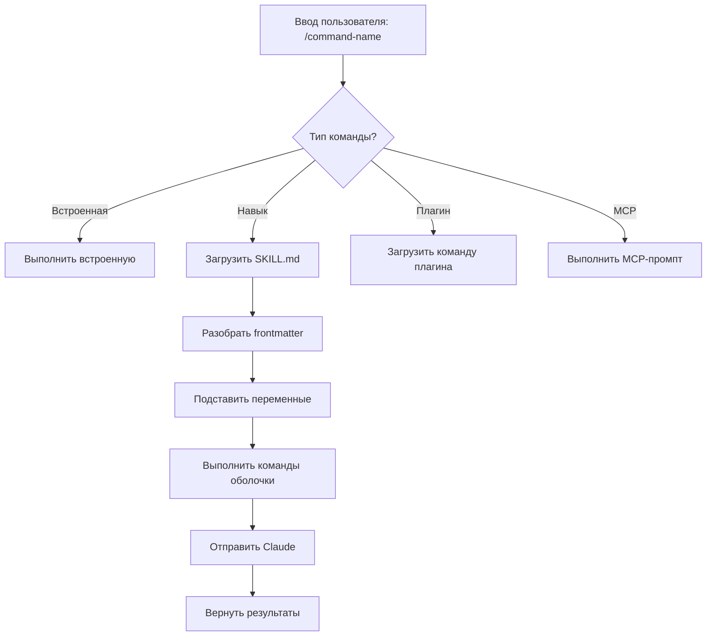
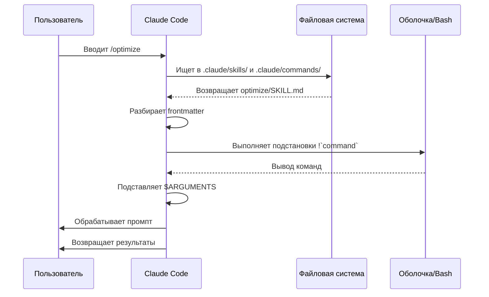

<!-- i18n-source: 01-slash-commands/README.md -->
<!-- i18n-source-sha: 232591b -->
<!-- i18n-date: 2026-10-23 -->

<picture>
  <source media="(prefers-color-scheme: dark)" srcset="../../resources/logos/claude-howto-logo-dark.svg">
  
</picture>

# Слэш-команды

## Обзор

Слэш-команды — это ярлыки, которые управляют поведением Claude в интерактивной сессии. Они бывают нескольких типов:

- **Встроенные команды**: их даёт Claude Code (`/help`, `/clear`, `/model`)
- **Навыки**: пользовательские команды в файлах `SKILL.md` (`/optimize`, `/pr`)
- **Команды плагинов**: команды установленных плагинов (`/frontend-design:frontend-design`)
- **MCP-промпты**: команды MCP-серверов (`/mcp__github__list_prs`)

> **Примечание**: пользовательские слэш-команды объединены с навыками. Файлы в `.claude/commands/` по-прежнему работают, но теперь рекомендуется подход через навыки (`.claude/skills/`). Оба варианта создают ярлыки `/command-name`. Полный справочник — в [руководстве по навыкам](../03-skills).

## Справочник встроенных команд

Встроенные команды — ярлыки для частых действий. Доступно **60+ встроенных команд** и **около 20 встроенных навыков** (часть доступна только за флагом функции). Введите `/` в Claude Code, чтобы увидеть полный список, или `/` и несколько букв, чтобы отфильтровать.

> **Примечание**: с v2.1.236 нажатие Enter на слэш-команде с опечаткой — или на команде, недоступной в текущей сессии, — сообщает об ошибке, а не молча запускает ближайшее нечёткое совпадение. Однозначные префиксы и заданные псевдонимы по-прежнему выполняются как раньше.

| Команда | Назначение |
|---------|------------|
| `/add-dir <path>` | Добавить рабочий каталог |
| `/advisor [model\|off]` | Настроить advisor. Открывается как интерактивный диалог; в десктопном приложении, в Remote Control и в headless-сессиях (`-p` / Agent SDK) вместо этого принимает текстовую форму — `/advisor` без аргументов, `/advisor <model>` или `/advisor off` (v2.1.260+) |
| `/agents` | Больше не рабочая команда: интерактивный мастер убран в v2.1.198, а с v2.1.281 `/agents` больше не появляется в меню `/` и в `/help` — ввод команды только объясняет, куда делся мастер. Попросите Claude создать субагентов или управлять ими либо правьте файлы в `.claude/agents/` напрямую |
| `/branch [name]` | Переключиться на копию разговора в этой точке, сохранив оригинал (вернуться к нему через `/resume`) |
| `/fork [prompt]` | Скопировать текущий разговор в новую **фоновую сессию** и продолжить работу здесь; с этой точки они независимы, и копия получает собственную строку в `claude agents` (v2.1.212+). Если копия не правит файлы на месте, Claude Code велит ей создать собственный worktree перед изменениями кода (инструкция изоляции требует v2.1.221+) |
| `/subtask <task>` | Запустить **форкнутого субагента**, который наследует весь разговор и работает над задачей, пока вы продолжаете; результат возвращается в этот разговор по завершении (v2.1.212+) |
| `/btw [question]` | Задать мимолётный побочный вопрос, пока Claude работает над основной задачей; основной контекст разговора при этом не засоряется. `/btw` без аргументов снова открывает последний побочный вопрос (v2.1.212+) |
| `/cd <path>` | Перенести сессию в новый рабочий каталог, не ломая кэш промптов (добавлено в v2.1.169) |
| `/chrome` | Настроить интеграцию с браузером Chrome |
| `/clear` | Очистить разговор (псевдонимы: `/reset`, `/new`) |
| `/color [color\|default]` | Задать цвет панели промпта. `/color` без аргументов выбирает случайный цвет сессии (v2.1.128+); передайте имя цвета или hex, чтобы задать его явно. |
| `/compact [instructions]` | Сжать разговор с необязательными инструкциями фокуса. Неудачное сжатие теперь показывается как ошибка в интерфейсе, а не проходит молча (v2.1.216) |
| `/config` | Открыть настройки (псевдоним: `/settings`) |
| `/context` | Показать использование контекста цветной сеткой. Явное предупреждение, когда использование превышает лимит контекстного окна (v2.1.216) |
| `/copy [N]` | Скопировать ответ ассистента в буфер обмена; `w` записывает в файл |
| `/cost` | Псевдоним-сокращение для `/usage` — открывает вкладку стоимости (v2.1.118+) |
| `/desktop` | Продолжить в приложении Desktop (псевдоним: `/app`) |
| `/diff` | Интерактивный просмотр diff незакоммиченных изменений. При полноэкранной отрисовке вместо этого открывает панель diff рядом с разговором, и она остаётся открытой, пока вы продолжаете работу — в ней список изменённых файлов с числом добавленных и удалённых строк, и она обновляется каждый раз, когда Claude правит файл или запускает команду оболочки; снова выполните `/diff` или нажмите `✕`, чтобы закрыть её (v2.1.260+). Классический отрисовщик открывает просмотр на месте промпта |
| `/doctor` | Диагностика состояния установки — можно открыть, пока Claude отвечает; встроенный навык: Claude проверяет вашу настройку и предлагает исправления, которые применяет после вашего подтверждения (`claude doctor` запускает диагностику только для чтения); `/doctor prompt-audit` (также `/checkup prompt-audit`) проверяет файлы CLAUDE.md, навыки, агентов и команды на шаблоны промптов, написанные для старых моделей (v2.1.283) |
| `/effort [low\|medium\|high\|xhigh\|max\|auto\|ultracode [on\|off]]` | Задать уровень усилия интерактивным ползунком на стрелках. Уровни: `low` → `medium` → `high` → `xhigh` (новый в v2.1.111) → `max`. По умолчанию `medium` на Opus 5.5 (модель по умолчанию с v2.1.280), Sonnet 5.5 и Haiku 5.5, `high` на Opus 5, Sonnet 5 и Opus 4.8 и `xhigh` на Opus 4.7; для `xhigh` нужны Fable 5.1, Fable 5, Opus 5.5, Sonnet 5.5, Haiku 5.5, Opus 5, Sonnet 5, Opus 4.8 или Opus 4.7; `max` работает на Fable 5.1, Fable 5, Opus 5.5, Sonnet 5.5, Haiku 5.5, Opus 5, Sonnet 5, Opus 4.8/4.7/4.6 и Sonnet 4.6. Уровень, сохранённый до того, как `/effort` стал помодельным, не применяется к новым моделям вроде Opus 5.5 (v2.1.280). У ползунка также есть переключатель **Ultracode** (Tab или `/effort ultracode [on\|off]`) — это не уровень усилия модели: Claude оркестрирует динамические Workflows на том уровне усилия, с которым идёт сессия. С v2.1.284 он больше не принуждает `xhigh` и остаётся включённым, когда вы меняете уровень; `/effort ultracode` действует на время сессии, а настройка `ultracode` делает его постоянным |
| `/exit` | Выйти из REPL (псевдоним: `/quit`) |
| `/export [filename]` | Экспортировать текущий разговор в файл или буфер обмена |
| `/usage-credits` | Настроить дополнительное использование при лимитах запросов (переименовано из `/extra-usage` в v2.1.144; `/extra-usage` по-прежнему работает как псевдоним) |
| `/fast [on\|off]` | Переключить быстрый режим. Применяется к Opus 5.5 (значение по умолчанию для быстрого режима с v2.1.280), Opus 5 и Opus 4.8 |
| `/feedback` | Отправить отзыв. С v2.1.141 можно приложить недавние сессии (последние 24 часа или 7 дней), чтобы отчёты, охватывающие больше одной сессии, включали контекст. С v2.1.178 `/bug` требует описание, прежде чем его можно отправить. |
| `/focus` | Переключить вид фокуса (добавлено в v2.1.110; заменяет `Ctrl+O` для переключения фокуса) |
| `/goal <statement>` | Зарегистрировать условие завершения на уровне сессии; Claude продолжает работу, пока цель не достигнута. `/goal clear` снимает её. Активная цель появляется в строке состояния, а живая оверлей-панель показывает прошедшее время, число ходов и расход токенов (добавлено в v2.1.139). |
| `/help` | Показать справку |
| `/hooks` | Просмотреть конфигурации хуков |
| `/ide` | Управлять интеграциями IDE |
| `/init` | Инициализировать `CLAUDE.md`. Задайте `CLAUDE_CODE_NEW_INIT=1` для интерактивного сценария |
| `/insights` | Сформировать отчёт анализа сессии |
| `/install-github-app` | Настроить приложение GitHub Actions |
| `/install-slack-app` | Установить приложение Slack |
| `/keybindings` | Открыть настройку сочетаний клавиш |
| `/fewer-permission-prompts` | Проанализировать недавние вызовы инструментов Bash и MCP и добавить приоритетный список разрешений в `.claude/settings.json`, чтобы уменьшить запросы разрешений (добавлено в v2.1.111) |
| `/login` | Переключить аккаунты Anthropic |
| `/logout` | Выйти из аккаунта Anthropic |
| `/mcp` | Управлять MCP-серверами и OAuth |
| `/memory` | Править `CLAUDE.md`, переключить автопамять |
| `/mobile` | QR-код для мобильного приложения (псевдонимы: `/ios`, `/android`) |
| `/model [model]` | Выбрать модель стрелками влево и вправо для усилия. С v2.1.153 выбор **сохраняется как значение по умолчанию** для новых сессий (как в IDE); нажмите `s` после выбора, чтобы применить его только к текущей сессии. (Сочетание `modelPicker:setAsDefault` переименовано в `modelPicker:thisSessionOnly`; прежнее действие `d` теперь `s`.) С v2.1.219 выбор показывал объединённую строку Opus как «Opus (1M context)»; v2.1.283 убирает эту подпись со строк Opus и Default там, где у Opus уже есть окно 1M (само окно не изменилось). |
| `/output-style [name]` | Показать и переключить стили вывода (снова добавлено в v2.1.269 после удаления в v2.1.91). Без аргумента выводит список стилей и отмечает текущий. Работает в headless-сессиях и сессиях Remote Control; выбор сохраняется в `.claude/settings.local.json` |
| `/passes` | Поделиться бесплатной неделей Claude Code |
| `/permissions` | Просмотреть и обновить разрешения (псевдоним: `/allowed-tools`) |
| `/plan [description]` | Войти в режим планирования |
| `/plugin` | Управлять плагинами |
| `/proactive` | Псевдоним `/loop` (добавлено в v2.1.105) |
| `/powerup` | Открывать функции через интерактивные уроки с анимированными демо |
| `/privacy-settings` | Настройки конфиденциальности (только Pro/Max) |
| `/release-notes` | Просмотреть список изменений |
| `/recap` | Показать краткий пересказ и сводку сессии при возврате к сессии (добавлено в v2.1.108) |
| `/reload-plugins` | Перезагрузить активные плагины. С v2.1.221 большинство установок активируются сразу, поэтому команда нужна только когда сводка установки говорит `Run /reload-plugins to activate.` Доступна в headless-сессиях с v2.1.260, поэтому также появляется в списках команд Claude Code Desktop и SDK |
| `/reload-skills` | Заново просканировать каталоги навыков без перезапуска сессии (добавлено в v2.1.152). Повторно отправляет Claude полный список навыков, что восстанавливает навыки после сжатия (v2.1.299) |
| `/remote-control` | Remote Control с claude.ai (псевдоним: `/rc`) |
| `/remote-env` | Настроить удалённое окружение по умолчанию |
| `/rename [name]` | Переименовать сессию |
| `/resume [session]` | Возобновить разговор (псевдоним: `/continue`) |
| `/review [low\|medium\|high\|xhigh\|max\|ultra] [--fix] [--comment] [pr#\|branch\|path]` | Псевдоним `/code-review` (v2.1.223): проверяет текущий diff либо номер PR, ветку или путь, который вы передаёте, — например, `/review 1234`. Принимает те же уровни усилия и флаги. Если уровень не указан, повторно использует последний введённый уровень от `low` до `max` |
| `/rewind` | Перемотать разговор и/или код (псевдонимы: `/checkpoint`, `/undo`) |
| `/sandbox` | Переключить режим песочницы |
| `/schedule [description]` | Создавать облачные запланированные задачи и управлять ими |
| `/scroll-speed` | Открыть интерактивный диалог настройки скорости прокрутки колесом мыши в полноэкранном режиме: ←/→ — изменить, `r` — сбросить, Enter — сохранить. Сохраняется в `~/.claude/settings.json` (добавлено в v2.1.139). |
| `/security-review` | Проанализировать ветку на уязвимости |
| `/skill-doctor` | Показать, какие загруженные навыки не используются и сколько каждый стоит в контексте, чтобы решить, какие выключить. Отчёт открывается на вкладке **Stats** менеджера `/plugin`; в неинтерактивном режиме `-p` печатается текстом. Через Remote Control отвечает `Skill usage reports are not available on this connection.` — запустите команду в терминале на машине, где идёт сессия (требуется v2.1.252+) |
| `/skills` | Список доступных навыков |
| `/stats` | Псевдоним-сокращение для `/usage` — открывает вкладку статистики (дневное использование, сессии, серии) (v2.1.118+) |
| `/stickers` | Заказать стикеры Claude Code |
| `/status` | Показать версию, модель, аккаунт и строку `Session kind` со значением `background job · attached`, `background job · unattended` или `interactive` (строка добавлена в v2.1.221). Можно открыть, пока Claude отвечает |
| `/statusline` | Настроить строку состояния |
| `/tasks` | Список фоновых задач и управление ими |
| `/team-onboarding` | Сформировать руководство по онбордингу коллеги по последним 30 дням сессий Claude Code, команд и использования MCP и вернуть ссылку для общего доступа (новое в v2.1.101) |
| `/teleport` | Возобновить веб-сессию Claude Code в этом терминале; открывает выбор ваших веб-сессий (псевдоним: `/tp`). Нужна подписка claude.ai |
| `/terminal-setup` | Настроить сочетания клавиш терминала |
| `/theme` | Открыть выбор темы и управлять пользовательскими темами (v2.1.118). Пользовательские темы задаются через JSON в `~/.claude/themes/<name>.json` |
| `/tui [default\|fullscreen]` | Задать отрисовщик интерфейса терминала (`fullscreen` даёт отрисовку без мерцания) и перезапуститься в него; `/tui` без аргументов печатает текущий отрисовщик (добавлено в v2.1.110) |
| `/ultrareview` | Всестороннее облачное мультиагентное код-ревью (добавлено в v2.1.111). Предпочтительный вызов теперь `/code-review ultra`; `/ultrareview` остаётся псевдонимом. Включает 3 бесплатных запуска на Pro и Max, затем нужны кредиты использования |
| `/upgrade` | Открыть страницу перехода на более высокий тариф |
| `/usage` | Каноническая панель использования (v2.1.118) — объединяет лимиты тарифа, лимиты запросов, стоимость и дневную статистику сессий. `/cost` и `/stats` — псевдонимы-сокращения, открывающие конкретные вкладки. Предупреждает о максимальном усилии, Workflows, всегда включённом контексте и больших результатах инструментов (v2.1.299) |
| `/voice` | Переключить голосовой ввод push-to-talk |
| `/workflows` | Просмотр выполняющихся и завершённых запусков динамических Workflows (добавлено в v2.1.154). См. [Динамические Workflows](../09-advanced-features/README.md#динамические-workflows) |

> **Почему важна `/cd`:** смена каталога раньше теряла прогрев кэша (следующий ход становился медленнее и дороже); `/cd` сохраняет кэш промптов при переключении.

### Встроенные навыки

Эти навыки поставляются с Claude Code и вызываются как слэш-команды:

| Навык | Назначение |
|-------|------------|
| `/batch <instruction>` | Оркестрировать масштабные параллельные изменения через worktree |
| `/claude-api` | Загрузить справочник Claude API для языка проекта |
| `/dataviz` | Рекомендации по графикам и дизайну дашбордов с запускаемым валидатором цветовой палитры (v2.1.198) |
| `/debug [description]` | Включить журналирование отладки |
| `/design [description]` | Создать **холст дизайна** — визуальный дизайн из нескольких артбордов (макеты UI, сценарии экранов, лендинги, постеры), который публикуется как артефакт и дорабатывается визуально, а не в коде. Используйте его вместо ручного HTML, когда итеративно править нужно именно компоновку. Требует v2.1.265+, сессию, где доступны артефакты, и аккаунт с шаблоном Design; недоступно на Bedrock, Vertex, Foundry и Claude Platform on AWS. Отдельный Claude Design (claude.ai/design) закрывается 14 декабря 2026. |
| `/loop [interval] [prompt]` | Повторно запускать промпт с заданным интервалом |
| `/code-review [low\|medium\|high\|xhigh\|max\|ultra] [--fix] [--comment] [--max-findings n\|all\|default] [pr#\|branch\|path]` | Проверить текущий diff — или номер PR, ветку либо путь, который вы передаёте, — на ошибки корректности. Передайте `--fix`, чтобы применить находки, `--comment`, чтобы опубликовать их как встроенные комментарии к PR на GitHub, или `ultra` для глубокого облачного ревью; с `ultra` на цели PR с `github.com` флаг `--post` заранее выбирает публикацию находок в PR. Если уровень усилия не указан, ревью повторно использует последний введённый уровень (v2.1.223). Изначально поглотила `/simplify` в v2.1.147, но `/simplify` вернулась отдельной командой в v2.1.154. Передайте `--max-findings <n>\|all`, чтобы сообщить больше или меньше находок, чем обычный лимит; выбор сохраняется, пока вы не передадите `--max-findings default` (v2.1.288) |
| `/simplify` | Запустить ревью только на очистку (переиспользование / упрощение / эффективность / высота абстракции) и применить исправления; ошибки **не** ищет — для этого используйте `/code-review`. Недолго была псевдонимом `/code-review --fix` (v2.1.152), а в v2.1.154 стала только очисткой |

### Устаревшие команды

| Команда | Статус |
|---------|--------|
| `/pr-comments` | Удалена в v2.1.91 — попросите Claude напрямую показать комментарии PR |
| `/vim` | Удалена в v2.1.92 — используйте /config → режим редактора |

### Недавние изменения

- `/fork` и `/subtask` поменялись ролями в **v2.1.212**. `/fork` теперь копирует разговор в новую независимую фоновую сессию; прежнее поведение форкнутого субагента перешло к новой команде `/subtask`. История: с v2.1.77 по v2.1.161 `/fork` была псевдонимом `/branch`; с v2.1.161 по v2.1.211 она запускала форкнутого субагента (то, что сейчас делает `/subtask`). Когда вид агентов выключен, `/subtask` недоступна, и `/fork` сохраняет поведение форкнутого субагента
- `/resume` (без аргументов) открывает выбор прошлых сессий — в том числе убранных из видимого списка — и возобновляет выбранную как фоновую сессию (v2.1.212)
- `/resume` и `claude --resume` для сессии, которая уже работает в фоне, открывают эту сессию, а не отказывают, а `claude --resume <id> "prompt"` отправляет промпт следующим ходом (v2.1.285)
- `/output-style` устарела (v2.1.73) и была удалена (v2.1.91), затем **возвращена в v2.1.269** — в v2.1.278 это снова живая команда, и она работает в headless-сессиях и сессиях Remote Control. Стили вывода также доступны через `/config` → Output style или настройку `outputStyle`; встроенные — Default, Proactive, Explanatory, Learning и Concise (добавлены в v2.1.237)
- `/review` стала полным псевдонимом `/code-review` — те же цели, уровни усилия и флаги (v2.1.223). История: сначала она перешла на движок `/code-review medium` в v2.1.186, оставаясь только для PR
- Добавлена команда `/effort`; уровень `max` доступен на Opus 4.6+ (изначально только на Opus 4.6)
- Добавлена команда `/voice` для голосового ввода push-to-talk
- Добавлена команда `/schedule` для создания запланированных задач и управления ими
- Добавлена команда `/color` для настройки цвета панели промпта
- /pr-comments удалена в v2.1.91 — попросите Claude напрямую показать комментарии PR
- /vim удалена в v2.1.92 — вместо этого используйте /config → режим редактора
- `/ultraplan` удалена в v2.1.222 — используйте режим планирования
- /powerup добавлена для интерактивных уроков по функциям
- /sandbox добавлена для переключения режима песочницы
- Выбор `/model` теперь показывает человекочитаемые подписи (например, «Sonnet 4.6») вместо сырых идентификаторов моделей
- `/resume` поддерживает псевдоним `/continue`
- MCP-промпты доступны как команды `/mcp__<server>__<prompt>` (см. [MCP-промпты как команды](#mcp-промпты-как-команды))
- Добавлена `/team-onboarding` для автоматической генерации руководств по онбордингу коллег (v2.1.101)
- Добавлена команда `/tui` для полноэкранной отрисовки TUI без мерцания (v2.1.110)
- Добавлена команда `/focus` для переключения вида фокуса; `Ctrl+O` теперь только переключает подробную стенограмму (v2.1.110)
- Добавлена команда `/recap`, чтобы вручную вызвать пересказ контекста сессии (v2.1.108)
- `/undo` добавлена как псевдоним `/rewind` (v2.1.108); она остаётся псевдонимом `/rewind` наряду с `/checkpoint`
- `/proactive` добавлена как псевдоним `/loop` (v2.1.105)
- У `/effort` появились интерактивный ползунок на стрелках и новый уровень `xhigh` между `high` и `max`; усилие по умолчанию поднято до `xhigh` для планов Opus 4.7 (v2.1.111). На Opus 4.8 по умолчанию `high` (v2.1.154); Opus 5 тоже по умолчанию `high` (v2.1.219)
- Добавлена `/ultrareview` для всестороннего облачного мультиагентного код-ревью (v2.1.111)
- Добавлена `/fewer-permission-prompts`, чтобы анализировать вызовы инструментов Bash и MCP и уменьшать запросы разрешений через список разрешений в `.claude/settings.json` (v2.1.111)
- Режиму Auto больше не нужен флаг `--enable-auto-mode` для подписчиков Max на Opus 4.7 (v2.1.112)
- Добавлена `/goal` — условие завершения на уровне сессии, к которому Claude идёт через ходы; живой оверлей показывает прошедшее время, число ходов и расход токенов (v2.1.139)
- Добавлена `/scroll-speed` — настройка скорости прокрутки колесом мыши на панели живого предпросмотра TUI; сохраняется для каждой машины (v2.1.139)
- Добавлена `/reload-skills` — повторное сканирование каталогов навыков без перезапуска сессии (v2.1.152)
- `/model` теперь сохраняет выбранную модель как значение по умолчанию для новых сессий; нажмите `s`, чтобы применить только к сессии (сочетание `modelPicker:setAsDefault` → `modelPicker:thisSessionOnly`) (v2.1.153)
- Добавлена `/workflows` — просмотр выполняющихся и завершённых запусков динамических Workflows (v2.1.154)
- `/simplify` вернулась как отдельная команда ревью только на очистку (переиспользование / упрощение / эффективность / высота абстракции), отдельно от поиска ошибок в `/code-review` (v2.1.154)
- У `/status` появилась строка `Session kind`, которая отличает подключённые и автономные фоновые задания от интерактивных сессий (v2.1.221)
- Установка плагинов теперь активирует их сразу, когда это безопасно; `/reload-plugins` нужна только если об этом просит сводка установки (v2.1.221)
- `/ultraplan` удалена — используйте режим планирования (v2.1.222)
- `/code-review` и `/review` запоминают последний введённый уровень усилия, если вы его опускаете (v2.1.223)
- `/code-review ultra` стала предпочтительной точкой входа в облачное мультиагентное ревью; `/ultrareview` остаётся псевдонимом (v2.1.223)
- `/code-review` на уровнях усилия `high`, `xhigh` и `max` теперь идёт в фоновом агенте, как и остальные уровни (v2.1.232)
- Подсказка при запуске с предложением создать собственных субагентов и парная подсказка в туре `/powerup` удалены (v2.1.232)
- `/permissions` теперь можно открыть, пока Claude работает — изменения правил применяются к оставшейся части текущего хода (v2.1.234)
- `/add-dir <path>` теперь можно использовать, пока Claude работает; диалоги `/add-dir`, `/autocompact`, `/theme`, `/help`, `/config` и `/advisor` открываются в середине хода **в полноэкранном TUI**, а не встают в очередь, пока Claude не закончит ответ (`/bug` уже открывалась сразу, с v2.1.232) (v2.1.234)

### `/goal` — условие завершения на уровне сессии

> **Новое в v2.1.139**

`/goal` регистрирует условие завершения для текущей сессии. Claude идёт к нему через ходы, а оверлей-панель показывает прошедшее время, число ходов и потраченные токены. Снимите цель командой `/goal clear`. Работает в интерактивном режиме, в `claude -p` и в Remote Control.

```
Пользователь: /goal Переведите сервис платежей с REST на gRPC и добейтесь прохождения интеграционных тестов.
Claude: Цель зарегистрирована. Я буду к ней идти, пока вы её не снимете.
[Панель цели: ⏱ 0 с · ходов 0 · токенов 0]

Пользователь: начните со списка REST-эндпоинтов
Claude: [выполняет работу, панель обновляется]
```

**Проверка застрявших фоновых задач (v2.1.234):** пока цель активна, если фоновая задача не продвигается 30+ минут, Claude сверяется и присылает статус, а не продолжает молча. Порог (в минутах) настраивается переменной окружения `CLAUDE_CODE_GOAL_CHECKIN_MINUTES`; значение `0` полностью отключает такие проверки.

### `/team-onboarding` — руководство по онбордингу коллеги

> **Новое в v2.1.101**

`/team-onboarding` формирует руководство по онбордингу коллеги по локальному использованию Claude Code в вашем проекте. Claude анализирует сессии, команды и использование MCP-серверов за последние 30 дней, затем составляет руководство по онбордингу, которое помогает новым разработчикам быстрее войти в работу, и возвращает ссылку для общего доступа.

Это встроенная команда — устанавливать ничего не нужно.

**Использование:**

```bash
claude /team-onboarding
```

Готовое руководство опирается на:

- Рабочие процессы, которые повторяются в недавних сессиях
- Команды, которые вы запускаете чаще всего
- [MCP-серверы](../05-mcp/README.md), которыми вы пользуетесь

**Доступность:** выпущена в Claude Code v2.1.101 (11 апреля 2026).

## Пользовательские команды (теперь навыки)

Пользовательские слэш-команды **объединены с навыками**. Оба подхода создают команды, которые вызываются как `/command-name`:

| Подход | Расположение | Статус |
|--------|--------------|--------|
| **Навыки (рекомендуется)** | `.claude/skills/<name>/SKILL.md` | Текущий стандарт |
| **Устаревшие команды** | `.claude/commands/<name>.md` | По-прежнему работают |

Если навык и команда называются одинаково, **приоритет у навыка**. Например, когда существуют и `.claude/commands/review.md`, и `.claude/skills/review/SKILL.md`, используется версия навыка.

### Путь миграции

Существующие файлы в `.claude/commands/` продолжают работать без изменений. Чтобы перейти на навыки:

**Было (команда):**
```
.claude/commands/optimize.md
```

**Стало (навык):**
```
.claude/skills/optimize/SKILL.md
```

### Зачем навыки?

У навыков больше возможностей, чем у устаревших команд:

- **Структура каталога**: рядом можно держать скрипты, шаблоны и справочные файлы
- **Автовызов**: Claude может запускать навыки сам, когда они уместны
- **Управление вызовом**: выберите, кто вызывает навык — пользователь, Claude или оба
- **Выполнение субагентом**: запускайте навыки в изолированном контексте с `context: fork`
- **Постепенное раскрытие**: дополнительные файлы загружаются только когда нужны

### Пользовательская команда как навык

Создайте каталог с файлом `SKILL.md`:

```bash
mkdir -p .claude/skills/my-command
```

**Файл:** `.claude/skills/my-command/SKILL.md`

```yaml
---
name: my-command
description: Что делает эта команда и когда её использовать
---

# Моя команда

Инструкции, которым Claude следует при вызове этой команды.

1. Первый шаг
2. Второй шаг
3. Третий шаг
```

### Справочник frontmatter

| Поле | Назначение | По умолчанию |
|------|------------|--------------|
| `name` | Имя команды (становится `/name`) | Имя каталога |
| `description` | Краткое описание (помогает Claude понять, когда вызывать) | Первая непустая строка |
| `argument-hint` | Ожидаемые аргументы для автодополнения | Нет |
| `allowed-tools` | Инструменты, которыми команда пользуется без разрешения | Наследуется |
| `model` | Конкретная модель | Наследуется |
| `disable-model-invocation` | Если `true`, вызвать может только пользователь (не Claude) | `false` |
| `user-invocable` | Если `false`, скрыть из меню `/` | `true` |
| `context` | Задайте `fork`, чтобы выполнить в изолированном субагенте | Нет |
| `agent` | Тип агента при `context: fork` | `general-purpose` |
| `hooks` | Хуки, которые регистрируются при запуске навыка (любое событие хука; они остаются активны до конца сессии) | Нет |

### Аргументы

Команды могут принимать аргументы:

**Все аргументы через `$ARGUMENTS`:**

```yaml
---
name: fix-issue
description: Исправить issue GitHub по номеру
---

Исправьте issue #$ARGUMENTS по нашим стандартам кода
```

Использование: `/fix-issue 123` → `$ARGUMENTS` становится «123»

**Отдельные аргументы через `$0`, `$1` и т. д.:**

```yaml
---
name: review-pr
description: Провести код-ревью PR с приоритетом
---

Проведите код-ревью PR #$0 с приоритетом $1
```

Использование: `/review-pr 456 high` → `$0`="456", `$1`="high"

`${CLAUDE_PROJECT_DIR}` раскрывается в абсолютный путь корня проекта (v2.1.196).

### Динамический контекст командами оболочки

Выполняйте команды bash до промпта через `` !`command` ``:

> **Примечание (v2.1.299)**: хуки `UserPromptSubmit` выполняются до раскрытия команды, поэтому хук, который блокирует промпт, также не даёт выполниться этим командам `!`.

```yaml
---
name: commit
description: Создать git-коммит с контекстом
allowed-tools: Bash(git *)
---

## Контекст

- Текущий статус git: !`git status`
- Текущий diff git: !`git diff HEAD`
- Текущая ветка: !`git branch --show-current`
- Недавние коммиты: !`git log --oneline -5`

## Ваша задача

На основе изменений выше создайте один git-коммит.
```

### Ссылки на файлы

Подключайте содержимое файлов через `@`:

```markdown
Проверьте реализацию в @src/utils/helpers.js
Сравните @src/old-version.js с @src/new-version.js
```

## Команды плагинов

Плагины могут давать собственные команды:

```
/plugin-name:command-name
```

Или просто `/command-name`, когда нет конфликта имён.

**Примеры:**
```bash
/frontend-design:frontend-design
/commit-commands:commit
```

## MCP-промпты как команды

MCP-серверы могут выставлять промпты как слэш-команды:

```
/mcp__<server-name>__<prompt-name> [arguments]
```

**Примеры:**
```bash
/mcp__github__list_prs
/mcp__github__pr_review 456
/mcp__jira__create_issue "Заголовок бага" high
```

### Синтаксис разрешений MCP

Управляйте доступом к MCP-серверу в разрешениях:

- `mcp__github` — доступ ко всему MCP-серверу GitHub
- `mcp__github__*` — доступ по маске ко всем инструментам
- `mcp__github__get_issue` — доступ к конкретному инструменту

> **v2.1.299+:** правило применяется только к тому серверу, который оно называет, — `mcp__github` больше не совпадает с сервером по имени `github__x` или `github_`. Для сервера, чьё нормализованное имя содержит `__`, пишите `mcp__<whole normalized name>__*` (то же относится к спискам `tools:` у субагента).

## Архитектура команд



## Жизненный цикл команды



## Команды в этой папке

Эти примеры команд можно установить как навыки или как устаревшие команды.

### 1. `/optimize` — оптимизация кода

Анализирует код на проблемы производительности, утечки памяти и возможности оптимизации.

**Использование:**
```
/optimize
[Вставьте свой код]
```

### 2. `/pr` — подготовка pull request

Проводит по чеклисту подготовки PR: линтинг, тесты и формат коммита.

**Использование:**
```
/pr
```

**Скриншот:**


### 3. `/generate-api-docs` — генератор документации API

Формирует полную документацию API по исходному коду.

**Использование:**
```
/generate-api-docs
```

### 4. `/commit` — git-коммит с контекстом

Создаёт git-коммит с динамическим контекстом из вашего репозитория.

**Использование:**
```
/commit [необязательное сообщение]
```

### 5. `/push-all` — индексация, коммит и отправка

Добавляет все изменения в индекс, создаёт коммит и отправляет на удалённый репозиторий с проверками безопасности.

**Использование:**
```
/push-all
```

**Проверки безопасности:**
- Секреты: `.env*`, `*.key`, `*.pem`, `credentials.json`
- API-ключи: отличает настоящие ключи от заглушек
- Большие файлы: `>10MB` без Git LFS
- Артефакты сборки: `node_modules/`, `dist/`, `__pycache__/`

### 6. `/doc-refactor` — перестройка документации

Перестраивает документацию проекта ради ясности и доступности.

**Использование:**
```
/doc-refactor
```

### 7. `/setup-ci-cd` — настройка пайплайна CI/CD

Внедряет хуки pre-commit и GitHub Actions для контроля качества.

**Использование:**
```
/setup-ci-cd
```

### 8. `/unit-test-expand` — расширение покрытия тестами

Увеличивает покрытие тестами за счёт непокрытых веток и граничных случаев.

**Использование:**
```
/unit-test-expand
```

## Установка

### Как навыки (рекомендуется)

Скопируйте в каталог навыков:

```bash
# Создайте каталог навыков
mkdir -p .claude/skills

# Для каждого файла команды создайте каталог навыка
for cmd in optimize pr commit; do
  mkdir -p .claude/skills/$cmd
  cp 01-slash-commands/$cmd.md .claude/skills/$cmd/SKILL.md
done
```

### Как устаревшие команды

Скопируйте в каталог команд:

```bash
# На весь проект (команда)
mkdir -p .claude/commands
cp 01-slash-commands/*.md .claude/commands/ && rm .claude/commands/README.md

# Личное использование
mkdir -p ~/.claude/commands
cp 01-slash-commands/*.md ~/.claude/commands/ && rm ~/.claude/commands/README.md
```

## Свои команды

### Шаблон навыка (рекомендуется)

Создайте `.claude/skills/my-command/SKILL.md`:

```yaml
---
name: my-command
description: Что делает эта команда. Используйте, когда [условия вызова].
argument-hint: [необязательные-аргументы]
allowed-tools: Bash(npm *), Read, Grep
---

# Заголовок команды

## Контекст

- Текущая ветка: !`git branch --show-current`
- Связанные файлы: @package.json

## Инструкции

1. Первый шаг
2. Второй шаг с аргументом: $ARGUMENTS
3. Третий шаг

## Формат вывода

- Как оформить ответ
- Что включить
```

### Команда только для пользователя (без автовызова)

Для команд с побочными эффектами, которые Claude не должен запускать сам:

```yaml
---
name: deploy
description: Задеплоить в продакшен
disable-model-invocation: true
allowed-tools: Bash(npm *), Bash(git *)
---

Задеплойте приложение в продакшен:

1. Запустите тесты
2. Соберите приложение
3. Отправьте на цель деплоя
4. Проверьте деплой
```

## Лучшие практики

| Делайте | Не делайте |
|---------|------------|
| Используйте ясные имена, ориентированные на действие | Создавайте команды для разовых задач |
| Включайте `description` с условиями вызова | Стройте сложную логику в командах |
| Держите команду сфокусированной на одной задаче | Зашивайте конфиденциальную информацию |
| Используйте `disable-model-invocation` для побочных эффектов | Пропускайте поле description |
| Используйте префикс `!` для динамического контекста | Считайте, что Claude знает текущее состояние |
| Группируйте связанные файлы в каталогах навыков | Складывайте всё в один файл |

## Устранение неполадок

### Команда не найдена

**Решения:**
- Проверьте, что файл лежит в `.claude/skills/<name>/SKILL.md` или `.claude/commands/<name>.md`
- Убедитесь, что поле `name` во frontmatter совпадает с ожидаемым именем команды
- Перезапустите сессию Claude Code
- Выполните `/help`, чтобы увидеть доступные команды

### Команда выполняется не так, как ожидалось

**Решения:**
- Добавьте более конкретные инструкции
- Включите примеры в файл навыка
- Проверьте `allowed-tools`, если используете команды bash
- Сначала проверьте на простых входных данных

### Конфликт навыка и команды

Если существуют оба с одним именем, **приоритет у навыка**. Удалите один из них или переименуйте.

## Связанные руководства

- **[Навыки](../03-skills)** — полный справочник по навыкам (возможности с автовызовом)
- **[Память](../02-memory)** — постоянный контекст через CLAUDE.md
- **[Субагенты](../04-subagents)** — делегированные ИИ-агенты
- **[Плагины](../07-plugins)** — комплекты команд
- **[Хуки](../06-hooks)** — автоматизация по событиям

## Дополнительные материалы

- [Официальная документация интерактивного режима](https://code.claude.com/docs/en/interactive-mode) — справочник встроенных команд
- [Официальная документация по навыкам](https://code.claude.com/docs/en/skills) — полный справочник навыков
- [Справочник CLI](https://code.claude.com/docs/en/cli-reference) — параметры командной строки

---

**Последнее обновление**: 18 октября 2026
**Версия Claude Code**: 2.1.302
**Источники**:
- https://code.claude.com/docs/en/output-styles
- https://code.claude.com/docs/en/skills
- https://code.claude.com/docs/en/slash-commands
- https://code.claude.com/docs/en/interactive-mode
- https://code.claude.com/docs/en/interactive-mode#review-changes-with-diff
- https://code.claude.com/docs/en/changelog
- https://code.claude.com/docs/en/commands
- https://code.claude.com/docs/en/whats-new/2026-w34
- https://code.claude.com/docs/en/model-config
- https://github.com/anthropics/claude-code/blob/main/CHANGELOG.md
- https://github.com/anthropics/claude-code/releases/tag/v2.1.139
- https://github.com/anthropics/claude-code/releases/tag/v2.1.144
- https://github.com/anthropics/claude-code/releases/tag/v2.1.152
- https://github.com/anthropics/claude-code/releases/tag/v2.1.153
- https://github.com/anthropics/claude-code/releases/tag/v2.1.154
- https://github.com/anthropics/claude-code/releases/tag/v2.1.281
- https://code.claude.com/docs/en/fast-mode
- https://github.com/anthropics/claude-code/releases/tag/v2.1.283
- https://code.claude.com/docs/en/workflows#let-claude-decide-with-ultracode
- https://github.com/anthropics/claude-code/releases/tag/v2.1.285
- https://code.claude.com/docs/en/hooks#hooks-in-skills-and-agents
- https://code.claude.com/docs/en/permissions#mcp
- https://code.claude.com/docs/en/changelog#2-1-299
- https://code.claude.com/docs/en/hooks#hook-lifecycle
- https://code.claude.com/docs/en/fullscreen
- https://support.claude.com/en/articles/17440474-migrate-from-standalone-claude-design-to-claude
**Совместимые модели**: Claude Fable 5, Claude Opus 5, Claude Sonnet 5, Claude Sonnet 4.6, Claude Opus 4.8, Claude Haiku 4.5

*Часть серии руководств [Claude How To](..)*
