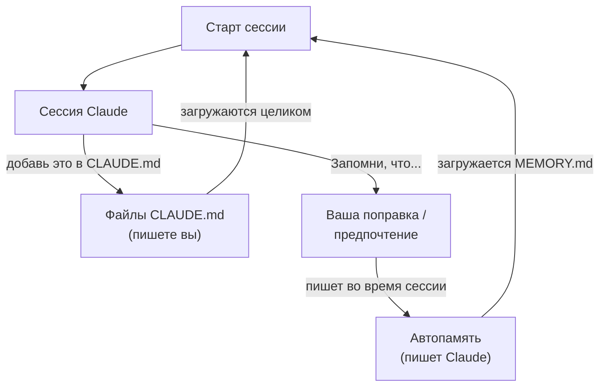
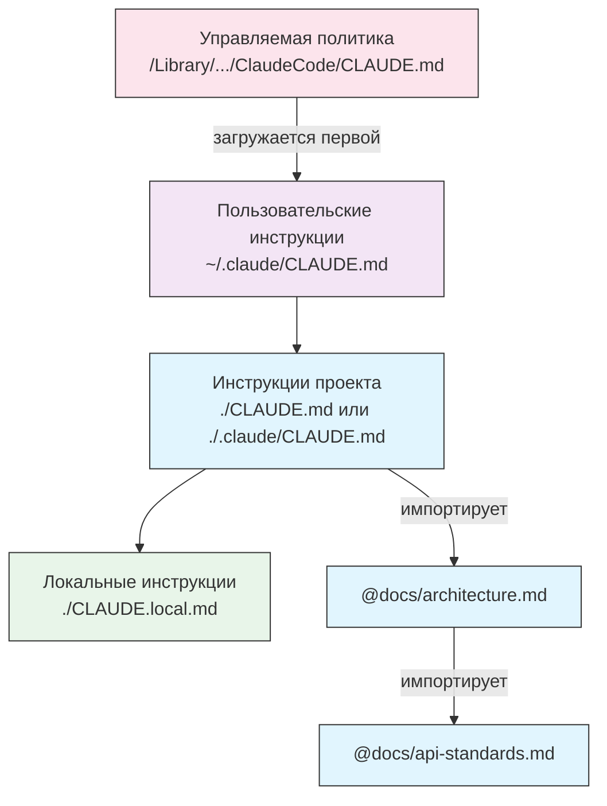
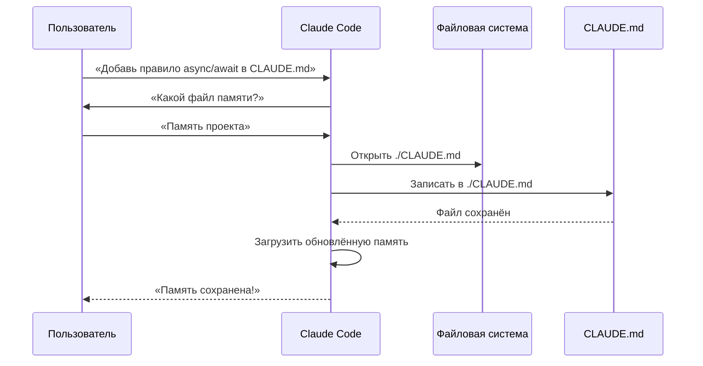
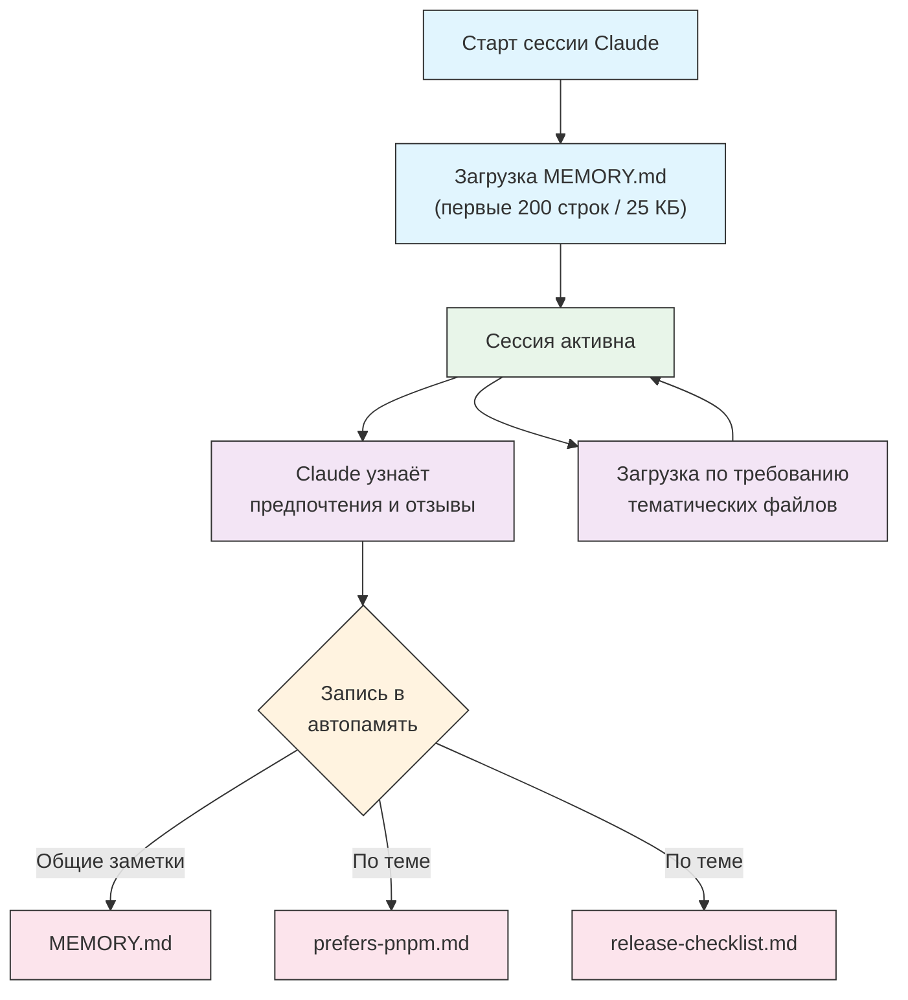
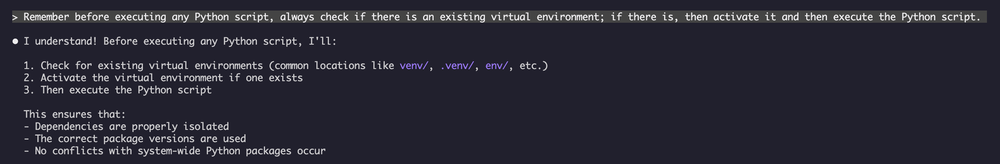
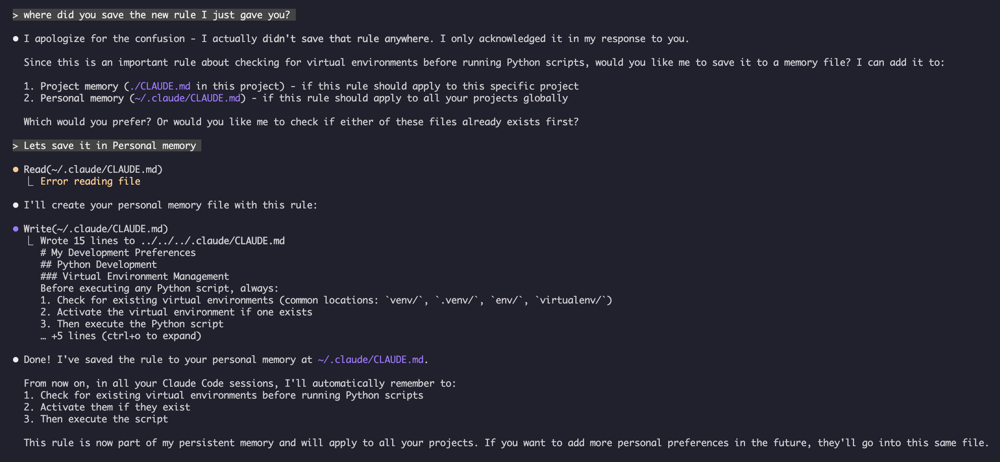

<!-- i18n-source: 02-memory/README.md -->
<!-- i18n-source-sha: 232591b -->
<!-- i18n-date: 2026-10-23 -->

<picture>
  <source media="(prefers-color-scheme: dark)" srcset="../../resources/logos/claude-howto-logo-dark.svg">
  
</picture>

# Руководство по памяти

Память позволяет Claude сохранять контекст между сессиями и диалогами. Она существует в двух видах: автоматический синтез в claude.ai и CLAUDE.md на файловой системе в Claude Code.

## Обзор

Память в Claude Code даёт постоянный контекст, который переносится между сессиями и диалогами. В отличие от временных контекстных окон, файлы памяти позволяют:

- Делиться стандартами проекта с командой
- Хранить личные предпочтения в разработке
- Держать правила и конфигурации для конкретных каталогов
- Импортировать внешнюю документацию
- Хранить память в системе контроля версий как часть проекта

Система памяти работает на нескольких уровнях: от глобальных личных предпочтений до конкретных подкаталогов. Так вы тонко управляете тем, что Claude помнит и как применяет эти знания.

## Краткий справочник команд памяти

| Команда | Назначение | Использование | Когда использовать |
|---------|---------|-------|-------------|
| `/init` | Инициализировать память проекта | `/init` | Новый проект, первая настройка CLAUDE.md |
| `/memory` | Править файлы памяти в редакторе | `/memory` | Крупные правки, реорганизация, просмотр содержимого |
| Префикс `#` | ~~Быстрое добавление одной строки в память~~ **Снято** | — | Используйте `/memory` или попросите в диалоге |
| `@path/to/file` | Импорт внешнего содержимого | `@README.md` или `@docs/api.md` | Ссылка на уже существующую документацию в CLAUDE.md |

## Быстрый старт: инициализация памяти

### Команда `/init`

Команда `/init` — самый быстрый способ настроить память проекта в Claude Code. Она создаёт файл CLAUDE.md с базовой документацией проекта.

**Использование:**

```bash
/init
```

**Что она делает:**

- Создаёт новый файл CLAUDE.md в проекте (обычно `./CLAUDE.md` или `./.claude/CLAUDE.md`)
- Фиксирует соглашения и рекомендации проекта
- Закладывает основу, чтобы контекст сохранялся между сессиями
- Даёт структуру шаблона для описания стандартов проекта

**Расширенный интерактивный режим.** Задайте `CLAUDE_CODE_NEW_INIT=1`, чтобы включить многофазный интерактивный сценарий. Он проведёт вас по настройке проекта шаг за шагом:

```bash
CLAUDE_CODE_NEW_INIT=1 claude
/init
```

**Когда использовать `/init`:**

- Начинаете новый проект в Claude Code
- Фиксируете командные стандарты кодирования и соглашения
- Описываете структуру кодовой базы
- Настраиваете иерархию памяти для совместной разработки

**Пример рабочего процесса:**

```markdown
# В каталоге проекта
/init

# Claude создаёт CLAUDE.md со структурой вроде такой:
# Конфигурация проекта
## Обзор проекта
- Название: ваш проект
- Стек: [ваши технологии]
- Размер команды: [число разработчиков]

## Стандарты разработки
- Предпочтения по стилю кода
- Требования к тестированию
- Соглашения рабочего процесса Git
```

### Быстрые обновления памяти

> **Примечание**: сокращение `#` для памяти прямо в строке снято. Используйте `/memory`, чтобы править файлы памяти напрямую, или попросите Claude в диалоге что-то запомнить (например, «запомни, что мы всегда используем строгий режим TypeScript»).

Добавлять информацию в память лучше так:

**Вариант 1: команда `/memory`**

```bash
/memory
```

Открывает файлы памяти в системном редакторе, и их можно править напрямую.

**Вариант 2: попросить в диалоге**

```
Запомни, что в этом проекте мы всегда используем строгий режим TypeScript.
Добавь в память: предпочитать async/await цепочкам промисов.
```

Просьба к Claude что-то запомнить сохраняет это в автопамять. Чтобы изменить CLAUDE.md, скажите «добавь это в CLAUDE.md» или отредактируйте файл сами через `/memory`.

**Историческая справка** (больше не работает):

Раньше префикс `#` позволял добавлять правила прямо в строке:

```markdown
# Всегда использовать строгий режим TypeScript в этом проекте  ← больше не работает
```

Если вы опирались на этот приём, перейдите на команду `/memory` или на просьбы в диалоге.

### Команда `/memory`

Команда `/memory` открывает файлы памяти CLAUDE.md на правку прямо внутри сессии Claude Code. Файлы открываются в системном редакторе, и их можно менять обстоятельно. Если файл открывается в GUI-редакторе, сессия больше не блокируется, пока файл открыт, и можно продолжать работу параллельно (v2.1.216). Терминальные редакторы вроде Vim по-прежнему занимают терминал, пока вы из него не выйдете.

**Использование:**

```bash
/memory
```

**Что она делает:**

- Открывает файлы памяти в редакторе системы по умолчанию
- Позволяет делать крупные добавления, правки и реорганизацию
- Даёт прямой доступ ко всем файлам памяти в иерархии
- Позволяет управлять постоянным контекстом между сессиями

**Когда использовать `/memory`:**

- Просматриваете уже записанную память
- Крупно обновляете стандарты проекта
- Реорганизуете структуру памяти
- Добавляете подробную документацию или рекомендации
- Сопровождаете память по мере того, как проект меняется

**Сравнение: `/memory` и `/init`**

| Аспект | `/memory` | `/init` |
|--------|-----------|---------|
| **Назначение** | Править существующие файлы памяти | Инициализировать новый CLAUDE.md |
| **Когда использовать** | Обновить или изменить контекст проекта | Начать новый проект |
| **Действие** | Открывает редактор для правок | Создаёт стартовый шаблон |
| **Рабочий процесс** | Постоянное сопровождение | Одноразовая настройка |

**Пример рабочего процесса:**

```markdown
# Открыть память для редактирования
/memory

# Claude предлагает варианты:
# 1. Память управляемой политики
# 2. Память проекта (./CLAUDE.md)
# 3. Пользовательская память (~/.claude/CLAUDE.md)
# 4. Локальная память проекта

# Выберите вариант 2 (память проекта)
# Редактор по умолчанию открывается с содержимым ./CLAUDE.md

# Внесите изменения, сохраните и закройте редактор
# Claude автоматически перезагружает обновлённую память
```

**Импорт в память:**

Файлы CLAUDE.md поддерживают синтаксис `@path/to/file`, чтобы включать внешнее содержимое:

```markdown
# Документация проекта
Обзор проекта: см. @README.md
Доступные команды npm: см. @package.json
Устройство системы: см. @docs/architecture.md

# Импорт из домашнего каталога по абсолютному пути
@~/.claude/my-project-instructions.md
```

**Возможности импорта:**

- Поддерживаются и относительные, и абсолютные пути (например, `@docs/api.md` или `@~/.claude/my-project-instructions.md`)
- Рекурсивный импорт поддерживается, максимальная глубина — 4 перехода
- Первый импорт из внешнего места открывает диалог подтверждения: так устроена защита
- Директивы импорта не вычисляются внутри строчных фрагментов кода Markdown и блоков кода, поэтому показывать их в примерах безопасно
- Не нужно дублировать текст: вы ссылаетесь на уже существующую документацию
- Упомянутое содержимое автоматически попадает в контекст Claude

## Архитектура памяти

Память в Claude Code устроена иерархически: разные области решают разные задачи. В отличие от 24-часового цикла синтеза в Claude Web/Desktop (см. [Память в Claude Web/Desktop](#память-в-claude-webdesktop) ниже), у Claude Code две системы памяти. Обе загружаются в начале каждой сессии и обновляются непрерывно, а не по таймеру:



## Иерархия памяти в Claude Code

У Claude Code две дополняющие друг друга системы памяти, и обе загружаются в начале каждого диалога: **файлы CLAUDE.md** (инструкции, которые пишете вы) и **автопамять** (заметки, которые Claude пишет сам). Файлы CLAUDE.md **конкатенируются в контекст, а не переопределяют друг друга** — это не жёсткая цепочка приоритетов, где верхний уровень заменяет нижний. Файлы `.claude/rules/*.md` — отдельный родственный механизм: инструкции по теме или по пути.

**Расположения файлов CLAUDE.md в порядке загрузки (от самой широкой области к самой конкретной):**

| Область | Расположение | Назначение |
|-------|----------|---------|
| Управляемая политика | macOS: `/Library/Application Support/ClaudeCode/CLAUDE.md`<br>Linux/WSL: `/etc/claude-code/CLAUDE.md`<br>Windows: `C:\Program Files\ClaudeCode\CLAUDE.md` | Инструкции на всю организацию под управлением IT/DevOps. Исключить индивидуальными настройками нельзя. |
| Пользовательские инструкции | `~/.claude/CLAUDE.md` | Личные предпочтения для всех проектов |
| Инструкции проекта | `./CLAUDE.md` или `./.claude/CLAUDE.md` | Инструкции, общие для команды, под контролем версий. Начиная с v2.1.277 на этом же уровне вместо них загружается `./AGENTS.md`, если `CLAUDE.md` или `CLAUDE.local.md` нет в рабочем каталоге и выше — этим управляет **Project instructions** в `/config` |
| Локальные инструкции | `./CLAUDE.local.md` | Личные предпочтения в рамках проекта; добавьте в `.gitignore` |

Внутри дерева каталогов Claude Code поднимается вверх от рабочего каталога: `foo/CLAUDE.md` загружается раньше `foo/bar/CLAUDE.md`, если запуск идёт из `foo/bar/`. Инструкции ближе к месту запуска читаются *последними* — не «наивысший приоритет» в смысле переопределения, а просто самые поздние в контексте. В каждом каталоге `CLAUDE.local.md` дописывается после `CLAUDE.md`. Файлы CLAUDE.md и CLAUDE.local.md в подкаталогах *ниже* рабочего каталога загружаются по требованию, когда Claude читает файлы в этих подкаталогах, а не при запуске.

Организация может также положить управляемое содержимое CLAUDE.md прямо в `managed-settings.json` через ключ `claudeMd`, а не выкладывать отдельный файл. Это учитывается только в управляемых настройках и настройках политики — ключ `claudeMd` в пользовательских или проектных настройках ни на что не влияет.

**`.claude/rules/*.md`** — модульные инструкции по конкретным темам. При желании их ограничивают путями к файлам через frontmatter `paths`. Правила без поля `paths` загружаются безусловно и с тем же приоритетом, что `.claude/CLAUDE.md`. Правила с ограничением по пути загружаются по требованию, когда Claude читает, пишет или редактирует подходящий файл — в том числе когда смотрит его одиночным чтением через Bash, например `cat`, `head`, `tail`, `sed -n` или `grep` (Write/Edit с v2.1.288, чтения через Bash с v2.1.293). Правила уровня пользователя (`~/.claude/rules/`) загружаются раньше правил проекта.

**Автопамять** (`~/.claude/projects/<project>/memory/`) — отдельная система: собственные заметки Claude, не содержимое CLAUDE.md и не часть порядка конкатенации выше. См. [Автопамять](#автопамять) ниже.

> **Примечание**: `CLAUDE.local.md` полностью поддерживается и описан в [официальной документации](https://code.claude.com/docs/en/memory). Файл задаёт личные предпочтения в рамках проекта, и в систему контроля версий его не коммитят. Добавьте `CLAUDE.local.md` в `.gitignore`.

**Как обнаруживается память:**



Все показанные файлы конкатенируются в один контекст, а не выбираются переопределением — более поздние блоки появляются в контексте позже, а не «вместо» более ранних.

## AGENTS.md

`AGENTS.md` — файл контекста проекта сразу для нескольких инструментов: документ той же *категории*, что и CLAUDE.md, написанный так, чтобы несколько агентов для кода делили один набор соглашений проекта. Начиная с **v2.1.277** Claude Code читает его напрямую как инструкции проекта, и импортировать его не требуется.

**Поведение по умолчанию** (`claude-md-or-agents-md`):

| Что есть в проекте | Что читает Claude Code |
|---------------------------|------------------------|
| `AGENTS.md`, нет `CLAUDE.md` | `AGENTS.md` |
| И `AGENTS.md`, и `CLAUDE.md` | только `CLAUDE.md` |
| `CLAUDE.md`, который импортирует `AGENTS.md` через `@AGENTS.md` | `CLAUDE.md`, импорт раскрыт |

**Какие файлы подавляют AGENTS.md.** Claude Code проверяет рабочий каталог и каждый каталог выше на наличие `CLAUDE.md`, `.claude/CLAUDE.md` или `CLAUDE.local.md`. Если найдётся любой из них, `AGENTS.md` не читается. `~/.claude/CLAUDE.md`, управляемый CLAUDE.md и `.claude/rules/` для этой проверки **не** считаются и продолжают загружаться рядом с тем проектным файлом, который победил.

> **Предупреждение**: если добавить `CLAUDE.local.md`, чтение `AGENTS.md` молча прекращается. Если инструкции проекта словно пропадают после того, как вы создаёте локальное переопределение, причина обычно в этом.

**Что читается.** Каждый `AGENTS.md` и `.claude/AGENTS.md` в рабочем каталоге и выше загружается при старте сессии. Файлы в подкаталогах загружаются по требованию, когда Claude читает там файлы. Импорты `@path` раскрываются так же, как в CLAUDE.md, и действует `claudeMdExcludes`.

**Что не читается никогда**: `AGENTS.local.md`, `AGENTS.override.md` и всё, что лежит в `.agents/`.

**Как выбрать поведение.** Настройка **Project instructions** принимает четыре значения:

| Значение | Эффект |
|-------|--------|
| `claude-md-or-agents-md` | По умолчанию — `AGENTS.md` только если файл CLAUDE.md не найден |
| `claude-md-and-agents-md` | Читаются оба, если есть оба |
| `claude-md` | Только файлы CLAUDE.md; `AGENTS.md` игнорируется |
| `managed-only` | Только инструкции управляемой политики |

Задайте её через `/config` или в настройках:

```jsonc
{
  "pluginConfigs": {
    "agents-md@builtin": {
      "options": {
        "instructionFiles": "claude-md-and-agents-md"
      }
    }
  }
}
```

Этот ключ учитывается только в пользовательских и управляемых настройках — в проектных или локальных он ни на что не влияет.

**Где прямое чтение недоступно.** На версиях до v2.1.277 (или до v2.1.281 на Bedrock, Vertex и Foundry, за LLM-шлюзами или при отключённой телеметрии), в первой сессии после обновления или при отключённом встроенном плагине `agents-md` Claude Code сам не подхватит `AGENTS.md`. Тогда импортируйте его из CLAUDE.md:

```markdown
@AGENTS.md
```

## Исключение файлов CLAUDE.md через `claudeMdExcludes`

В больших монорепозиториях часть файлов CLAUDE.md может быть не нужна текущей работе. Настройка `claudeMdExcludes` позволяет пропустить конкретные файлы CLAUDE.md, чтобы они не попали в контекст:

```jsonc
// В ~/.claude/settings.json или .claude/settings.json
{
  "claudeMdExcludes": [
    "**/packages/legacy-app/CLAUDE.md",
    "**/vendors/**/CLAUDE.md"
  ]
}
```

Шаблоны сопоставляются с абсолютными путями файлов по синтаксису glob, поэтому шаблоны относительно репозитория начинайте с `**/`. Это особенно полезно в таких случаях:

- В монорепозитории много подпроектов, и нужны лишь некоторые
- В репозитории лежат вендоренные или сторонние файлы CLAUDE.md
- Нужно убрать шум из контекстного окна Claude и исключить устаревшие или посторонние инструкции

## Иерархия файлов настроек

Настройки Claude Code (включая `autoMemoryDirectory`, `claudeMdExcludes` и прочую конфигурацию) разрешаются по приоритету — в отличие от файлов CLAUDE.md выше, настройки действительно переопределяют друг друга, а не конкатенируются. Если одна и та же настройка задана в нескольких областях, побеждает более высокий уровень:

| Уровень | Расположение | Область |
|-------|----------|-------|
| 1 (наивысший) | Управляемые — `managed-settings.json`, plist или реестр, либо управляемые сервером | Принудительные правила на всю организацию; переопределить нельзя |
| 2 | Аргументы командной строки | Временные переопределения на сессию |
| 3 | `.claude/settings.local.json` | Локальные переопределения (git их игнорирует) |
| 4 | `.claude/settings.json` | Уровень проекта (коммитится в git) |
| 5 (низший) | `~/.claude/settings.json` | Пользовательские предпочтения |

Управляемые настройки также поддерживают каталог drop-in `managed-settings.d/` рядом с `managed-settings.json`: сначала сливается базовый файл, затем файлы `*.json` из каталога drop-in сливаются поверх в алфавитном порядке (скаляры переопределяют, массивы конкатенируются и дедуплицируются, объекты сливаются глубоко). Так отдельные команды деплоят независимые фрагменты политики, не правя общий файл. Это механизм **settings.json**, а не CLAUDE.md — к расположениям файлов CLAUDE.md, описанным выше, он не применяется.

Правила разрешений (`allow`/`ask`/`deny`) ведут себя иначе, чем остальные настройки: они сливаются между областями, и верхний уровень не заменяет нижний.

**Платформенная конфигурация (v2.1.51+):**

Настройки также можно задать через:
- **macOS**: файлы property list (plist)
- **Windows**: реестр Windows

Эти платформенные механизмы читаются вместе с JSON-файлами настроек и следуют тем же правилам приоритета.

> **Примечание (v2.1.119)**: изменения `/config` теперь сохраняются в `~/.claude/settings.json`. Значения, записанные через `/config`, участвуют в обычной цепочке приоритета политика / локальные / проект, описанной выше — они больше не живут только внутри сессии. Используйте `/config` для интерактивных правок, а файлы `settings.json` правьте напрямую, когда конфигурация скриптовая или управляемая.

### Настройки хранения и очистки

| Настройка | Тип | По умолчанию | Описание |
|---------|------|---------|-------------|
| `cleanupPeriodDays` | integer (дни) | 30 | Окно хранения транскриптов сессий и других данных приложения в `~/.claude/`, включая `file-history/` (снимки контрольных точек), `plans/`, `debug/`, `tasks/`, `shell-snapshots/` и `backups/`. Каталога `~/.claude/checkpoints/` нет. Файлы старше окна удаляются при запуске. |

```jsonc
// ~/.claude/settings.json
{
  "cleanupPeriodDays": 14
}
```

### Настройки атрибуции, голоса и URL pull request

| Настройка | Тип | Описание |
|---------|------|-------------|
| `attribution.commit` | string | Текст, который дописывается к коммитам, созданным Claude (по умолчанию трейлер `Co-Authored-By: Claude`); `""` его скрывает. Заменяет устаревший флаг `includeCoAuthoredBy`. |
| `attribution.pr` | string | Текст, который дописывается к описаниям pull request, созданным Claude; `""` его скрывает. Заменяет устаревший флаг `includeCoAuthoredBy` для PR. |
| `attribution.sessionUrl` | boolean | Убирает ссылку на сессию claude.ai из коммитов и PR, созданных в веб-сессиях и сессиях Remote Control (v2.1.183+). |
| `voice.enabled` | boolean | Включает голосовой ввод push-to-talk (`/voice`). Заменяет устаревший флаг `voiceEnabled`. |
| `prUrlTemplate` | string | **Новое в v2.1.119.** Свой шаблон URL для значка PR в подвале. Полезен для GitLab, Bitbucket или внутренних платформ код-ревью. Поддерживает плейсхолдеры `{host}`, `{owner}`, `{repo}`, `{number}` и `{url}`. Ссылки на merge request в GitLab не меняются. |

```jsonc
// ~/.claude/settings.json
{
  "attribution": {
    "commit": "",
    "pr": ""
  },
  "voice": {
    "enabled": true
  },
  "prUrlTemplate": "https://reviews.example.com/{owner}/{repo}/pull/{number}"
}
```

Пустая строка (`""`) скрывает эту атрибуцию; `"attribution": false` скрывает её целиком (v2.1.281+).

#### Устаревшие имена настроек

Следующие старые ключи настроек всё ещё работают, но они устарели. Предпочитайте замены выше.

| Устаревший ключ | Замена | Примечания |
|----------------|-------------|-------|
| `includeCoAuthoredBy` | `attribution.commit` / `attribution.pr` | Старый единый флаг разделён на отдельные переключатели для коммита и PR. На старых установках можно оставить прежний ключ; в новых проектах используйте вложенную форму. |
| `voiceEnabled` | `voice.enabled` | Сгруппирован в пространстве имён `voice` вместе с будущими настройками голоса. |

## Модульная система правил

Складывайте правила по конкретным путям в каталог `.claude/rules/`. Правила можно задавать и на уровне проекта, и на уровне пользователя:

```
your-project/
├── .claude/
│   ├── CLAUDE.md
│   └── rules/
│       ├── code-style.md
│       ├── testing.md
│       ├── security.md
│       └── api/                  # Подкаталоги поддерживаются
│           ├── conventions.md
│           └── validation.md

~/.claude/
├── CLAUDE.md
└── rules/                        # Правила уровня пользователя (все проекты)
    ├── personal-style.md
    └── preferred-patterns.md
```

Правила обнаруживаются рекурсивно внутри каталога `rules/`, включая любые подкаталоги. Правила уровня пользователя в `~/.claude/rules/` загружаются раньше правил проекта: личные значения по умолчанию проект может переопределить.

### Правила для конкретных путей с YAML-frontmatter

Задайте правила, которые действуют только для конкретных путей к файлам:

```markdown
---
paths: src/api/**/*.ts
---

# Правила разработки API

- У каждой конечной точки API должна быть проверка входных данных
- Использовать Zod для проверки схемы
- Документировать все параметры и типы ответов
- Предусматривать обработку ошибок для всех операций
```

**Примеры шаблонов glob:**

- `**/*.ts` — все файлы TypeScript
- `src/**/*` — все файлы внутри src/
- `src/**/*.{ts,tsx}` — несколько расширений
- `{src,lib}/**/*.ts, tests/**/*.test.ts` — несколько шаблонов

### Подкаталоги и символические ссылки

Правила в `.claude/rules/` поддерживают две возможности организации:

- **Подкаталоги**: правила обнаруживаются рекурсивно, поэтому их можно разложить по тематическим папкам (например, `rules/api/`, `rules/testing/`, `rules/security/`)
- **Символические ссылки**: они нужны, чтобы делить правила между несколькими проектами. Например, можно сделать символическую ссылку на общий файл правил из центрального места в каталог `.claude/rules/` каждого проекта. Начиная с v2.1.284 правило по символической ссылке извне проекта — или каталог `.claude` по символической ссылке извне — показывает тот же запрос подтверждения внешних импортов, что и импорт `@path`

## Таблица расположений памяти

Файлы CLAUDE.md и правила конкатенируются в контекст, а не выбираются жёстким переопределением — «порядок загрузки» ниже означает, *где в контексте это появляется*, а не *кто побеждает*. Автопамять — отдельный механизм со своим местом хранения.

| Расположение | Тип | Порядок загрузки | Общий доступ | Доступ | Лучше всего для |
|----------|------|-------------|--------|--------|----------|
| `/Library/Application Support/ClaudeCode/CLAUDE.md` (macOS) | Управляемая политика | 1-й (загружается первым) | Организация | Система | Политики на всю компанию |
| `/etc/claude-code/CLAUDE.md` (Linux/WSL) | Управляемая политика | 1-й (загружается первым) | Организация | Система | Стандарты организации |
| `C:\Program Files\ClaudeCode\CLAUDE.md` (Windows) | Управляемая политика | 1-й (загружается первым) | Организация | Система | Корпоративные рекомендации |
| `~/.claude/rules/*.md` | Пользовательские правила | 2-й | Лично | Файловая система | Личные правила (все проекты) |
| `~/.claude/CLAUDE.md` | Пользовательская память | 3-й | Лично | Файловая система | Личные предпочтения (все проекты) |
| `./.claude/rules/*.md` | Правила проекта | 4-й | Команда | Git | Модульные правила для конкретных путей |
| `./CLAUDE.md` или `./.claude/CLAUDE.md` | Память проекта | 5-й | Команда | Git | Стандарты команды, общая архитектура |
| `./CLAUDE.local.md` | Локально для проекта | 6-й (загружается последним) | Лично | Git (игнорируется) | Личные предпочтения в этом проекте |
| `~/.claude/projects/<project>/memory/` | Автопамять | н/д — отдельный механизм | Лично | Файловая система | Автоматические заметки и выводы Claude |

## Жизненный цикл обновления памяти

Вот как обновления памяти проходят через сессии Claude Code:



## Автопамять

Автопамять — постоянный каталог, куда Claude по ходу работы с проектом сам сохраняет типизированные заметки (`user`, `feedback`, `project`, `reference`). Всё, что можно вывести из кодовой базы, он пропускает: архитектуру, пути к файлам, исправления при отладке. В отличие от файлов CLAUDE.md, которые вы пишете и ведёте вручную, автопамять во время сессий пишет сам Claude.

### Как работает автопамять

- **Расположение**: `~/.claude/projects/<project>/memory/`
- **Точка входа**: `MEMORY.md` — главный файл каталога автопамяти
- **Тематические файлы**: необязательные дополнительные файлы, по одному на каждую память (например, `prefers-pnpm.md`, `release-checklist.md`)
- **Как загружается**: первые 200 строк `MEMORY.md` (или первые 25 КБ — что наступит раньше) попадают в контекст при старте сессии. Тематические файлы загружаются по требованию, не при старте
- **Чтение и запись**: во время сессий Claude читает и пишет файлы памяти, узнавая предпочтения, отзывы и контекст проекта
- **Frontmatter**: у файлов, которые начинаются с YAML-frontmatter, появляется поле `modified` — метка времени ISO 8601. Claude Code записывает её при каждой записи файла (v2.1.214)

### Архитектура автопамяти



### Структура каталога автопамяти

```
~/.claude/projects/<project>/memory/
├── MEMORY.md              # Точка входа (первые 200 строк / 25 КБ загружаются при старте)
├── prefers-pnpm.md        # Тематический файл (загружается по требованию)
├── release-checklist.md   # Тематический файл (загружается по требованию)
└── team-contacts.md       # Тематический файл (загружается по требованию)
```

### Требование к версии

Автопамяти нужен **Claude Code v2.1.59 или новее**. Если версия старше, сначала обновитесь:

```bash
npm install -g @anthropic-ai/claude-code@latest
```

### Включение и выключение автопамяти

Автопамять **включена по умолчанию**. Ею управляет настройка `autoMemoryEnabled` (по умолчанию `true`). При `false` Claude не читает каталог автопамяти и не пишет в него. Переключить её можно и через `/memory` во время сессии.

```json
{
  "autoMemoryEnabled": false
}
```

Чтобы выключить её переменной окружения, задайте `CLAUDE_CODE_DISABLE_AUTO_MEMORY=1`. Значение `0` принудительно **включает** автопамять, даже если режим `--bare` или `autoMemoryEnabled: false` иначе её выключили бы.

### Свой каталог автопамяти

По умолчанию автопамять лежит в `~/.claude/projects/<project>/memory/`. Место можно сменить настройкой `autoMemoryDirectory` (доступна с **v2.1.74**):

```jsonc
// В любом файле настроек: пользовательские, проектные, локальные или управляемая политика
{
  "autoMemoryDirectory": "/path/to/custom/memory/directory"
}
```

> **Примечание**: `autoMemoryDirectory` читается из любой области настроек: пользовательской, проектной, локальной, управляемой политики или `--settings`. Значение должно быть абсолютным путём или начинаться с `~/`.

Это полезно, когда нужно:

- Хранить автопамять в общем или синхронизируемом месте
- Отделить автопамять от каталога конфигурации Claude по умолчанию
- Взять путь конкретного проекта вне иерархии по умолчанию

### Общий доступ для worktree и репозитория

Все worktree и подкаталоги одного git-репозитория делят один каталог автопамяти. Переключение между worktree или работа в разных подкаталогах одного репозитория читает и пишет те же файлы памяти.

### Память субагента

Субагенты (их порождает инструмент Agent) могут хранить собственную постоянную память. Поле frontmatter `memory` в определении субагента выбирает, где лежит этот каталог:

```yaml
memory: user      # ~/.claude/agent-memory/<agent-name>/
memory: project   # .claude/agent-memory/<agent-name>/ (можно отдать через git)
memory: local     # .claude/agent-memory-local/<agent-name>/ (не коммитится)
```

При старте субагент читает первые 200 строк или 25 КБ файла `MEMORY.md` в этом каталоге и получает Read, Write и Edit, чтобы его вести. Если автопамять выключена, это ни на что не влияет.

> **Примечание**: субагенты также могут вести собственную автопамять. Подробности — в [официальной документации по памяти субагентов](https://code.claude.com/docs/en/sub-agents#enable-persistent-memory).

### Управление автопамятью

Автопамятью можно управлять через переменную окружения `CLAUDE_CODE_DISABLE_AUTO_MEMORY`:

| Значение | Поведение |
|-------|----------|
| `0` | Принудительно **включить** автопамять |
| `1` | Принудительно **выключить** автопамять |
| *(не задано)* | Поведение по умолчанию (автопамять включена) |

```bash
# Отключить автопамять на сессию
CLAUDE_CODE_DISABLE_AUTO_MEMORY=1 claude

# Принудительно включить автопамять
CLAUDE_CODE_DISABLE_AUTO_MEMORY=0 claude
```

## Дополнительные каталоги с `--add-dir`

Флаг `--add-dir` позволяет Claude Code загружать файлы CLAUDE.md из дополнительных каталогов, помимо текущего рабочего каталога. Это нужно в монорепозиториях и схемах из нескольких проектов, где важен контекст из других каталогов.

Чтобы включить эту функцию, задайте переменную окружения:

```bash
CLAUDE_CODE_ADDITIONAL_DIRECTORIES_CLAUDE_MD=1
```

Затем запустите Claude Code с флагом:

```bash
claude --add-dir /path/to/other/project
```

Claude загрузит CLAUDE.md из указанного дополнительного каталога вместе с файлами памяти текущего рабочего каталога.

## Практические примеры

### Пример 1: структура памяти проекта

**Файл:** `./CLAUDE.md`

```markdown
# Конфигурация проекта

## Обзор проекта
- **Название**: платформа электронной коммерции
- **Стек**: Node.js, PostgreSQL, React 18, Docker
- **Размер команды**: 5 разработчиков
- **Срок**: Q4 2025

## Архитектура
@docs/architecture.md
@docs/api-standards.md
@docs/database-schema.md

## Стандарты разработки

### Стиль кода
- Использовать Prettier для форматирования
- Использовать ESLint с конфигом airbnb
- Максимальная длина строки: 100 символов
- Использовать отступ в 2 пробела

### Соглашения об именовании
- **Файлы**: kebab-case (user-controller.js)
- **Классы**: PascalCase (UserService)
- **Функции и переменные**: camelCase (getUserById)
- **Константы**: UPPER_SNAKE_CASE (API_BASE_URL)
- **Таблицы базы данных**: snake_case (user_accounts)

### Рабочий процесс Git
- Имена веток: `feature/description` или `fix/description`
- Сообщения коммитов: следовать conventional commits
- PR обязателен до слияния
- Все проверки CI/CD должны проходить
- Нужно минимум одно одобрение

### Требования к тестированию
- Минимум 80% покрытия кода
- У всех критических путей должны быть тесты
- Использовать Jest для модульных тестов
- Использовать Cypress для E2E-тестов
- Имена файлов тестов: `*.test.ts` или `*.spec.ts`

### Стандарты API
- Только конечные точки REST
- Запрос и ответ в JSON
- Правильно использовать коды состояния HTTP
- Версионировать конечные точки API: `/api/v1/`
- Документировать все конечные точки с примерами

### База данных
- Менять схему через миграции
- Никогда не зашивать учётные данные в код
- Использовать пул соединений
- Включать журнал запросов в разработке
- Нужны регулярные резервные копии

### Деплой
- Деплой на основе Docker
- Оркестрация через Kubernetes
- Стратегия сине-зелёного деплоя
- Автоматический откат при сбое
- Миграции базы данных выполняются до деплоя

## Частые команды

| Команда | Назначение |
|---------|---------|
| `npm run dev` | Запустить сервер разработки |
| `npm test` | Запустить набор тестов |
| `npm run lint` | Проверить стиль кода |
| `npm run build` | Собрать для продакшена |
| `npm run migrate` | Запустить миграции базы данных |

## Контакты команды
- Техлид: Sarah Chen (@sarah.chen)
- Менеджер продукта: Mike Johnson (@mike.j)
- DevOps: Alex Kim (@alex.k)

## Известные проблемы и обходные пути
- Пул соединений PostgreSQL ограничен 20 в часы пик
- Обходной путь: поставить запросы в очередь
- Проблемы совместимости Safari 14 с асинхронными генераторами
- Обходной путь: использовать транспилятор Babel

## Связанные проекты
- Панель аналитики: `/projects/analytics`
- Мобильное приложение: `/projects/mobile`
- Панель администратора: `/projects/admin`
```

### Пример 2: память для конкретного каталога

**Файл:** `./src/api/CLAUDE.md`

````markdown
# Стандарты модуля API

Этот файл дополняет корневой CLAUDE.md для всего, что лежит в /src/api/. Файлы памяти
конкатенируются, а не переопределяются — корневой CLAUDE.md по-прежнему действует, и Claude Code
загружает этот файл по требованию, когда читает, пишет или редактирует файлы в этом поддереве.

## Специальные стандарты API

### Проверка запросов
- Использовать Zod для проверки схемы
- Всегда проверять входные данные
- Возвращать 400 вместе с ошибками проверки
- Включать подробности ошибок по каждому полю

### Аутентификация
- Все конечные точки требуют токен JWT
- Токен передаётся в заголовке Authorization
- Токен истекает через 24 часа
- Реализовать механизм refresh token

### Формат ответа

Все ответы должны следовать этой структуре:

```json
{
  "success": true,
  "data": { /* фактические данные */ },
  "timestamp": "2025-11-06T10:30:00Z",
  "version": "1.0"
}
```

Ответы с ошибкой:
```json
{
  "success": false,
  "error": {
    "code": "VALIDATION_ERROR",
    "message": "Сообщение пользователю",
    "details": { /* ошибки полей */ }
  },
  "timestamp": "2025-11-06T10:30:00Z"
}
```

### Пагинация
- Использовать пагинацию по курсору (не offset)
- Включать булево поле `hasMore`
- Ограничить максимальный размер страницы значением 100
- Размер страницы по умолчанию: 20

### Лимит запросов
- 1000 запросов в час для аутентифицированных пользователей
- 100 запросов в час для публичных конечных точек
- При превышении возвращать 429
- Добавлять заголовок retry-after

### Кэширование
- Использовать Redis для кэша сессий
- Длительность кэша: по умолчанию 5 минут
- Сбрасывать кэш при операциях записи
- Помечать ключи кэша типом ресурса
````

### Пример 3: личная память

**Файл:** `~/.claude/CLAUDE.md`

```markdown
# Мои предпочтения в разработке

## Обо мне
- **Уровень опыта**: 8 лет full-stack-разработки
- **Предпочитаемые языки**: TypeScript, Python
- **Стиль общения**: прямой, с примерами
- **Стиль обучения**: наглядные схемы вместе с кодом

## Предпочтения по коду

### Обработка ошибок
Я предпочитаю явную обработку ошибок: блоки try-catch и осмысленные сообщения об ошибках.
Избегать общих ошибок. Всегда записывать ошибки в журнал для отладки.

### Комментарии
Писать комментарии про ЗАЧЕМ, а не про ЧТО. Код должен объяснять сам себя.
Комментарии должны объяснять бизнес-логику или неочевидные решения.

### Тестирование
Я предпочитаю TDD (разработка через тестирование).
Сначала тесты, потом реализация.
Смотреть на поведение, а не на детали реализации.

### Архитектура
Я предпочитаю модульный, слабо связанный дизайн.
Использовать внедрение зависимостей ради тестируемости.
Разделять ответственности (контроллеры, сервисы, репозитории).

## Предпочтения по отладке
- Использовать console.log с префиксом: `[DEBUG]`
- Добавлять контекст: имя функции, нужные переменные
- Использовать трассировку стека, когда она есть
- Всегда ставить метки времени в журналах

## Общение
- Объяснять сложные понятия схемами
- Сначала показывать конкретные примеры, потом теорию
- Приводить фрагменты кода «до» и «после»
- В конце суммировать главное

## Организация проекта
Проекты я раскладываю так:

   project/
   ├── src/
   │   ├── api/
   │   ├── services/
   │   ├── models/
   │   └── utils/
   ├── tests/
   ├── docs/
   └── docker/

## Инструменты
- **IDE**: VS Code с сочетаниями клавиш vim
- **Терминал**: Zsh с Oh-My-Zsh
- **Формат**: Prettier (длина строки 100 символов)
- **Линтер**: ESLint с конфигом airbnb
- **Фреймворк тестов**: Jest с React Testing Library
```

_Мой тест_
Попросить Claude сохранить новое правило


Claude не сохранил правило, потому что у меня нигде не было файла `Claude.md`. Затем я попросил Claude подтвердить расположение.



### Пример 4: обновление памяти во время сессии

Новые правила можно добавлять в CLAUDE.md во время активной сессии Claude Code, попросив Claude напрямую (если попросить *запомнить* что-то, запись попадёт в автопамять):

```markdown
Пользователь: Добавь это в CLAUDE.md: я предпочитаю React hooks вместо классовых компонентов
     для всех новых компонентов.

Claude: Добавляю это в вашу память. В какой файл памяти это записать?
        1. Память проекта (./CLAUDE.md)
        2. Личная память (~/.claude/CLAUDE.md)

Пользователь: Память проекта

Claude: ✅ Память сохранена!

Добавлено в ./CLAUDE.md:
---

### Разработка компонентов
- Использовать функциональные компоненты с React Hooks
- Предпочитать хуки классовым компонентам
- Свои хуки для повторяемой логики
- Использовать useCallback для обработчиков событий
- Использовать useMemo для дорогих вычислений
```

Для крупных обновлений или реорганизации можно править файлы памяти напрямую через `/memory`.

#### Советы по добавлению памяти

- Делайте правила конкретными и такими, чтобы по ним можно было действовать
- Группируйте связанные правила под заголовком раздела
- Обновляйте существующие разделы, а не дублируйте содержимое
- Выбирайте подходящую область памяти (проект или личная)

## Сравнение возможностей памяти

| Возможность | Claude Web/Desktop | Claude Code (CLAUDE.md) |
|---------|-------------------|------------------------|
| Автосинтез | ✅ Каждые 24 ч | ✅ Автопамять |
| Между проектами | ✅ Общая | ❌ Только для проекта |
| Доступ команды | ✅ Общие проекты | ✅ В Git |
| Поиск | ✅ Встроенный | ✅ Через `/memory` |
| Правка | ✅ В чате | ✅ Прямая правка файла |
| Импорт и экспорт | ✅ Да | ✅ Скопировать |
| Постоянство | ✅ 24 ч+ | ✅ Бессрочно |

### Память в Claude Web/Desktop

#### Хронология синтеза памяти


**Пример сводки памяти:**

```markdown
## Память Claude о пользователе

### Профессиональный опыт
- Старший full-stack-разработчик с 8 годами опыта
- Фокус на бэкендах TypeScript/Node.js и фронтендах React
- Активный участник open source
- Интересуется ИИ и машинным обучением

### Контекст проекта
- Сейчас делает платформу электронной коммерции
- Стек: Node.js, PostgreSQL, React 18, Docker
- Работает в команде из 5 разработчиков
- Использует CI/CD и сине-зелёный деплой

### Предпочтения в общении
- Предпочитает прямые и сжатые объяснения
- Любит наглядные схемы и примеры
- Ценит фрагменты кода
- Объясняет бизнес-логику в комментариях

### Текущие цели
- Улучшить производительность API
- Поднять покрытие тестами до 90%
- Внедрить стратегию кэширования
- Задокументировать архитектуру
```

## Рекомендации

### Что включать

- **Будьте конкретны и подробны**: давайте ясные, подробные инструкции, а не расплывчатые указания
  - ✅ Хорошо: «Использовать отступ в 2 пробела во всех файлах JavaScript»
  - ❌ Избегайте: «Следовать лучшим практикам»

- **Держите порядок**: разбивайте файлы памяти на ясные разделы и заголовки Markdown

- **Берите подходящий уровень иерархии**:
  - **Управляемая политика**: политики на всю компанию, стандарты безопасности, требования соответствия
  - **Память проекта**: стандарты команды, архитектура, соглашения о коде (коммитьте в git)
  - **Пользовательская память**: личные предпочтения, стиль общения, выбор инструментов
  - **Память каталога**: правила конкретного модуля и переопределения

- **Используйте импорт**: синтаксис `@path/to/file` ссылается на существующую документацию
  - Рекурсивный импорт поддерживает максимальную глубину в 4 перехода
  - Убирает дубли между файлами памяти
  - Пример: `См. @README.md — обзор проекта`

- **Документируйте частые команды**: включайте команды, которые повторяете, чтобы экономить время

- **Храните память проекта в системе контроля версий**: коммитьте файлы CLAUDE.md уровня проекта в git — это полезно команде

- **Просматривайте время от времени**: регулярно обновляйте память, когда проект развивается и требования меняются

- **Давайте конкретные примеры**: включайте фрагменты кода и конкретные сценарии

### Чего избегать

- **Не храните секреты**: никогда не включайте API-ключи, пароли, токены и учётные данные

- **Не включайте чувствительные данные**: никаких персональных данных (PII), частной информации и проприетарных секретов

- **Не дублируйте содержимое**: импорт (`@path`) ссылается на существующую документацию

- **Не будьте расплывчаты**: избегайте общих фраз вроде «следовать лучшим практикам» или «писать хороший код»

- **Не раздувайте файл**: цель — **меньше 200 строк** на один CLAUDE.md. Более длинные файлы всё равно загружаются целиком, но следование инструкциям падает — см. [Как держать CLAUDE.md небольшим](#как-держать-claudemd-небольшим) ниже

- **Не усложняйте структуру**: пользуйтесь иерархией осознанно и не плодите лишние переопределения в подкаталогах

- **Не забывайте обновлять**: устаревшая память путает и закрепляет старые практики

- **Не превышайте предел вложенности**: импорт памяти поддерживает максимальную глубину в 4 перехода

### Как держать CLAUDE.md небольшим

Текущая рекомендация Anthropic противоположна формуле «положить всё в CLAUDE.md». Файл загружается в **каждой** сессии, поэтому каждая добавленная строка отнимает внимание у задач, к которым не имеет отношения.

**Практическое правило: держите CLAUDE.md короче 200 строк.** Более длинные файлы всё равно загружаются целиком, но следование инструкциям ухудшается по мере роста файла.

Когда он начинает расти, выносите содержимое наружу, а не ужимайте прозу:

| Содержимое | Куда его класть | Зачем |
|---------|------------------|-----|
| Многошаговые процедуры | [Навык](../03-skills) | Загружается по требованию, только когда уместен |
| Правила для каталога или типа файлов | `.claude/rules/*.md` с frontmatter `paths:` | Область задаётся glob; загрузка только когда вы трогаете подходящие файлы |
| Справочные материалы и длинные примеры | Каталог `references/` навыка | Читается только когда навыку это нужно |
| То, что Claude должен помнить о *вас* | Автопамять (включена по умолчанию) | Пишется и загружается автоматически |

> **Примечание**: импорты `@path` упорядочивают большой CLAUDE.md, но **не** экономят контекст — импортированные файлы точно так же подтягиваются в момент загрузки. То, что реально сокращает загрузку, — разбиение на правила с областью по пути.

`/doctor` (v2.1.206+) проверяет конфигурацию и предлагает, что сократить, когда CLAUDE.md вырос дальше полезного размера.

### Не пишите напоминания о проверке

Старые рекомендации поощряли строки вроде «всегда запускай тесты, прежде чем сказать, что готово» или «перепроверь свою работу». На **Claude Opus 5 и Fable 5 это теперь вызывает избыточную проверку** — Claude заново проверяет работу, которая уже была верной, и сжигает ходы и токены.

Для поколения Claude 5 Anthropic убрал больше 80% собственного системного промпта Claude Code, и измеримой регрессии не было. Тот же принцип верен для вашего CLAUDE.md: лучше назвать цель и дать Claude самому судить, чем перечислять проверки, которые он должен выполнить.

Удалите напоминания о проверке из существующих файлов CLAUDE.md, рассчитанных на Opus 5 или Fable 5. Оставьте по-настоящему неочевидные требования проекта — «интеграционным тестам нужен запущенный Docker»: это сведения, а не напоминание.

### Советы по управлению памятью

**Выберите правильный уровень памяти:**

| Сценарий | Уровень памяти | Обоснование |
|----------|-------------|-----------|
| Политика безопасности компании | Управляемая политика | Действует для всех проектов организации |
| Руководство команды по стилю кода | Проект | Общее для команды через git |
| Ваши сочетания клавиш в редакторе | Пользователь | Личное предпочтение, никому не отдаётся |
| Стандарты модуля API | Каталог | Только для этого модуля |

**Рабочий процесс быстрого обновления:**

1. Одно правило: откройте редактор через `/memory` или попросите в диалоге
2. Несколько изменений: откройте редактор через `/memory`
3. Начальная настройка: создайте шаблон через `/init`

**Лучшие приёмы импорта:**

```markdown
# Хорошо: ссылайтесь на существующие документы
@README.md
@docs/architecture.md
@package.json

# Избегайте: копировать содержимое, которое уже есть в другом месте
# Вместо копирования содержимого README в CLAUDE.md просто импортируйте его
```

## Инструкции по установке

### Настройка памяти проекта

#### Способ 1: команда `/init` (рекомендуется)

Самый быстрый способ настроить память проекта:

1. **Перейдите в каталог проекта:**
   ```bash
   cd /path/to/your/project
   ```

2. **Запустите команду init в Claude Code:**
   ```bash
   /init
   ```

3. **Claude создаст и заполнит CLAUDE.md** структурой шаблона

4. **Подгоните созданный файл** под нужды проекта

5. **Закоммитьте в git:**
   ```bash
   git add CLAUDE.md
   git commit -m "Инициализировать память проекта через /init"
   ```

#### Способ 2: создание вручную

Если удобнее настроить всё руками:

1. **Создайте CLAUDE.md в корне проекта:**
   ```bash
   cd /path/to/your/project
   touch CLAUDE.md
   ```

2. **Добавьте стандарты проекта:**
   ```bash
   cat > CLAUDE.md << 'EOF'
   # Конфигурация проекта

   ## Обзор проекта
   - **Название**: название вашего проекта
   - **Стек**: перечислите технологии
   - **Размер команды**: число разработчиков

   ## Стандарты разработки
   - Ваши стандарты кодирования
   - Соглашения об именовании
   - Требования к тестированию
   EOF
   ```

3. **Закоммитьте в git:**
   ```bash
   git add CLAUDE.md
   git commit -m "Добавить конфигурацию памяти проекта"
   ```

### Настройка личной памяти

1. **Создайте каталог ~/.claude:**
   ```bash
   mkdir -p ~/.claude
   ```

2. **Создайте личный CLAUDE.md:**
   ```bash
   touch ~/.claude/CLAUDE.md
   ```

3. **Добавьте свои предпочтения:**
   ```bash
   cat > ~/.claude/CLAUDE.md << 'EOF'
   # Мои предпочтения в разработке

   ## Обо мне
   - Уровень опыта: [ваш уровень]
   - Предпочитаемые языки: [ваши языки]
   - Стиль общения: [ваш стиль]

   ## Предпочтения по коду
   - [ваши предпочтения]
   EOF
   ```

### Настройка памяти для конкретного каталога

1. **Создайте память для конкретных каталогов:**
   ```bash
   mkdir -p /path/to/directory/.claude
   touch /path/to/directory/CLAUDE.md
   ```

2. **Добавьте правила для этого каталога:**
   ```bash
   cat > /path/to/directory/CLAUDE.md << 'EOF'
   # Стандарты [имя каталога]

   Этот файл дополняет корневой CLAUDE.md для этого каталога. Файлы памяти
   конкатенируются, а не переопределяются — Claude Code загружает этот файл по
   требованию, когда читает, пишет или редактирует файлы в этом каталоге.

   ## [Конкретные стандарты]
   EOF
   ```

3. **Закоммитьте в систему контроля версий:**
   ```bash
   git add /path/to/directory/CLAUDE.md
   git commit -m "Добавить конфигурацию памяти для [каталог]"
   ```

### Проверка настройки

1. **Проверьте расположения памяти:**
   ```bash
   # Память в корне проекта
   ls -la ./CLAUDE.md

   # Личная память
   ls -la ~/.claude/CLAUDE.md
   ```

2. **Claude Code автоматически загрузит** эти файлы при старте сессии

3. **Проверьте в Claude Code**: начните новую сессию в своём проекте

## Официальная документация

Самые свежие сведения смотрите в официальной документации Claude Code:

- **[Документация по памяти](https://code.claude.com/docs/en/memory)** — полный справочник системы памяти
- **[Справочник слэш-команд](https://code.claude.com/docs/en/interactive-mode)** — все встроенные команды, включая `/init` и `/memory`
- **[Справочник CLI](https://code.claude.com/docs/en/cli-reference)** — документация интерфейса командной строки

### Ключевые технические детали из официальной документации

**Загрузка памяти:**

- Все файлы памяти автоматически загружаются, когда запускается Claude Code
- Claude поднимается вверх от текущего рабочего каталога и ищет файлы CLAUDE.md
- Файлы поддерева обнаруживаются и загружаются по контексту, когда вы обращаетесь к этим каталогам

**Синтаксис импорта:**

- `@path/to/file` включает внешнее содержимое (например, `@~/.claude/my-project-instructions.md`)
- Поддерживаются и относительные, и абсолютные пути (относительные пути считаются от файла, в котором стоит импорт, а не от рабочего каталога)
- Рекурсивный импорт поддерживается, максимальная глубина — 4 перехода
- Первый внешний импорт открывает диалог подтверждения
- Не вычисляется внутри строчных фрагментов кода Markdown и блоков кода
- Упомянутое содержимое автоматически попадает в контекст Claude

**Порядок загрузки CLAUDE.md** (конкатенация в контекст, а не жёсткое переопределение — см. [Иерархия памяти в Claude Code](#иерархия-памяти-в-claude-code) выше):

1. Управляемая политика (загружается первой)
2. Правила уровня пользователя (`~/.claude/rules/`)
3. Пользовательская память
4. Правила проекта (`.claude/rules/`)
5. Память проекта
6. Локальная память проекта (загружается последней)

Автопамять — отдельный механизм (`~/.claude/projects/<project>/memory/`), в этот порядок конкатенации она не входит.

## Ссылки на связанные понятия

### Точки интеграции
- [Протокол MCP](../05-mcp) — доступ к живым данным рядом с памятью
- [Слэш-команды](../01-slash-commands) — сокращения для конкретной сессии
- [Навыки](../03-skills) — автоматизированные рабочие процессы с контекстом памяти

### Связанные функции Claude
- [Память Claude Web](https://claude.ai) — автоматический синтез
- [Официальная документация по памяти](https://code.claude.com/docs/en/memory) — документация Anthropic

---

**Последнее обновление**: 18 октября 2026
**Версия Claude Code**: 2.1.302
**Источники**:
- https://code.claude.com/docs/en/memory
- https://code.claude.com/docs/en/memory#agents-md
- https://code.claude.com/docs/en/memory#when-agents-md-support-is-unavailable
- https://github.com/anthropics/claude-code/releases/tag/v2.1.284
- https://github.com/anthropics/claude-code/releases/tag/v2.1.288
- https://github.com/anthropics/claude-code/releases/tag/v2.1.293
- https://code.claude.com/docs/en/sub-agents#enable-persistent-memory
- https://code.claude.com/docs/en/settings-reference
- https://code.claude.com/docs/en/claude-directory
**Совместимые модели**: Claude Fable 5, Claude Opus 5, Claude Sonnet 5, Claude Sonnet 4.6, Claude Opus 4.8, Claude Haiku 4.5
