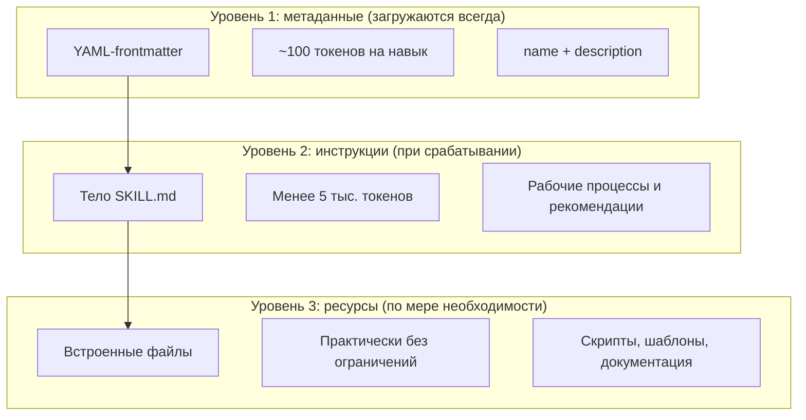
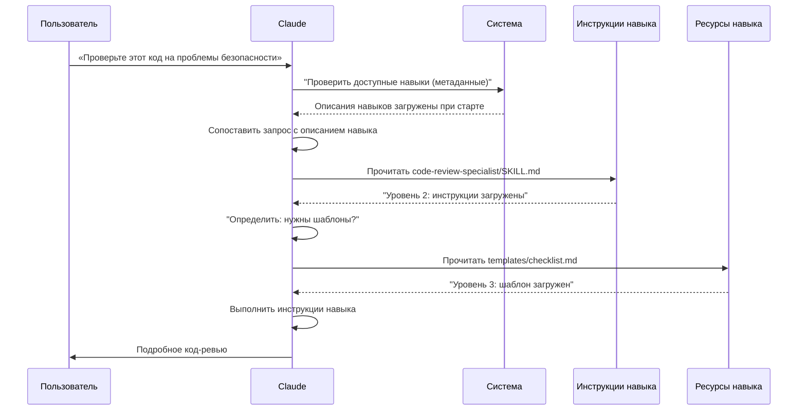

<!-- i18n-source: 03-skills/README.md -->
<!-- i18n-source-sha: ca57ef1 -->
<!-- i18n-date: 2026-10-23 -->

<picture>
  <source media="(prefers-color-scheme: dark)" srcset="../../resources/logos/claude-howto-logo-dark.svg">
  
</picture>

# Руководство по навыкам агентов

Навыки агентов (Agent Skills) — это переиспользуемые возможности на файловой системе, которые расширяют Claude. Они упаковывают предметную экспертизу, рабочие процессы и лучшие практики в обнаруживаемые компоненты, и Claude сам подключает их, когда они уместны.

## Обзор

**Навыки агентов** — модульные возможности, которые превращают агентов общего назначения в специалистов. В отличие от промптов (инструкций уровня разговора для разовой задачи), навыки загружаются по требованию и избавляют от необходимости снова и снова давать одни и те же указания в разных разговорах.

### Ключевые выгоды

- **Специализируйте Claude**: подстраивайте возможности под предметные задачи
- **Меньше повторений**: создайте один раз и используйте автоматически в разных разговорах
- **Собирайте возможности**: сочетайте навыки, чтобы строить сложные рабочие процессы
- **Масштабируйте рабочие процессы**: переиспользуйте навыки в разных проектах и командах
- **Держите качество**: встраивайте лучшие практики прямо в рабочий процесс

Навыки следуют открытому стандарту [Agent Skills](https://agentskills.io), который работает в разных ИИ-инструментах. Claude Code расширяет стандарт: управление вызовом, выполнение субагентом и динамическая подстановка контекста.

> **Примечание**: пользовательские слэш-команды объединены с навыками. Файлы в `.claude/commands/` по-прежнему работают и поддерживают те же поля frontmatter. Для новой разработки рекомендуются навыки. Если по одному пути есть оба варианта (например, `.claude/commands/review.md` и `.claude/skills/review/SKILL.md`), приоритет у навыка.

## Как работают навыки: постепенное раскрытие

Навыки используют архитектуру **постепенного раскрытия** — Claude загружает информацию поэтапно, по мере необходимости, а не занимает контекст заранее. Так контекст расходуется экономно, а масштабируемость остаётся неограниченной.

### Три уровня загрузки



| Уровень | Когда загружается | Стоимость в токенах | Содержимое |
|-------|------------|------------|---------|
| **Уровень 1: метаданные** | Всегда (при запуске) | ~100 токенов на навык | `name` и `description` из YAML-frontmatter |
| **Уровень 2: инструкции** | Когда навык срабатывает | Менее 5 тыс. токенов | Тело SKILL.md с инструкциями и рекомендациями |
| **Уровень 3+: ресурсы** | По мере необходимости | Практически без ограничений | Встроенные файлы выполняются через bash, и их содержимое не загружается в контекст |

Так навыки остаются лёгкими — пока навык не вызван, Claude знает только, что он есть и когда его использовать, — но не бесплатными: каждый навык из списка добавляет своё описание в контекст на каждом шаге.

## Процесс загрузки навыка



## Типы навыков и где они лежат

| Тип | Расположение | Область | Общий доступ | Лучше всего для |
|------|----------|-------|--------|----------|
| **Корпоративный** | Управляемые настройки | Все пользователи организации | Да | Стандарты всей организации |
| **Личный** | `~/.claude/skills/<skill-name>/SKILL.md` | Один человек | Нет | Личные рабочие процессы |
| **Проектный** | `.claude/skills/<skill-name>/SKILL.md` | Команда | Да (через git) | Стандарты команды |
| **Плагин** | `<plugin>/skills/<skill-name>/SKILL.md` | Где включён | Зависит | В составе плагинов |

Если навыки с одним именем есть на разных уровнях, побеждает более приоритетное место: **корпоративный > личный > проектный**. При одном имени в `~/.claude/skills/` и `.claude/skills/` выполняется личный. Чтобы изменить видимость навыка (не его приоритет), используйте настройку `skillOverrides` (v2.1.129+) — см. [Управление поведением переопределения навыков](#управление-поведением-переопределения-навыков-skilloverrides). Навыки плагинов живут в пространстве имён `plugin-name:skill-name`, поэтому с остальными не конфликтуют.

> **Обнаружение навыков субагентом (v2.1.133+)**: субагенты теперь обнаруживают проектные, пользовательские и навыки плагинов через инструмент Skill так же, как основная сессия. В более ранних версиях субагенты видели только собственный встроенный набор, из-за чего связки навыка и субагента незаметно работали хуже; с v2.1.133 один и тот же каталог навыков виден обоим.

### Автоматическое обнаружение

**Вложенные каталоги**: когда вы работаете с файлами в подкаталогах, Claude Code сам находит навыки во вложенных каталогах `.claude/skills/`. Например, если вы правите файл в `packages/frontend/`, Claude Code также ищет навыки в `packages/frontend/.claude/skills/`. Так устроены монорепозитории, где у пакетов свои навыки. Если у вложенного навыка то же имя, что у навыка в корне репозитория, **загружаются оба**: для навыка `deploy` в корне и в `apps/web/.claude/skills/` команда `/deploy` запускает корневой, а `/apps/web:deploy` — вложенный.

**Каталоги `--add-dir`**: навыки из каталогов, добавленных через `--add-dir`, загружаются автоматически, с обнаружением изменений в реальном времени. Любая правка файлов навыков в этих каталогах вступает в силу сразу, без перезапуска Claude Code.

**Перезагрузка навыков**: команда `/reload-skills` (добавлена в v2.1.152) заново сканирует все каталоги навыков без перезапуска сессии — удобно, когда вы добавили или поправили навык, который живое обнаружение не подхватило. Хук `SessionStart` запускает то же повторное сканирование, если вернёт `reloadSkills: true` (см. [Хуки](../06-hooks/README.md)).

**Бюджет описаний**: описания навыков (метаданные уровня 1) ограничены **1% контекстного окна** (запасной предел: **8 000 символов**). Если навыков много, описания могут укорачиваться. Имена всех навыков всегда попадают в список, а описания обрезаются, чтобы уместиться. Ставьте главный сценарий использования в начало описания. Переопределите бюджет переменной окружения `SLASH_COMMAND_TOOL_CHAR_BUDGET`.

## Создание своих навыков

### Базовая структура каталога

```
my-skill/
├── SKILL.md           # Основные инструкции (обязательно)
├── template.md        # Шаблон, который заполняет Claude
├── examples/
│   └── sample.md      # Пример результата в ожидаемом формате
└── scripts/
    └── validate.sh    # Скрипт, который Claude может выполнить
```

### Формат SKILL.md

```yaml
---
name: your-skill-name
description: Кратко, что делает этот навык и когда его использовать
---

# Название вашего навыка

## Инструкции
Дайте Claude ясные пошаговые указания.

## Примеры
Покажите конкретные примеры использования этого навыка.
```

### Рекомендуемые поля

- **description** (рекомендуется): что делает навык И когда его использовать. Если поле опущено, Claude Code берёт первую непустую строку Markdown. Суммарный текст `description` + `when_to_use` обрезается на **1 536 символах** в списке навыков (настраивается через `skillListingMaxDescChars`). Именно по этому тексту Claude решает, когда включить навык.
- **name** (необязательно): по умолчанию берётся **имя каталога** навыка. Если задано, оно становится отображаемым именем — рекомендуемая переносимая форма: только строчные буквы, цифры и дефисы (не больше 64 символов); она обязательна для claude.ai и Skills API. Сам Claude Code (v2.1.299+) пропускает навык или команду, в имени которых есть скрытые символы, символы смены направления или похожие на пробел, `<` или `>`, либо имя длиннее 256 символов, пока вы его не переименуете. В Claude Code имена `anthropic-skills` и `synced` зарезервированы и не загружаются вне плагина; более строгий запрет на «anthropic» и «claude» действует для навыков, загруженных на claude.ai или в Skills API. Для навыков плагина `name` также задаёт последний сегмент команды.

Все поля frontmatter в SKILL.md необязательны; рекомендуется только `description`.

### Необязательные поля frontmatter

```yaml
---
name: my-skill
description: Что делает этот навык и когда его использовать
argument-hint: "[filename] [format]"        # Подсказка для автодополнения
disable-model-invocation: true              # Вызвать может только пользователь
user-invocable: false                       # Скрыть из меню слэш-команд
allowed-tools: Read, Grep, Glob             # Заранее разрешить эти инструменты (без запросов разрешений), пока навык работает
disallowed-tools: Write, Edit               # Убрать указанные инструменты, пока навык активен (v2.1.152)
model: opus                                 # Какую модель использовать
effort: high                                # Переопределение уровня усилий (low, medium, high, xhigh, max)
context: fork                               # Запуск в изолированном субагенте
agent: Explore                              # Какой тип агента (вместе с context: fork)
background: false                           # Навыки с форком идут в фоне (по умолчанию true); false = передний план
shell: bash                                 # Оболочка для команд: bash (по умолчанию) или powershell
hooks:                                      # Хуки, которые регистрируются при вызове навыка
  PreToolUse:
    - matcher: "Bash"
      hooks:
        - type: command
          command: "./scripts/validate.sh"
paths: "src/api/**/*.ts"               # Шаблоны glob, которые ограничивают, когда навык включается
---
```

| Поле | Описание |
|-------|-------------|
| `name` | Рекомендуемая переносимая форма: только строчные буквы, цифры и дефисы (не больше 64 символов). В Claude Code зарезервированы `anthropic-skills` и `synced`. |
| `description` | Что делает навык И когда его использовать. Суммарный текст `description` + `when_to_use` обрезается до 1 536 символов в списке навыков (настраивается через `skillListingMaxDescChars`). Критично для сопоставления при автовызове. |
| `when_to_use` | Дополнительный контекст о том, когда Claude должен вызвать навык. Дописывается к `description` в списке навыков и входит в предел 1 536 символов. |
| `argument-hint` | Подсказка в меню автодополнения `/` (например, `"[filename] [format]"`). |
| `disable-model-invocation` | `true` = вызвать можете только вы через `/name`. Claude никогда не вызовет его сам. |
| `user-invocable` | `false` = скрыт из меню `/`. Вызвать его автоматически может только Claude. |
| `allowed-tools` | Список инструментов через запятую, которые навык может использовать без запросов разрешений. |
| `disallowed-tools` | Список инструментов через запятую, которые убираются, пока навык активен (дополняет `allowed-tools`). Добавлено в v2.1.152. |
| `model` | Переопределение модели, пока навык активен (например, `opus`, `sonnet`). |
| `effort` | Переопределение уровня усилий, пока навык активен: `low`, `medium`, `high`, `xhigh` или `max` — все пять поддерживаются на Fable 5.1, Fable 5, Opus 5.5, Sonnet 5.5, Haiku 5.5, Opus 5, Sonnet 5, Opus 4.8 и Opus 4.7. Усилия по умолчанию — `high` на каждой модели, которая поддерживает effort, кроме Opus 5.5, Sonnet 5.5 и Haiku 5.5, где по умолчанию `medium`, и Opus 4.7, где по умолчанию `xhigh`. |
| `context` | `fork`, чтобы запустить навык в форке субагента с собственным контекстным окном. |
| `agent` | Тип субагента при `context: fork` (например, `Explore`, `Plan`, `general-purpose`). |
| `background` | Имеет смысл только вместе с `context: fork`. Для навыков с `context: fork` по умолчанию `true`, поэтому они идут в фоне; поставьте `false`, чтобы запустить форк на переднем плане. Добавлено в v2.1.218. |
| `shell` | Оболочка для подстановок `` !`command` `` и скриптов: `bash` (по умолчанию) или `powershell`. |
| `hooks` | Хуки, которые регистрируются при вызове навыка (тот же формат, что у хуков в настройках; любое событие). Они остаются активными до конца сессии. |
| `paths` | Шаблоны glob, которые ограничивают автоактивацию навыка. Строка через запятую или список YAML. Тот же формат, что у правил для путей. |
| `arguments` | Объявляет аргументы, которые принимает навык, для автодополнения и подстановки аргументов. Подставляются только первые 64 имени, каждое не длиннее 64 символов (v2.1.301). |
| `metadata` | Произвольная карта ключ/значение для ваших служебных пометок (например, `version`, `author`). Claude Code передаёт её как есть. |
| `license` | Идентификатор лицензии навыка (например, `MIT`). |
| `compatibility` | Произвольная формулировка о совместимости, до 500 символов. Claude Code принимает её, но ничего с ней не делает. |

> **Примечание**: для навыков, загруженных на claude.ai или созданных через Skills API, допустимы только `name`, `description`, `license`, `compatibility`, `metadata` и `allowed-tools`. Остальные поля этой таблицы есть только в Claude Code.

С v2.1.218 логические поля frontmatter, помимо `true`/`false`, принимают `yes`/`no`, `on`/`off` и `1`/`0` (без учёта регистра).

## Типы содержимого навыка

В навыке бывает два типа содержимого, и у каждого своя задача:

### Справочное содержимое

Добавляет знания, которые Claude применяет к текущей работе: соглашения, приёмы, руководства по стилю, предметные знания. Выполняется в том же контексте разговора.

```yaml
---
name: api-conventions
description: Приёмы проектирования API для этой кодовой базы
---

Когда пишете эндпоинты API:
- Используйте соглашения об именовании REST
- Возвращайте ошибки в одном формате
- Включайте проверку запроса
```

### Содержимое задачи

Пошаговые инструкции для конкретного действия. Часто вызывается напрямую через `/skill-name`.

```yaml
---
name: deploy
description: Задеплоить приложение в продакшен
context: fork
disable-model-invocation: true
---

Задеплойте приложение:
1. Запустите набор тестов
2. Соберите приложение
3. Отправьте на цель деплоя
```

## Управление вызовом навыка

По умолчанию вызвать любой навык можете и вы, и Claude. Два поля frontmatter задают три режима вызова:

| Frontmatter | Можете вызвать | Claude может вызвать |
|---|---|---|
| (по умолчанию) | Да | Да |
| `disable-model-invocation: true` | Да | Нет |
| `user-invocable: false` | Нет | Да |

**Ставьте `disable-model-invocation: true`** для рабочих процессов с побочными эффектами: `/commit`, `/deploy`, `/send-slack-message`. Вам не нужно, чтобы Claude сам решил задеплоить проект, потому что код выглядит готовым.

**Ставьте `user-invocable: false`** для фоновых знаний, которые не являются осмысленной командой. Навык `legacy-system-context` объясняет, как устроена старая система: это полезно Claude, но для пользователя это не действие.

## Подстановки строк

Навыки поддерживают динамические значения. Они раскрываются до того, как содержимое навыка попадает к Claude:

| Переменная | Описание |
|----------|-------------|
| `$ARGUMENTS` | Все аргументы, переданные при вызове навыка |
| `$ARGUMENTS[N]` или `$N` | Конкретный аргумент по индексу (с нуля) |
| `${CLAUDE_SESSION_ID}` | Идентификатор текущей сессии |
| `${CLAUDE_SKILL_DIR}` | Каталог с файлом SKILL.md этого навыка |
| `${CLAUDE_PROJECT_DIR}` | Абсолютный путь к корню проекта. Можно использовать в теле навыка и в `allowed-tools` (v2.1.196) |
| `${CLAUDE_EFFORT}` | Текущий уровень усилий (`low`, `medium`, `high`, `xhigh` или `max`). Удобно ветвить поведение навыка: например, `[ "${CLAUDE_EFFORT}" = "max" ] && deep_analysis` (v2.1.120+) |
| `` !`command` `` | Динамическая подстановка контекста — выполняет команду оболочки и вставляет вывод |

**Пример:**

```yaml
---
name: fix-issue
description: Исправить issue на GitHub
---

Исправьте issue GitHub $ARGUMENTS по нашим стандартам кода.
1. Прочитайте описание issue
2. Реализуйте исправление
3. Напишите тесты
4. Создайте коммит
```

Команда `/fix-issue 123` подставляет вместо `$ARGUMENTS` значение `123`.

### Сложение навыков

В одном вызове в терминальном промпте можно сложить несколько слэш-навыков, например `/write-tests /fix-issue 123`. С v2.1.199 загружаются ВСЕ ведущие навыки — первый и ещё до 5 — и каждому передаются аргументы в конце (`123`); раньше загружался только первый навык. Раскрытие останавливается на навыке, который выполняется как субагент в форке, например `/code-review`, а через Agent SDK или `claude -p` загружается только первый навык. Если один и тот же навык вызван больше одного раза, одинаковое содержимое сворачивается в одну копию (v2.1.202), а не дописывается второй раз.

## Подстановка динамического контекста

Синтаксис `` !`command` `` выполняет команды оболочки до того, как содержимое навыка уходит к Claude:

> **Примечание (v2.1.299)**: хуки `UserPromptSubmit` выполняются до раскрытия команды, поэтому хук, который блокирует промпт, также не даёт выполниться этим командам `!`.

```yaml
---
name: pr-summary
description: Кратко пересказать изменения в pull request
context: fork
agent: Explore
---

## Контекст pull request
- Diff PR: !`gh pr diff`
- Комментарии PR: !`gh pr view --comments`
- Изменённые файлы: !`gh pr diff --name-only`

## Ваша задача
Кратко перескажите этот pull request...
```

Команды выполняются сразу; Claude видит только итоговый вывод. По умолчанию команды идут в `bash`. Чтобы использовать PowerShell, задайте во frontmatter `shell: powershell`.

## Запуск навыков в субагентах

Добавьте `context: fork`, чтобы запустить навык в изолированном контексте субагента. Содержимое навыка становится задачей отдельного субагента со своим контекстным окном, и основной разговор не засоряется. С v2.1.218 у навыков с `context: fork` поле `background` по умолчанию равно `true`, поэтому они идут в фоне; поставьте во frontmatter `background: false`, чтобы запустить навык с форком на переднем плане.

> **Исправление v2.1.145**: навык с `context: fork` раньше в редких случаях мог запустить бесконечный цикл повторных вызовов. Обновитесь до v2.1.145+, если вы пишете навыки с форком или на них опираетесь.

Поле `agent` задаёт тип агента:

| Тип агента | Лучше всего для |
|---|---|
| `Explore` | Исследование только на чтение, анализ кодовой базы |
| `Plan` | Составление планов реализации |
| `general-purpose` | Широкие задачи, которым нужны все инструменты |
| Пользовательские агенты | Специализированные агенты из вашей конфигурации |

**Пример frontmatter:**

```yaml
---
context: fork
agent: Explore
---
```

**Полный пример навыка:**

```yaml
---
name: topic-research
description: Тщательно исследовать тему
context: fork
agent: Explore
---

Тщательно исследуйте $ARGUMENTS:
1. Найдите нужные файлы через Glob и Grep
2. Прочитайте и разберите код
3. Суммируйте находки со ссылками на конкретные файлы
```

## Практические примеры

### Пример 1: навык код-ревью

**Структура каталога:**

```
~/.claude/skills/code-review-specialist/
├── SKILL.md
├── templates/
│   ├── review-checklist.md
│   └── finding-template.md
└── scripts/
    ├── analyze-metrics.py
    └── compare-complexity.py
```

**Файл:** `~/.claude/skills/code-review-specialist/SKILL.md`

```yaml
---
name: code-review-specialist
description: Подробное код-ревью с анализом безопасности, производительности и качества. Используйте, когда просят проверить код, оценить качество, разобрать pull request или упоминают код-ревью, анализ безопасности или оптимизацию производительности.
---

# Навык код-ревью

Этот навык даёт подробное код-ревью с упором на:

1. **Анализ безопасности**
   - Проблемы аутентификации и авторизации
   - Риски раскрытия данных
   - Уязвимости инъекций
   - Криптографические слабости

2. **Ревью производительности**
   - Эффективность алгоритмов (анализ Big O)
   - Оптимизация памяти
   - Оптимизация запросов к базе данных
   - Возможности кэширования

3. **Качество кода**
   - Принципы SOLID
   - Паттерны проектирования
   - Соглашения об именовании
   - Покрытие тестами

4. **Сопровождаемость**
   - Читаемость кода
   - Размер функции (короче 50 строк)
   - Цикломатическая сложность
   - Типобезопасность

## Шаблон ревью

Для каждого разобранного фрагмента кода укажите:

### Сводка
- Общая оценка качества (1–5)
- Число ключевых замечаний
- Приоритетные области

### Критичные проблемы (если есть)
- **Проблема**: ясное описание
- **Место**: файл и номер строки
- **Влияние**: почему это важно
- **Серьёзность**: критическая/высокая/средняя
- **Исправление**: пример кода

Подробные чек-листы см. в [templates/review-checklist.md](templates/review-checklist.md).
```

### Пример 2: навык визуализации кодовой базы

Навык, который строит интерактивные HTML-визуализации:

**Структура каталога:**

```
~/.claude/skills/codebase-visualizer/
├── SKILL.md
└── scripts/
    └── visualize.py
```

**Файл:** `~/.claude/skills/codebase-visualizer/SKILL.md`

````yaml
---
name: codebase-visualizer
description: Строит интерактивное сворачиваемое дерево вашей кодовой базы. Используйте, когда изучаете новый репозиторий, разбираете структуру проекта или ищете крупные файлы.
allowed-tools: Bash(python *)
---

# Визуализатор кодовой базы

Постройте интерактивное HTML-дерево со структурой файлов проекта.

## Использование

Запустите скрипт визуализации из корня проекта:

```bash
python ~/.claude/skills/codebase-visualizer/scripts/visualize.py .
```

Он создаёт `codebase-map.html` и открывает его в браузере по умолчанию.

## Что показывает визуализация

- **Сворачиваемые каталоги**: щёлкните папку, чтобы развернуть или свернуть
- **Размеры файлов**: показаны рядом с каждым файлом
- **Цвета**: разные цвета для разных типов файлов
- **Итоги по каталогам**: суммарный размер каждой папки
````

Встроенный скрипт Python делает основную работу, а Claude занимается оркестрацией.

### Пример 3: навык деплоя (только по вызову пользователя)

```yaml
---
name: deploy
description: Задеплоить приложение в продакшен
disable-model-invocation: true
allowed-tools: Bash(npm *), Bash(git *)
---

Задеплойте $ARGUMENTS в продакшен:

1. Запустите набор тестов: `npm test`
2. Соберите приложение: `npm run build`
3. Отправьте на цель деплоя
4. Проверьте, что деплой прошёл
5. Сообщите статус деплоя
```

### Пример 4: навык голоса бренда (фоновые знания)

```yaml
---
name: brand-voice
description: Следит, чтобы вся коммуникация совпадала с голосом бренда и рекомендациями по тону. Используйте при создании маркетинговых текстов, общении с клиентами или публичных материалах.
user-invocable: false
---

## Тон голоса
- **Дружелюбно, но профессионально** — легко общаться, без панибратства
- **Ясно и кратко** — без жаргона
- **Уверенно** — мы знаем, что делаем
- **С эмпатией** — понимаем потребности пользователя

## Рекомендации по письму
- Обращайтесь к читателю на «вы»
- Используйте действительный залог
- Держите предложения короче 20 слов
- Начинайте с ценностного предложения

Шаблоны см. в [templates/](templates/).
```

### Пример 5: навык генератора CLAUDE.md

```yaml
---
name: claude-md
description: Создаёт или обновляет файлы CLAUDE.md по лучшим практикам для оптимального онбординга ИИ-агента. Используйте, когда пользователь упоминает CLAUDE.md, документацию проекта или онбординг ИИ.
---

## Основные принципы

**LLM не хранят состояние**: CLAUDE.md — главный файл проекта, который загружается в каждый разговор (рядом с автопамятью и правилами без области).

### Золотые правила

1. **Меньше — значит лучше**: держите каждый CLAUDE.md короче 200 строк
2. **Применимость ко всем сессиям**: включайте только то, что нужно в КАЖДОЙ сессии
3. **Не используйте Claude как линтер**: используйте детерминированные инструменты
4. **Никогда не генерируйте автоматически**: составляйте файл вручную и обдуманно

## Обязательные разделы

- **Название проекта**: краткое описание в одну строку
- **Стек**: основной язык, фреймворки, база данных
- **Команды разработки**: команды установки, тестов и сборки
- **Критичные соглашения**: только неочевидные соглашения с большим влиянием
- **Известные проблемы / подводные камни**: то, обо что спотыкаются разработчики
```

### Пример 6: навык рефакторинга со скриптами

**Структура каталога:**

```
refactor/
├── SKILL.md
├── references/
│   ├── code-smells.md
│   └── refactoring-catalog.md
├── templates/
│   └── refactoring-plan.md
└── scripts/
    ├── analyze-complexity.py
    └── detect-smells.py
```

**Файл:** `refactor/SKILL.md`

```yaml
---
name: refactor
description: Систематический рефакторинг кода по методологии Мартина Фаулера. Используйте, когда просят отрефакторить код, улучшить структуру, снизить технический долг или убрать запахи кода.
---

# Навык рефакторинга кода

Поэтапный подход: безопасные пошаговые изменения, опирающиеся на тесты.

## Рабочий процесс

Фаза 1: исследование и анализ → Фаза 2: оценка покрытия тестами →
Фаза 3: поиск запахов кода → Фаза 4: план рефакторинга →
Фаза 5: пошаговая реализация → Фаза 6: ревью и итерации

## Основные принципы

1. **Сохранение поведения**: внешнее поведение должно остаться прежним
2. **Маленькие шаги**: делайте крошечные изменения, которые можно проверить тестом
3. **Опора на тесты**: тесты — это страховка
4. **Непрерывность**: рефакторинг идёт постоянно, а не один раз

Каталог запахов кода см. в [references/code-smells.md](references/code-smells.md).
Приёмы рефакторинга см. в [references/refactoring-catalog.md](references/refactoring-catalog.md).
```

## Вспомогательные файлы

Помимо `SKILL.md`, в каталоге навыка может быть несколько файлов. Эти вспомогательные файлы (шаблоны, примеры, скрипты, справочные документы) оставляют главный файл навыка собранным и дают Claude дополнительные ресурсы, которые он загружает по мере необходимости.

```
my-skill/
├── SKILL.md              # Основные инструкции (обязательно, держите короче 500 строк)
├── templates/            # Шаблоны, которые заполняет Claude
│   └── output-format.md
├── examples/             # Примеры результата в ожидаемом формате
│   └── sample-output.md
├── references/           # Предметные знания и спецификации
│   └── api-spec.md
└── scripts/              # Скрипты, которые Claude может выполнить
    └── validate.sh
```

Рекомендации по вспомогательным файлам:

- Держите `SKILL.md` короче **500 строк**. Подробные справочные материалы, крупные примеры и спецификации выносите в отдельные файлы.
- Ссылайтесь на дополнительные файлы из `SKILL.md` **относительными путями** (например, `[Справочник API](references/api-spec.md)`).
- Вспомогательные файлы загружаются на уровне 3 (по мере необходимости), поэтому не занимают контекст, пока Claude их действительно не прочитает.

## Управление навыками

### Просмотр доступных навыков

Спросите Claude напрямую:
```
Какие навыки доступны?
```

Или посмотрите файловую систему:
```bash
# Личные навыки
ls ~/.claude/skills/

# Проектные навыки
ls .claude/skills/
```

> **Совет (v2.1.121+):** печатайте текст, чтобы отфильтровать интерактивное меню `/skills` — удобно, когда навыков много.

### Проверка навыка

Два способа проверить:

**Дайте Claude вызвать его самому**, спросив то, что совпадает с описанием:
```
Поможете проверить этот код на проблемы безопасности?
```

**Или вызовите напрямую** по имени навыка:
```
/code-review-specialist src/auth/login.ts
```

> **Примечание**: этот локальный навык установлен как `code-review-specialist`, поэтому он **не** сталкивается со встроенным навыком `/code-review` (ревью с упором на ошибки, псевдоним `/review`). Если скопировать его в `~/.claude/skills/code-review/`, он заменит встроенный `/code-review` (хотя `/review` по-прежнему запускает встроенный) — оставьте суффикс `-specialist`, чтобы этого избежать.

### Обновление навыка

Правьте файл `SKILL.md` напрямую, затем выполните `/reload-skills` (v2.1.152+), чтобы заново просканировать каталоги навыков. Перезапуск Claude Code тоже работает, но не обязателен — навыки в каталогах `--add-dir` подхватываются на лету, а хук `SessionStart`, который возвращает `reloadSkills: true`, запускает то же повторное сканирование.

```bash
# Личный навык
code ~/.claude/skills/my-skill/SKILL.md

# Проектный навык
code .claude/skills/my-skill/SKILL.md
```

### Ограничение доступа Claude к навыкам

Три способа управлять тем, какие навыки Claude может вызывать:

**Отключите все навыки** в `/permissions`:
```
# Добавьте в правила запрета:
Skill
```

**Разрешите или запретите отдельные навыки**:
```
# Разрешить только указанные навыки
Skill(commit)
Skill(review-pr *)

# Запретить указанные навыки
Skill(deploy *)
```

**Скройте отдельные навыки**, добавив во frontmatter `disable-model-invocation: true`.

### Управление поведением переопределения навыков (`skillOverrides`)

`skillOverrides` (v2.1.129+) — это карта видимости по каждому навыку, а не переключатель приоритета: из настроек задаётся, как показывать навык, без правки его SKILL.md. Каждый ключ — имя навыка; меню `/skills` записывает его за вас (сохраняется в `.claude/settings.local.json`). Приоритет не меняется — личный навык по-прежнему побеждает проектный с тем же именем. Добавьте это в `~/.claude/settings.json` или в проектный `.claude/settings.json`:

```json
{
  "skillOverrides": {
    "deploy": "off",
    "legacy-helper": "name-only"
  }
}
```

Допустимые значения:

| Значение | Поведение |
|-------|----------|
| `"on"` (по умолчанию) | Claude видит имя и описание; навык показан в меню `/`. |
| `"name-only"` | Claude видит только имя; навык показан в меню `/`. |
| `"user-invocable-only"` | Скрыт от Claude; в меню `/` по-прежнему показан. |
| `"off"` | Скрыт и от Claude, и из меню `/`. |

На навыки плагинов `skillOverrides` не действует; управляйте ими через `/plugin`.

## Лучшие практики

### 1. Делайте описания конкретными

- **Плохо (размыто)**: «Помогает с документами»
- **Хорошо (конкретно)**: «Извлекает текст и таблицы из PDF, заполняет формы, объединяет документы. Используйте при работе с PDF или когда пользователь упоминает PDF, формы или извлечение из документов.»

### 2. Держите навык узким

- Один навык = одна возможность
- ✅ «Заполнение PDF-форм»
- ❌ «Обработка документов» (слишком широко)

### 3. Добавляйте слова-триггеры

Добавьте в описание ключевые слова, которые совпадают с просьбами пользователя:
```yaml
description: Анализирует таблицы Excel, строит сводные таблицы, создаёт диаграммы. Используйте при работе с файлами Excel, таблицами или файлами .xlsx.
```

### 4. Держите SKILL.md короче 500 строк

Подробные справочные материалы выносите в отдельные файлы, которые Claude загружает по мере необходимости.

### 5. Ссылайтесь на вспомогательные файлы

```markdown
## Дополнительные материалы

- Полные сведения об API см. в [reference.md](reference.md)
- Примеры использования см. в [examples.md](examples.md)
```

### Что делать

- Используйте ясные говорящие имена
- Включайте подробные инструкции
- Добавляйте конкретные примеры
- Упаковывайте связанные скрипты и шаблоны
- Проверяйте на реальных сценариях
- Документируйте зависимости

### Чего не делать

- Не создавайте навыки для разовых задач
- Не дублируйте то, что уже есть
- Не делайте навыки слишком широкими
- Не пропускайте поле description
- Не ставьте навыки из ненадёжных источников без проверки

## Устранение неполадок

### Краткий справочник

| Проблема | Решение |
|-------|----------|
| Claude не использует навык | Сделайте описание конкретнее и добавьте слова-триггеры |
| Файл навыка не найден | Проверьте путь: `~/.claude/skills/name/SKILL.md` |
| Ошибки YAML | Проверьте маркеры `---`, отступы и отсутствие табуляции |
| Навыки конфликтуют | Используйте в описаниях разные слова-триггеры |
| Скрипты не запускаются | Проверьте разрешения: `chmod +x scripts/*.py` |
| Claude видит не все навыки | Навыков слишком много; проверьте предупреждения в `/context`, затем выполните `/skill-doctor` (v2.1.252+), чтобы увидеть, какие навыки не используются и сколько стоят |

### Навык не срабатывает

Если Claude не использует навык, когда вы этого ждёте:

1. Проверьте, что в описании есть слова, которые пользователь скажет сам
2. Убедитесь, что навык появляется в ответе на «Какие навыки доступны?»
3. Переформулируйте просьбу так, чтобы она совпала с описанием
4. Вызовите напрямую через `/skill-name`, чтобы проверить

### Навык срабатывает слишком часто

Если Claude использует навык, когда вам это не нужно:

1. Сделайте описание конкретнее
2. Добавьте `disable-model-invocation: true`, чтобы вызов был только ручным

### Claude видит не все навыки

Описания навыков загружаются в пределах **1% контекстного окна** (запасной предел: **8 000 символов**). У каждой записи `description` + `when_to_use` по умолчанию обрезается до 1 536 символов (`skillListingMaxDescChars`). Выполните `/context`, чтобы проверить предупреждения об исключённых навыках. Переопределите бюджет переменной окружения `SLASH_COMMAND_TOOL_CHAR_BUDGET`.

## Соображения безопасности

**Используйте навыки только из доверенных источников.** Навык даёт Claude возможности через инструкции и код — вредоносный навык может направить Claude вызывать инструменты или выполнять код вредоносным образом.

**Главное по безопасности:**

- **Проверяйте тщательно**: просмотрите все файлы в каталоге навыка
- **Внешние источники рискованны**: навыки, которые ходят по внешним URL, можно скомпрометировать
- **Злоупотребление инструментами**: вредоносные навыки могут вызывать инструменты вредоносным образом
- **Относитесь как к установке программы**: используйте навыки только из доверенных источников

### Отключение подстановки оболочки в навыках

Навыки поддерживают синтаксис `` !`command` ``, чтобы подставить вывод команд оболочки в промпт до того, как его увидит Claude. В средах с повышенными требованиями к безопасности (общие корпоративные деплои, жёстко ограниченные CI-раннеры) эту подстановку можно отключить целиком настройкой `disableSkillShellExecution` (добавлена в **v2.1.91**):

```jsonc
// ~/.claude/settings.json или управляемая политика
{
  "disableSkillShellExecution": true
}
```

Когда `disableSkillShellExecution` равен `true`, каждый маркер `` !`command` `` в навыке заменяется на `[shell command execution disabled by policy]`, а не выполняется — поверхность атаки через подстановку оболочки на уровне навыка уходит, а сами навыки остаются. Имеет смысл сочетать это со списком разрешений `allowedTools` для эшелонированной защиты.

### Скрытие встроенных навыков (`disableBundledSkills`)

Настройка `disableBundledSkills` (добавлена в **v2.1.169**) скрывает от модели встроенные навыки, Workflows и команды, которые поставляются с Claude Code. Используйте её, когда встроенные навыки шумят в конкретном проекте или когда нужно сузить поверхность навыков модели:

```jsonc
// ~/.claude/settings.json или проектный .claude/settings.json
{
  "disableBundledSkills": true
}
```

Тот же смысл у переменной окружения:

```bash
export CLAUDE_CODE_DISABLE_BUNDLED_SKILLS=1
```

## Навыки и другие функции

| Функция | Вызов | Лучше всего для |
|---------|------------|----------|
| **Навыки** | Автоматически или `/name` | Повторно используемая экспертиза, рабочие процессы |
| **Слэш-команды** | По вашей инициативе, `/name` | Быстрые ярлыки (объединены с навыками) |
| **Субагенты** | Автоделегирование | Изолированное выполнение задач |
| **Память (CLAUDE.md)** | Загружается всегда | Постоянный контекст проекта |
| **MCP** | В реальном времени | Доступ к внешним данным и сервисам |
| **Хуки** | По событиям | Автоматические побочные эффекты |

## Встроенные навыки

С Claude Code поставляется набор встроенных навыков. Они доступны всегда, без установки (ниже самые полезные; полный набор см. в [справочнике команд](https://code.claude.com/docs/en/commands)):

| Навык | Описание |
|-------|-------------|
| `/batch <instruction>` | Оркестрирует крупные параллельные изменения по всей кодовой базе через git worktree |
| `/claude-api` | Загружает справочник Claude API/SDK; включается сам при импортах `anthropic`/`@anthropic-ai/sdk` |
| `/dataviz` | Рекомендации по графикам и дашбордам с запускаемым валидатором цветовой палитры (v2.1.198) |
| `/debug [description]` | Разбирает текущую сессию по журналу отладки |
| `/deep-research <question>` | Встроенный **Workflow**, а не навык: запускает веер веб-поиска и собирает отчёт со ссылками на источники (только явный вызов с v2.1.218 — Claude не запускает его сам) |
| `/fewer-permission-prompts` | Просматривает транскрипты и предлагает приоритетный список разрешений для частых инструментов только для чтения |
| `/loop [interval] [prompt]` | Повторно запускает промпт с интервалом (например, `/loop 5m check the deploy`) |
| `/run` *(v2.1.145+)* | Запускает приложение этого проекта, чтобы увидеть изменение в работе — ищет проектный навык, иначе переходит к встроенным шаблонам по типу проекта |
| `/run-skill-generator` *(v2.1.145+)* | Учит `/run` и `/verify` работать с конкретным проектом: генерирует навык под этот проект |
| `/code-review [effort]` | Проверяет текущий diff на ошибки корректности при выбранном уровне усилий (например, `/code-review high`); передайте `--comment`, чтобы опубликовать замечания как встроенные комментарии PR. Отдельный навык от `/simplify` (чистки качества и повторного использования), который снова выделили в v2.1.154. Claude также может запустить его сам, везде с v2.1.246. С v2.1.218 он работает как фоновый субагент, поэтому работа ревью больше не заполняет ваш разговор, а сложенные слэш-команды остаются целью ревью. |
| `/simplify` | Ревью только на очистку — повторное использование, упрощение, эффективность, уровень абстракции — и применяет исправления. Снова выделен из `/code-review` в v2.1.154 |
| `/verify` *(v2.1.145+)* | Собирает, запускает и наблюдает приложение, чтобы подтвердить, что исправление работает (а не только что тесты проходят) (только явный вызов с v2.1.215 — Claude не запускает его сам) |

Для автоматических ревью pull request на GitHub организации с планами Team и Enterprise могут включить [управляемое код-ревью](https://code.claude.com/docs/en/code-review).

> **Примечание**: если среди проектных или пользовательских навыков есть навык с именем `verify`, Claude запускает его прямо перед коммитом, кроме коммитов только с документацией и только с тестами (v2.1.286).

Эти навыки доступны сразу из коробки, их не нужно устанавливать или настраивать. Формат SKILL.md у них тот же, что у своих навыков.

## Как делиться навыками

### Проектные навыки (общий доступ команды)

1. Создайте навык в `.claude/skills/`
2. Сделайте коммит в git
3. Участники команды подтягивают изменения — навыки доступны сразу

### Личные навыки

```bash
# Скопировать в личный каталог
cp -r my-skill ~/.claude/skills/

# Сделать скрипты исполняемыми
chmod +x ~/.claude/skills/my-skill/scripts/*.py
```

### Распространение через плагин

Упакуйте навыки в каталог `skills/` плагина, чтобы распространять их шире.

## Дальше: подборка навыков и менеджер навыков

Когда вы начинаете всерьёз собирать навыки, становятся необходимы две вещи: библиотека проверенных навыков и инструмент, чтобы ими управлять.

**[luongnv89/skills](https://github.com/luongnv89/skills)** — подборка навыков, которыми я пользуюсь каждый день почти во всех своих проектах. Среди заметных: `logo-designer` (генерирует логотипы проекта на лету) и `ollama-optimizer` (подстраивает производительность локальной LLM под ваше железо). Хорошая отправная точка, если нужны готовые навыки.

**[luongnv89/asm](https://github.com/luongnv89/asm)** — Agent Skill Manager. Ведёт разработку навыков, поиск дубликатов и тестирование. Команда `asm link` позволяет проверить навык в любом проекте, не копируя файлы, — это необходимо, когда навыков становится больше горстки.

## Дополнительные материалы

- [Официальная документация по навыкам](https://code.claude.com/docs/en/skills)
- [Блог об архитектуре Agent Skills](https://claude.com/blog/equipping-agents-for-the-real-world-with-agent-skills)
- [Репозиторий навыков](https://github.com/luongnv89/skills) — подборка готовых навыков
- [Руководство по слэш-командам](../01-slash-commands) — ярлыки, которые запускаете вы
- [Руководство по субагентам](../04-subagents) — делегированные ИИ-агенты
- [Руководство по памяти](../02-memory) — постоянный контекст
- [MCP (Model Context Protocol)](../05-mcp) — внешние данные в реальном времени
- [Руководство по хукам](../06-hooks) — автоматизация по событиям

---

**Последнее обновление**: 18 октября 2026
**Версия Claude Code**: 2.1.302
**Источники**:
- https://code.claude.com/docs/en/skills
- https://code.claude.com/docs/en/slash-commands
- https://github.com/anthropics/claude-code/blob/main/CHANGELOG.md
- https://code.claude.com/docs/en/model-config
- https://code.claude.com/docs/en/model-config#adjust-effort-level
- https://code.claude.com/docs/en/settings-reference
- https://github.com/anthropics/claude-code/releases/tag/v2.1.286
- https://code.claude.com/docs/en/hooks#hooks-in-skills-and-agents
- https://code.claude.com/docs/en/skills#characters-a-skill-name-cant-hold
- https://code.claude.com/docs/en/hooks#hook-lifecycle
- https://code.claude.com/docs/en/changelog#2-1-299
- https://code.claude.com/docs/en/skills#pre-approve-tools-for-a-skill
- https://code.claude.com/docs/en/commands
- https://code.claude.com/docs/en/memory#write-effective-instructions
- https://code.claude.com/docs/en/memory
- https://code.claude.com/docs/en/changelog#2-1-301
- https://code.claude.com/docs/en/code-review
**Совместимые модели**: Claude Fable 5, Claude Opus 5, Claude Sonnet 5, Claude Sonnet 4.6, Claude Opus 4.8, Claude Haiku 4.5
