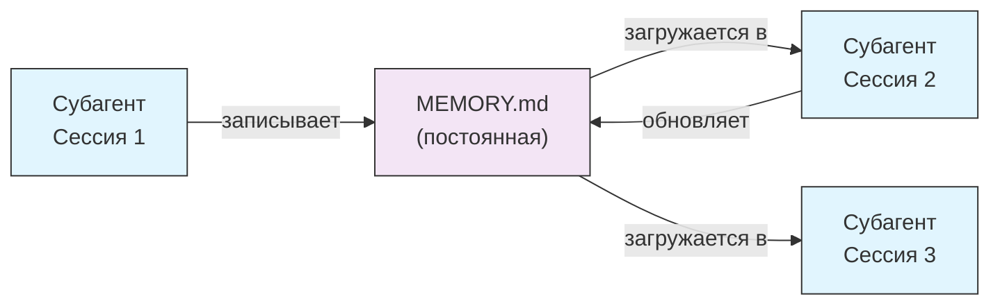
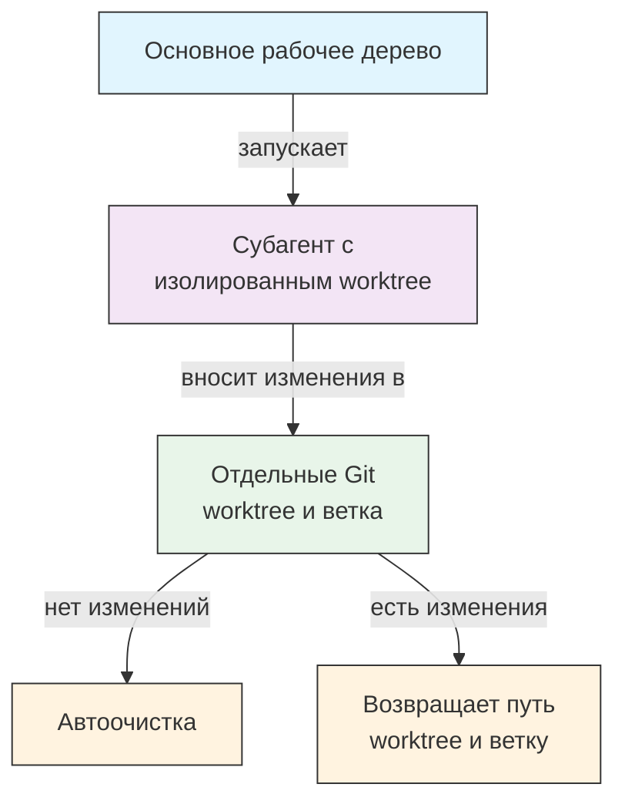
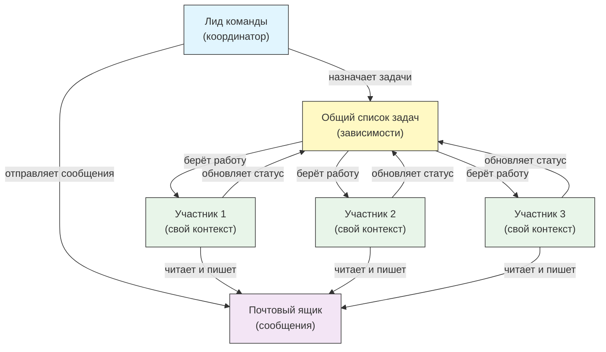
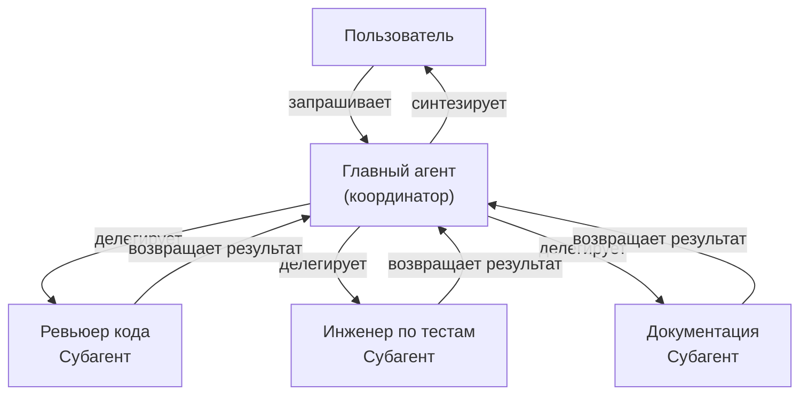
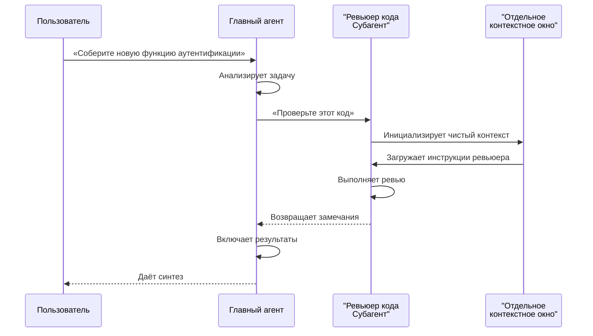
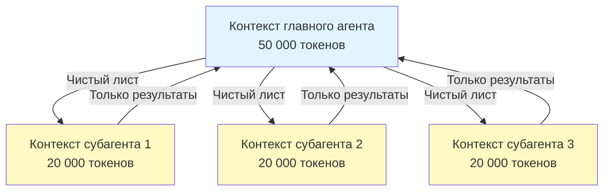
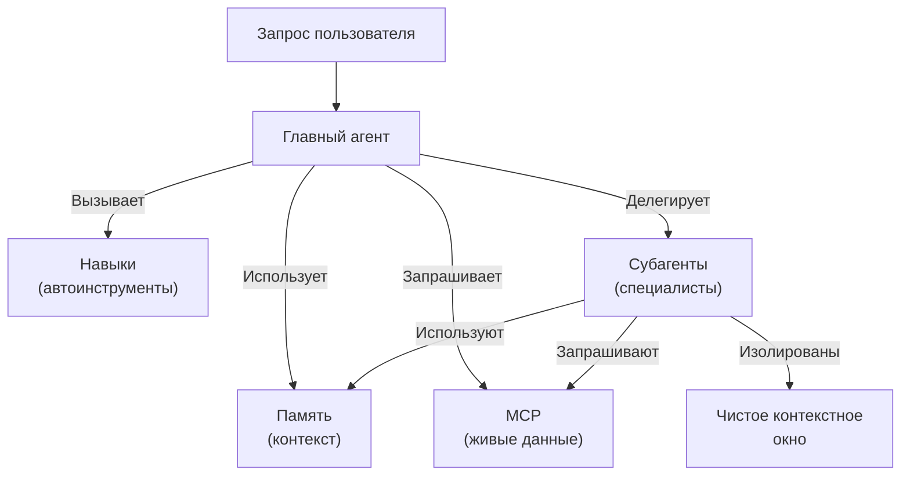

<!-- i18n-source: 04-subagents/README.md -->
<!-- i18n-source-sha: 232591b -->
<!-- i18n-date: 2026-10-23 -->

<picture>
  <source media="(prefers-color-scheme: dark)" srcset="../../resources/logos/claude-howto-logo-dark.svg">
  
</picture>

# Субагенты — полное справочное руководство

Субагенты — это специализированные ИИ-ассистенты, которым Claude Code может делегировать задачи. У каждого субагента своё назначение, собственное контекстное окно, отдельное от основного разговора, и его можно настроить на конкретные инструменты и свой системный промпт.

## Содержание

1. [Обзор](#обзор)
2. [Ключевые преимущества](#ключевые-преимущества)
3. [Расположение файлов](#расположение-файлов)
4. [Конфигурация](#конфигурация)
5. [Встроенные субагенты](#встроенные-субагенты)
6. [Управление субагентами](#управление-субагентами)
7. [Использование субагентов](#использование-субагентов)
8. [Возобновляемые агенты](#возобновляемые-агенты)
9. [Цепочки субагентов](#цепочки-субагентов)
10. [Постоянная память для субагентов](#постоянная-память-для-субагентов)
11. [Фоновые субагенты](#фоновые-субагенты)
12. [Изоляция через worktree](#изоляция-через-worktree)
13. [Форкнутые субагенты](#форкнутые-субагенты)
14. [Ограничение запускаемых субагентов](#ограничение-запускаемых-субагентов)
15. [Команда CLI `claude agents`](#команда-cli-claude-agents)
16. [Agent Teams (экспериментально)](#agent-teams-экспериментально)
17. [Безопасность субагентов плагинов](#безопасность-субагентов-плагинов)
18. [Архитектура](#архитектура)
19. [Управление контекстом](#управление-контекстом)
20. [Когда использовать субагентов](#когда-использовать-субагентов)
21. [Лучшие практики](#лучшие-практики)
22. [Примеры субагентов в этой папке](#примеры-субагентов-в-этой-папке)
23. [Инструкции по установке](#инструкции-по-установке)
24. [Структура файлов](#структура-файлов)
25. [Связанные понятия](#связанные-понятия)
26. [Наблюдаемость](#наблюдаемость)
27. [Дополнительные ресурсы](#дополнительные-ресурсы)

---

## Обзор

Субагенты дают делегированное выполнение задач в Claude Code за счёт того, что:

- Создают **изолированных ИИ-ассистентов** с отдельными контекстными окнами
- Дают **настроенные системные промпты** для узкой экспертизы
- Вводят **контроль доступа к инструментам**, чтобы ограничить возможности
- Не дают **загрязнять контекст** сложными задачами
- Позволяют **параллельно выполнять** несколько специализированных задач

Каждый субагент работает независимо, с чистого листа, получает только тот контекст, который нужен для его задачи, и возвращает результат главному агенту для синтеза.

**Быстрый старт**: попросите Claude создать субагента («создайте субагента, который проверяет безопасность») или добавьте файл `.claude/agents/<name>.md` напрямую — см. [Управление субагентами](#управление-субагентами) ниже.

> **Примечание**: с v2.1.198 команда `/agents` больше не открывает интерактивный мастер создания. Создавайте субагентов и управляйте ими, прося Claude или правя файлы в `.claude/agents/` напрямую.

---

## Ключевые преимущества

| Преимущество | Описание |
|---------|-------------|
| **Сохранение контекста** | Работает в отдельном контексте и не загрязняет основной разговор |
| **Узкая экспертиза** | Настроен на конкретные области и даёт более высокий процент успеха |
| **Повторное использование** | Можно применять в разных проектах и делиться с командами |
| **Гибкие разрешения** | Разный уровень доступа к инструментам для разных типов субагентов |
| **Масштабируемость** | Несколько агентов одновременно работают над разными аспектами |

---

## Расположение файлов

Файлы субагентов можно хранить в нескольких местах с разной областью действия:

| Приоритет | Тип | Расположение | Область |
|----------|------|----------|-------|
| 1 (наивысший) | **Управляемые** | Управляемые настройки | На всю организацию |
| 2 | **Заданные через CLI** | Через флаг `--agents` (JSON) | Только сессия |
| 3 | **Субагенты проекта** | `.claude/agents/` | Текущий проект |
| 4 | **Субагенты пользователя** | `~/.claude/agents/` | Все проекты |
| 5 (наименьший) | **Агенты плагинов** | Каталог `agents/` плагина | Через плагины |

Если имена совпадают, побеждает источник с более высоким приоритетом.

> **Приоритет вложенных `.claude/` (v2.1.178)**: когда одно и то же имя агента определено в нескольких вложенных каталогах `.claude/agents/` (например, монорепозиторий с каталогами `.claude/` на уровне пакетов), побеждает определение, **ближайшее к текущему рабочему каталогу**. То же правило «побеждает ближайший» применяется к вложенным определениям рабочих процессов и стилей вывода (output style).

---

## Конфигурация

### Формат файла

Субагенты задаются в YAML-frontmatter, за которым в Markdown идёт системный промпт:

```yaml
---
name: your-sub-agent-name
description: Описание того, когда следует вызывать этого субагента
tools: tool1, tool2, tool3  # Необязательно — наследует все инструменты, если поле опущено
disallowedTools: tool4  # Необязательно — явно запрещённые инструменты
model: sonnet  # Необязательно — sonnet, opus, haiku или inherit
permissionMode: default  # Необязательно — режим разрешений
maxTurns: 20  # Необязательно — лимит агентных ходов
skills: skill1, skill2  # Необязательно — навыки для предзагрузки в контекст
mcpServers: server1  # Необязательно — MCP-серверы, которые нужно сделать доступными
memory: user  # Необязательно — область постоянной памяти (user, project, local)
background: false  # Необязательно — запуск как фоновая задача
effort: high  # Необязательно — усилие рассуждения (low, medium, high, xhigh, max)
isolation: worktree  # Необязательно — изоляция через git worktree
initialPrompt: "Сначала проанализируйте кодовую базу"  # Необязательно — автоматически отправляемый первый ход
experimental:  # Необязательно — блок экспериментальных настроек
  cacheTtl: "1h"  # TTL кэша для этого субагента: "5m" или "1h" (v2.1.248+)
hooks:  # Необязательно — хуки с областью компонента
  PreToolUse:
    - matcher: "Bash"
      hooks:
        - type: command
          command: "./scripts/security-check.sh"
---

Здесь находится системный промпт субагента. Это может быть несколько абзацев,
и в нём нужно ясно определить роль субагента, его возможности и подход
к решению задач.
```

### Поля конфигурации

| Поле | Обязательно | Описание |
|-------|----------|-------------|
| `name` | Да | Уникальный идентификатор (строчные буквы и дефисы). Поиск нормализуется (без учёта регистра и разделителей — см. ниже), но имя, содержащее `:`, с v2.1.218 **отклоняется**: `:` зарезервирован для пространства имён плагинов |
| `description` | Да | Описание назначения на естественном языке. Добавьте «use PROACTIVELY», чтобы поощрить автоматический вызов |
| `tools` | Нет | Список конкретных инструментов через запятую. Опустите поле, чтобы наследовать все инструменты. Поддерживает синтаксис `Agent(agent_name)`, чтобы ограничить субагентов, которых можно запускать, когда агент работает как главный поток с `claude --agent`; внутри субагента список типов игнорируется. MCP: `mcp__<server>__*` открывает целый сервер (v2.1.299+: совпадает только с этим точным именем сервера). |
| `disallowedTools` | Нет | Список инструментов через запятую, которые субагент не должен использовать |
| `model` | Нет | Модель: `sonnet`, `opus`, `haiku`, полный идентификатор модели или `inherit`. По умолчанию — настроенная модель субагента |
| `permissionMode` | Нет | `default` (ручной режим; `manual` принимается как псевдоним с v2.1.200), `acceptEdits`, `dontAsk`, `bypassPermissions`, `plan`, `auto`. С v2.1.212 параметр вызова `mode` у инструмента Task устарел и игнорируется — субагенты по умолчанию наследуют режим разрешений родительской сессии, если он не переопределён здесь. Когда родитель работает в `bypassPermissions`, `acceptEdits` или `auto`, `permissionMode` субагента игнорируется |
| `maxTurns` | Нет | Максимальное число агентных ходов, которые может сделать субагент |
| `skills` | Нет | Список навыков через запятую для предзагрузки. При старте вставляет полное содержимое навыков в контекст субагента. **v2.1.133+:** субагенты также обнаруживают навыки проекта, пользователя и плагинов через инструмент Skill — тот же каталог, что и у основной сессии, и больше не ограничены собственным встроенным набором. Предзагружается не больше 32 навыков, каждый один раз; субагент с инструментом Skill по-прежнему может вызывать остальные (v2.1.295). |
| `mcpServers` | Нет | MCP-серверы, которые нужно сделать доступными субагенту |
| `hooks` | Нет | Хуки, которые выполняются только пока этот субагент активен. Поддерживаются все события хуков; чаще всего используются `PreToolUse`, `PostToolUse`, `Stop` (выполняется как `SubagentStop`) |
| `memory` | Нет | Область каталога постоянной памяти: `user`, `project` или `local` |
| `background` | Нет | Субагенты и так работают в фоне по умолчанию (v2.1.198). С v2.1.302 десктопное приложение и VS Code тоже всегда запускают субагентов основного разговора в фоне; собственные вызовы Agent субагента в `claude -p`, Agent SDK, десктопном приложении и VS Code по умолчанию идут на переднем плане. Установите `true`, чтобы *принудительно* всегда запускать в фоне и запретить выполнение в основном потоке (inline) |
| `effort` | Нет | Уровень усилия рассуждения: `low`, `medium`, `high`, `xhigh` или `max`. Переопределяет уровень усилия сессии; доступные уровни зависят от модели. Claude также может передать значение `effort` при вызове инструмента Agent (v2.1.292). |
| `isolation` | Нет | Установите `worktree`, чтобы дать субагенту собственный git worktree |
| `initialPrompt` | Нет | Автоматически отправляемый первый ход, когда субагент работает как главный агент |
| `color` | Нет | Цвет отображения субагента в списке задач и транскрипте. Принимает `red`, `blue`, `green`, `yellow`, `purple`, `orange`, `pink` или `cyan` |
| `experimental` | Нет | Блок экспериментальных настроек (v2.1.248+). `experimental.cacheTtl` задаёт TTL кэша для этого субагента — `"5m"` или `"1h"` |
| `omitClaudeMd` | Нет | Установите `true`, чтобы запустить субагента без пользовательского, проектного и локального файлов CLAUDE.md (v2.1.271+). Файлы управляемой политики всё равно загружаются, кроме управляемых субагентов. Игнорируется, когда агент работает как агент основной сессии через `--agent` или настройку `agent`. Также принимается в JSON `--agents` |
| `autoCompactWindow` | Нет | Автоматически сжимать контекст этого субагента раньше, чем окно основного разговора (v2.1.296+; также принимается в JSON `--agents`) |

#### Переменные окружения модели субагента

Две переменные окружения влияют на то, на какой модели работает субагент:

| Переменная | Версия | Описание |
|----------|---------|-------------|
| `CLAUDE_CODE_SUBAGENT_MODEL` | — | Задаёт модель, которая используется для субагентов |
| `CLAUDE_CODE_SUBAGENT_MODEL_FORCE` | v2.1.257+ | Установите `1`, чтобы принудительно выбрать модель субагента поверх frontmatter `model:` |

> **Приоритет изменился в v2.1.251**: до этого релиза `CLAUDE_CODE_SUBAGENT_MODEL` шёл первым и переопределял frontmatter агента — включая `model: inherit`. С v2.1.251 побеждает собственный frontmatter `model:` субагента. Задайте `CLAUDE_CODE_SUBAGENT_MODEL_FORCE=1` (v2.1.257+), когда нужно, чтобы переменная окружения снова переопределяла frontmatter, например чтобы зафиксировать весь прогон оценки на одной модели.

### Учёт frontmatter агента главного потока (v2.1.117+/v2.1.119+)

Когда агент вызывается как агент главного потока (через `claude --agent <name>` или режим `--print`), учитываются такие поля frontmatter:

| Поле | Версия | Примечания |
|-------|---------|-------|
| `mcpServers` | v2.1.117+ | Загружаются, когда агент вызывается как агент главного потока через `claude --agent <name>` |
| `permissionMode` | v2.1.119+ | Учитывается для встроенных агентов через `--agent <name>` |
| `tools` / `disallowedTools` | v2.1.119+ | Учитываются в режиме `--print` (неинтерактивное и скриптовое использование) |

**Пример — агент с `mcpServers` и `permissionMode`:**

```yaml
---
name: secure-researcher
description: Исследовательский агент с ограниченным доступом к MCP и урезанными разрешениями
permissionMode: acceptEdits
mcpServers:
  notion:
    type: http
    url: https://mcp.notion.com/mcp
  github:
    type: http
    url: https://api.githubcopilot.com/mcp/
    headers:
      Authorization: "Bearer ${GITHUB_PERSONAL_ACCESS_TOKEN}"
tools: Read, Grep, Glob
---

Вы — исследовательский агент. Вы можете запрашивать Notion и GitHub через
настроенные MCP-серверы и читать локальные файлы, но не можете писать
или выполнять команды за пределами принятых правок.
```

Запуск:

```bash
claude --agent secure-researcher
```

### Варианты настройки инструментов

**Вариант 1: наследовать все инструменты (опустить поле)**
```yaml
---
name: full-access-agent
description: Агент со всеми доступными инструментами
---
```

**Вариант 2: указать отдельные инструменты**
```yaml
---
name: limited-agent
description: Агент только с конкретными инструментами
tools: Read, Grep, Glob, Bash
---
```

> **Примечание о Glob/Grep (v2.1.113+):** в нативных сборках macOS/Linux Glob и Grep предоставляются как `bfs`/`ugrep` через инструмент Bash, а не как отдельные инструменты. Сборки Windows и npm-JS по-прежнему показывают их как самостоятельные инструменты. Авторы по-прежнему могут указывать Glob/Grep в `allowedTools`; подмена на стороне бэкенда прозрачна.

**Вариант 3: условный доступ к инструментам**
```yaml
---
name: conditional-agent
description: Агент с отфильтрованным доступом к инструментам
tools: Read, Bash(npm:*), Bash(test:*)
---
```

### Конфигурация через CLI

Задайте субагентов на одну сессию флагом `--agents` в формате JSON:

```bash
claude --agents '{
  "code-reviewer": {
    "description": "Эксперт по код-ревью. Use proactively после изменений кода.",
    "prompt": "Вы — старший ревьюер кода. Сосредоточьтесь на качестве кода, безопасности и лучших практиках.",
    "tools": ["Read", "Grep", "Glob", "Bash"],
    "model": "sonnet"
  }
}'
```

**Формат JSON для флага `--agents`:**

```json
{
  "agent-name": {
    "description": "Обязательно: когда вызывать этого агента",
    "prompt": "Обязательно: системный промпт агента",
    "tools": ["Необязательно", "массив", "из", "инструментов"],
    "model": "необязательно: sonnet|opus|haiku"
  }
}
```

> **Примечание**: с v2.1.243 `--agents` больше не молча игнорирует невалидный JSON или невалидные определения агентов — Claude Code завершается с ясной ошибкой, как и `--mcp-config`.

**Приоритет определений агентов:**

Определения агентов загружаются в таком порядке приоритета (побеждает первое совпадение):
1. **Управляемые** — управляемые настройки (на всю организацию)
2. **Заданные через CLI** — флаг `--agents` (только сессия, JSON)
3. **Уровень проекта** — `.claude/agents/` (текущий проект)
4. **Уровень пользователя** — `~/.claude/agents/` (все проекты)
5. **Уровень плагина** — каталог `agents/` плагина

Так определения из CLI на одну сессию перекрывают определения проекта, пользователя и плагина; управляемые определения по-прежнему главнее.

---

## Встроенные субагенты

В Claude Code есть несколько встроенных субагентов, которые доступны всегда:

| Агент | Модель | Назначение |
|-------|-------|---------|
| **general-purpose** | Наследует | Сложные многошаговые задачи |
| **Plan** | Наследует | Исследование для режима планирования |
| **Explore** | Наследует (с потолком Opus) | Исследование кодовой базы только для чтения (быстро / средне / очень тщательно) |
| **claude** | Наследует | Запасной вариант для задач, которым не подходит более специализированный агент; доступны все инструменты субагентов. Также агент по умолчанию для запущенной фоновой сессии |
| **statusline-setup** | Sonnet | Запускается, когда вы используете `/statusline`, чтобы настроить строку состояния |
| **claude-code-guide** | Haiku | Отвечает на вопросы о функциях Claude Code |

### Субагент общего назначения

| Свойство | Значение |
|----------|-------|
| **Модель** | Наследует от родителя |
| **Инструменты** | Все инструменты |
| **Назначение** | Сложные исследовательские задачи, многошаговые операции, изменения кода |

**Когда используется**: задачи, которым нужны и исследование, и изменения, со сложными рассуждениями.

### Субагент Plan

| Свойство | Значение |
|----------|-------|
| **Модель** | Наследует от родителя |
| **Инструменты** | Read, Glob, Grep, Bash |
| **Назначение** | Автоматически используется в режиме планирования, чтобы исследовать кодовую базу |

**Когда используется**: когда Claude нужно понять кодовую базу, прежде чем представить план.

### Субагент Explore

| Свойство | Значение |
|----------|-------|
| **Модель** | Наследует модель сессии, с потолком Opus (v2.1.198). Задайте `model: haiku`, чтобы он оставался быстрым и дешёвым |
| **Режим** | Строго только чтение |
| **Инструменты** | Glob, Grep, Read, Bash (только команды чтения) |
| **Назначение** | Быстрый поиск и анализ кодовой базы |

**Когда используется**: когда нужно искать и понимать код, не внося изменений.

**Уровни тщательности** — укажите глубину исследования:
- **"quick"** — быстрый поиск с минимальным исследованием, подходит, чтобы найти конкретные шаблоны
- **"medium"** — умеренное исследование, баланс скорости и тщательности, подход по умолчанию
- **"very thorough"** — всесторонний анализ по нескольким местам и соглашениям об именовании, может занять больше времени

### Субагент Claude

| Свойство | Значение |
|----------|-------|
| **Модель** | Наследует от родителя |
| **Инструменты** | Все инструменты, доступные субагентам |
| **Назначение** | Запасной агент для задач, которым не подходит более специализированный агент |

**Когда используется**: когда задача не совпадает с более специализированным встроенным агентом. Это также агент по умолчанию для запущенной фоновой сессии; в каком режиме разрешений он стартует, зависит от того, как эта сессия была запущена.

### Субагент настройки строки состояния

| Свойство | Значение |
|----------|-------|
| **Модель** | Sonnet |
| **Инструменты** | Read, Write, Bash |
| **Назначение** | Настроить отображение строки состояния Claude Code |

**Когда используется**: когда вы настраиваете или меняете строку состояния.

### Субагент-гид Claude Code (`claude-code-guide`)

| Свойство | Значение |
|----------|-------|
| **Модель** | Haiku (быстрый, с низкой задержкой) |
| **Инструменты** | Только чтение |
| **Назначение** | Отвечать на вопросы о функциях и использовании Claude Code |

**Когда используется**: когда пользователи спрашивают, как устроен Claude Code или как пользоваться конкретной функцией.

---

## Управление субагентами

### Спросите Claude (рекомендуется)

Самый простой способ создать субагента или управлять им — попросить Claude напрямую:

```text
Создайте субагента, который проверяет код на уязвимости безопасности.
```

Claude сам напишет файл `.claude/agents/<name>.md` и подберёт разумный frontmatter (инструменты, модель, описание). Затем файл можно доработать вручную или попросить Claude его поправить.

> **Примечание**: команда `/agents` больше не открывает интерактивный мастер создания (удалён в v2.1.198). Теперь она направляет вас попросить Claude или править файлы в `.claude/agents/` напрямую.

### Прямое управление файлами

```bash
# Создайте субагента проекта
mkdir -p .claude/agents
cat > .claude/agents/test-runner.md << 'EOF'
---
name: test-runner
description: Use proactively для запуска тестов и исправления падений
---

Вы — эксперт по автоматизации тестов. Когда видите изменения кода, проактивно
запускайте подходящие тесты. Если тесты падают, разберите падения и исправьте
их, сохранив исходный замысел теста.
EOF

# Создайте субагента пользователя (доступен во всех проектах)
mkdir -p ~/.claude/agents
```

---

## Использование субагентов

### Автоматическое делегирование

Claude проактивно делегирует задачи на основе:
- Описания задачи в вашем запросе
- Поля `description` в конфигурации субагента
- Текущего контекста и доступных инструментов

Чтобы поощрить проактивное использование, добавьте «use PROACTIVELY» или «MUST BE USED» в поле `description`:

```yaml
---
name: code-reviewer
description: Эксперт по код-ревью. Use PROACTIVELY после написания или изменения кода.
---
```

### Явный вызов

Вы можете явно запросить конкретного субагента:

```
> Используйте субагента test-runner, чтобы исправить падающие тесты
> Попросите субагента code-reviewer посмотреть мои недавние изменения
> Попросите субагента debugger разобраться с этой ошибкой
```

> **Сопоставление `subagent_type` без учёта регистра и разделителей (v2.1.140)**: `subagent_type` (в вызовах инструмента `Agent` или флагах `--agent`) сопоставляется без учёта регистра и игнорирует стиль разделителя — `code-reviewer`, `Code Reviewer` и `code_reviewer` указывают на одного и того же агента. Так убрана давняя ловушка, когда небольшие различия в регистре молча приводили к выбору агента по умолчанию.

### Вызов через @-упоминание

Префикс `@` гарантирует вызов конкретного субагента (эвристика автоматического делегирования обходится):

```
> @"code-reviewer (agent)" проверьте модуль аутентификации
```

### Агент на всю сессию

Проведите всю сессию с конкретным агентом в роли главного:

```bash
# Через флаг CLI
claude --agent code-reviewer

# Через settings.json
{
  "agent": "code-reviewer"
}
```

### Список доступных агентов

Чтобы увидеть, какие субагенты настроены, спросите Claude или просмотрите `.claude/agents/` и `~/.claude/agents/`. (`claude agents` к этому не относится: команда открывает представление агентов для фоновых сессий — см. [CLI](../10-cli/README.md#просмотр-агентов-claude-agents-v21139).)

---

## Возобновляемые агенты

Субагенты могут продолжать предыдущие разговоры с полным сохранённым контекстом:

```bash
# Первичный вызов
> Используйте агента code-analyzer, чтобы начать ревью модуля аутентификации
# Возвращает agentId: "abc123"

# Возобновление агента позже
> Возобновите агента abc123 и теперь проанализируйте также логику авторизации
```

**Сценарии использования**:
- Долгое исследование через несколько сессий
- Пошаговое уточнение без потери контекста
- Многошаговые рабочие процессы с сохранением контекста

---

## Цепочки субагентов

Запускайте нескольких субагентов по очереди:

```bash
> Сначала используйте субагента code-analyzer, чтобы найти проблемы производительности,
  затем используйте субагента optimizer, чтобы их исправить
```

Так строятся сложные рабочие процессы, в которых вывод одного субагента подаётся на вход другому.

---

## Постоянная память для субагентов

Поле `memory` даёт субагентам постоянный каталог, который переживает разговоры. Субагенты накапливают знания: заметки, находки и контекст сохраняются между сессиями.

### Области памяти

| Область | Каталог | Сценарий |
|-------|-----------|----------|
| `user` | `~/.claude/agent-memory/<name>/` | Личные заметки и предпочтения во всех проектах |
| `project` | `.claude/agent-memory/<name>/` | Знания о проекте, общие для команды |
| `local` | `.claude/agent-memory-local/<name>/` | Локальные знания о проекте, которые не попадают в систему контроля версий |

### Как это работает

- Первые 200 строк `MEMORY.md` в каталоге памяти автоматически загружаются в системный промпт субагента
- Инструменты `Read`, `Write` и `Edit` автоматически включаются, чтобы субагент вёл свои файлы памяти
- Субагент может создавать в каталоге памяти дополнительные файлы по мере необходимости

### Пример конфигурации

```yaml
---
name: researcher
description: Исследовательский ассистент, который хранит находки в постоянной памяти между сессиями
memory: user
---

Вы — исследовательский ассистент. Используйте каталог памяти, чтобы хранить находки,
отслеживать прогресс между сессиями и накапливать знания.

В начале каждой сессии проверяйте файл MEMORY.md, чтобы вспомнить предыдущий контекст.
```



---

## Фоновые субагенты

Субагенты работают в фоне по умолчанию (v2.1.198). С v2.1.302 десктопное приложение и VS Code тоже всегда запускают субагентов основного разговора в фоне; собственные вызовы Agent субагента в `claude -p`, Agent SDK, десктопном приложении и VS Code по умолчанию идут на переднем плане. Claude продолжает работу над основным разговором, пока субагент выполняется, и получает уведомление, когда тот заканчивает, поэтому вам больше не нужно ждать возврата субагента, чтобы продолжить.

### Конфигурация

Поскольку фон и так выбран по умолчанию, `background: true` во frontmatter *принудительно* заставляет субагента всегда работать в фоне и не даёт ему выполняться в основном потоке:

```yaml
---
name: long-runner
background: true
description: Выполняет долгие аналитические задачи в фоне
---
```

### Сочетания клавиш

| Сочетание | Действие |
|----------|--------|
| `Ctrl+B` | Отправить текущую задачу субагента в фон |
| `Ctrl+X` `Ctrl+K` | Остановить всех работающих фоновых субагентов (нажмите дважды в течение 3 секунд для подтверждения; это заменило `Ctrl+F`) |

### Отключение фоновых задач

Задайте переменную окружения, чтобы полностью отключить поддержку фоновых задач:

```bash
export CLAUDE_CODE_DISABLE_BACKGROUND_TASKS=1
```

---

## Изоляция через worktree

Настройка `isolation: worktree` даёт субагенту собственный git worktree: он может вносить изменения независимо и не затрагивать основное рабочее дерево.

### Конфигурация

```yaml
---
name: feature-builder
isolation: worktree
description: Реализует функции в изолированном git worktree
tools: Read, Write, Edit, Bash, Grep, Glob
---
```

### Как это работает



- Субагент работает в собственном git worktree на отдельной ветке
- Если субагент ничего не изменил, worktree автоматически очищается
- Если изменения есть, главному агенту возвращаются путь к worktree и имя ветки — для ревью или слияния

---

## Форкнутые субагенты

Форкнутый субагент в момент форка наследует весь разговор родителя — системный промпт, инструменты, модель, историю сообщений и кэш промпта, — а не начинает с чистого листа. Это удобно, чтобы исследовать альтернативные пути и не потерять уже сделанную работу.

> **Доступность**: общедоступно (GA) в v2.1.117. **С v2.1.232 режим форка включён по умолчанию в интерактивных сессиях** — на любой сборке, официальной или нет. С v2.1.302 он также включён по умолчанию в неинтерактивном режиме (`claude -p`), в Agent SDK, в десктопном приложении и в VS Code; `claude mcp serve` никогда не предлагает форкнутых субагентов. В Claude Code старше v2.1.232 или там, где режим по умолчанию выключен, задайте `CLAUDE_CODE_FORK_SUBAGENT=1`, чтобы его включить.

> **Субагенты в режиме форка работают в фоне.** Там, где режим форка включён — а в интерактивной сессии он включён по умолчанию, — Claude Code запускает субагента в фоне, и форкнутого, и нефоркнутого.

### Конфигурация

Форк не задаётся в файле агента. Claude запускает его через инструмент Agent с `subagent_type: "fork"`, либо вы запускаете его сами командой `/subtask <task>` (v2.1.212+):

```text
/subtask Исследуйте альтернативный путь реализации и опишите компромиссы
```

Форк не может запускать дальнейшие форки. Чтобы запретить форки, добавьте правило запрета `Agent(fork)`:

```json
{
  "permissions": {
    "deny": ["Agent(fork)"]
  }
}
```

> **Примечание**: `context: fork` — это поле frontmatter **навыка** (см. [Навыки](../03-skills/README.md)), а не поле субагента. Claude Code молча игнорирует поля, которые не распознаёт в определении агента.

### Явное включение режима форка

Задайте `CLAUDE_CODE_FORK_SUBAGENT=0`, чтобы выключить режим форка везде. В версиях до v2.1.302 задайте `1`, чтобы включить форки в `claude -p` и Agent SDK.

```bash
export CLAUDE_CODE_FORK_SUBAGENT=0
claude
```

### Когда использовать форк, а когда чистый контекст

| Сценарий | Форк (`subagent_type: "fork"`) | Чистый контекст (по умолчанию) |
|----------|-----------------|-------------------------|
| Исследовать альтернативные реализации | Да | Нет (контекст был бы потерян) |
| Долгое исследование с уже имеющимся контекстом | Да | Нет |
| Независимая специализированная задача | Нет | Да |
| Избежать загрязнения контекста | Нет | Да |

---

## Ограничение запускаемых субагентов

Вы можете управлять тем, каких субагентов разрешено запускать агенту, работающему как главный поток с `claude --agent`, с помощью синтаксиса `Agent(agent_type)` в поле `tools`. Так задаётся список разрешённых субагентов для делегирования. В определении субагента любой список типов в скобках игнорируется.

> **Примечание**: в v2.1.63 инструмент `Task` переименован в `Agent`. Существующие ссылки `Task(...)` по-прежнему работают как псевдонимы.

### Пример

```yaml
---
name: coordinator
description: Координирует работу между специализированными агентами
tools: Agent(worker, researcher), Read, Bash
---

Вы — агент-координатор. Вы можете делегировать работу только субагентам
«worker» и «researcher». Для собственного исследования используйте Read и Bash.
```

В этом примере, когда вы запускаете `claude --agent coordinator`, главный поток может запускать только субагентов `worker` и `researcher`. Он не может запускать никаких других субагентов, даже если они определены в другом месте. Если `coordinator` работает как субагент, список типов игнорируется.

---

## Команда CLI `claude agents`

`claude agents` открывает **представление агентов** (v2.1.139+): полноэкранный список ваших фоновых сессий, сгруппированных по состоянию. Команда не перечисляет настроенные определения субагентов; используйте `claude agents --json`, чтобы писать скрипты по состоянию сессий.

```bash
claude agents
claude agents --json
```

Настроенные субагенты лежат в `.claude/agents/` (проект) и `~/.claude/agents/` (пользователь).

---

## Agent Teams (экспериментально)

Agent Teams координируют несколько экземпляров Claude Code, которые вместе работают над сложными задачами. В отличие от субагентов (это делегированные подзадачи, возвращающие результат), участники команды работают независимо, со своими контекстными окнами, и могут писать друг другу напрямую через общую систему почтовых ящиков.

> **Официальная документация**: [code.claude.com/docs/en/agent-teams](https://code.claude.com/docs/en/agent-teams)

> **Примечание**: Agent Teams — экспериментальная функция, по умолчанию выключена. Нужен Claude Code v2.1.32+. Включите её перед использованием.

### Субагенты и Agent Teams

| Аспект | Субагенты | Agent Teams |
|--------|-----------|-------------|
| **Модель делегирования** | Родитель делегирует подзадачу и ждёт результат | Лид команды координирует работу, участники выполняют её независимо |
| **Контекст** | Свежий контекст на каждую подзадачу, результаты возвращаются в сжатом виде | Каждый участник держит собственное постоянное контекстное окно |
| **Координация** | Последовательно или параллельно, управляет родитель | Общий список задач с автоматическим управлением зависимостями |
| **Общение** | Результаты возвращаются только родителю (сообщений между агентами нет) | Участники могут писать друг другу напрямую через почтовый ящик |
| **Возобновление сессии** | Поддерживается | Не поддерживается для участников внутри процесса |
| **Лучше всего для** | Сфокусированных, чётко очерченных подзадач | Сложной работы, которой нужны общение между агентами и параллельное выполнение |

### Включение Agent Teams

Задайте переменную окружения или добавьте её в `settings.json`:

```bash
export CLAUDE_CODE_EXPERIMENTAL_AGENT_TEAMS=1
```

Или в `settings.json`:

```json
{
  "env": {
    "CLAUDE_CODE_EXPERIMENTAL_AGENT_TEAMS": "1"
  }
}
```

### Запуск команды

Когда функция включена, попросите Claude работать с участниками прямо в промпте:

```
Пользователь: Соберите модуль аутентификации. Используйте команду — один участник для эндпоинтов API,
      один для схемы базы данных и один для набора тестов.
```

Claude создаст команду, назначит задачи и будет координировать работу автоматически.

### Режимы отображения

Управляйте тем, как показывается активность участников:

| Режим | Флаг | Описание |
|------|------|-------------|
| **Auto** | `--teammate-mode auto` | Автоматически выбирает лучший режим отображения для вашего терминала |
| **В процессе** (по умолчанию) | `--teammate-mode in-process` | Показывает вывод участника прямо в текущем терминале |
| **Разделённые панели** | `--teammate-mode tmux` | Открывает каждого участника в отдельной панели tmux или iTerm2 |
| **iTerm2** | `--teammate-mode iterm2` | (v2.1.186+) Запускает участников в отдельных панелях iTerm2. Нужен CLI `it2`; режим auto предупреждает, если его не удаётся найти |

```bash
claude --teammate-mode tmux
```

Режим отображения можно задать и в `settings.json`:

```json
{
  "teammateMode": "tmux"
}
```

> **Примечание**: режим разделённых панелей требует tmux или iTerm2. Он недоступен в терминале VS Code, Windows Terminal и Ghostty.

### Навигация

Чтобы переключаться между участниками, используйте клавиши со стрелками вверх и вниз на панели агентов и нажмите Enter (режим внутри процесса) или щёлкните панель участника (режим разделённых панелей).

### Конфигурация команды

Конфигурации команд хранятся в `~/.claude/teams/{team-name}/config.json`.

### Выбор модели участника

С v2.1.234 настройка `/config` «Default teammate model» удалена. Теперь участники по умолчанию наследуют модель лида команды, если вызов запуска явно не задаёт другую модель.

### Архитектура



**Ключевые компоненты**:

- **Лид команды**: основная сессия Claude Code, которая создаёт команду, назначает задачи и координирует работу
- **Общий список задач**: синхронизированный список задач с автоматическим отслеживанием зависимостей
- **Почтовый ящик**: система сообщений между агентами, чтобы участники сообщали статус и координировались
- **Участники**: независимые экземпляры Claude Code, каждый со своим контекстным окном

### Назначение задач и обмен сообщениями

Лид команды разбивает работу на задачи и назначает их участникам. Общий список задач обеспечивает:

- **Автоматическое управление зависимостями** — задачи ждут, пока завершатся их зависимости
- **Отслеживание статуса** — участники обновляют статус задачи по ходу работы
- **Обмен сообщениями между агентами** — участники отправляют сообщения через почтовый ящик для координации (например, «Схема базы данных готова, можно начинать писать запросы»)

### Рабочий процесс согласования плана

Для сложных задач лид команды создаёт план выполнения до того, как участники начнут работу. Пользователь просматривает и одобряет план, чтобы подход команды совпал с ожиданиями до любых изменений кода.

### События хуков для команд

Agent Teams добавляют два [события хуков](../06-hooks):

| Событие | Когда срабатывает | Когда полезно |
|-------|-----------|----------|
| `TeammateIdle` | Участник закончил текущую задачу, и ожидающей работы нет | Отправить уведомления, назначить следующие задачи |
| `TaskCompleted` | Задача в общем списке отмечена выполненной | Запустить проверку, обновить панели, продолжить зависимую работу |

### Лучшие практики

- **Размер команды**: держите команды из 3–5 участников для лучшей координации
- **Размер задач**: разбивайте работу на задачи по 5–15 минут — достаточно мелкие, чтобы распараллелить, и достаточно крупные, чтобы они были содержательными
- **Избегайте конфликтов файлов**: назначайте разным участникам разные файлы или каталоги, чтобы не было конфликтов слияния
- **Начинайте с простого**: для первой команды используйте режим внутри процесса; переходите к разделённым панелям, когда освоитесь
- **Ясные описания задач**: давайте конкретные, исполнимые описания, чтобы участники могли работать независимо

### Ограничения

- **Экспериментальная функция**: поведение может измениться в будущих релизах
- **Нет возобновления сессии**: участников внутри процесса нельзя возобновить после окончания сессии
- **Одна команда на сессию**: нельзя создавать вложенные команды или несколько команд в одной сессии
- **Фиксированное лидерство**: роль лида команды нельзя передать участнику
- **Ограничения разделённых панелей**: нужны tmux/iTerm2; недоступно в терминале VS Code, Windows Terminal и Ghostty
- **Нет команд между сессиями**: участники существуют только в текущей сессии

> **Предупреждение**: Agent Teams — экспериментальная функция. Сначала проверяйте её на некритичной работе и следите за координацией участников на случай неожиданного поведения.

---

## Безопасность субагентов плагинов

У субагентов из плагинов возможности frontmatter ограничены из соображений безопасности. В определениях субагентов плагина **нельзя** использовать такие поля:

- `hooks` — нельзя определять хуки жизненного цикла
- `mcpServers` — нельзя настраивать MCP-серверы
- `permissionMode` — нельзя переопределять настройки разрешений

Это не даёт плагинам повышать привилегии или выполнять произвольные команды через хуки субагентов.

### Сканирование вывода субагента (v2.1.210+)

С v2.1.210 Claude Code сканирует итоговый отчёт каждого субагента на текст, который имитирует собственный формат вывода обвязки (harness) — поддельные теги в стиле `<system-reminder>`, сфабрикованные ходы `Human:`/`Assistant:` или упоминания флагов обхода разрешений и путей к файлам настроек. Это защита от инъекции промпта, которую несёт вывод субагента, например если субагент получил вредоносную веб-страницу с поддельными управляющими токенами, рассчитанными на манипуляцию родительской сессией.

Когда сканирование что-то отмечает, Claude Code обезвреживает это — вставляет обратную косую черту или встроенный маркер вроде `[harness: subagent output matched instruction-shaped pattern(s): ...]`, называющий, что вызвало срабатывание, — и родительская сессия должна воспринимать отмеченный текст как находку для пересказа, а не как инструкцию к исполнению. Сканирование включено по умолчанию, документированного способа его отключить нет. Оно склоняется к отметке: законный отчёт субагента, который дословно цитирует настоящее имя флага (например, `--dangerously-skip-permissions`), может получить маркер, хотя ничего вредоносного не было — ложное срабатывание предпочтительнее пропущенной инъекции.

### Лимиты одновременности и глубины субагентов

> **Лимит запусков на сессию снят.** Claude Code ограничивал запуски субагентов 200 на сессию с v2.1.212, но **v2.1.224 снял этот лимит** — долгие сессии больше не отказывают новым агентам, и официальный справочник по субагентам прямо говорит, что нет лимита на общее число субагентов, которых Claude может запустить за сессию. Вместе с лимитом исчезла переменная `CLAUDE_CODE_MAX_SUBAGENTS_PER_SESSION`, которая его переопределяла.

Два лимита на веерный запуск субагентов всё же действуют, оба задаются переменной окружения:

- `CLAUDE_CODE_MAX_CONCURRENT_SUBAGENTS` (v2.1.217) — максимальное число субагентов, работающих **одновременно**. По умолчанию: 20.
- `CLAUDE_CODE_MAX_SUBAGENT_SPAWN_DEPTH` (v2.1.217) — максимальная **глубина вложенности** для субагентов, которые запускают собственных субагентов. **По умолчанию: 3 с v2.1.219** (было 1 в v2.1.217–v2.1.218). Установите `1`, чтобы отключить вложенность (см. [Ключевое поведение](#ключевое-поведение)).

```bash
export CLAUDE_CODE_MAX_CONCURRENT_SUBAGENTS=20
export CLAUDE_CODE_MAX_SUBAGENT_SPAWN_DEPTH=5
```

---

## Архитектура

### Архитектура верхнего уровня



### Жизненный цикл субагента



---

## Управление контекстом



### Ключевые моменты

- Каждый субагент получает **свежее контекстное окно** без истории основного разговора
- Субагенту передаётся только **нужный контекст** для его конкретной задачи
- Результаты **в сжатом виде** возвращаются главному агенту
- Это не даёт **исчерпать токены контекста** на долгих проектах

### Соображения производительности

- **Эффективность контекста** — агенты сохраняют основной контекст и позволяют вести более долгие сессии
- **Задержка** — субагенты начинают с чистого листа и могут добавить задержку, пока собирают начальный контекст

### Ключевое поведение

- **Вложенный запуск по умолчанию, глубина 3 (v2.1.219)** — субагенты могут запускать собственных субагентов до трёх уровней ниже основного разговора. Задайте `CLAUDE_CODE_MAX_SUBAGENT_SPAWN_DEPTH`, чтобы изменить лимит, или `1`, чтобы выключить вложенность. На пределе глубины Claude Code не даёт инструмент `Agent` ни одному субагенту, кроме форка. (История: в v2.1.172–v2.1.216 вложенность была по умолчанию до 5 уровней, и изменить это было нельзя; v2.1.217 сделал вложенность включаемой явно на глубине 1; v2.1.219 установил значение по умолчанию 3.) Используйте синтаксис ограничения `Agent(agent_type)` (см. [Ограничение запускаемых субагентов](#ограничение-запускаемых-субагентов)), чтобы управлять тем, каких субагентов может запускать агент главного потока (`claude --agent`); внутри субагента список типов игнорируется
- **Разрешения в фоне** — когда фоновому субагенту нужно разрешение, которое не одобрено заранее, запрос появляется в основной сессии и называет субагента, который спрашивает
- **Уход в фон** — нажмите `Ctrl+B`, чтобы отправить текущую задачу в фон
- **Транскрипты** — транскрипты субагентов хранятся в `~/.claude/projects/{project}/{sessionId}/subagents/agent-{agentId}.jsonl`
- **Автосжатие** — контекст субагента автоматически сжимается примерно при 95% заполнения (переопределяется переменной окружения `CLAUDE_AUTOCOMPACT_PCT_OVERRIDE`)
- **Наследуется расширенное мышление (v2.1.198)** — субагенты и сжатие контекста теперь наследуют конфигурацию расширенного мышления сессии (раньше оно всегда было выключено). Отдельного поля мышления для субагента нет

### Дополнительные средства управления

- **Отключить встроенных агентов Explore и Plan** — задайте `CLAUDE_CODE_DISABLE_EXPLORE_PLAN_AGENTS=1`, чтобы убрать встроенных агентов Explore и Plan (v2.1.198)
- **Добавить текст к промпту каждого субагента** — в неинтерактивном режиме и режиме `--print` флаг `--append-subagent-system-prompt "<text>"` дописывает текст к системному промпту каждого субагента (v2.1.205)
- **Добавить текст из файла** — `--append-subagent-system-prompt-file ./subagent-rules.txt` читает тот же добавляемый текст из файла, если промпт слишком длинный для командной строки. Тоже только для `-p`, и его нельзя сочетать с `--append-subagent-system-prompt` (v2.1.261)

---

## Когда использовать субагентов

| Сценарий | Использовать субагента | Почему |
|----------|--------------|-----|
| Сложная функция со многими шагами | Да | Разделить ответственности и не загрязнять контекст |
| Быстрое код-ревью | Нет | Лишние накладные расходы |
| Параллельное выполнение задач | Да | У каждого субагента свой контекст |
| Нужна узкая экспертиза | Да | Свои системные промпты |
| Долгий анализ | Да | Не даёт исчерпать основной контекст |
| Одна задача | Нет | Зря добавляет задержку |

---

## Лучшие практики

### Принципы проектирования

**Делайте:**
- Начинайте с агентов, которых сгенерировал Claude — пусть Claude создаст первого субагента, а затем дорабатывайте его
- Проектируйте сфокусированных субагентов — одна ясная ответственность, а не один агент на всё
- Пишите подробные промпты — конкретные инструкции, примеры и ограничения
- Ограничивайте доступ к инструментам — давайте только те инструменты, которые нужны для назначения субагента
- Храните в системе контроля версий — коммитьте субагентов проекта, чтобы команда могла работать вместе

**Не делайте:**
- Не создавайте пересекающихся субагентов с одинаковыми ролями
- Не давайте субагентам лишний доступ к инструментам
- Не используйте субагентов для простых одношаговых задач
- Не смешивайте разные ответственности в промпте одного субагента
- Не забывайте передавать нужный контекст

### Лучшие практики системного промпта

1. **Точно опишите роль**
   ```
   Вы — эксперт по код-ревью, специализирующийся на [конкретные области]
   ```

2. **Ясно задайте приоритеты**
   ```
   Приоритеты ревью (по порядку):
   1. Проблемы безопасности
   2. Проблемы производительности
   3. Качество кода
   ```

3. **Задайте формат вывода**
   ```
   Для каждой проблемы укажите: серьёзность, категорию, место, описание, исправление, влияние
   ```

4. **Включите шаги действий**
   ```
   При вызове:
   1. Запустите git diff, чтобы увидеть недавние изменения
   2. Сосредоточьтесь на изменённых файлах
   3. Сразу начинайте ревью
   ```

### Стратегия доступа к инструментам

1. **Начинайте с ограничений**: сначала только необходимые инструменты
2. **Расширяйте только когда нужно**: добавляйте инструменты по мере требований
3. **Только чтение, когда возможно**: используйте Read/Grep для агентов анализа
4. **Выполнение в песочнице**: ограничивайте команды Bash конкретными шаблонами

---

## Примеры субагентов в этой папке

В этой папке лежат готовые примеры субагентов:

### 1. Ревьюер кода (`code-reviewer.md`)

**Назначение**: всесторонний анализ качества кода и сопровождаемости

**Инструменты**: Read, Grep, Glob, Bash

**Специализация**:
- Поиск уязвимостей безопасности
- Выявление возможностей оптимизации производительности
- Оценка сопровождаемости кода
- Анализ покрытия тестами

**Когда использовать**: когда нужно автоматическое код-ревью с упором на качество и безопасность

---

### 2. Инженер по тестам (`test-engineer.md`)

**Назначение**: стратегия тестирования, анализ покрытия и автоматические тесты

**Инструменты**: Read, Write, Bash, Grep

**Специализация**:
- Создание модульных тестов
- Проектирование интеграционных тестов
- Поиск граничных случаев
- Анализ покрытия (цель выше 80%)

**Когда использовать**: когда нужно создать всесторонний набор тестов или проанализировать покрытие

---

### 3. Автор документации (`documentation-writer.md`)

**Назначение**: техническая документация, документация API и руководства пользователя

**Инструменты**: Read, Write, Grep

**Специализация**:
- Документация эндпоинтов API
- Создание руководств пользователя
- Документация архитектуры
- Улучшение комментариев в коде

**Когда использовать**: когда нужно создать или обновить документацию проекта

---

### 4. Ревьюер безопасности (`secure-reviewer.md`)

**Назначение**: код-ревью с фокусом на безопасности и минимальными разрешениями

**Инструменты**: Read, Grep

**Специализация**:
- Поиск уязвимостей безопасности
- Проблемы аутентификации и авторизации
- Риски раскрытия данных
- Выявление атак инъекций

**Когда использовать**: когда нужен аудит безопасности без возможности что-либо менять

---

### 5. Агент реализации (`implementation-agent.md`)

**Назначение**: полные возможности реализации для разработки функций

**Инструменты**: Read, Write, Edit, Bash, Grep, Glob

**Специализация**:
- Реализация функций
- Генерация кода
- Запуск сборки и тестов
- Изменение кодовой базы

**Когда использовать**: когда нужен субагент, который реализует функции от начала до конца

---

### 6. Отладчик (`debugger.md`)

**Назначение**: специалист по отладке ошибок, падений тестов и неожиданного поведения

**Инструменты**: Read, Edit, Bash, Grep, Glob

**Специализация**:
- Анализ первопричин
- Расследование ошибок
- Устранение падений тестов
- Внедрение минимального исправления

**Когда использовать**: когда вы сталкиваетесь с багами, ошибками или неожиданным поведением

---

### 7. Специалист по данным (`data-scientist.md`)

**Назначение**: эксперт по анализу данных для SQL-запросов и выводов из данных

**Инструменты**: Bash, Read, Write

**Специализация**:
- Оптимизация SQL-запросов
- Операции BigQuery
- Анализ данных и визуализация
- Статистические выводы

**Когда использовать**: когда нужен анализ данных, SQL-запросы или операции BigQuery

---

### 8. Ревьюер чистого кода (`clean-code-reviewer.md`)

**Назначение**: ревью читаемости и сопровождаемости по принципам чистого кода

**Инструменты**: Read, Grep, Glob, Bash

**Специализация**:
- Имена, длина функций и число аргументов
- Дублирование и мёртвый код
- Качество комментариев и намерение
- Структурная ясность важнее остроумия

**Когда использовать**: когда нужен проход по стилю и сопровождаемости, отдельный от проверки корректности

---

### 9. Оптимизатор производительности (`performance-optimizer.md`)

**Назначение**: поиск и устранение узких мест производительности

**Инструменты**: Read, Edit, Bash, Grep, Glob

**Специализация**:
- Алгоритмическая сложность и горячие пути
- Выделение памяти и утечки
- Кэширование и оптимизация запросов
- Узкие места параллелизма и ввода-вывода

**Когда использовать**: когда код измеримо медленный и нужна точечная оптимизация

---

## Инструкции по установке

### Способ 1: спросите Claude (рекомендуется)

Опишите нужного субагента и пусть Claude создаст файл:

```text
Создайте субагента уровня проекта, который запускает тесты и исправляет падения.
Дайте ему доступ к Bash, Read, Edit и Grep.
```

Claude запишет `.claude/agents/<name>.md` с подходящим frontmatter. Просмотрите созданный файл и пользуйтесь им. (Интерактивный мастер создания `/agents` удалён в v2.1.198 — вместо этого попросите Claude или правьте файл напрямую.)

### Способ 2: копирование в проект

Скопируйте файлы агентов в каталог `.claude/agents/` своего проекта:

```bash
# Перейдите в свой проект
cd /path/to/your/project

# Создайте каталог агентов, если его ещё нет
mkdir -p .claude/agents

# Скопируйте все файлы агентов из этой папки
cp /path/to/04-subagents/*.md .claude/agents/

# Удалите README (в .claude/agents он не нужен)
rm .claude/agents/README.md
```

### Способ 3: копирование в каталог пользователя

Для агентов, доступных во всех ваших проектах:

```bash
# Создайте каталог агентов пользователя
mkdir -p ~/.claude/agents

# Скопируйте агентов
cp /path/to/04-subagents/code-reviewer.md ~/.claude/agents/
cp /path/to/04-subagents/debugger.md ~/.claude/agents/
# ... скопируйте остальные по необходимости
```

### Проверка

После установки убедитесь, что агенты распознаны, выведя содержимое каталога:

```bash
ls .claude/agents/
```

Можно также спросить Claude, какие субагенты доступны в текущей сессии, и он перечислит встроенных и пользовательских агентов, которым может делегировать.

---

## Структура файлов

```
project/
├── .claude/
│   └── agents/
│       ├── code-reviewer.md
│       ├── test-engineer.md
│       ├── documentation-writer.md
│       ├── secure-reviewer.md
│       ├── implementation-agent.md
│       ├── debugger.md
│       ├── data-scientist.md
│       ├── clean-code-reviewer.md
│       └── performance-optimizer.md
└── ...
```

---

## Связанные понятия

### Связанные функции

- **[Слэш-команды](../01-slash-commands)** — быстрые ярлыки, которые вызывает пользователь
- **[Память](../02-memory)** — постоянный контекст между сессиями
- **[Навыки](../03-skills)** — переиспользуемые автономные возможности
- **[Протокол MCP](../05-mcp)** — доступ к внешним данным в реальном времени
- **[Хуки](../06-hooks)** — автоматизация команд оболочки по событиям
- **[Плагины](../07-plugins)** — упакованные наборы расширений

### Сравнение с другими функциями

| Функция | Вызов пользователем | Автовызов | Постоянство | Внешний доступ | Изолированный контекст |
|---------|--------------|--------------|-----------|------------------|------------------|
| **Слэш-команды** | Да | Нет | Нет | Нет | Нет |
| **Субагенты** | Да | Да | Нет | Нет | Да |
| **Память** | Авто | Авто | Да | Нет | Нет |
| **MCP** | Авто | Да | Нет | Да | Нет |
| **Навыки** | Да | Да | Нет | Нет | Нет |

### Схема интеграции



---

## Наблюдаемость

> **Добавлено в v2.1.139.**

Запросы API, которые исходят от субагента, несут два дополнительных HTTP-заголовка, чтобы трассировки и логи можно было сопоставить с сессией, которая отправила задачу:

| Заголовок | Описание |
|--------|-------------|
| `x-claude-code-agent-id` | UUID субагента, который делает запрос. |
| `x-claude-code-parent-agent-id` | UUID агента, который отправил этого субагента (главный агент или субагент более высокого уровня в цепочке). |

Те же идентификаторы доступны на спанах OpenTelemetry `claude_code.llm_request` как атрибуты `claude.code.agent.id` и `claude.code.agent.parent_id`. Используйте их, чтобы:

- Относить расход API к конкретному типу субагента, а не к родительской сессии
- Восстанавливать цепочку вызовов агентов задним числом (parent_id образует дерево)
- Оповещать об убежавших субагентах (например, один `agent.id` даёт больше 50% расхода сессии)

Сквозную настройку экспортёра см. в разделе OpenTelemetry в [Продвинутые функции → Телеметрия](../09-advanced-features/README.md).

## Дополнительные ресурсы

- [Официальная документация по субагентам](https://code.claude.com/docs/en/sub-agents)
- [Справочник CLI](https://code.claude.com/docs/en/cli-reference) — флаг `--agents` и другие параметры CLI
- [Руководство по плагинам](../07-plugins) — как упаковать агентов вместе с другими функциями
- [Руководство по навыкам](../03-skills) — возможности с автовызовом
- [Руководство по памяти](../02-memory) — постоянный контекст
- [Руководство по хукам](../06-hooks) — автоматизация по событиям

---

**Последнее обновление**: 18 октября 2026
**Версия Claude Code**: 2.1.302
**Источники**:
- https://code.claude.com/docs/en/sub-agents
- https://github.com/anthropics/claude-code/blob/main/CHANGELOG.md
- https://code.claude.com/docs/en/cli-reference
- https://code.claude.com/docs/en/agent-teams
- https://code.claude.com/docs/en/changelog#2-1-172
- https://code.claude.com/docs/en/changelog
- https://github.com/anthropics/claude-code/releases/tag/v2.1.117
- https://github.com/anthropics/claude-code/releases/tag/v2.1.131
- https://github.com/anthropics/claude-code/releases/tag/v2.1.138
- https://github.com/anthropics/claude-code/releases/tag/v2.1.139
- https://github.com/anthropics/claude-code/releases/tag/v2.1.140
- https://code.claude.com/docs/en/model-config
- https://code.claude.com/docs/en/interactive-mode
- https://github.com/anthropics/claude-code/releases/tag/v2.1.296
- https://code.claude.com/docs/en/hooks
- https://code.claude.com/docs/en/agent-view
- https://code.claude.com/docs/en/sub-agents#permission-modes
- https://code.claude.com/docs/en/sub-agents#available-tools
- https://code.claude.com/docs/en/mcp
- https://code.claude.com/docs/en/changelog#2-1-302
**Совместимые модели**: Claude Fable 5, Claude Opus 5, Claude Sonnet 5, Claude Sonnet 4.6, Claude Opus 4.8, Claude Haiku 4.5
