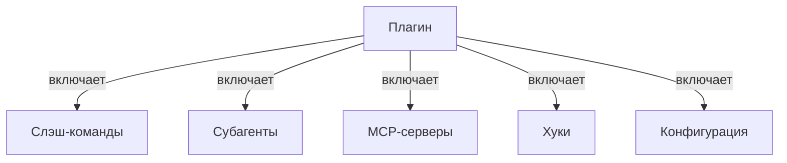
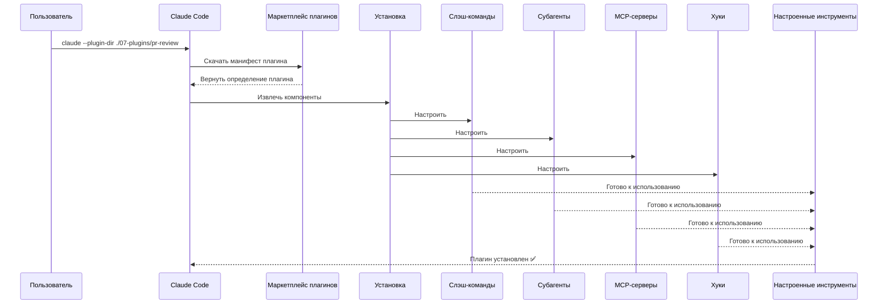
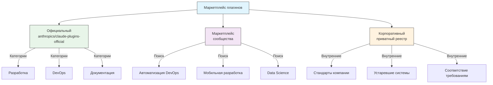
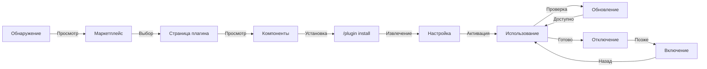
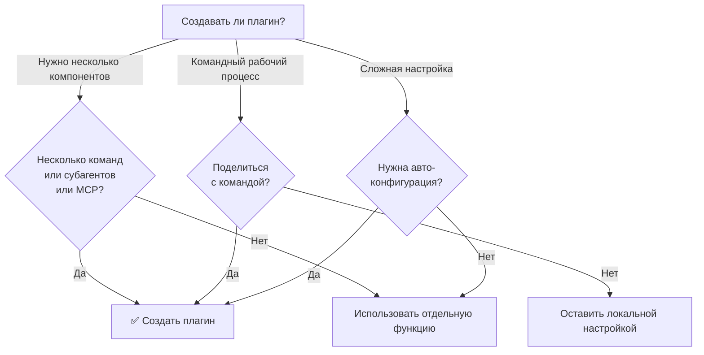

<!-- i18n-source: 07-plugins/README.md -->
<!-- i18n-source-sha: 232591b -->
<!-- i18n-date: 2026-10-23 -->

<picture>
  <source media="(prefers-color-scheme: dark)" srcset="../../resources/logos/claude-howto-logo-dark.svg">
  
</picture>

# Плагины Claude Code

В этой папке — полные примеры плагинов, которые собирают несколько функций Claude Code в цельные устанавливаемые пакеты.

## Обзор

Плагины Claude Code — это собранные наборы настроек (слэш-команды, субагенты, MCP-серверы и хуки), которые устанавливаются одной командой. Это механизм расширения самого высокого уровня — несколько функций собираются в цельные пакеты, которыми можно делиться.

## Архитектура плагина



## Процесс загрузки плагина



> **Маркетплейс не нужен (v2.1.157+)**: плагины в каталогах `.claude/skills` теперь загружаются сами, без маркетплейса. Каркас нового создаётся командой `claude plugin init <name>`, она кладёт его в `~/.claude/skills/<name>/` (глобально для пользователя) и автоматически загружает в следующей сессии как `<name>@skills-dir`.

## Типы плагинов и распространение

| Тип | Область | Общий доступ | Полномочия | Примеры |
|------|-------|--------|-----------|----------|
| Официальный | Глобальная | Все пользователи | Anthropic | PR Review, Security Guidance |
| Сообщество | Публичная | Все пользователи | Сообщество | DevOps, Data Science |
| Организация | Внутренняя | Участники команды | Компания | Внутренние стандарты, инструменты |
| Личный | Индивидуальная | Один пользователь | Разработчик | Свои рабочие процессы |

## Структура определения плагина

Манифест плагина — это JSON в `.claude-plugin/plugin.json`:

```json
{
  "name": "my-first-plugin",
  "description": "Плагин приветствия",
  "version": "1.0.0",
  "author": {
    "name": "Ваше имя"
  },
  "homepage": "https://example.com",
  "repository": "https://github.com/user/repo",
  "license": "MIT"
}
```

Помимо этих полей идентификации манифест может указать Claude Code на компоненты, которые лежат не в папках по умолчанию, и нести метаданные обнаружения и зависимостей:

| Поле | Тип | Описание |
|-------|------|-------------|
| `workflows` | string \| array | Пользовательские файлы или каталоги скриптов [Workflows](https://code.claude.com/docs/en/workflows) (заменяют каталог `workflows/` по умолчанию) |
| `outputStyles` | string \| array | Файлы или каталоги пользовательских стилей вывода (заменяют каталог `output-styles/` по умолчанию) |
| `lspServers` | string \| array \| object | LSP-серверы для интеллектуального анализа кода — переход к определению, поиск ссылок, диагностика. Обычно `"./.lsp.json"`. См. [Настройка LSP-сервера](#настройка-lsp-сервера) |
| `channels` | array | Объявления каналов для внедрения сообщений (в стиле Telegram, Slack, Discord) |
| `dependencies` | array | Другие плагины, которые требуются этому плагину, при необходимости с ограничениями версии semver |
| `keywords` | array | Теги обнаружения при просмотре и поиске по маркетплейсам |
| `metadata` | object | Произвольный объект для ваших данных, например полей прав доступа или каталога |
| `experimental.themes` | string \| array | Файлы или каталоги цветовых тем (заменяют каталог `themes/` по умолчанию) |
| `experimental.monitors` | string \| array | Конфигурации [фонового монитора](#фоновые-мониторы-v21105), которые запускаются автоматически, когда плагин активен |

## Пример структуры плагина

```
my-plugin/
├── .claude-plugin/
│   └── plugin.json       # Манифест (name, description, version, author)
├── commands/             # Навыки в виде файлов Markdown
│   ├── task-1.md
│   ├── task-2.md
│   └── workflows/
├── agents/               # Определения пользовательских агентов
│   ├── specialist-1.md
│   ├── specialist-2.md
│   └── configs/
├── skills/               # Навыки агента с файлами SKILL.md
│   ├── skill-1/
│   │   └── SKILL.md
│   └── skill-2/
│       └── SKILL.md
├── hooks/                # Обработчики событий в hooks.json
│   └── hooks.json
├── .mcp.json             # Конфигурации MCP-серверов
├── .lsp.json             # Конфигурации LSP-серверов для интеллектуального анализа кода
├── bin/                  # Исполняемые файлы, которые добавляются в PATH инструмента Bash, пока плагин включён (инструмент PowerShell тоже их находит, v2.1.302)
├── settings.json         # Настройки по умолчанию, когда плагин включён (действуют только ключи `agent` и `subagentStatusLine`)
├── themes/               # Необязательно: свои темы Claude Code (v2.1.118+)
├── templates/
│   └── issue-template.md
├── scripts/
│   ├── helper-1.sh
│   └── helper-2.py
├── docs/
│   ├── README.md
│   └── USAGE.md
└── tests/
    └── plugin.test.js
```

> **Примечание**: `commands/` — это **наследие**. Официальная рекомендация — *«Для новых плагинов используйте `skills/`.»* Существующие каталоги `commands/` продолжают работать — три примера плагинов в этом модуле поставляют такой каталог — но новый плагин должен класть свои возможности в `skills/` как каталоги `SKILL.md`, а не как плоские файлы команд Markdown.

### Настройка LSP-сервера

Плагины могут включать поддержку протокола языкового сервера (LSP) для интеллектуального анализа кода в реальном времени. LSP-серверы дают диагностику, навигацию по коду и сведения о символах по мере работы.

**Где задаётся конфигурация**:
- Файл `.lsp.json` в корневом каталоге плагина
- Ключ `lspServers` в `plugin.json` — официальное имя поля манифеста. Он принимает строку, массив или объект: строка или массив указывают на файл(ы) или каталоги конфигурации LSP (например, `"./.lsp.json"`), а объект объявляет серверы прямо в манифесте.

#### Справочник полей

| Поле | Обязательно | Описание |
|-------|----------|-------------|
| `command` | Да | Бинарный файл LSP-сервера (должен быть в PATH) |
| `extensionToLanguage` | Да | Сопоставляет расширения файлов с идентификаторами языков |
| `args` | Нет | Аргументы командной строки для сервера |
| `transport` | Нет | Способ обмена: `stdio` (по умолчанию) или `socket` |
| `env` | Нет | Переменные окружения для процесса сервера |
| `initializationOptions` | Нет | Параметры, отправляемые при инициализации LSP |
| `settings` | Нет | Конфигурация рабочей области, передаваемая серверу |
| `workspaceFolder` | Нет | Переопределение пути к папке рабочей области |
| `startupTimeout` | Нет | Максимальное время (мс) ожидания запуска сервера |
| `shutdownTimeout` | Нет | Максимальное время (мс) на корректное завершение |
| `restartOnCrash` | Нет | Автоматически перезапускать, если сервер падает |
| `maxRestarts` | Нет | Максимум попыток перезапуска, после которых попытки прекращаются |

#### Примеры конфигураций

**Go (gopls)**:

```json
{
  "go": {
    "command": "gopls",
    "args": ["serve"],
    "extensionToLanguage": {
      ".go": "go"
    }
  }
}
```

**Python (pyright)**:

```json
{
  "python": {
    "command": "pyright-langserver",
    "args": ["--stdio"],
    "extensionToLanguage": {
      ".py": "python",
      ".pyi": "python"
    }
  }
}
```

**TypeScript**:

```json
{
  "typescript": {
    "command": "typescript-language-server",
    "args": ["--stdio"],
    "extensionToLanguage": {
      ".ts": "typescript",
      ".tsx": "typescriptreact",
      ".js": "javascript",
      ".jsx": "javascriptreact"
    }
  }
}
```

#### Доступные LSP-плагины

В официальном маркетплейсе есть готовые LSP-плагины:

| Плагин | Язык | Бинарный файл сервера | Команда установки |
|--------|----------|---------------|----------------|
| `pyright-lsp` | Python | `pyright-langserver` | `pip install pyright` |
| `typescript-lsp` | TypeScript/JavaScript | `typescript-language-server` | `npm install -g typescript-language-server typescript` |
| `rust-analyzer-lsp` | Rust | `rust-analyzer` | Установка через `rustup component add rust-analyzer` |

#### Возможности LSP

После настройки LSP-серверы дают:

- **Мгновенную диагностику** — ошибки и предупреждения появляются сразу после правок
- **Навигацию по коду** — переход к определению, поиск ссылок и реализаций
- **Сведения при наведении** — сигнатуры типов и документация при наведении
- **Список символов** — просмотр символов в текущем файле или рабочей области

### Каталог `bin/` в `PATH`

Когда плагин включён, его каталог `bin/` добавляется в `PATH` сессии после ваших собственных записей `PATH`, поэтому плагин не может затенить `git`, `ls` или другую системную команду. Любой исполняемый файл оттуда можно вызвать напрямую из инструмента Bash по имени — полный путь не нужен (инструмент PowerShell тоже их находит, v2.1.302).

```bash
# В раскладке плагина:
my-plugin/
├── .claude-plugin/
│   └── plugin.json
└── bin/
    └── my-tool          # исполняемый файл (chmod +x)

# В сессии Claude Code с включённым плагином:
$ my-tool --help
```

Используйте это для вспомогательных CLI, к которым хуки, навыки или команды того же плагина будут обращаться через оболочку. Пометьте файлы как исполняемые в репозитории плагина (`chmod +x`) — git сохраняет этот бит.

## Параметры плагина (v2.1.83+)

Плагины могут объявлять настраиваемые пользователем параметры в манифесте через `userConfig`. Значения с пометкой `sensitive: true` хранятся в системной связке ключей, а не в файлах настроек открытым текстом:

```json
{
  "name": "my-plugin",
  "version": "1.0.0",
  "userConfig": {
    "apiKey": {
      "type": "string",
      "title": "API-ключ",
      "description": "API-ключ сервиса",
      "sensitive": true
    },
    "region": {
      "type": "string",
      "title": "Регион",
      "description": "Регион деплоя",
      "default": "us-east-1"
    }
  }
}
```

## Постоянные данные плагина (`${CLAUDE_PLUGIN_DATA}`) (v2.1.78+)

Плагины имеют доступ к каталогу постоянного состояния через переменную окружения `${CLAUDE_PLUGIN_DATA}`. Этот каталог уникален для каждого плагина и сохраняется между сессиями, поэтому подходит для кэшей, баз данных и другого постоянного состояния:

```json
{
  "hooks": {
    "PostToolUse": [
      {
        "matcher": "*",
        "hooks": [
          {
            "type": "command",
            "command": "node \"${CLAUDE_PLUGIN_ROOT}\"/scripts/track-usage.js \"${CLAUDE_PLUGIN_DATA}\"/usage.json"
          }
        ]
      }
    ]
  }
}
```

Каталог (`~/.claude/plugins/data/<id>/`) создаётся при первом обращении и сохраняется при обновлениях плагина. Он удаляется, когда вы удаляете плагин из последнего места, где он установлен (если не передать `--keep-data`).

### Фоновые мониторы (v2.1.105)

Плагины могут регистрировать фоновые мониторы, которые запускаются при старте сессии или при первом запуске одного из навыков плагина. Объявите их в `experimental.monitors` в `plugin.json` (или в `monitors/monitors.json`):

```json
{
  "name": "my-plugin",
  "version": "1.0.0",
  "experimental": {
    "monitors": [
      {
        "name": "app-log",
        "command": "tail -f /var/log/app.log",
        "description": "Ошибки журнала приложения",
        "when": "always"
      }
    ]
  }
}
```

`name`, `command` и `description` обязательны. `when` принимает:
- `"always"` (по умолчанию) — запуск при старте сессии и при перезагрузке плагина
- `"on-skill-invoke:<skill>"` — запуск при первом выполнении этого навыка

Неизвестные ключи отклоняются, и плагин не загружается. Ключ `monitors` верхнего уровня всё ещё загружается, но `claude plugin validate` выдаёт предупреждение.

Под капотом мониторы используют тот же инструмент Monitor и передают строки stdout как события, на которые Claude может реагировать.

## Плагин прямо в настройках (`source: 'settings'`) (v2.1.80+)

Плагины можно задавать прямо в файлах настроек как записи маркетплейса через поле `source: 'settings'`. Так определение плагина встраивается напрямую, без отдельного репозитория или маркетплейса. Объявите его в `extraKnownMarketplaces.<name>.source`; `name` должен совпадать с ключом маркетплейса, а его плагины должны ссылаться на внешние источники, такие как GitHub или npm (относительные пути отклоняются):

```json
{
  "extraKnownMarketplaces": {
    "inline-tools": {
      "source": {
        "source": "settings",
        "name": "inline-tools",
        "plugins": [
          {
            "name": "quick-lint",
            "source": {
              "source": "github",
              "repo": "my-org/quick-lint"
            }
          }
        ]
      }
    }
  }
}
```

## Моды (v2.1.287+)

Мод — это плагин, который меняет внешний вид и поведение Claude Code. Его код — модуль хуков на JavaScript или TypeScript: обработчики событий, которые Claude Code вызывает, когда что-то происходит, например вызов инструмента, отправленный промпт или отрисовка части интерфейса. Каждый обработчик может наблюдать событие, переписать его или ответить на него сам. Мод устанавливается как любой другой плагин (`/plugin install <plugin>@<marketplace>`), может поставляться в том же плагине, что навыки и MCP-серверы, и работает с вашими разрешениями, поэтому устанавливайте моды только от авторов и маркетплейсов, которым доверяете. Моды работают в CLI Claude Code (v2.1.287+), на вкладке Code приложения Claude Desktop и в расширении VS Code.

| Что может мод | Пример |
|-------------------|---------|
| Рисовать панели и полосу над промптом | Панель рядом с транскриптом или полоса над промптом, с вкладками, кнопками и текстовыми полями |
| Добавлять команды | `/command`, которая сразу запускает вашу функцию, без хода Claude, даже пока Claude работает |
| Ограничивать или менять вызовы инструментов | Удержать вызов инструмента, пока вы задаёте пользователю вопрос, отклонить его или ответить, не запуская инструмент |
| Реагировать на события | Следить за вызовами инструментов, промптами и ходами; хуки мода делят переменные, поэтому один может считать вызовы инструментов, а другой показывать счётчик рядом со спиннером |
| Вызывать API модов | Вызвать модель, читать и писать файлы, запускать процессы или делать сетевые запросы (хук может делать это только через API модов) |

Чтобы создать мод, опишите, что вам нужно, в сессии Claude Code: Claude работает со встроенным навыком `plugin-authoring` (или запустите `/plugin-authoring` сами), пишет мод и, когда вы включаете горячую перезагрузку для сессии, перезагружает его в конце каждого хода, который его меняет; `claude plugin validate` проверяет мод, не запуская его. Администраторы решают, запускаются ли моды и какие именно, через управляемые настройки — например, `allowManagedModsOnly` разрешает запускать хуки только модам вашей организации и модам, встроенным в Claude Code.

> **Примечание**: v2.1.299–2.1.300 добавляют у `Text` свойства `size`, `weight`, `mono`, `tabular`, `dir` (RTL) — `bold` устарел в пользу `weight` — шаги отступов `Box` `xs`–`xl`, `virtualText` у промпта, `$.ui.view({ agentId })` и хук `prompt.change`; v2.1.301 добавляет у `Input` свойство `rows` для многострочного поля (Enter отправляет, Shift+Enter добавляет строку).

> **Примечание**: см. официальные [Обзор модов](https://code.claude.com/docs/en/plugins/mods/overview), [Создание мода](https://code.claude.com/docs/en/plugins/mods/create) и [Справочник по модам](https://code.claude.com/docs/en/plugins/mods/reference).

## Настройки плагина

Плагины могут поставлять файл `settings.json` с конфигурацией по умолчанию. Действуют два ключа, `agent` и `subagentStatusLine`; все остальные ключи отбрасываются. `agent` принимает имя одного из агентов плагина и запускает его как основной поток:

```json
{
  "agent": "specialist-1"
}
```

Если плагин включает `settings.json`, его значения по умолчанию применяются при установке. Пользователи могут переопределить эти настройки в собственной конфигурации проекта или пользователя.

## Отдельный подход и плагины

| Подход | Имена команд | Конфигурация | Лучше всего для |
|----------|---------------|---|---|
| **Отдельно** | `/hello` | Ручная настройка в CLAUDE.md | Личное, под конкретный проект |
| **Плагины** | `/plugin-name:hello` | Автоматически через plugin.json | Общий доступ, распространение, командное использование |

Используйте **отдельные слэш-команды** для быстрых личных рабочих процессов. Используйте **плагины**, когда нужно собрать несколько функций, поделиться с командой или опубликовать для распространения.

> **Вызов через пробел (v2.1.136+)**: слэш-команды плагина работают и с пробелом — `/myplugin review` разрешается в каноническую `/myplugin:review`. Обе формы допустимы; форма с двоеточием каноническая и рекомендуется в скриптах.

> **Обнаружение `skills/` (v2.1.136+)**: запись `skills` в `plugin.json` больше не скрывает каталог `skills/` плагина по умолчанию. Навыки, объявленные в обоих местах, объединяются, поэтому можно перечислить несколько основных в `plugin.json`, не теряя остальные.

> **Плагины с `SKILL.md` в корне (v2.1.142+)**: плагин с `SKILL.md` верхнего уровня и **без подкаталога `skills/`** сам показывается как один навык — плагин *и есть* навык. Это дополнительный шаблон, а не замена каталога `skills/` или записи `skills` в `plugin.json`; используйте его для небольших плагинов с одним навыком, где раскладка каталогов ничего не даёт.

## Практические примеры

### Пример 1: плагин ревью PR

**Файл:** `.claude-plugin/plugin.json`

```json
{
  "name": "pr-review",
  "version": "1.0.0",
  "description": "Полный рабочий процесс ревью PR с проверками безопасности, тестов и документации",
  "author": {
    "name": "Anthropic"
  },
  "repository": "https://github.com/your-org/pr-review",
  "license": "MIT"
}
```

**Файл:** `commands/review-pr.md`

```markdown
---
name: Review PR
description: Начать полное ревью PR с проверками безопасности и тестов
---

# Ревью PR

Эта команда запускает полное ревью pull request, включая:

1. Анализ безопасности
2. Проверку покрытия тестами
3. Обновления документации
4. Проверки качества кода
5. Оценку влияния на производительность
```

**Файл:** `agents/security-reviewer.md`

```yaml
---
name: security-reviewer
description: Код-ревью с упором на безопасность
tools: Read, Grep, Bash
---

# Ревьюер безопасности

Специализируется на поиске уязвимостей:
- Проблемы аутентификации и авторизации
- Утечка данных
- Атаки через инъекции
- Безопасная конфигурация
```

**Установка:**

```bash
claude --plugin-dir ./07-plugins/pr-review

# Результат:
# ✅ Установлено 3 слэш-команды
# ✅ Настроено 3 субагента
# ✅ Подключено 2 MCP-сервера
# ✅ Зарегистрировано 4 хука
# ✅ Готово к использованию!
```

### Пример 2: плагин DevOps

**Компоненты:**

```
devops-automation/
├── commands/
│   ├── deploy.md
│   ├── rollback.md
│   ├── status.md
│   └── incident.md
├── agents/
│   ├── deployment-specialist.md
│   ├── incident-commander.md
│   └── alert-analyzer.md
├── mcp/
│   └── kubernetes-config.json
├── hooks/
│   ├── pre-deploy.js
│   └── post-deploy.js
└── scripts/
    ├── deploy.sh
    ├── rollback.sh
    └── health-check.sh
```

### Пример 3: плагин документации

**Компоненты в составе:**

```
documentation/
├── commands/
│   ├── generate-api-docs.md
│   ├── generate-readme.md
│   ├── sync-docs.md
│   └── validate-docs.md
├── agents/
│   ├── api-documenter.md
│   ├── code-commentator.md
│   └── example-generator.md
├── mcp/
│   └── github-docs-config.json
└── templates/
    ├── api-endpoint.md
    ├── function-docs.md
    └── adr-template.md
```

## Маркетплейс плагинов

Официальный каталог плагинов под управлением Anthropic — `anthropics/claude-plugins-official`, он регистрируется сам при первом интерактивном запуске. Администраторы предприятия также могут создавать приватные маркетплейсы плагинов для внутреннего распространения.

Есть также **маркетплейс сообщества**, `anthropics/claude-plugins-community`: там сторонние плагины, прошедшие автоматическую проверку и отбор по безопасности Anthropic — каждый закреплён за конкретным SHA коммита в каталоге. В отличие от официального маркетплейса его добавляют вручную:

```bash
/plugin marketplace add anthropics/claude-plugins-community

# Затем установите из него, используя имя маркетплейса claude-community
/plugin install <plugin-name>@claude-community
```



### Конфигурация маркетплейса

Пользователи предприятия и продвинутые пользователи могут управлять поведением маркетплейса через настройки:

| Настройка | Описание |
|---------|-------------|
| `extraKnownMarketplaces` | Добавить дополнительные источники маркетплейсов сверх значений по умолчанию |
| `strictKnownMarketplaces` | Управлять тем, какие маркетплейсы пользователям разрешено добавлять (только управляемые настройки) |
| `blockedMarketplaces` | Управляемый администратором список запрещённых маркетплейсов (с v2.1.119 поддерживает поля регулярных выражений `hostPattern` / `pathPattern`) |
| `enabledPlugins` (со значением `false`) | Заблокировать конкретный плагин: `"enabledPlugins": { "<plugin>@<marketplace>": false }` в управляемых настройках запрещает установку в любой области видимости и скрывает его из маркетплейса |

> **Более удобные псевдонимы (v2.1.232)**: `additionalMarketplaces` принимается как псевдоним
> `extraKnownMarketplaces`, а `allowedMarketplaces` — для `strictKnownMarketplaces`.
> Официальный справочник настроек перечисляет оба в разделе
> [Псевдонимы ключей маркетплейса](https://code.claude.com/docs/en/settings-reference#marketplace-key-aliases).
> Более ранние версии игнорируют псевдонимы, поэтому канонические ключи можно спокойно продолжать использовать.

> **Подстановочные знаки владельца (v2.1.223+)**: запись `"owner/*"` разрешает или блокирует каждый репозиторий
> маркетплейса одного владельца GitHub. **Принимается только в `strictKnownMarketplaces` и
> `blockedMarketplaces`.** Во всех остальных местах, где встречается источник `github`, — включая
> `extraKnownMarketplaces` и `/plugin marketplace add`, — значение `repo` должно указывать
> один репозиторий.

> **Применение** (v2.1.117+): `blockedMarketplaces` и `strictKnownMarketplaces` применяются на каждом событии жизненного цикла плагина — установка, обновление, обновление каталога и автообновление — а не только при первом добавлении. `strictKnownMarketplaces` бывает только в управляемых настройках.

Пример `blockedMarketplaces` с регулярным выражением хоста или пути (v2.1.119):

```json
{
  "blockedMarketplaces": [
    { "source": "hostPattern", "hostPattern": "^evil\\.example\\.com$" },
    { "source": "pathPattern", "pathPattern": "^/opt/approved/" }
  ]
}
```

#### `headersHelper` маркетплейса (v2.1.238)

Маркетплейс типа `url` — или отдельная запись каталога — может указать команду `headersHelper`, которая выпускает HTTP-заголовки для загрузки каталога и архивов с того же источника. Так приватный маркетплейс за сервисом выдачи токенов проходит аутентификацию без статического секрета в конфигурации.

Вспомогательная команда **записи каталога** запускается только при установке или обновлении и только после того, как команда показана вам: `claude plugin install` и `claude plugin update` спрашивают `[y/N]` перед запуском. Передайте `-y`, чтобы принять без запроса в автоматизации.

### Дополнительные возможности маркетплейса

- **Строка поиска маркетплейса (v2.1.172)**: при просмотре плагинов маркетплейса в `/plugin` строка поиска фильтрует плагины по имени или ключевому слову — удобно для больших маркетплейсов, где прокрутка полного списка идёт медленно.
- **Таймаут git по умолчанию**: увеличен с 30 с до 120 с для больших репозиториев плагинов
- **Свои реестры npm**: плагины могут указывать свои URL реестра npm для разрешения зависимостей
- **Закрепление версии**: фиксируйте плагины на конкретных версиях для воспроизводимых окружений
- **Прогнозируемая стоимость контекста в панели просмотра (v2.1.143)**: браузер маркетплейса в `/plugin` показывает прогнозируемую стоимость контекстных токенов каждого плагина на один ход — сумму всегда загружаемых навыков, хуков и описателей MCP-серверов. Используйте её, чтобы оценить стоимость внедрения плагина до установки. Та же оценка доступна после установки через [`claude plugin details <name>`](#claude-plugin-details-name-v21139).

Пример строки просмотра со столбцом стоимости:

```text
NAME              VERSION   AUTHOR     CTX/TURN   DESCRIPTION
code-reviewer     1.2.0     anthropic  +1,420     Multi-agent PR review
devops-toolkit    0.4.1     acme       +3,180     SRE playbooks, on-call helpers
docs-helper       0.9.0     community  +610       Doc-style guide enforcement
```

### Схема определения маркетплейса

Маркетплейсы плагинов задаются в `.claude-plugin/marketplace.json`:

```json
{
  "name": "my-team-plugins",
  "owner": { "name": "my-org" },
  "plugins": [
    {
      "name": "code-standards",
      "source": "./plugins/code-standards",
      "description": "Следить за стандартами кодирования команды",
      "version": "1.2.0",
      "author": { "name": "platform-team" }
    },
    {
      "name": "deploy-helper",
      "source": {
        "source": "github",
        "repo": "my-org/deploy-helper",
        "ref": "v2.0.0"
      },
      "description": "Рабочие процессы автоматизации деплоя"
    }
  ]
}
```

| Поле | Обязательно | Описание |
|-------|----------|-------------|
| `name` | Да | Имя маркетплейса в kebab-case |
| `owner` | Да | Организация или пользователь, который ведёт маркетплейс: объект с обязательным `name` (`email` и `url` необязательны) |
| `plugins` | Да | Массив записей плагинов |
| `plugins[].name` | Да | Имя плагина (kebab-case) |
| `plugins[].source` | Да | Источник плагина (строка пути или объект источника) |
| `plugins[].description` | Нет | Краткое описание плагина |
| `plugins[].version` | Нет | Строка семантической версии |
| `plugins[].author` | Нет | Автор плагина: объект с обязательным `name` (`email` и `url` необязательны) |
| `renames` | Нет | Поле маркетплейса верхнего уровня (не у записи): сопоставляет прежнее `name` плагина с текущим именем (или `null`, если плагин удалён), чтобы пользователи мигрировали автоматически (v2.1.193) |
| `plugins[].displayName` | Нет | Человекочитаемое имя в интерфейсе; для поиска не используется (v2.1.143) |
| `plugins[].defaultEnabled` | Нет | Если `false`, плагин устанавливается выключенным, пока пользователь сам его не включит (v2.1.154) |

### Типы источников плагина

Плагины можно брать из нескольких мест:

| Источник | Синтаксис | Пример |
|--------|--------|---------|
| **Относительный путь** | Строка пути | `"./plugins/my-plugin"` |
| **GitHub** | `{ "source": "github", "repo": "owner/repo" }` | `{ "source": "github", "repo": "acme/lint-plugin", "ref": "v1.0" }` |
| **Git URL** | `{ "source": "url", "url": "..." }` | `{ "source": "url", "url": "https://git.internal/plugin.git" }` |
| **Подкаталог Git** | `{ "source": "git-subdir", "url": "...", "path": "..." }` | `{ "source": "git-subdir", "url": "https://github.com/org/monorepo.git", "path": "packages/plugin" }` |
| **npm** | `{ "source": "npm", "package": "..." }` | `{ "source": "npm", "package": "@acme/claude-plugin", "version": "^2.0" }` |
| **Архив** (v2.1.224+) | `{ "source": "archive", "url": "..." }` | `{ "source": "archive", "url": "https://cdn.example.com/lint-plugin-1.2.0.zip", "sha256": "…" }` |
| **Команда** (v2.1.229+) | `{ "source": "command", "command": "..." }` | `{ "source": "command", "command": "acme-plugin-resolver --print-dir" }` |

Источники GitHub и git поддерживают необязательные поля `ref` (ветка или тег) и `sha` (хеш коммита) для закрепления версии.

**Голые имена источников и `metadata.pluginRoot` (v2.1.239)**: `metadata.pluginRoot` маркетплейса теперь действует — голое имя источника плагина в каталоге разрешается в каталог под этим корнем, и не нужно писать полный относительный путь в каждой записи.

**Навыки, синхронизированные с claude.ai (v2.1.239)**: плагины, скачанные с claude.ai, отображаются как `name@synced`. Обращайтесь к ним так в `claude plugin enable <name>@synced` и `claude plugin disable <name>@synced`. Синхронизированный плагин никогда не перекрывает установленный плагин с тем же именем — они сосуществуют и различаются суффиксом `@synced`.

#### Источник `archive` (v2.1.224+)

Установите плагин из zip по HTTPS — без клонирования git и без npm install.

```json
{
  "source": "archive",
  "url": "https://cdn.example.com/lint-plugin-1.2.0.zip",
  "sha256": "3b1f0c2e9a7d4f5b8c6e1a2d3f4b5c6d7e8f9a0b1c2d3e4f5a6b7c8d9e0f1a2b"
}
```

| Поле | Обязательно | Примечания |
|-------|----------|-------|
| `url` | Да | **Только HTTPS.** Хосты `http://`, loopback, link-local и cloud-metadata отклоняются — и перепроверяются на **каждом шаге редиректа**, поэтому редирект не может незаметно перевести вас на заблокированный хост |
| `sha256` | Нет | 64 шестнадцатеричных символа. При несовпадении установка завершается ошибкой `Plugin archive integrity check failed` |

Архивы ограничены **256 MiB**. Закрепляйте `sha256` для всего, что собрали не вы — без него тот, кто контролирует URL, контролирует код, который выполняется в вашей сессии.

#### Источник `command` (v2.1.229+)

Пусть локально установленный инструмент решает, где лежит плагин. Полезно, когда внутренний менеджер пакетов уже умеет получать и раскладывать ваши плагины.

```json
{
  "source": "command",
  "command": "acme-plugin-resolver --print-dir",
  "timeout": 60,
  "mode": "copy"
}
```

Контракт строгий: **команда должна напечатать ровно одну строку в stdout и завершиться с кодом 0.** Эта строка — абсолютный путь к каталогу с полным плагином.

| Поле | Обязательно | По умолчанию | Примечания |
|-------|----------|---------|-------|
| `command` | Да | — | Команда, которую нужно запустить |
| `timeout` | Нет | `60` (секунд) | Максимум 600 |
| `mode` | Нет | `"copy"` | `"copy"` делает снимок каталога; `"link"` создаёт символическую ссылку, поэтому правки видны сразу |

Команда разрешается заново в каждой сессии, и результат применяется без перезапуска. Организации могут полностью запретить этот тип источника через `disableCommandPluginSources`.

Зарезервированные имена маркетплейсов теперь включают `first-party-plugins` и `healthcare` (v2.1.205) — они заняты для официального использования, и свой маркетплейс не может их занять.

### Способы распространения

**GitHub (рекомендуется)**:
```bash
# Пользователи добавляют ваш маркетплейс
/plugin marketplace add owner/repo-name
```

**Другие git-сервисы** (нужен полный URL):
```bash
/plugin marketplace add https://gitlab.com/org/marketplace-repo.git
```

Голые URL репозиториев `gitlab.com` — включая вложенные подгруппы — клонируются так же, как URL `github.com` (v2.1.232). **Схема обязательна**: с v2.1.196 голый `gitlab.example.com/team/plugins` отклоняется как неверное сокращение `owner/repo`, поэтому используйте полную форму `https://gitlab.com/company/plugins.git`. В v2.1.232 также добавлено скрытие секретов семейства токенов GitLab, а CLI `glab` получил ту же защиту песочницы и пути к учётным данным, которая уже была у `gh`.

**Приватные репозитории**: поддерживаются через git credential helpers или токены в переменных окружения. У пользователей должен быть доступ на чтение к репозиторию.

**Отправка в каталог**: отправляйте плагины в каталог Anthropic для более широкого распространения через портал разработчика по адресу [claude.ai/directory/manage](https://claude.ai/directory/manage). Официальный маркетплейс Anthropic, `claude-plugins-official`, не принимает заявки через портал каталога.

### Управление маркетплейсами

```bash
# Команды CLI маркетплейса
claude plugin marketplace add <source>       # Добавить маркетплейс (GitHub, URL, локальный)
claude plugin marketplace update [name]      # Обновить индекс каталога
claude plugin marketplace remove <name>      # Удалить маркетплейс
claude plugin marketplace list               # Список настроенных маркетплейсов
```

> **Важно**: `marketplace update` только обновляет каталог плагинов (то, что доступно для установки). Установленные плагины он НЕ обновляет. Используйте `plugin update <name>`, чтобы обновить конкретные установленные плагины.

### Строгий режим

Как определения маркетплейса сочетаются с локальными файлами `plugin.json`:

| Настройка | Поведение |
|---------|----------|
| `strict: true` (по умолчанию) | Локальный `plugin.json` главный; запись маркетплейса его дополняет |
| `strict: false` | Запись маркетплейса — это всё определение плагина |

**Ограничения организации** через `strictKnownMarketplaces`:

| Значение | Эффект |
|-------|--------|
| Не задано | Ограничений нет — пользователи могут добавить любой маркетплейс |
| Пустой массив `[]` | Блокировка — маркетплейсы запрещены |
| Массив объектов источников | Список разрешённых — можно добавить только совпадающие маркетплейсы |

```json
{
  "strictKnownMarketplaces": [
    { "source": "github", "repo": "my-org/*" },
    { "source": "github", "repo": "trusted-vendor/*" }
  ]
}
```

> **Предупреждение**: в строгом режиме с `strictKnownMarketplaces` пользователи могут устанавливать плагины только из маркетплейсов в списке разрешённых. Это полезно для корпоративных сред, где нужно контролировать распространение плагинов.

## Установка плагина и жизненный цикл



## Сравнение функций плагина

| Функция | Слэш-команда | Навык | Субагент | Плагин |
|---------|---------------|-------|----------|--------|
| **Установка** | Ручное копирование | Ручное копирование | Ручная настройка | Одна команда |
| **Время настройки** | 5 минут | 10 минут | 15 минут | 2 минуты |
| **Объединение** | Один файл | Один файл | Один файл | Несколько |
| **Версионирование** | Вручную | Вручную | Вручную | Автоматически |
| **Общий доступ в команде** | Копировать файл | Копировать файл | Копировать файл | ID установки |
| **Обновления** | Вручную | Вручную | Вручную | Доступны автоматически |
| **Зависимости** | Нет | Нет | Нет | Могут быть |
| **Маркетплейс** | Нет | Нет | Нет | Да |
| **Распространение** | Репозиторий | Репозиторий | Репозиторий | Маркетплейс |

## Команды CLI плагина

Все операции с плагинами доступны как команды CLI:

```bash
claude plugin install <name>@<marketplace>   # Установить из маркетплейса
claude plugin uninstall <name>               # Удалить плагин
claude plugin update <name>                  # Обновить установленный плагин до последней версии
claude plugin list                           # Список установленных плагинов
claude plugin enable <name>                  # Включить отключённый плагин
claude plugin disable <name>                 # Отключить плагин
claude plugin validate <path>                # Проверить структуру плагина по пути <path>
claude plugin tag [path]                     # Создать git-тег релиза {name}--v{version} (v2.1.118+)
claude plugin prune                          # Удалить осиротевшие автоустановленные зависимости плагинов (v2.1.121+)
claude plugin uninstall <name> --prune       # Удалить и каскадно вычистить осиротевшие зависимости (v2.1.121+)
claude plugin details <name>                 # Показать инвентарь и прогнозируемую стоимость токенов на ход (v2.1.139+)
claude plugin configure <name>@<marketplace> # Показать параметры плагина и какие не заданы; сохранить значения из stdin через --values-stdin (v2.1.285+)
claude plugin init <name>                    # Создать каркас нового плагина (псевдоним: claude plugin new)
```

**Псевдонимы**: `claude plugin new` для `init`, `remove` / `rm` для `uninstall`, `ls` для `list` и `autoremove` для `prune`.

**Флаги, которые стоит знать:**

| Команда | Флаг | Назначение |
|---------|------|---------|
| `plugin init` | `--with <components...>` | Создать каркас указанных папок компонентов: `skills`, `agents`, `hooks`, `mcp`, `lsp`, `output-style`, `channel` |
| `plugin init` | `-f`, `--force` | Перезаписать существующий каталог `.claude-plugin/` |
| `plugin install` | `--config <key=value>` | Задать параметр `userConfig` при установке; с v2.1.285 `<server>.<key>=<value>` задаёт собственную настройку встроенного MCP-сервера `.mcpb`, чтобы он запускался без захода в `/plugin` → Configure |
| `plugin install` | `-y`, `--yes` | Принимать команды без запроса подтверждения |
| `plugin list` | `--available` | Также показать плагины, доступные из маркетплейсов (нужен `--json`) |
| `plugin tag` | `--push` | Отправить тег в удалённый репозиторий после создания |
| `plugin tag` | `--dry-run` | Показать, что было бы помечено тегом, не создавая тег |
| `plugin validate` | `--strict` | Считать предупреждения ошибками |
| `plugin validate` | `--json` | Вывести машиночитаемый отчёт проверки (v2.1.259+) |

`claude plugin validate` также проверяет записи `.mcp.json` (v2.1.281+) и завершается ошибкой, когда пути `outputStyles`, `themes`, `monitors` или `lspServers` отсутствуют или указывают за пределы каталога плагина (v2.1.283+).

Пример: `claude plugin tag ./my-plugin` принимает **путь** к плагину (не строку версии). Команда создаёт git-тег `{name}--v{version}` из `plugin.json`, проверяя, что `plugin.json` и охватывающая запись маркетплейса согласованы, и это рекомендуемый способ выпускать релизы плагина для распространения.

`claude plugin prune` полезен после установки или удаления плагинов маркетплейса, которые подтянули собственные зависимости — он удаляет автоустановленные плагины, чей родительский плагин уже удалён. `plugin uninstall --prune` делает тот же каскад за один шаг.

> **Контроль зависимостей (v2.1.143)**: `claude plugin disable <name>` **отказывает**, если другой включённый плагин всё ещё зависит от цели (граф зависимостей сломался бы). `claude plugin enable <name>` **принудительно включает транзитивные зависимости** после одного запроса подтверждения, а не требует отдельного включения для каждой. Используйте `claude plugin prune`, чтобы убрать зависимости, чьи зависимые плагины позже удалили.

### `claude plugin details <name>` (v2.1.139+)

`claude plugin details <name>` печатает полный инвентарь компонентов плагина — навыки, хуки, MCP-серверы, LSP-серверы, фоновые мониторы, слэш-команды — плюс **прогнозируемую стоимость токенов на ход (и на вызов)**. Используйте её, чтобы оценить плагин до внедрения, особенно на моделях с ограниченным контекстным окном.

Пример вывода (сокращённо):

```text
plugin: code-reviewer (1.2.0)
skills:        3      hooks: 2      mcp: 1      lsp: 0      monitors: 0
commands:      /review, /security-review
projected ctx: +1,420 tokens per turn  ·  +9,800 tokens per /review invocation
```

LSP-серверы добавлены в панель сведений в v2.1.142. См. также прогнозируемую стоимость контекста в панели просмотра маркетплейса (v2.1.143), о которой сказано в разделе [Маркетплейс плагинов](#маркетплейс-плагинов).

### `claude plugin eval` (v2.1.269+)

`claude plugin eval` запускает набор eval плагина и выдаёт оценённые, воспроизводимые результаты, чтобы вы видели, улучшило ли изменение навыка или агента его работу. Результаты приходят как JSON плюс HTML-отчёт. С v2.1.283 нужен git 2.31 или новее, если git установлен.

```bash
claude plugin eval            # Запустить набор eval плагина
claude plugin eval --help     # Полный список параметров
```

`--disallow-tools <tools…>` и поле `disallowed_tools` у отдельного случая не пускают встроенные инструменты вроде Agent в прогоны eval (v2.1.299).

### Машиночитаемый вывод с `--json` (v2.1.268+)

`--json` принимается у `install`, `uninstall`, `update`, `enable` и `disable`, поэтому управление плагинами можно встроить в скрипты CI. Каждая строка `claude plugin list --json` также содержит `errorDetails` и `noteDetails`, так что сбойный плагин объясняет себя без второй команды.

```bash
claude plugin install my-plugin@my-marketplace --json
claude plugin list --json
```

### Принятие точной команды через `--accept-command` (v2.1.271+)

`--accept-command <sha256>` у `install` и `update` принимает ровно ту команду, которую показал предыдущий запуск с `--json`, вместо безусловного `-y`.

```bash
claude plugin install my-plugin@my-marketplace --accept-command <sha256>
```

### Установка из маркетплейса, который вы ещё не добавили (v2.1.275+)

В сессии `/plugin install <plugin> --marketplace <source>` указывает маркетплейс прямо в команде и предлагает добавить его перед установкой, поэтому обнаружение и добавление маркетплейса больше не отдельный шаг. Из оболочки `claude plugin install <plugin> --marketplace <source>` делает то же самое (v2.1.292+): при необходимости добавляет маркетплейс с теми же проверками политики, что и `claude plugin marketplace add`, затем устанавливает плагин.

```bash
/plugin install code-review --marketplace anthropics/claude-code
claude plugin install code-review --marketplace anthropics/claude-code   # то же самое из оболочки (v2.1.292+)
```

## Способы установки

### Из маркетплейса
```bash
/plugin install plugin-name
# или из CLI:
claude plugin install plugin-name@marketplace-name
```

**Вступает в силу сразу?** С **v2.1.221** обычно да — прочитайте последнюю строку сводки установки:

| Что говорит сводка установки | Что это значит |
|---|---|
| `Plugin is now active.` | Claude Code активировал плагин в ходе установки. Больше ничего делать не нужно. |
| `Run /reload-plugins to activate.` | Плагин установлен, но ещё не активен — либо активация сбросила бы кэш промпта, либо попытка активации не удалась. |

До v2.1.221 ни одна установка не вступала в силу в текущей сессии, пока вы не запускали `/reload-plugins` или не перезапускали сессию, поэтому старые руководства описывают этот шаг как безусловный.

### Включение и отключение (с автоопределением области)
```bash
/plugin enable plugin-name
/plugin disable plugin-name
```

Интерфейс `/plugin` показывает неиспользуемые плагины, чтобы вы могли их убрать (v2.1.187+). Включение и отключение работает и когда `name` в `plugin.json` плагина отличается от имени записи маркетплейса (v2.1.195+).

### Список установленных плагинов (v2.1.163)
Проверьте, какие плагины активны в текущей сессии:
```bash
/plugin list             # все установленные плагины
/plugin list --enabled   # только включённые плагины
/plugin list --disabled  # только отключённые плагины
```

### Локальный плагин (для разработки)
```bash
# Флаг CLI для локального тестирования (можно повторять для нескольких плагинов)
claude --plugin-dir ./path/to/plugin
claude --plugin-dir ./plugin-a --plugin-dir ./plugin-b

# --plugin-dir также принимает путь к архиву .zip (v2.1.128+)
claude --plugin-dir ./my-plugin.zip

# Загрузить архив .zip плагина по URL для текущей сессии (v2.1.129+, можно повторять)
claude --plugin-url https://example.com/releases/my-plugin-0.3.0.zip
```

### Из Git-репозитория
```bash
/plugin marketplace add username/repo                    # Добавить репозиторий GitHub как маркетплейс
/plugin install plugin-name@marketplace-name             # Затем установить из него плагин
/plugin install plugin-name --marketplace username/repo  # Или оба шага одной командой (v2.1.275+)
```

## Автообновление

Claude Code может автоматически обновлять маркетплейсы и их установленные плагины при запуске.

| Тип маркетплейса | Автообновление по умолчанию | Как переключить |
|------------------|---------------------|---------------|
| Официальный (`claude-plugins-official`) | ✅ Включено | `/plugin` → Marketplaces → Select |
| Сторонний / локальный | ❌ Выключено | Тот же путь в интерфейсе |

Когда автообновление запускается, Claude Code:
1. Обновляет каталог маркетплейса
2. Обновляет установленные плагины до последних версий
3. Сообщает итог по каждому плагину: `Plugin is now active.`, если Claude Code активировал его в ходе обновления, или `Run /reload-plugins to activate.`, если не активировал

### Переменные окружения

| Переменная | Эффект |
|----------|--------|
| `DISABLE_AUTOUPDATER=1` | Отключить все автообновления (Claude Code и плагины) |
| `DISABLE_AUTOUPDATER=1` + `FORCE_AUTOUPDATE_PLUGINS=1` | Оставить обновления плагинов, отключить обновления Claude Code |
| `CLAUDE_CODE_PLUGIN_PREFER_HTTPS=1` | (v2.1.141+) Заставить `claude plugin install` клонировать источники плагинов GitHub по HTTPS, а не по SSH, даже когда доступен SSH-remote. Используйте в раннерах CI или контейнерах без SSH-ключей. |

```bash
# Отключить все автообновления
export DISABLE_AUTOUPDATER=1

# Оставить только автообновление плагинов
export DISABLE_AUTOUPDATER=1
export FORCE_AUTOUPDATE_PLUGINS=1

# Раннер CI без SSH-ключей — принудительный HTTPS для установки плагинов
export CLAUDE_CODE_PLUGIN_PREFER_HTTPS=1
claude plugin install code-review@claude-code-plugins
```

> **Загрузка плагинов в удалённой сессии (v2.1.179)**: в v2.1.179 ускорена загрузка плагинов в удалённых сессиях, поэтому плагины становятся доступны быстрее, когда вы подключаетесь к удалённой сессии.

## Когда создавать плагин



### Сценарии использования плагина

| Сценарий | Рекомендация | Почему |
|----------|-----------------|-----|
| **Онбординг команды** | ✅ Использовать плагин | Мгновенная настройка, все конфигурации |
| **Настройка фреймворка** | ✅ Использовать плагин | Собирает команды под конкретный фреймворк |
| **Корпоративные стандарты** | ✅ Использовать плагин | Централизованное распространение, контроль версий |
| **Быстрая автоматизация задачи** | ❌ Использовать команду | Избыточная сложность |
| **Экспертиза в одной области** | ❌ Использовать навык | Слишком тяжело, используйте навык |
| **Специализированный анализ** | ❌ Использовать субагента | Создайте вручную или используйте навык |
| **Доступ к живым данным** | ❌ Использовать MCP | Отдельно, не собирайте в пакет |

## Тестирование плагина

Перед публикацией протестируйте плагин локально флагом CLI `--plugin-dir` (его можно повторять для нескольких плагинов):

```bash
claude --plugin-dir ./my-plugin
claude --plugin-dir ./my-plugin --plugin-dir ./another-plugin

# --plugin-dir принимает архивы .zip в дополнение к каталогам (v2.1.128+)
claude --plugin-dir ./my-plugin.zip

# --plugin-url загружает .zip плагина по URL для этой сессии (v2.1.129+, можно повторять)
claude --plugin-url https://example.com/releases/my-plugin-0.3.0.zip
```

Так запускается Claude Code с загруженным плагином, и вы можете:
- Убедиться, что все слэш-команды доступны
- Проверить, что субагенты и агенты работают правильно
- Убедиться, что MCP-серверы подключаются как нужно
- Проверить выполнение хуков
- Проверить конфигурации LSP-серверов
- Проверить, нет ли ошибок конфигурации

## Горячая перезагрузка

Плагины поддерживают горячую перезагрузку во время разработки. Когда вы меняете файлы плагина, Claude Code может обнаружить изменения автоматически. Принудительную перезагрузку тоже можно запустить так:

```bash
/reload-plugins
```

Команда заново читает все манифесты плагинов, команды, агентов, навыки, хуки и конфигурации MCP/LSP, не перезапуская сессию.

## Управляемые настройки для плагинов

Администраторы могут управлять поведением плагинов во всей организации через управляемые настройки:

| Настройка | Описание |
|---------|-------------|
| `enabledPlugins` | Список разрешённых плагинов, которые включены по умолчанию |
| `enabledPlugins` (со значением `false`) | Заблокировать плагин: `"enabledPlugins": { "<plugin>@<marketplace>": false }` в управляемых настройках запрещает установку в любой области видимости и скрывает его из маркетплейса |
| `extraKnownMarketplaces` | Добавить дополнительные источники маркетплейсов сверх значений по умолчанию |
| `strictKnownMarketplaces` | Ограничить, какие маркетплейсы пользователям разрешено добавлять (только управляемые настройки; применяется на каждом событии жизненного цикла плагина с v2.1.117) |
| `blockedMarketplaces` | Список запрещённых маркетплейсов; применяется на каждом событии жизненного цикла плагина с v2.1.117; с v2.1.119 поддерживает поля регулярных выражений `hostPattern` / `pathPattern` |
| `allowedChannelPlugins` | Список разрешённых плагинов [каналов](https://code.claude.com/docs/en/channels), которые могут отправлять сообщения в сессии (записи указывают `marketplace` и `plugin`) |
| `disableCommandPluginSources` | Запретить тип источника плагина `command` на всю организацию (v2.1.229+) |

> **Более удобные псевдонимы (v2.1.232)**: `additionalMarketplaces` принимается как псевдоним
> `extraKnownMarketplaces`, а `allowedMarketplaces` — для `strictKnownMarketplaces`.
> Официальный справочник настроек перечисляет оба в разделе
> [Псевдонимы ключей маркетплейса](https://code.claude.com/docs/en/settings-reference#marketplace-key-aliases).
> Более ранние версии игнорируют псевдонимы, поэтому канонические ключи можно спокойно продолжать использовать.

> **Подстановочные знаки владельца (v2.1.223+)**: запись `"owner/*"` разрешает или блокирует каждый репозиторий
> маркетплейса одного владельца GitHub. **Принимается только в `strictKnownMarketplaces` и
> `blockedMarketplaces`.** Во всех остальных местах, где встречается источник `github`, — включая
> `extraKnownMarketplaces` и `/plugin marketplace add`, — значение `repo` должно указывать
> один репозиторий.

Эти настройки можно задать на уровне организации через файлы управляемой конфигурации, и они имеют приоритет над настройками пользователя.

## Безопасность плагина

Субагенты плагина **игнорируют** следующие ключи frontmatter (агент всё равно загружается; ключи ни на что не влияют):

- `hooks` -- Субагенты не могут регистрировать обработчики событий
- `mcpServers` -- Субагенты не могут настраивать MCP-серверы
- `permissionMode` -- Субагенты не могут переопределять модель разрешений
- `initialPrompt` -- Агенты плагина не могут автоматически отправлять первый промпт

Файл агента не может сам добавить хуки или MCP-серверы; поставляйте их как хуки и MCP-серверы уровня плагина.

## Публикация плагина

**Шаги публикации:**

1. Создайте структуру плагина со всеми компонентами
2. Напишите манифест `.claude-plugin/plugin.json`
3. Создайте `README.md` с документацией
4. Протестируйте локально через `claude --plugin-dir ./my-plugin`
5. Пометьте релиз тегом через `claude plugin tag ./my-plugin` (v2.1.118+) — команда принимает **путь** к плагину и создаёт git-тег `{name}--v{version}` из `plugin.json`
6. Отправьте в маркетплейс плагинов
7. Пройдите ревью и получите одобрение
8. Публикация в маркетплейсе
9. Пользователи устанавливают одной командой

**Пример заявки:**

````markdown
# Плагин ревью PR

## Описание
Полный рабочий процесс ревью PR с проверками безопасности, тестов и документации.

## Что входит
- 3 слэш-команды для разных типов ревью
- 3 специализированных субагента
- Интеграция MCP GitHub и CodeQL
- Хуки автоматического сканирования безопасности

## Установка
```bash
claude --plugin-dir ./07-plugins/pr-review
```

## Возможности
✅ Анализ безопасности
✅ Проверка покрытия тестами
✅ Проверка документации
✅ Оценка качества кода
✅ Анализ влияния на производительность

## Использование
```bash
/review-pr
/check-security
/check-tests
```

## Требования
- Claude Code 2.1+
- Доступ к GitHub
- CodeQL (необязательно)
````

## Плагин и ручная настройка

**Ручная настройка (2+ часа):**
- Устанавливать слэш-команды по одной
- Создавать субагентов по отдельности
- Настраивать MCP отдельно
- Настраивать хуки вручную
- Документировать всё
- Делиться с командой (и надеяться, что настроят правильно)

**С плагином (2 минуты):**
```bash
claude --plugin-dir ./07-plugins/pr-review
# ✅ Всё установлено и настроено
# ✅ Готово к использованию сразу
# ✅ Команда может воспроизвести ту же настройку
```

## Лучшие практики

### Что делать ✅
- Используйте ясные, описательные имена плагинов
- Включайте полный README
- Версионируйте плагин правильно (semver)
- Тестируйте все компоненты вместе
- Ясно документируйте требования
- Приводите примеры использования
- Включайте обработку ошибок
- Ставьте подходящие теги для обнаружения
- Сохраняйте обратную совместимость
- Держите плагины сфокусированными и цельными
- Включайте полные тесты
- Документируйте все зависимости

### Чего не делать ❌
- Не объединяйте несвязанные функции
- Не зашивайте учётные данные в код
- Не пропускайте тестирование
- Не забывайте документацию
- Не создавайте избыточные плагины
- Не игнорируйте версионирование
- Не усложняйте зависимости компонентов
- Не забывайте корректно обрабатывать ошибки

## Инструкции по установке

### Установка из маркетплейса

1. **Просмотрите доступные плагины** (вкладка **Discover** перечисляет плагины ваших маркетплейсов; `/plugin list` показывает только установленные плагины):
   ```bash
   /plugin
   ```

2. **Посмотрите сведения о плагине:** выберите плагин на вкладке **Discover**, чтобы открыть сведения. (`claude plugin details plugin-name` работает только когда плагин загружен: установлен или передан через `--plugin-dir`.)

3. **Установите плагин:**
   ```bash
   /plugin install plugin-name
   ```

### Установка из локального пути

```bash
# /plugin install нужен name@marketplace; цель-путь сообщает "marketplace not found"
claude --plugin-dir ./path/to/plugin-directory
```

### Установка из GitHub

```bash
/plugin marketplace add username/repo                    # Добавить репозиторий GitHub как маркетплейс
/plugin install plugin-name@marketplace-name             # Затем установить из него плагин
/plugin install plugin-name --marketplace username/repo  # Или оба шага одной командой (v2.1.275+)
```

### Список установленных плагинов

```bash
/plugin list             # все установленные плагины
/plugin list --enabled   # только включённые плагины
/plugin list --disabled  # только отключённые плагины
```

### Обновление плагина

Используйте форму CLI — именно она описана в [`plugin update`](https://code.claude.com/docs/en/plugins-reference) и именно на неё указывает сам Claude Code, когда доступно обновление:

```bash
claude plugin update plugin-name
```

### Отключение и включение плагина

```bash
# Временно отключить
/plugin disable plugin-name

# Включить снова
/plugin enable plugin-name
```

### Удаление плагина

```bash
/plugin uninstall plugin-name
```

## Связанные понятия

Следующие функции Claude Code работают вместе с плагинами:

- **[Слэш-команды](../01-slash-commands)** - Отдельные команды, собранные в плагины
- **[Память](../02-memory)** - Постоянный контекст для плагинов
- **[Навыки](../03-skills)** - Предметная экспертиза, которую можно обернуть в плагины
- **[Субагенты](../04-subagents)** - Специализированные агенты в составе плагина
- **[MCP-серверы](../05-mcp)** - Интеграции Model Context Protocol, собранные в плагины
- **[Хуки](../06-hooks)** - Обработчики событий, которые запускают рабочие процессы плагина

## Полный пример рабочего процесса

### Полный рабочий процесс плагина ревью PR

```
1. Пользователь: /review-pr

2. Плагин выполняет:
   ├── хук pre-review.js проверяет git-репозиторий
   ├── MCP GitHub получает данные PR
   ├── субагент security-reviewer анализирует безопасность
   ├── субагент test-checker проверяет покрытие
   └── субагент performance-analyzer проверяет производительность

3. Результаты сводятся и показываются:
   ✅ Безопасность: критичных проблем нет
   ⚠️  Тесты: покрытие 65% (рекомендуется 80%+)
   ✅ Производительность: заметного влияния нет
   📝 Дано 12 рекомендаций
```

## Устранение неполадок

### Плагин не устанавливается
- Проверьте совместимость версии Claude Code: `claude --version`
- Проверьте синтаксис `plugin.json` валидатором JSON
- Проверьте интернет-соединение (для удалённых плагинов)
- Проверьте разрешения: `ls -la plugin/`

### Компоненты не загружаются
- Проверьте, что пути в `plugin.json` совпадают с реальной структурой каталогов
- Проверьте права на файлы: `chmod +x scripts/`
- Проверьте синтаксис файлов компонентов
- Проверьте инвентарь компонентов: `claude plugin details plugin-name`

### Не удалось подключиться к MCP
- Проверьте, что переменные окружения заданы правильно
- Проверьте установку и здоровье MCP-сервера
- Проверьте статус MCP-сервера через `/mcp`
- Просмотрите конфигурацию MCP в каталоге `mcp/`

### Команды недоступны после установки
- Убедитесь, что плагин установлен успешно: `/plugin list`
- Проверьте, включён ли плагин: `/plugin list --enabled`
- Проверьте, активен ли он уже — см. рекомендации по сводке установки в разделе [Способы установки](#способы-установки): `Plugin is now active.` не требует действий, `Run /reload-plugins to activate.` значит, что нужно выполнить эту команду (перезапуск не нужен)
- Проверьте конфликты имён с существующими командами

### Проблемы выполнения хуков
- Проверьте, что у файлов хуков правильные разрешения
- Проверьте синтаксис хуков и имена событий
- Просмотрите журналы хуков, чтобы увидеть детали ошибок
- По возможности протестируйте хуки вручную

## Дополнительные материалы

- [Официальная документация по плагинам](https://code.claude.com/docs/en/plugins)
- [Как найти плагины](https://code.claude.com/docs/en/discover-plugins)
- [Маркетплейсы плагинов](https://code.claude.com/docs/en/plugin-marketplaces)
- [Справочник по плагинам](https://code.claude.com/docs/en/plugins-reference)
- [Справочник MCP-серверов](https://modelcontextprotocol.io/)
- [Руководство по настройке субагентов](../04-subagents/README.md)
- [Справочник по системе хуков](../06-hooks/README.md)

---

**Последнее обновление**: 18 октября 2026
**Версия Claude Code**: 2.1.302
**Источники**:
- https://code.claude.com/docs/en/plugins
- https://code.claude.com/docs/en/plugins-reference
- https://code.claude.com/docs/en/changelog#2-1-172
- https://code.claude.com/docs/en/changelog
- https://code.claude.com/docs/en/commands
- https://code.claude.com/docs/en/plugin-marketplaces
- https://code.claude.com/docs/en/discover-plugins.md
- https://github.com/anthropics/claude-code/releases/tag/v2.1.117
- https://github.com/anthropics/claude-code/releases/tag/v2.1.118
- https://github.com/anthropics/claude-code/releases/tag/v2.1.131
- https://github.com/anthropics/claude-code/releases/tag/v2.1.138
- https://github.com/anthropics/claude-code/releases/tag/v2.1.139
- https://github.com/anthropics/claude-code/releases/tag/v2.1.141
- https://github.com/anthropics/claude-code/releases/tag/v2.1.142
- https://github.com/anthropics/claude-code/releases/tag/v2.1.143
- https://code.claude.com/docs/en/cli-reference
- https://code.claude.com/docs/en/model-config
- https://github.com/anthropics/claude-code/blob/main/CHANGELOG.md
- https://code.claude.com/docs/en/plugins/cli-reference
- https://code.claude.com/docs/en/plugin-evals
- https://github.com/anthropics/claude-code/releases/tag/v2.1.281
- https://github.com/anthropics/claude-code/releases/tag/v2.1.283
- https://code.claude.com/docs/en/plugins/install
- https://github.com/anthropics/claude-code/releases/tag/v2.1.285
- https://code.claude.com/docs/en/plugins/mods/overview
- https://code.claude.com/docs/en/plugins/mods/create
- https://code.claude.com/docs/en/plugins/mods/reference
- https://github.com/anthropics/claude-code/releases/tag/v2.1.287
- https://github.com/anthropics/claude-code/releases/tag/v2.1.292
- https://code.claude.com/docs/en/plugins-reference#monitors
- https://code.claude.com/docs/en/changelog#2-1-299
- https://code.claude.com/docs/en/changelog#2-1-300
- https://code.claude.com/docs/en/plugins/manifest-reference
- https://code.claude.com/docs/en/plugins/marketplace-reference
- https://code.claude.com/docs/en/settings-reference
- https://code.claude.com/docs/en/plugins/components
- https://code.claude.com/docs/en/plugins/publish
- https://code.claude.com/docs/en/plugins/overview
- https://code.claude.com/docs/en/changelog#2-1-301
- https://code.claude.com/docs/en/changelog#2-1-302
**Совместимые модели**: Claude Fable 5, Claude Opus 5, Claude Sonnet 5, Claude Sonnet 4.6, Claude Opus 4.8, Claude Haiku 4.5
