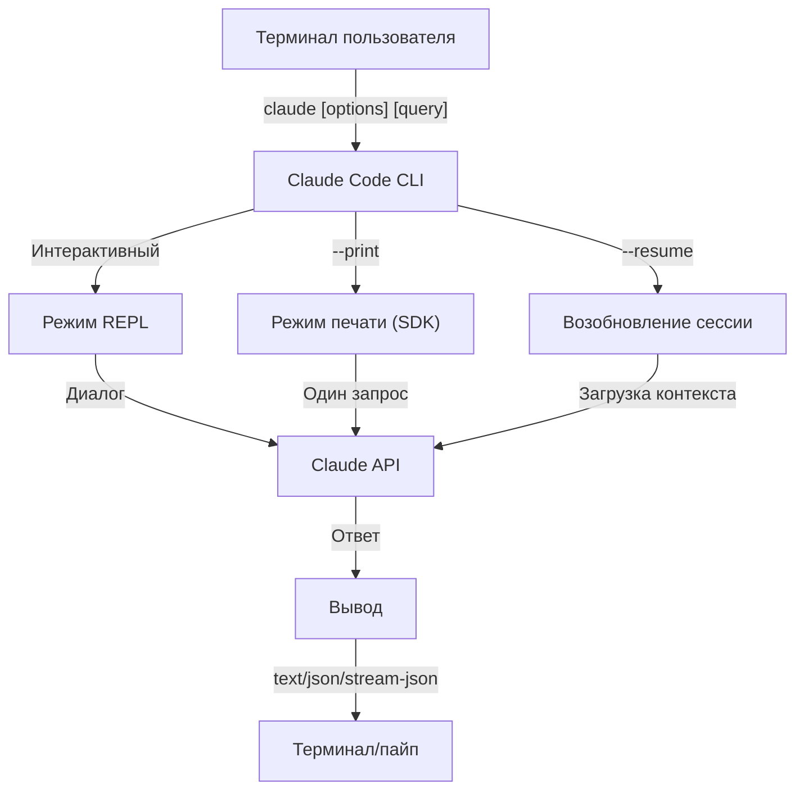
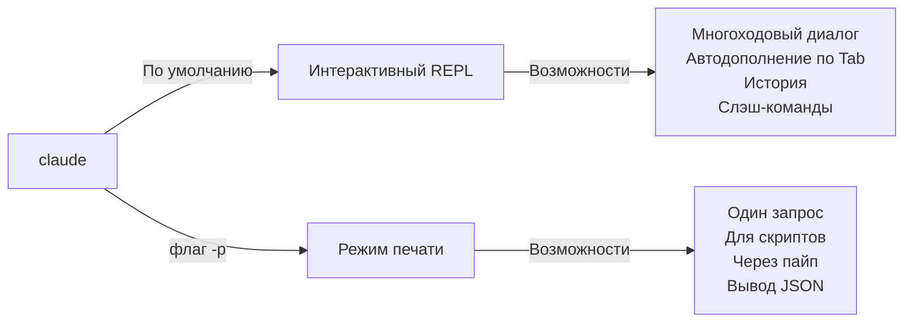

<!-- i18n-source: 10-cli/README.md -->
<!-- i18n-source-sha: 232591b -->
<!-- i18n-date: 2026-10-23 -->

<picture>
  <source media="(prefers-color-scheme: dark)" srcset="../../resources/logos/claude-howto-logo-dark.svg">
  
</picture>

# Справочник CLI

## Обзор

CLI (интерфейс командной строки) Claude Code — основной способ работы с Claude Code. Он даёт широкие возможности для запросов, управления сессиями, настройки моделей и встраивания Claude в ваши рабочие процессы разработки.

## Архитектура



## Среда выполнения и упаковка

Начиная с **v2.1.113** CLI Claude Code запускает **нативный бинарный файл под каждую платформу** (macOS, Linux, Windows) через необязательные зависимости npm. При установке бинарный файл подбирается под вашу ОС и архитектуру — прежняя встроенная среда выполнения на JavaScript больше не используется по умолчанию на macOS и Linux.

**Рекомендуемая установка** — нативный установщик (`curl -fsSL https://claude.ai/install.sh | bash`; в Windows `irm https://claude.ai/install.ps1 | iex`). Установка через npm в официальном README помечена как устаревшая; предпочтительны нативный установщик, Homebrew (`brew install --cask claude-code`) или WinGet (`winget install Anthropic.ClaudeCode`). Для справки: `npm install -g @anthropic-ai/claude-code` (Node.js 22+) ставит тот же нативный бинарный файл через необязательную зависимость под конкретную платформу.

**Хост загрузки** (v2.1.116+): артефакты нативного бинарного файла раздаются с `https://downloads.claude.ai/claude-code-releases`.

> **Корпоративные сети и прокси**: если сети нужен явный список разрешённых адресов, добавьте `downloads.claude.ai` (и `https://downloads.claude.ai/claude-code-releases`) в правила исходящего трафика прокси. Среды, где раньше был разрешён только `storage.googleapis.com` или реестр npm, нужно обновить, иначе `claude update` и первичная установка завершатся ошибкой.

Старый JavaScript-бандл по-прежнему собирается для Windows и для сред, которые на него зафиксированы; в таких установках Glob и Grep по-прежнему поставляются как полноценные инструменты (см. сноску про Glob/Grep в разделе [Инструменты](#инструменты-и-управление-разрешениями)).

## Команды CLI

| Команда | Описание | Пример |
|---------|----------|--------|
| `claude` | Запустить интерактивный REPL | `claude` |
| `claude "запрос"` | Запустить REPL с начальным промптом | `claude "объясни этот проект"` |
| `claude -p "запрос"` | Режим печати — запрос и выход | `claude -p "объясни эту функцию"` |
| `cat file \| claude -p "запрос"` | Обработать данные из пайпа | `cat logs.txt \| claude -p "объясни"` |
| `claude -c` | Продолжить самый недавний диалог | `claude -c` |
| `claude -c -p "запрос"` | Продолжить в режиме печати | `claude -c -p "проверь ошибки типов"` |
| `claude -r "<session>" "запрос"` | Возобновить сессию по ID или имени | `claude -r "auth-refactor" "заверши этот PR"` |
| `claude update` | Обновить до последней версии | `claude update` |
| `/doctor` (слэш-команда) | Диагностика установки, конфигурации и состояния плагинов. С v2.1.116 её можно открыть, **пока Claude отвечает**, значки статуса показываются в строке, а клавиша `f` автоматически исправляет найденные проблемы. В v2.1.178 макет обновлён: плоское дерево, более чёткие значки статуса и подсвеченные команды | запустите `/doctor` внутри REPL |
| `claude mcp` | Настроить MCP-серверы (включая `login`/`logout` для аутентификации, v2.1.186+) | См. [документацию MCP](../05-mcp) |
| `claude mcp serve` | Запустить Claude Code как MCP-сервер | `claude mcp serve` |
| `claude agents` | Открыть **просмотр агентов** (Agent View, исследовательская предварительная версия, v2.1.139+) — диспетчер нескольких сессий, который перечисляет каждую сессию Claude Code и её статус. См. [Просмотр агентов](#просмотр-агентов-claude-agents-v21139) ниже. | `claude agents` |
| `claude auto-mode defaults` | Вывести правила режима Auto по умолчанию в виде JSON | `claude auto-mode defaults` |
| `claude auto-mode reset` | Вернуть конфигурацию режима Auto по умолчанию, с запросом подтверждения (`--yes`, чтобы пропустить) (v2.1.212) | `claude auto-mode reset --yes` |
| `claude remote-control` | Запустить сервер Remote Control (серверный режим, без локальной интерактивной сессии; обслуживает несколько сессий, `--capacity` по умолчанию 32) | `claude remote-control --name "Мой проект"` |
| `claude --remote-control [name]` | Запустить интерактивную сессию с включённым Remote Control (псевдоним `--rc`) | `claude --rc` |
| `claude plugin` | Управлять плагинами (установка, включение, отключение) | `claude plugin install my-plugin` |
| `claude plugin init <name>` | Создать каркас нового плагина в `~/.claude/skills/<name>/` (глобально для пользователя) — подхватится в следующей сессии как `<name>@skills-dir`, маркетплейс не нужен (v2.1.157+) | `claude plugin init my-plugin` |
| `claude plugin tag [path]` | Создать git-тег релиза `{name}--v{version}` для плагина по пути `[path]`, проверив, что `plugin.json` и объемлющая запись маркетплейса согласованы (v2.1.118+) | `claude plugin tag ./my-plugin` |
| `claude install [version]` | Установить конкретную версию нативного бинарного файла. Принимает `stable`, `latest` или явную строку версии | `claude install 2.1.131` |
| `claude purge [path]` | Удалить всё локальное состояние Claude Code для проекта (транскрипты, задачи, журналы отладки, историю правок файлов, историю промптов и запись в `~/.claude.json`). Без `[path]` открывается интерактивный выбор. Флаги: `--dry-run` — предварительный просмотр, `-y/--yes` — без подтверждения, `-i/--interactive` — подтверждать каждый элемент, `--all` — все проекты (v2.1.126+) — переименовано из `claude project purge` в v2.1.288; старое имя всё ещё работает и печатает уведомление | `claude purge ~/work/repo --dry-run` |
| `claude plugin prune` | Удалить осиротевшие автоматически установленные зависимости плагинов (родительский плагин уже удалён). `plugin uninstall --prune` делает то же каскадное удаление после удаления целевого плагина (v2.1.121+) | `claude plugin prune` |
| `claude ultrareview [target]` | Запустить `/ultrareview` неинтерактивно. Печатает находки в stdout, код выхода 0 при успехе и 1 при неудаче. `--json` даёт сырые данные, `--timeout <minutes>` переопределяет 45 минут по умолчанию (с v2.1.260), а `--post` / `--no-post` управляют тем, публикуются ли находки обратно в PR. **Нужен Claude Code v2.1.227 или новее** | `claude ultrareview 1234 --json --no-post` |
| `claude self-hosted-runner [setup\|doctor\|orchestrator]` | Запустить runner, который размещает облачные сессии Claude Code на вашей машине или в контейнере. `setup` — пошаговый сценарий для оператора, `doctor` диагностирует уже развёрнутый runner, `orchestrator` порождает runner по запросу (его `--shutdown-drain-sec`, v2.1.299, даёт незавершённым хукам опроса и порождения закончить работу по SIGTERM). **Планы Team и Enterprise; нужен Claude Code v2.1.224 или новее.** В Windows для запуска нужен явный `--base-dir` (v2.1.229) | `claude self-hosted-runner setup` |
| `claude auth login` | Войти (поддерживаются `--email`, `--sso`). С v2.1.126 принимает код OAuth, вставленный в терминал, как запасной путь, когда обратный вызов браузера не достигает localhost (WSL2, SSH, контейнеры) | `claude auth login --email user@example.com` |
| `claude auth logout` | Выйти из текущей учётной записи | `claude auth logout` |
| `claude auth status` | Проверить статус аутентификации (код выхода 0, если вход выполнен, и 1, если нет) | `claude auth status` |

## Основные флаги

| Флаг | Описание | Пример |
|------|----------|--------|
| `-p, --print` | Напечатать ответ без интерактивного режима | `claude -p "запрос"` |
| `-c, --continue` | Загрузить самый недавний диалог | `claude --continue` |
| `-r, --resume` | Возобновить конкретную сессию по ID или имени | `claude --resume auth-refactor` |
| `-v, --version` | Вывести номер версии | `claude -v` |
| `--system-prompt-snapshot off` | Собирать системный промпт заново на каждый запрос, а не переиспользовать промпт, записанный вместе с диалогом. Полезно, пока вы правите текст промпта (v2.1.257+) | `claude --system-prompt-snapshot off` |
| `-w, --worktree` | Запуститься в изолированном git worktree. С v2.1.233 принимает URL запроса на слияние GitLab и URL PR GitHub | `claude -w` |
| `-n, --name` | Отображаемое имя сессии | `claude -n "auth-refactor"` |
| `--from-pr <url-or-number>` | Возобновить сессии, связанные с pull request или запросом на слияние. С v2.1.119 принимает URL GitHub (облако и Enterprise), GitLab MR и Bitbucket PR; раньше — только GitHub.com | `claude --from-pr 42` или `claude --from-pr https://gitlab.example.com/org/repo/-/merge_requests/17` |
| `--cloud [description\|session_id\|url]` | Создать облачную сессию на claude.ai с заданным описанием или подключиться к существующей по ID сессии или URL claude.ai/code | `claude --cloud "реализуй API"` |
| `--remote "task"` | **Устаревший псевдоним `--cloud`**, включая форму для существующей сессии. Используйте `--cloud` | `claude --remote "реализуй API"` |
| `--remote-control, --rc` | Интерактивная сессия с Remote Control | `claude --rc` |
| `--teleport [session]` | Возобновить веб-сессию локально. Без аргумента открывает выбор ваших веб-сессий; передайте ID сессии, чтобы возобновить её напрямую. Нужна подписка claude.ai | `claude --teleport` |
| `--teammate-mode` | Режим отображения команды агентов | `claude --teammate-mode tmux` |
| `--bare` | Минимальный режим (пропустить хуки, навыки, плагины, MCP, автоматическую память, CLAUDE.md) | `claude --bare` |
| `--safe-mode` | Запуск со всеми отключёнными настройками (CLAUDE.md, плагины, навыки, хуки, MCP), чтобы изолировать проблемы конфигурации; также `CLAUDE_CODE_SAFE_MODE=1` (v2.1.169) | `claude --safe-mode` |
| `--restricted` | Жёстко ограничить сессию для недоверенного или общего использования: убирает встроенные инструменты запуска команд и кода и WebFetch, игнорирует пользовательские, проектные и локальные настройки, ограничивает файловые инструменты рабочими каталогами и отказывает в `bypassPermissions` и облачных сессиях. Также `CLAUDE_CODE_RESTRICTED=1` (v2.1.248+) | `claude --restricted -p "кратко опиши этот репозиторий"` |
| `--permission-mode auto` | Стартовать в режиме разрешений Auto (заменяет удалённый флаг `--enable-auto-mode`, его нет с v2.1.111) | `claude --permission-mode auto` |
| `--channels` | Подписаться на канальные плагины MCP. Записи должны быть помечены как `plugin:<name>@<marketplace>`; голые имена отклоняются | `claude --channels plugin:discord@my-marketplace` |
| `--chrome` / `--no-chrome` | Включить или отключить интеграцию с браузером Chrome | `claude --chrome` |
| `--effort` | Задать уровень усилий мышления | `claude --effort high` |
| `--desktop` | Открыть сессию в настольном приложении Claude в текущем каталоге; добавьте `--continue` или `--resume <id>`, чтобы выбрать сессию (v2.1.285) | `claude --desktop --continue` |
| `--init` / `--init-only` | `--init` запускает хуки инициализации (Setup) до сессии, только режим печати; `--init-only` запускает хуки Setup и `SessionStart`, затем завершается | `claude -p --init "запрос"` |
| `--maintenance` | Запустить хуки обслуживания (Setup) до сессии (только режим печати) | `claude -p --maintenance "запрос"` |
| `--disable-slash-commands` | Отключить все навыки и слэш-команды | `claude --disable-slash-commands` |
| `--no-session-persistence` | Отключить сохранение сессии (режим печати) | `claude -p --no-session-persistence "запрос"` |
| `--exclude-dynamic-system-prompt-sections` | Исключить динамические разделы из системного промпта, чтобы чаще попадать в кэш промпта | `claude -p --exclude-dynamic-system-prompt-sections "запрос"` |

### Ограниченный режим (`--restricted`, v2.1.248+)

`--restricted` (или `CLAUDE_CODE_RESTRICTED=1`) нужен, когда `claude` работает от имени того, чей ввод вы не контролируете — обвязка оценки на общей машине, задание CI, запущенное внешним участником, демонстрационная машина. Применяются все перечисленные ограничения:

- **Убирает инструменты, которые запускают команды или код** — Bash, PowerShell и REPL — плюс WebFetch, если `--tools` явно их не называет.
- **Игнорирует пользовательские, проектные и локальные файлы настроек.** Управляемые настройки и явный файл `--settings` по-прежнему действуют, так что администратор сохраняет контроль, а закоммиченный `.claude/settings.json` не может расширить песочницу.
- **Ограничивает файловые инструменты рабочими каталогами**, так что чтение и запись не могут выйти за пути, с которых вы стартовали.
- **Отказывает в `bypassPermissions`**, каким бы способом его ни запросили.
- **Отказывает в создании облачных сессий**, так что ограниченный запуск не может увести работу с машины.

```bash
# Обвязка оценки: нет оболочки, нет сетевых загрузок, нет наследования настроек
claude --restricted -p "кратко опиши архитектуру этого репозитория"

# Та же блокировка, но один инструмент сознательно включён снова
claude --restricted --tools WebFetch -p "проверь связанный RFC"
```

> **Примечание**: `--restricted` — более грубая блокировка, чем `--permission-mode`. Он убирает инструменты целиком, а не запрашивает разрешение на них, поэтому ограниченную сессию нельзя расширить изнутри.

### Интерактивный режим и режим печати



**Интерактивный режим** (по умолчанию):
```bash
# Запустить интерактивную сессию
claude

# Запустить с начальным промптом
claude "объясни поток аутентификации"
```

**Режим печати** (неинтерактивный):
```bash
# Один запрос, затем выход
claude -p "что делает эта функция?"

# Обработать содержимое файла
cat error.log | claude -p "объясни эту ошибку"

# Сцепить с другими инструментами
claude -p "перечисли задачи" | grep "URGENT"
```

## Модель и конфигурация

| Флаг | Описание | Пример |
|------|----------|--------|
| `--model` | Задать модель (sonnet, opus, haiku или полное имя) | `claude --model opus` |
| `--fallback-model` | Автоматический запасной вариант, когда основная модель перегружена или недоступна; до трёх моделей через настройку `fallbackModel`. С v2.1.166 действует и для интерактивных сессий (раньше — только режим печати) | `claude -p --fallback-model sonnet "запрос"` |
| `--agent` | Указать агента для сессии | `claude --agent my-custom-agent` |
| `--agents` | Определить своих субагентов через JSON | См. [Конфигурация агентов](#конфигурация-агентов) |
| `--effort` | Задать уровень усилий (low, medium, high, xhigh, max) | `claude --effort xhigh` |

### Примеры выбора модели

```bash
# Opus 5.5 для сложных задач
claude --model opus "спроектируй стратегию кэширования"

# Haiku для быстрых задач (Haiku 5.5 в Anthropic API с v2.1.293; Haiku 4.5 на Bedrock, Vertex и Foundry)
claude --model haiku -p "отформатируй этот JSON"

# Полное имя модели
claude --model claude-sonnet-4-6 "проверь этот код"

# Запасная модель для надёжности
claude -p --model opus --fallback-model sonnet "проанализируй архитектуру"

# opusplan (Opus планирует, Sonnet выполняет)
claude --model opusplan "спроектируй и реализуй слой кэширования"
```

> **Обнаружение моделей шлюза (v2.1.129+, по желанию)**: если `ANTHROPIC_BASE_URL` указывает на шлюз, совместимый с Anthropic, задайте `CLAUDE_CODE_ENABLE_GATEWAY_MODEL_DISCOVERY=1`, чтобы заполнить `/model` из конечной точки `/v1/models` шлюза. Без этой переменной окружения `/model` возвращается к встроенному статическому списку. Флаг включается явно (изменение в v2.1.129), потому что запрос обнаружения может показать модели, на которые у пользователя нет права; в v2.1.126 это было неявным, и такое поведение откатили.

> **Контекст 1M при своём базовом URL (v2.1.285)**: сессии, у которых `ANTHROPIC_BASE_URL` указывает на свою конечную точку, теперь используют контекстное окно 1M у моделей, где оно есть (Opus 4.7+, Sonnet 5+, Fable). Если шлюз останавливается на 200K, выполните `/autocompact 200k`.

> **Контекст 1M по умолчанию у сторонних провайдеров (v2.1.287)**: Opus 4.7+ и Fable теперь по умолчанию используют контекстное окно 1M на Amazon Bedrock, Google Vertex AI, Microsoft Foundry и шлюзе приложений Claude, без суффикса `[1m]`. Задайте `CLAUDE_CODE_DISABLE_1M_CONTEXT=1`, чтобы оставить их на 200K.

> **Модель организации по умолчанию (v2.1.196)**: если администратор организации задал модель по умолчанию, `/model` помечает её как «Org default» (или «Role default»).

## Настройка системного промпта

| Флаг | Описание | Пример |
|------|----------|--------|
| `--system-prompt` | Заменить весь промпт по умолчанию | `claude --system-prompt "Вы — эксперт по Python"` |
| `--system-prompt-file` | Загрузить промпт из файла, заменив промпт по умолчанию | `claude -p --system-prompt-file ./prompt.txt "запрос"` |
| `--append-system-prompt` | Дописать к промпту по умолчанию | `claude --append-system-prompt "Всегда используй TypeScript"` |
| `--append-subagent-system-prompt` | Дописать текст к системному промпту каждого субагента (неинтерактивно) | `claude -p --append-subagent-system-prompt "Указывай источники" "запрос"` |
| `--append-subagent-system-prompt-file` | (v2.1.261) Загрузить этот дописываемый текст из файла, если промпт слишком длинный для командной строки. Только неинтерактивно, и **нельзя сочетать** с `--append-subagent-system-prompt` | `claude -p --append-subagent-system-prompt-file ./subagent-rules.txt "запрос"` |

### Примеры системного промпта

```bash
# Полностью своя персона
claude --system-prompt "Вы — старший инженер по безопасности. Сосредоточьтесь на уязвимостях."

# Дописать конкретные указания
claude --append-system-prompt "Всегда прилагай модульные тесты к примерам кода"

# Загрузить сложный промпт из файла
claude -p --system-prompt-file ./prompts/code-reviewer.txt "проверь main.py"
```

### Сравнение флагов системного промпта

| Флаг | Поведение | Интерактивный | Печать |
|------|-----------|---------------|--------|
| `--system-prompt` | Заменяет весь системный промпт по умолчанию | ✅ | ✅ |
| `--system-prompt-file` | Заменяет промптом из файла | ✅ | ✅ |
| `--append-system-prompt` | Дописывает к системному промпту по умолчанию | ✅ | ✅ |

**Все флаги системного промпта работают и в интерактивном режиме, и в режиме печати (файловые формы — с v2.1.69). `--system-prompt` и `--system-prompt-file` заменяют промпт по умолчанию; флаги дописывания добавляют к нему.**

## Инструменты и управление разрешениями

| Флаг | Описание | Пример |
|------|----------|--------|
| `--tools` | Ограничить доступные встроенные инструменты | `claude -p --tools "Bash,Edit,Read" "запрос"` |
| `--allowedTools` | Инструменты, которые выполняются без запроса | `"Bash(git log:*)" "Read"` |
| `--disallowedTools` | Инструменты, убранные из контекста | `"Bash(rm:*)" "Edit"` |
| `--dangerously-skip-permissions` | Пропустить все запросы разрешений | `claude --dangerously-skip-permissions` |
| `--permission-mode` | Начать в указанном режиме разрешений | `claude --permission-mode auto` |
| `--permission-prompt-tool` | Инструмент MCP для обработки разрешений | `claude -p --permission-prompt-tool mcp_auth "запрос"` |
| `--permission-prompts` | (v2.1.259) Кто отвечает на запросы разрешений в режиме печати. По умолчанию `host` отправляет их хосту Agent SDK или инструменту `--permission-prompt-tool`; передайте `none`, когда ответить некому, и Claude Code отклонит их | `claude -p --permission-prompts none "запрос"` |

> **Обновление v2.1.111**: `--enable-auto-mode` удалён; режим Auto теперь по умолчанию в цикле `Shift+Tab` — используйте `--permission-mode auto`, чтобы стартовать в нём сразу.

> **Сноска про Glob / Grep (v2.1.113+)**: в нативных сборках macOS/Linux `Glob` и `Grep` предоставляются как встроенные бинарные файлы `bfs` и `ugrep`, которые вызываются через инструмент Bash, а не как отдельные полноценные инструменты. Установки Windows и npm-бандла (JS) по-прежнему показывают их как самостоятельные инструменты. Для списков `allowedTools` / `disallowedTools` субагента подмена бэкенда прозрачна — в конфигурации на любой платформе можно по-прежнему писать `Glob` / `Grep`.

> **Автоодобрение PowerShell (v2.1.119)**: команды инструмента PowerShell можно автоматически одобрять в режиме разрешений точно так же, как команды Bash. Используйте тот же синтаксис сопоставления, что и для правил `Bash(...)`, чтобы ограничить разрешения PowerShell — например, `PowerShell(Get-ChildItem:*)`.

> **`--permission-mode` учитывается при возобновлении (v2.1.132+)**: `claude -p --continue --permission-mode plan` (и `--resume`) теперь учитывает флаг. Более ранние версии молча отбрасывали `--permission-mode` при возобновлении сессии, поэтому сессия в режиме планирования, возобновлённая без повторной передачи флага, молча понижала режим — это исправлено.

> **Усиление разрешений (v2.1.214)**: команды Docker/Podman с флагами перенаправления к демону (например `--url`, `--connection`, `--identity`) теперь требуют запрос разрешения, а не выполняются автоматически. Команды `file` с `-m`/`--magic-file` или `-f`/`--files-from` тоже теперь требуют разрешение. Команды Bash длиннее 10 000 символов всегда запрашивают разрешение, независимо от разрешающих правил.

### Примеры разрешений

```bash
# Режим только для чтения при код-ревью
claude --permission-mode plan "проверь эту кодовую базу"

# Оставить только безопасные инструменты
claude --tools "Read,Grep,Glob" -p "найди все комментарии TODO"

# Разрешить конкретные команды git без запросов
claude --allowedTools "Bash(git status:*)" "Bash(git log:*)"

# Заблокировать опасные операции
claude --disallowedTools "Bash(rm -rf:*)" "Bash(git push --force:*)"
```

> **Сопоставление параметров `Tool(param:value)` (v2.1.178)**: правила разрешений имеют вид `Tool` (любое использование) или `Tool(specifier)`. С v2.1.178 спецификатор может сопоставлять **параметры** ввода инструмента, а не только шаблоны команды или пути — в форме `Tool(param:value)` с поддержкой подстановочных знаков. Это обобщает сопоставление, которое вы уже используете для префиксов команд `Bash(...)` (например `Bash(npm run test *)`) и глобов путей `Read(...)` (например `Read(./.env.*)`), чтобы другие инструменты можно было ограничивать их аргументами. Перед тем как писать правило, сверьтесь со [справочником разрешений](https://code.claude.com/docs/en/settings): точные имена параметров зависят от инструмента.

## Вывод и формат

| Флаг | Описание | Варианты | Пример |
|------|----------|----------|--------|
| `--output-format` | Задать формат вывода (режим печати) | `text`, `json`, `stream-json` | `claude -p --output-format json "запрос"` |
| `--input-format` | Задать формат ввода (режим печати) | `text`, `stream-json` | `claude -p --input-format stream-json` |
| `--verbose` | Включить подробное журналирование | | `claude --verbose` |
| `--include-partial-messages` | Включить события потока | Требуется `stream-json` | `claude -p --output-format stream-json --include-partial-messages "запрос"` |
| `--forward-subagent-text` | Пересылать текстовый вывод субагента в поток. С v2.1.219 пересылаются и субагенты, порождённые на глубине 2 и глубже, с ключом по id `tool_use` породившего их `Agent` (так вы наблюдаете вложенность, которая по умолчанию включена через `CLAUDE_CODE_MAX_SUBAGENT_SPAWN_DEPTH`) | Требуется `stream-json` | `claude -p --output-format stream-json --forward-subagent-text "запрос"` |
| `--json-schema` | Получить проверенный JSON по схеме | | `claude -p --json-schema '{"type":"object"}' "запрос"` |
| `--max-budget-usd` | Максимальные траты для режима печати. С v2.1.217 достижение предела также останавливает работающих фоновых субагентов и отклоняет новые порождения (раньше фоновые агенты продолжали работу после предела) | | `claude -p --max-budget-usd 5.00 "запрос"` |

### Примеры формата вывода

```bash
# Обычный текст (по умолчанию)
claude -p "объясни этот код"

# JSON для программного использования
claude -p --output-format json "перечисли все функции в main.py"

# Потоковый JSON для обработки в реальном времени
claude -p --output-format stream-json "сгенерируй длинный отчёт"

# Структурированный вывод с проверкой по схеме
claude -p --json-schema '{"type":"object","properties":{"bugs":{"type":"array"}}}' \
  "найди ошибки в этом коде и верни JSON"
```

## Рабочее пространство и каталоги

| Флаг | Описание | Пример |
|------|----------|--------|
| `--add-dir` | Добавить дополнительные рабочие каталоги | `claude --add-dir ../apps ../lib` |
| `--setting-sources` | Источники настроек через запятую | `claude --setting-sources user,project` |

> **Сохранение `/config` (v2.1.119)**: изменения, сделанные интерактивно командой `/config`, теперь записываются в `~/.claude/settings.json` и участвуют в обычной цепочке приоритета (политика → локальные → проект → пользователь). До v2.1.119 часть изменений `/config` жила только в сессии. Полный порядок приоритета — в [Память и настройки](../02-memory/README.md).
| `--settings` | Загрузить настройки из файла или JSON. Файл не больше 2 MiB (v2.1.214) | `claude --settings ./settings.json` |
| `--plugin-dir` | Загрузить плагины из каталога (можно повторять). С v2.1.265 также принимает **папку плагинов** — загружается каждый дочерний каталог с манифестом, а каталоги, добавленные или удалённые во время сессии, подхватываются | `claude --plugin-dir ./my-plugin` |

### Пример с несколькими каталогами

```bash
# Работа сразу в нескольких каталогах проекта
claude --add-dir ../frontend ../backend ../shared "найди все конечные точки API"

# Загрузить свои настройки
claude --settings '{"model":"opus","verbose":true}' "сложная задача"
```

## Конфигурация MCP

| Флаг | Описание | Пример |
|------|----------|--------|
| `--mcp-config` | Загрузить MCP-серверы из JSON | `claude --mcp-config ./mcp.json` |
| `--strict-mcp-config` | Использовать только указанную конфигурацию MCP | `claude --strict-mcp-config --mcp-config ./mcp.json` |
| `--channels` | Подписаться на канальные плагины MCP. Записи должны быть помечены как `plugin:<name>@<marketplace>`; голые имена отклоняются | `claude --channels plugin:discord@my-marketplace` |

### Примеры MCP

```bash
# Загрузить MCP-сервер GitHub
claude --mcp-config ./github-mcp.json "перечисли открытые PR"

# Строгий режим — только указанные серверы
claude --strict-mcp-config --mcp-config ./production-mcp.json "задеплой на staging"
```

## Управление сессиями

| Флаг | Описание | Пример |
|------|----------|--------|
| `--session-id` | Использовать конкретный ID сессии (UUID) | `claude --session-id "550e8400-..."` |
| `--fork-session` | Создать новую сессию при возобновлении | `claude --resume abc123 --fork-session` |

### Примеры сессий

```bash
# Продолжить последний диалог
claude -c

# Возобновить именованную сессию
claude -r "feature-auth" "продолжи реализацию входа"

# Форк сессии для эксперимента
claude --resume feature-auth --fork-session "попробуй другой подход"

# Использовать конкретный ID сессии
claude --session-id "550e8400-e29b-41d4-a716-446655440000" "продолжи"
```

> **v2.1.299**: команда возобновления, которую печатают при выходе, называет сессию по её ID.

### Форк сессии

Создайте ветку от существующей сессии для эксперимента:

```bash
# Форк сессии, чтобы попробовать другой подход
claude --resume abc123 --fork-session "попробуй другую реализацию"

# Форк с собственным сообщением
claude -r "feature-auth" --fork-session "проверь с другой архитектурой"
```

**Сценарии:**
- Пробовать другие реализации, не теряя исходную сессию
- Экспериментировать с разными подходами параллельно
- Создавать ветки от удачной работы для вариаций
- Проверять ломающие изменения, не затрагивая основную сессию

Исходная сессия остаётся неизменной, а форк становится новой независимой сессией.

### Очистка состояния проекта (v2.1.126+)

`claude purge` удаляет всё локальное состояние Claude Code для проекта — транскрипты, списки задач, журналы отладки, историю правок файлов, строки истории промптов и запись проекта в `~/.claude.json`. До v2.1.288 команда называлась `claude project purge`; это имя всё ещё работает и печатает уведомление. Сначала используйте `--dry-run`, чтобы увидеть, что будет удалено; `--all` обходит каждый проект на машине.

```bash
# Предварительный просмотр того, что будет удалено (безопасно)
claude purge ~/work/repo --dry-run

# Удалить состояние конкретного проекта без запросов
claude purge ~/work/repo --yes

# Обойти каждый проект интерактивно
claude purge --all --interactive
```

## Продвинутые функции

| Флаг | Описание | Пример |
|------|----------|--------|
| `--chrome` | Включить интеграцию с браузером Chrome | `claude --chrome` |
| `--no-chrome` | Отключить интеграцию с браузером Chrome | `claude --no-chrome` |
| `--ide` | Автоматически подключиться к IDE, если она доступна | `claude --ide` |
| `--max-turns` | Ограничить агентные ходы (неинтерактивно) | `claude -p --max-turns 3 "запрос"` |
| `--debug` | Включить режим отладки с фильтрацией (фильтр действует только в форме `=`) | `claude --debug=api,mcp` |
| `--enable-lsp-logging` | Включить подробное журналирование LSP | `claude --enable-lsp-logging` |
| `--betas` | Бета-заголовки для запросов API | `claude --betas interleaved-thinking` |
| `--plugin-dir` | Загрузить плагины из каталога (можно повторять). С v2.1.265 также принимает **папку плагинов** — загружается каждый дочерний каталог с манифестом, а каталоги, добавленные или удалённые во время сессии, подхватываются | `claude --plugin-dir ./my-plugin` |
| `--effort` | Задать уровень усилий мышления | `claude --effort high` |
| `--bare` | Минимальный режим (пропустить хуки, навыки, плагины, MCP, автоматическую память, CLAUDE.md) | `claude --bare` |
| `--channels` | Подписаться на канальные плагины MCP (метка `plugin:<name>@<marketplace>`) | `claude --channels plugin:discord@my-marketplace` |
| `--tmux` | Создать сессию tmux для worktree (нужен `--worktree`) | `claude --worktree feature-x --tmux` |
| `--fork-session` | Создать новый ID сессии при возобновлении | `claude --resume abc --fork-session` |
| `--max-budget-usd` | Максимальные траты (режим печати); при достижении также останавливает фоновых субагентов (v2.1.217) | `claude -p --max-budget-usd 5.00 "запрос"` |
| `--json-schema` | Проверенный вывод JSON | `claude -p --json-schema '{"type":"object"}' "q"` |
| `--ax-screen-reader` | Режим отрисовки обычным текстом для программ чтения с экрана (v2.1.208) | `claude --ax-screen-reader` |

### Заметки о платформе и теме (v2.1.112)

- **Инструмент PowerShell в Windows**: отдельный инструмент PowerShell разворачивается в Windows, и им можно управлять через переменную окружения.
- **Тема Auto (как в терминале)**: новая тема «Auto (match terminal)» синхронизирует светлое и тёмное оформление Claude Code с вашим терминалом.
- **Более тихие запросы разрешений**: вызовы `Bash` только для чтения и шаблоны `Glob` больше не вызывают запросы разрешений.

### Продвинутые примеры

```bash
# Ограничить автономные действия
claude -p --max-turns 5 "отрефакторь этот модуль"

# Отладить вызовы API
claude --debug=api "тестовый запрос"

# Включить интеграцию с IDE
claude --ide "помоги с этим файлом"
```

## Конфигурация агентов

Флаг `--agents` принимает объект JSON, который определяет своих субагентов для сессии.

С **v2.1.243** `--agents` больше не молча игнорирует неверный JSON или неверное определение агента — завершается с ясной ошибкой, как уже делал `--mcp-config`.

### Формат JSON для агентов

```json
{
  "agent-name": {
    "description": "Обязательно: когда вызывать этого агента",
    "prompt": "Обязательно: системный промпт агента",
    "tools": ["Необязательный", "массив", "из", "инструментов"],
    "model": "необязательно: sonnet|opus|haiku"
  }
}
```

**Обязательные поля:**
- `description` — описание на естественном языке, когда использовать этого агента
- `prompt` — системный промпт, который задаёт роль и поведение агента

**Необязательные поля:**
- `tools` — массив доступных инструментов (если опустить, наследуются все)
  - Формат: `["Read", "Grep", "Glob", "Bash"]`
- `model` — модель: `sonnet`, `opus` или `haiku`

### Полный пример агентов

```json
{
  "code-reviewer": {
    "description": "Эксперт по код-ревью. Вызывайте проактивно после изменений кода.",
    "prompt": "Вы — старший ревьюер кода. Сосредоточьтесь на качестве кода, безопасности и проверенных практиках.",
    "tools": ["Read", "Grep", "Glob", "Bash"],
    "model": "sonnet"
  },
  "debugger": {
    "description": "Специалист по отладке ошибок и падений тестов.",
    "prompt": "Вы — эксперт по отладке. Анализируйте ошибки, находите первопричины и предлагайте исправления.",
    "tools": ["Read", "Edit", "Bash", "Grep"],
    "model": "opus"
  },
  "documenter": {
    "description": "Специалист по документации для подготовки руководств.",
    "prompt": "Вы — технический писатель. Создавайте ясную и полную документацию.",
    "tools": ["Read", "Write"],
    "model": "haiku"
  }
}
```

### Примеры команд агентов

```bash
# Определить своих агентов прямо в команде
claude --agents '{
  "security-auditor": {
    "description": "Специалист по безопасности для анализа уязвимостей",
    "prompt": "Вы — эксперт по безопасности. Находите уязвимости и предлагайте исправления.",
    "tools": ["Read", "Grep", "Glob"],
    "model": "opus"
  }
}' "проверь эту кодовую базу на проблемы безопасности"

# Загрузить агентов из файла
claude --agents "$(cat ~/.claude/agents.json)" "проверь модуль аутентификации"

# Сочетать с другими флагами
claude -p --agents "$(cat agents.json)" --model sonnet "проанализируй производительность"
```

### Приоритет агентов

Когда определений агентов несколько, они загружаются в таком порядке приоритета:
1. **Заданные в CLI** (флаг `--agents`) — для этой сессии
2. **Уровень проекта** (`.claude/agents/`) — текущий проект
3. **Уровень пользователя** (`~/.claude/agents/`) — все проекты

Агенты из CLI перекрывают и проектных, и пользовательских агентов на время сессии. Агенты уровня проекта перекрывают агентов уровня пользователя при совпадении имён. Полная таблица приоритета, включая агентов уровня плагина, — в [Урок 04 — Субагенты](../04-subagents/README.md#расположение-файлов).

### Просмотр агентов (`claude agents`, v2.1.139+)

> **Исследовательская предварительная версия** — функция достаточно стабильна для ежедневной работы, но может измениться.

`claude agents` открывает **просмотр агентов** (Agent View) — единый список каждой сессии Claude Code на машине с текущим статусом (`running`, `blocked on you`, `done`). Это замена жонглированию несколькими вкладками терминала, когда вы запускаете фоновых агентов, запланированные задачи или сессии через `--bg`.

```bash
# Открыть просмотр агентов
claude agents
```

Когда вы отправляете сессию из этого просмотра (или через `claude --bg <prompt>`), можно передать те же флаги конфигурации, что и самому `claude`. Флаги, введённые для пути отправки из просмотра агентов:

| Флаг | С версии | Описание |
|------|----------|----------|
| `--cwd <path>` | v2.1.141 | Ограничить список сессий (или новую сессию) конкретным рабочим каталогом |
| `--add-dir <path>` | v2.1.142 | Добавить каталоги в рабочее пространство отправленной сессии |
| `--settings <path>` | v2.1.142 | Использовать конкретный `settings.json` для отправленной сессии |
| `--mcp-config <path>` | v2.1.142 | Использовать конкретную конфигурацию MCP для отправленной сессии |
| `--plugin-dir <path>` | v2.1.142 | Использовать конкретный каталог плагинов для отправленной сессии |
| `--permission-mode <mode>` | v2.1.142 | Задать режим разрешений (`plan`, `acceptEdits`, `auto` и т. д.) для отправленной сессии |
| `--model <model>` | v2.1.142 | Зафиксировать модель для отправленной сессии |
| `--effort <level>` | v2.1.142 | Зафиксировать уровень усилий (`low`/`medium`/`high`/`xhigh`/`max`) |
| `--dangerously-skip-permissions` | v2.1.142 | Запустить отправленную сессию без запросов разрешений (только в песочницах) |
| `--json` | v2.1.145 | Напечатать список агентов как машинно-читаемый JSON для скриптов (строки состояния, выбор сессий, интеграции tmux-resurrect) |

Сессии, которые закончили работу, но оставили открытой фоновую оболочку, переходят из «Working» в «Completed» (исправление v2.1.141). Внутри присоединённой сессии агента `Shift+Tab` переключает режимы разрешений, включая режим Auto (v2.1.143).

**Запросы на слияние GitLab (v2.1.233)** — просмотр агентов распознаёт URL запросов на слияние GitLab наряду с URL PR GitHub и показывает запросы на слияние как `!N` (pull request GitHub остаются `#N`). Тот же релиз научил `--worktree` принимать URL запроса на слияние GitLab.

**Закрепить сессию** — нажмите `Ctrl+T` на сессии в `claude agents`, чтобы закрепить её (v2.1.147). Закреплённые фоновые сессии остаются живыми в простое, перезапускаются на месте, чтобы применить обновления Claude Code, и сбрасываются при нехватке памяти только после незакреплённых сессий. (Этот `Ctrl+T` действует в просмотре агентов; в основной сессии он переключает вид списка задач.)

**Значения по умолчанию для новых сессий (v2.1.299)** — в просмотре агентов `/effort` и `/fast` задают то, с чего стартуют новые сессии; `/model`, `/effort` или `/fast` без аргументов открывают выбор.

---

## Ценные сценарии использования

### 1. Интеграция с CI/CD

Используйте Claude Code в пайплайнах CI/CD для автоматического код-ревью, тестов и документации.

**Пример GitHub Actions:**

```yaml
name: Код-ревью с ИИ

on: [pull_request]

jobs:
  review:
    runs-on: ubuntu-latest
    steps:
      - uses: actions/checkout@v4

      - name: Установка Claude Code
        run: npm install -g @anthropic-ai/claude-code

      - name: Запуск код-ревью
        env:
          ANTHROPIC_API_KEY: ${{ secrets.ANTHROPIC_API_KEY }}
        run: |
          claude -p --output-format json \
            --max-turns 1 \
            "Проверь изменения в этом PR:
            - Уязвимости безопасности
            - Проблемы производительности
            - Качество кода
            Выведи JSON с массивом 'issues'" > review.json

      - name: Публикация комментария ревью
        uses: actions/github-script@v7
        with:
          script: |
            const fs = require('fs');
            const review = JSON.parse(fs.readFileSync('review.json', 'utf8'));
            // Обработать и опубликовать комментарии ревью
```

**Пайплайн Jenkins:**

```groovy
pipeline {
    agent any
    stages {
        stage('ИИ-ревью') {
            steps {
                sh '''
                    claude -p --output-format json \
                      --max-turns 3 \
                      "Проанализируй покрытие тестами и предложи недостающие тесты" \
                      > coverage-analysis.json
                '''
            }
        }
    }
}
```

**Неинтерактивный `ultrareview` (нужен v2.1.227+):**

```yaml
# .github/workflows/ultrareview.yml
- name: Claude ultrareview
  run: claude ultrareview ${{ github.event.pull_request.number }} --json --no-post > review.json
```

`claude ultrareview` завершается с кодом 0 при чистом ревью и с кодом 1, когда есть находки, поэтому это готовая проверка для PR. `--timeout <minutes>` переопределяет 45 минут по умолчанию (с v2.1.260). `--post` публикует готовые находки в pull request; `--no-post` оставляет их только в stdout — это то, что нужно, когда следующий шаг CI сам форматирует отчёт.

### 2. Пайпы в скриптах

Пропускайте файлы, журналы и данные через Claude для анализа.

**Анализ журналов:**

```bash
# Разобрать журналы ошибок
tail -1000 /var/log/app/error.log | claude -p "суммируй эти ошибки и предложи исправления"

# Найти закономерности в журналах доступа
cat access.log | claude -p "выяви подозрительные шаблоны доступа"

# Проанализировать историю git
git log --oneline -50 | claude -p "суммируй недавнюю разработку"
```

**Обработка кода:**

```bash
# Проверить конкретный файл
cat src/auth.ts | claude -p "проверь этот код аутентификации на проблемы безопасности"

# Сгенерировать документацию
cat src/api/*.ts | claude -p "сгенерируй документацию API в markdown"

# Найти TODO и расставить приоритеты
grep -r "TODO" src/ | claude -p "расставь эти TODO по важности"
```

### 3. Многосессионные рабочие процессы

Ведите сложные проекты несколькими нитями диалога.

```bash
# Начать сессию ветки функции
claude -r "feature-auth" "давай реализуем аутентификацию пользователя"

# Позже продолжить сессию
claude -r "feature-auth" "добавь сброс пароля"

# Форк, чтобы попробовать другой подход
claude --resume feature-auth --fork-session "попробуй OAuth"

# Переключаться между сессиями разных функций
claude -r "feature-payments" "продолжи интеграцию со Stripe"
```

### 4. Своя конфигурация агентов

Определите специализированных агентов под рабочие процессы команды.

```bash
# Сохранить конфигурацию агентов в файл
cat > ~/.claude/agents.json << 'EOF'
{
  "reviewer": {
    "description": "Ревьюер кода для разбора PR",
    "prompt": "Проверяй код на качество, безопасность и сопровождаемость.",
    "model": "opus"
  },
  "documenter": {
    "description": "Специалист по документации",
    "prompt": "Готовь ясную и полную документацию.",
    "model": "sonnet"
  },
  "refactorer": {
    "description": "Эксперт по рефакторингу кода",
    "prompt": "Предлагай и выполняй чистый рефакторинг кода.",
    "tools": ["Read", "Edit", "Glob"]
  }
}
EOF

# Использовать агентов в сессии
claude --agents "$(cat ~/.claude/agents.json)" "проверь модуль аутентификации"
```

### 5. Пакетная обработка

Обрабатывайте много запросов с одними и теми же настройками.

```bash
# Обработать несколько файлов
for file in src/*.ts; do
  echo "Обрабатывается $file..."
  claude -p --model haiku "кратко опиши этот файл: $(cat $file)" >> summaries.md
done

# Пакетное код-ревью
find src -name "*.py" -exec sh -c '
  echo "## $1" >> review.md
  cat "$1" | claude -p "краткое код-ревью" >> review.md
' _ {} \;

# Сгенерировать тесты для всех модулей
for module in $(ls src/modules/); do
  claude -p "сгенерируй модульные тесты для src/modules/$module" > "tests/$module.test.ts"
done
```

### 6. Разработка с учётом безопасности

Используйте управление разрешениями для безопасной работы.

```bash
# Аудит безопасности только для чтения
claude --permission-mode plan \
  --tools "Read,Grep,Glob" \
  "проверь эту кодовую базу на уязвимости"

# Заблокировать опасные команды
claude --disallowedTools "Bash(rm:*)" "Bash(curl:*)" "Bash(wget:*)" \
  "помоги навести порядок в этом проекте"

# Ограниченная автоматизация
claude -p --max-turns 2 \
  --allowedTools "Read" "Glob" \
  "найди все зашитые учётные данные"
```

### 7. Интеграция с JSON API

Используйте Claude как программируемый API для своих инструментов с разбором через `jq`.

```bash
# Получить структурированный анализ
claude -p --output-format json \
  --json-schema '{"type":"object","properties":{"functions":{"type":"array"},"complexity":{"type":"string"}}}' \
  "проанализируй main.py и верни список функций с оценкой сложности"

# Связать с jq для обработки (вывод по схеме попадает в .structured_output)
claude -p --output-format json \
  --json-schema '{"type":"object","properties":{"endpoints":{"type":"array"}}}' \
  "перечисли все конечные точки API" | jq '.structured_output.endpoints[]'

# Использовать в скриптах
RESULT=$(claude -p --output-format json \
  --json-schema '{"type":"object","properties":{"secure":{"type":"boolean"},"issues":{"type":"array"}},"required":["secure","issues"]}' \
  "этот код безопасен?" < code.py)
if echo "$RESULT" | jq -e '.structured_output.secure == false' > /dev/null; then
  echo "Найдены проблемы безопасности!"
  echo "$RESULT" | jq '.structured_output.issues[]'
fi
```

### Примеры разбора через jq

Разбирайте и обрабатывайте JSON-вывод Claude с помощью `jq`. Текст ответа лежит в `.result`; с `--json-schema` проверенный объект лежит в `.structured_output` (`$SCHEMA` ниже обозначает схему, которая задаёт поля, читаемые каждым фильтром):

```bash
# Извлечь текст ответа
claude -p --output-format json "проанализируй этот код" | jq -r '.result'

# Отфильтровать элементы массива
claude -p --output-format json --json-schema "$SCHEMA" "перечисли проблемы" | jq -r '.structured_output.issues[] | select(.severity=="high")'

# Извлечь несколько полей
claude -p --output-format json --json-schema "$SCHEMA" "опиши проект" | jq -r '.structured_output | {name, version, description}'

# Преобразовать в CSV
claude -p --output-format json --json-schema "$SCHEMA" "перечисли функции" | jq -r '.structured_output.functions[] | [.name, .lineCount] | @csv'

# Условная обработка
claude -p --output-format json --json-schema "$SCHEMA" "проверь безопасность" | jq 'if (.structured_output.vulnerabilities | length) > 0 then "НЕБЕЗОПАСНО" else "БЕЗОПАСНО" end'

# Извлечь вложенные значения
claude -p --output-format json --json-schema "$SCHEMA" "проанализируй производительность" | jq '.structured_output.metrics.cpu.usage'

# Обработать весь массив
claude -p --output-format json --json-schema "$SCHEMA" "найди задачи" | jq '.structured_output.todos | length'

# Преобразовать вывод
claude -p --output-format json --json-schema "$SCHEMA" "перечисли улучшения" | jq '.structured_output.improvements | map({title: .title, priority: .priority})'
```

---

## Модели

Claude Code поддерживает несколько моделей с разными возможностями:

| Модель | ID | Контекстное окно | Примечания |
|--------|-----|------------------|------------|
| Opus 5.5 | `claude-opus-5-5` | 1 млн токенов | Модель по умолчанию и модель Opus по умолчанию с v2.1.280 на планах Pro, Max, Team, Enterprise, в Anthropic API, Claude Platform on AWS, Amazon Bedrock и Google Cloud's Agent Platform (раньше у Pro и Team Standard по умолчанию был Sonnet 5); Microsoft Foundry по-прежнему разрешает `opus` в Opus 4.6, а `default` — в Sonnet 4.5. Адаптивные уровни усилий `low → max`, уровень по умолчанию `medium`; мышление нельзя отключить. Нужна v2.1.280+ |
| Sonnet 5.5 | `claude-sonnet-5-5` | 1 млн токенов | Модель Sonnet по умолчанию в Anthropic API с v2.1.284 (псевдоним `sonnet` разрешается в неё там); адаптивные уровни усилий `low → max`, уровень по умолчанию `medium`; мышление нельзя отключить; недоступна в быстром режиме. Нужна v2.1.284+ |
| Haiku 5.5 | `claude-haiku-5-5` | 1 млн токенов | Модель Haiku по умолчанию в Anthropic API с v2.1.293 (псевдоним `haiku` разрешается в неё там; Bedrock, Vertex, Foundry и Claude Platform on AWS по-прежнему разрешают `haiku` в Haiku 4.5); адаптивные уровни усилий `low → max`, уровень по умолчанию `medium`; мышление нельзя отключить. Нужна v2.1.293+ |
| Sonnet 5 | `claude-sonnet-5` | 1 млн токенов | По умолчанию на местах Pro / Team Standard с v2.1.197 до v2.1.280, когда эти планы перешли на Opus 5.5; родное контекстное окно в 1 млн токенов |
| Opus 5 | `claude-opus-5` | 1 млн токенов | Модель Opus по умолчанию с v2.1.219 до v2.1.280 (теперь Opus 5.5); по-прежнему доступна для выбора; адаптивные уровни усилий `low → max`, уровень по умолчанию `high` |
| Opus 4.8 | `claude-opus-4-8` | 1 млн токенов | Предыдущая флагманская Opus, по-прежнему доступна для выбора; адаптивные уровни усилий `low → max`; уровень по умолчанию `high` (v2.1.154) |
| Sonnet 4.6 | `claude-sonnet-4-6` | 1 млн токенов | Баланс скорости и возможностей; уровень усилий по умолчанию для подписчиков Pro/Max повышен с `medium` до `high` в v2.1.117 |
| Haiku 4.5 | `claude-haiku-4-5` | 200 тыс. токенов | Предыдущая Haiku, по-прежнему псевдоним `haiku` на Bedrock, Vertex, Foundry и Claude Platform on AWS; уровней усилий нет |
| Fable 5.1 | `claude-fable-5-1` | — | Текущая модель Fable; псевдоним `fable` разрешается в неё (v2.1.257) |
| Fable 5 | `claude-fable-5` | — | Модель класса Mythos, допущенная к общему использованию (v2.1.170) |

> **Примечание**: Sonnet 4.5 выводится из эксплуатации 30 ноября 2026 года в Claude API, Claude Platform on AWS и Microsoft Foundry. В Foundry, где `default` и `sonnet` по-прежнему разрешаются в Sonnet 4.5, явно укажите более новую модель.

### Выбор модели

```bash
# Короткие имена
claude --model opus "сложный архитектурный разбор"
claude --model sonnet "реализуй эту функцию"
claude --model haiku -p "отформатируй этот JSON"

# Псевдоним opusplan (Opus планирует, Sonnet выполняет)
claude --model opusplan "спроектируй и реализуй API"

# Переключить быстрый режим во время сессии
/fast
```

> **Fable 5.1 и псевдоним `fable` (v2.1.257)**: Fable 5.1 (`claude-fable-5-1`) выходит в **v2.1.257**, и псевдоним `fable` теперь разрешается в неё, а не в Fable 5. Официальная страница конфигурации моделей говорит, что Fable 5.1 «требует Claude Code v2.1.255 или новее», но 2.1.255 так и не опубликовали — v2.1.257 первый релиз, с которым её действительно можно установить. На шлюзе приложений Claude `fable` и `best` по-прежнему разрешаются в **Fable 5**; там выберите 5.1 явно в `/model`. Если новейшая модель Fable недоступна вашей организации, `fable` и `best` один раз повторяют попытку на предыдущей модели Fable (v2.1.301).

> **Быстрый режим работает на Opus 5.5, Opus 5 и Opus 4.8 (v2.1.280)**: с v2.1.219 `/fast` применяется к **Opus 5 и Opus 4.8** — Opus 4.7 убран из быстрого режима. Быстрый режим Opus 5 тарифицируется по $10/$50 за млн токенов. Сначала быстрый режим переехал на Opus 4.8 в v2.1.154 (примерно в 2 раза дороже стандартного тарифа при ~2,5 раза большей скорости вывода), перед этим переключившись с Opus 4.6 на Opus 4.7 в v2.1.142. Переменная окружения `CLAUDE_CODE_OPUS_4_6_FAST_MODE_OVERRIDE` **устарела в v2.1.154 и удалена 2026-06-01**; быстрый режим на Opus 4.6 больше недоступен — выбирайте Opus 5 или Opus 4.8. **С v2.1.280 быстрый режим по умолчанию использует Opus 5.5** ($8/$40 за млн токенов); Opus 5 и Opus 4.8 остаются доступными по $10/$50.

### Уровни усилий (Opus 5 / Sonnet 5 / Opus 4.8 / Opus 4.7)

Opus 5, Sonnet 5, Opus 4.8 и Opus 4.7 поддерживают адаптивное рассуждение с уровнями усилий, от самого лёгкого к самому тяжёлому: `low` (○), `medium` (◐), `high` (●), `xhigh` и `max`. Opus 5.5, Sonnet 5.5 и Haiku 5.5 тоже поддерживают все пять уровней. **По умолчанию** стоит `medium` у Opus 5.5 (модель по умолчанию с v2.1.280), Sonnet 5.5 и Haiku 5.5, `high` у Opus 5, Sonnet 5, Opus 4.8 (с v2.1.154), Opus 4.6 и Sonnet 4.6, и `xhigh` у Opus 4.7. `xhigh` доступен на Opus 5.5, Sonnet 5.5, Haiku 5.5, Opus 5, Sonnet 5, Opus 4.8 и Opus 4.7; `max` работает на Opus 5.5, Sonnet 5.5, Haiku 5.5, Opus 5, Sonnet 5, Opus 4.8/4.7/4.6 и Sonnet 4.6 (только в сессии). У Haiku 4.5 уровней усилий нет. На Opus 4.6 / Sonnet 4.6 уровень по умолчанию для подписчиков Pro/Max повышен с `medium` до `high` в v2.1.117.

```bash
# Задать уровень усилий флагом CLI
claude --effort high "сложный разбор"

# Задать уровень усилий слэш-командой
/effort high

# Задать уровень усилий переменной окружения
export CLAUDE_CODE_EFFORT_LEVEL=high   # low, medium, high, xhigh (Opus 5.5, Sonnet 5.5, Haiku 5.5, Opus 5, Sonnet 5, Opus 4.8/4.7) или max — по умолчанию high на Opus 5
```

Ключевое слово «ultrathink» в промптах включает глубокое рассуждение. У ползунка `/effort` также есть переключатель **Ultracode** (Tab или `/effort ultracode [on|off]`), и это **не** уровень усилий модели — он заставляет Claude оркестрировать динамические Workflows на том уровне усилий, на котором идёт сессия. С v2.1.284 он больше не принуждает `xhigh` и остаётся включённым, когда вы меняете уровень; `--effort ultracode` и `effortLevel: "ultracode"` в Agent SDK по-прежнему ставят `xhigh`.

---

## Основные переменные окружения

| Переменная | Описание |
|------------|----------|
| `ANTHROPIC_API_KEY` | API-ключ для аутентификации |
| `ANTHROPIC_MODEL` | Переопределить модель по умолчанию |
| `ANTHROPIC_DEFAULT_MODEL` | (v2.1.236) Задаёт модель, с которой стартуют новые сессии. В отличие от `ANTHROPIC_MODEL`, которая фиксирует модель, выбор в `/model` по-прежнему перекрывает это значение **и сохраняется между перезапусками** — в этом контрасте и смысл переменной. |
| `ANTHROPIC_CUSTOM_MODEL_OPTION` | Свой вариант модели для API |
| `ANTHROPIC_DEFAULT_OPUS_MODEL` | Переопределить ID модели Opus по умолчанию |
| `ANTHROPIC_DEFAULT_SONNET_MODEL` | Переопределить ID модели Sonnet по умолчанию |
| `ANTHROPIC_DEFAULT_HAIKU_MODEL` | Переопределить ID модели Haiku по умолчанию |
| `MAX_THINKING_TOKENS` | Задать бюджет токенов расширенного мышления |
| `CLAUDE_CODE_EFFORT_LEVEL` | Задать уровень усилий (`low`/`medium`/`high`/`xhigh`/`max`) — по умолчанию `medium` на Opus 5.5, Sonnet 5.5 и Haiku 5.5, `high` на Opus 5, Sonnet 5 и Opus 4.8 (`xhigh` на Opus 4.7); `xhigh` нужен Opus 5.5, Sonnet 5.5, Haiku 5.5, Opus 5, Sonnet 5 или Opus 4.8/4.7; `max` работает на Opus 5.5, Sonnet 5.5, Haiku 5.5, Opus 5, Sonnet 5, Opus 4.8/4.7/4.6 и Sonnet 4.6 |
| `CLAUDE_CODE_SIMPLE` | Минимальный режим, задаётся флагом `--bare` |
| `CLAUDE_CODE_SAFE_MODE` | Задайте `1`, чтобы стартовать со всеми отключёнными настройками (CLAUDE.md, плагины, навыки, хуки, MCP) — форма `--safe-mode` через переменную окружения, чтобы изолировать проблемы конфигурации (v2.1.169) |
| `CLAUDE_CODE_DISABLE_BUNDLED_SKILLS` | Задайте `1`, чтобы скрыть от модели встроенные навыки, Workflows и команды (v2.1.169) |
| `CLAUDE_CODE_DISABLE_AUTO_MEMORY` | Задайте `1`, чтобы отключить автоматическую память (файлы автоматической памяти не создаются и не загружаются) |
| `CLAUDE_CODE_DISABLE_BACKGROUND_TASKS` | Отключить выполнение фоновых задач |
| `CLAUDE_CODE_DISABLE_CRON` | Отключить запланированные задачи и cron |
| `CLAUDE_CODE_DISABLE_GIT_INSTRUCTIONS` | Отключить инструкции, связанные с git |
| `CLAUDE_CODE_DISABLE_TERMINAL_TITLE` | Отключить обновление заголовка терминала |
| `CLAUDE_CODE_DISABLE_1M_CONTEXT` | Отключить контекстное окно в 1 млн токенов |
| `CLAUDE_CODE_DISABLE_MOUSE_CLICKS` | Отключить щелчок, перетаскивание и наведение мыши в полноэкранном режиме; прокрутка колёсиком по-прежнему работает (v2.1.195+) |
| `CLAUDE_CODE_DISABLE_NONSTREAMING_FALLBACK` | Отключить запасной путь без потока |
| `CLAUDE_CODE_ENABLE_TASKS` | Инструменты задач включены по умолчанию; задайте `0`, чтобы вернуться к прежнему инструменту `TodoWrite` |
| `CLAUDE_CODE_TASK_LIST_ID` | Именованный каталог задач, общий для сессий |
| `CLAUDE_CODE_ENABLE_PROMPT_SUGGESTION` | Переключить подсказки промптов (`true`/`false`) |
| `CLAUDE_CODE_EXPERIMENTAL_AGENT_TEAMS` | Включить экспериментальные команды агентов |
| `CLAUDE_CODE_NEW_INIT` | Использовать новый поток инициализации |
| `CLAUDE_CODE_SUBAGENT_MODEL` | Модель для выполнения субагента |
| `CLAUDE_CODE_PLUGIN_SEED_DIR` | Каталог файлов-заготовок плагинов |
| `CLAUDE_CODE_SUBPROCESS_ENV_SCRUB` | Переменные окружения, которые вычищаются из подпроцессов |
| `CLAUDE_AUTOCOMPACT_PCT_OVERRIDE` | Переопределить процент автокомпактирования |
| `CLAUDE_STREAM_IDLE_TIMEOUT_MS` | Таймаут простоя потока в миллисекундах |
| `SLASH_COMMAND_TOOL_CHAR_BUDGET` | Бюджет символов для инструментов слэш-команд |
| `ENABLE_TOOL_SEARCH` | Включить поиск по инструментам |
| `MAX_MCP_OUTPUT_TOKENS` | Максимум токенов для вывода инструмента MCP |
| `CLAUDE_CODE_PERFORCE_MODE` | Задайте `1`, чтобы включить режим Perforce — файлы по умолчанию считаются только для чтения (для рабочих процессов контроля версий Perforce/P4) (добавлено в v2.1.98) |
| `DISABLE_UPDATES` | Блокирует все пути обновления, включая ручной `claude update`. Строже, чем `DISABLE_AUTOUPDATER`, который блокирует только фоновый автообновлятор (v2.1.118+) |
| `CLAUDE_CODE_HIDE_CWD` | При значении `1` скрывает текущий рабочий каталог в стартовом логотипе (приватность и демонстрация экрана) (v2.1.119+) |
| `CLAUDE_CODE_FORK_SUBAGENT` | Задайте `0`, чтобы выключить форк-субагентов. С v2.1.302 они по умолчанию включены в терминале, в `claude -p`, в Agent SDK, в настольном приложении и в VS Code; до v2.1.302 задавайте `1`, чтобы включить их в `claude -p` и Agent SDK. |
| `CLAUDE_CODE_DISABLE_ALTERNATE_SCREEN` | Задайте `1`, чтобы отказаться от полноэкранного отрисовщика альтернативного экрана; сессия остаётся в обычном буфере прокрутки терминала. Полезно, когда транскрипты уходят в журналы или когда вы работаете вместе с `script(1)` (v2.1.132+). |
| `CLAUDE_CODE_SESSION_ID` | Задаётся в каждом подпроцессе инструмента Bash, который запускает Claude Code; равна `session_id` во входном JSON хука. Используйте, чтобы сопоставить журналы bash с телеметрией хуков (v2.1.132+). |
| `CLAUDE_CODE_ENABLE_FEEDBACK_SURVEY_FOR_OTEL` | Задайте `1`, чтобы снова включить опрос Anthropic о качестве сессии для организаций, которые собирают данные OpenTelemetry. В развёртываниях OTEL по умолчанию выключен (v2.1.136+). |
| `OTEL_LOG_TOOL_DETAILS` | Задайте `1`, чтобы снять редактирование имён своих команд и команд MCP в событиях OpenTelemetry (v2.1.117+). Редактирование остаётся поведением по умолчанию. Также добавляет `classifier_category` к событиям `tool_decision` (v2.1.301). |
| `CLAUDE_CODE_OTEL_CONTENT_MAX_LENGTH` | Задаёт предел усечения (по умолчанию 60 КБ), который применяется к атрибутам содержимого OpenTelemetry (v2.1.214) |
| `FORCE_HYPERLINK` | Задайте `0`, чтобы отказаться от кликабельных гиперссылок-значков PR в подвале: теперь они рисуются даже тогда, когда поддержку терминала нельзя определить автоматически (v2.1.217) |
| `ANTHROPIC_BEDROCK_SERVICE_TIER` | Выбирает уровень сервиса Bedrock: `default`, `flex` или `priority` (v2.1.122+) |
| `AI_AGENT` | Автоматически задаётся в подпроцессах, чтобы внешние CLI (например `gh`) могли отнести трафик к Claude Code (v2.1.120+) |
| `CLAUDE_CODE_FORCE_SYNC_OUTPUT` | Задайте `1`, чтобы принудительно включить синхронный вывод для терминалов, где автоопределение промахивается (например Emacs `eat`) (v2.1.129+) |
| `CLAUDE_CODE_PACKAGE_MANAGER_AUTO_UPDATE` | Задайте `1`, чтобы включить фоновые обновления для установок Homebrew/WinGet (которые обычно сами не обновляются) (v2.1.129+) |
| `CLAUDE_CODE_ENABLE_GATEWAY_MODEL_DISCOVERY` | Задайте `1`, чтобы явно включить обнаружение `/v1/models` шлюза, когда задан `ANTHROPIC_BASE_URL`. Без этого `/model` показывает встроенный статический список (v2.1.129+) |
| `CLAUDE_CODE_DISABLE_STRUCTURED_OUTPUTS` | Задайте `1`, чтобы перестать отправлять поле структурированного вывода `output_config.format` и парное ему значение `anthropic-beta`, если вышестоящий шлюз LLM их отвергает. Остальные предварительные возможности, которые выключает `CLAUDE_CODE_DISABLE_EXPERIMENTAL_BETAS`, остаются включёнными (v2.1.288) |
| `CLAUDE_CODE_ENABLE_AUTO_MODE` | Прежнее явное включение режима Auto на Bedrock, Vertex и Foundry (v2.1.158–v2.1.206). С v2.1.207 режим Auto на этих провайдерах доступен по умолчанию для Sonnet 5, Opus 4.7/4.8 и Fable 5 (Opus 5 добавлен в v2.1.219) — переменная принимается для совместимости, но ни на что не влияет |
| `CLAUDE_CODE_MAX_WEB_SEARCHES_PER_SESSION` | Предел вызовов инструмента WebSearch за сессию, чтобы остановить безудержные циклы поиска. По умолчанию 200 (v2.1.212). С v2.1.290 бюджет в интерактивных сессиях пополняется со временем — см. `CLAUDE_CODE_WEB_SEARCH_REFILLS_PER_HOUR` |
| `CLAUDE_CODE_WEB_SEARCH_REFILLS_PER_HOUR` | Скорость пополнения бюджета WebSearch сессии, в вызовах в час. По умолчанию `100` в интерактивной сессии; `0` (без пополнения) в неинтерактивной сессии (`-p`). Только обычные цифры (v2.1.290) |
| `CLAUDE_CODE_MAX_CONCURRENT_SUBAGENTS` | Предел субагентов, работающих одновременно. По умолчанию 20 (v2.1.217) |
| `CLAUDE_CODE_MAX_SUBAGENT_SPAWN_DEPTH` | Насколько глубоко может уходить вложенное порождение субагентов. С v2.1.219 по умолчанию **3 слоя** (было 1); задайте `1`, чтобы полностью отключить вложенность |
| `CLAUDE_CODE_MCP_AUTO_BACKGROUND_MS` | Порог в миллисекундах, после которого долгий вызов инструмента MCP уходит в фон. По умолчанию 120000 (2 минуты) (v2.1.212) |
| `CLAUDE_AX_SCREEN_READER` | Задайте `1`, чтобы включить режим отрисовки обычным текстом для программы чтения с экрана. Тот же эффект, что у `--ax-screen-reader` или `"axScreenReader": true` в настройках (v2.1.208) |
| `CLAUDE_CLIENT_PRESENCE_FILE` | Укажите на файл-маркер, чтобы подавить мобильные push-уведомления, пока вы за машиной (v2.1.181+). Обратите внимание: имя — `CLAUDE_CLIENT_PRESENCE_FILE`, а не `CLAUDE_CODE_CLIENT_PRESENCE_FILE`. |
| `CLAUDE_CODE_MAX_RETRIES` | Максимальное число попыток повтора запроса к API. С v2.1.186 потолок — 15. |
| `CLAUDE_CODE_RETRY_WATCHDOG` | Управление повторами, рекомендуемое для сессий без присмотра, как альтернатива повышению `CLAUDE_CODE_MAX_RETRIES` (v2.1.186+). |
| `CLAUDE_CODE_RETRY_WATCHDOG_MAX_WAIT_MS` | Максимальное время в миллисекундах, которое каждый запрос к API проводит в ожидании ошибок `429` и `529`, когда задан `CLAUDE_CODE_RETRY_WATCHDOG`; когда оно израсходовано, следующая такая ошибка завершает запрос. Положительное целое число обычными цифрами (например `1800000` для 30 минут); если не задано, предела нет (v2.1.295) |
| `CLAUDE_CODE_RETRY_WATCHDOG_MAX_USAGE_LIMIT_WAIT_MS` | Самый долгий сброс лимита использования, которого ждёт режим повторов без присмотра (`CLAUDE_CODE_RETRY_WATCHDOG`); запрос на лимите, который сбросится позже, завершается, а не ждёт (v2.1.301) |
| `CLAUDE_CODE_OVERLOADED_RETRY_BASE_DELAY_MS` | Начальная задержка в миллисекундах вместо 500 по умолчанию в экспоненциальной паузе между автоматическими повторами запроса, отклонённого с ошибкой перегрузки `529`. Целые миллисекунды от 500 до 32000 обычными цифрами; не действует при `CLAUDE_CODE_RETRY_WATCHDOG=1` и в быстром режиме (v2.1.292) |
| `CLAUDE_ENABLE_STREAM_WATCHDOG` | Сторож простоя потока (прерывает и повторяет через 5 минут без событий потока) по умолчанию включён для всех провайдеров; задайте `0`, чтобы отключить (v2.1.196). |
| `CLAUDE_CODE_MCP_TOOL_IDLE_TIMEOUT` | Переопределить 5-минутное прерывание по простою для вызовов удалённых инструментов MCP, которые зависли без ответа (v2.1.187+). |
| `CLAUDE_CODE_OPUS_4_6_FAST_MODE_OVERRIDE` | **Удалена (пустая операция с v2.1.160).** Раньше фиксировала быстрый режим (`/fast`) на Opus 4.6. `/fast` применяется только к **Opus 5.5 (по умолчанию с v2.1.280), Opus 5 и Opus 4.8** — Opus 4.6 и Opus 4.7 больше не цели быстрого режима. |
| `CLAUDE_CODE_MCP_STARTUP_WAIT_MS` | Ограничивает, как долго первый неинтерактивный ход ждёт MCP-серверы, которые ещё подключаются. Задайте `0`, чтобы не ждать (v2.1.274), кроме того что с v2.1.284 первый ход всё же ждёт до 2 с серверы, названные в `--allowedTools` или хуке `mcp_tool` |
| `MCP_PROTOCOL_NEGOTIATION` | Только в среде выполнения клиента MCP v2: проверяет ли Claude Code серверы на ревизию протокола MCP 2026-07-28: `auto` проверяет HTTP, коннектор claude.ai и серверы stdio; `legacy` не проверяет никого. Любое другое значение игнорируется с предупреждением в журнале отладки (v2.1.221) |
| `CLAUDE_CODE_DISABLE_WEB_FETCH` | Выключает инструмент WebFetch (v2.1.285) |
| `CLAUDE_CODE_NONSTREAMING_TIMEOUT_RETRIES` | Ограничивает, сколько раз повторно отправляется запасной запрос без потока, у которого вышел таймаут (v2.1.285) |
| `CLAUDE_CODE_WEBFETCH_DEADLINE_MS` | Переопределяет крайний срок WebFetch в 300 секунд, введённый в v2.1.268. Задайте `0`, чтобы отключить крайний срок (v2.1.268) |
| `CLAUDE_CODE_WORKFLOW_MAX_CONCURRENT_AGENTS` | Повышает предел одновременных агентов инструмента Workflow на один запуск. Принимает 1–256 (v2.1.269) |
| `CLAUDE_CODE_AUTO_MODE_SERVER` | Задайте `0`, чтобы использовать собственные запросы классификатора режима Auto в Claude Code вместо серверной проверки — на Bedrock, Vertex, Foundry и шлюзах с v2.1.278, а на прямом соединении с Anthropic API с v2.1.281 (там локальный классификатор затем учитывается в использовании, а `1` включает его явно) |
| `CLAUDE_CODE_AUTO_MODE_MODEL` | Модель, которую использует клиентский классификатор режима Auto; модель серверного режима Auto не меняет (v2.1.302) |
| `CLAUDE_CODE_DISABLE_DANGEROUS_RM_TIMEOUT` | Задайте `1`, чтобы выключить 2-минутный таймаут на опасном запросе `rm` в `--dangerously-skip-permissions` и режиме Auto, который иначе отклоняет команду с подсказкой переписать её, чтобы сессии без присмотра продолжались (v2.1.281) |
| `CLAUDE_CODE_DISABLE_FILE_MENTIONS` | Задайте `1`, чтобы перестать раскрывать упоминания `@` файлов и каталогов; Claude получает упомянутые пути с пометкой прочитать их своими файловыми инструментами. Игнорируется в проектных и локальных настройках (v2.1.299) |
| `CLAUDE_CODE_IDLE_COMPACT_MIN_TOKENS` | Размер контекста в токенах, с которого применяется компактирование при простое (по умолчанию `200000`; значения ниже `100000` поднимаются до `100000`). Выключите компактирование при простое через `"idleCompaction": false` или строкой `Idle compaction` в `/config` (v2.1.302). Добавлено в v2.1.299; нужна v2.1.290+ |
| `CLAUDE_CODE_GZIP_REQUEST_BODIES` | Задайте `0`, чтобы выключить gzip-сжатие больших тел запросов API, телеметрии и публикации артефактов, которые уходят на `api.anthropic.com`. Сжатие автоматически пропускается за прокси, с клиентским сертификатом или с `NODE_EXTRA_CA_CERTS`; используйте `0`, если прокси с разбором TLS, который Claude Code не может обнаружить, плохо обрабатывает сжатые запросы. С v2.1.300 сжатие применяется даже когда телеметрия выключена (v2.1.300) |
| `CLAUDE_CODE_ARTIFACT_PUBLISH_EDITS` | Задайте `0`, чтобы Claude перестал применять мелкие правки к файлу артефакта как часть его публикации; тогда Claude правит файл своими файловыми инструментами и публикует отдельным шагом (v2.1.300) |
| `CLAUDE_CODE_ENABLE_TODO_TOOLS` | Задайте `1`, чтобы вернуть инструменты задач и списков дел (`TaskCreate`/`Get`/`Update`/`List`, `TodoWrite`), которые по умолчанию доступны только на моделях Claude 3.x, Opus 4–4.7, Sonnet 4–4.6 и Haiku 4.5 (v2.1.268) |
| `CLAUDE_CODE_WEBFETCH_CACHE_TTL_MS` | Как долго WebFetch кэширует загруженный URL. По умолчанию 15 минут (v2.1.233) |
| `CLAUDE_CODE_TOOL_MEMORY_LIMIT` | Только Linux: явно включить cgroup памяти, применяемый к командам Bash (v2.1.233) |
| `ANTHROPIC_BEDROCK_REGION_PREFIX` | Предпочесть конкретный кросс-региональный профиль инференса Bedrock (v2.1.224) |
| `CLAUDE_CODE_DISABLE_UNKNOWN_MODEL_WINDOW_ENFORCEMENT` | Задайте `1`, чтобы вернуть поведение автокомпактирования до v2.1.223 на нераспознанных ID моделей (v2.1.223) |
| `CLAUDE_CODE_WORKFLOW_PREFIX_STAGGER_MS` | Задайте `0`, чтобы отключить ступенчатый сдвиг префикса при веерном запуске динамических Workflows (v2.1.229) |
| `CLAUDE_CODE_USER_DIALOG_TIMEOUT_MS` | Переопределяет настройку `dialogExpiry` (v2.1.224) |
| `CLAUDE_CODE_PROJECT_DIR_NAME` | Переопределяет имя каталога транскриптов проекта, которое Claude Code выводит из пути проекта (v2.1.234) |

> **Эти восемь строк взяты из журнала изменений.** На странице справочника CLI нет отдельного
> раздела про переменные окружения, поэтому они задокументированы по записям журнала
> изменений v2.1.221–v2.1.234, а не по странице справочника.

> **`CLAUDE_CODE_DISABLE_1M_CONTEXT` расширена в v2.1.223**: теперь она удерживает **каждую** модель Claude с родным окном в 1 млн токенов на 200K через автокомпактирование, а не только фиксированный список ID моделей.

> **`ENABLE_TOOL_SEARCH` на Vertex AI (v2.1.119+)**: поиск по инструментам **по умолчанию выключен в развёртываниях Google Cloud Vertex AI**. Кто хочет поиск по инструментам на Vertex, должен явно включить его через `export ENABLE_TOOL_SEARCH=true`. На прямом Anthropic API он по-прежнему включён по умолчанию.

> **Переменные OpenTelemetry в настройках проекта (v2.1.282)**: проектные и локальные настройки игнорируют переменные OpenTelemetry, которые включают экспорт, задают его конечную точку или захватывают содержимое, например `CLAUDE_CODE_ENABLE_TELEMETRY` и `OTEL_LOG_*`.

---

## Ключи settings.json

Эти ключи живут в файле `settings.json` (`~/.claude/settings.json` для области пользователя, `.claude/settings.json` для области проекта), а не передаются флагами или переменными окружения. Таблица ниже покрывает несколько недавно добавленных ключей интерфейса; про управляемый ключ `enforceAvailableModels` см. [Продвинутые функции → Управляемые настройки](../09-advanced-features/README.md#доступные-управляемые-настройки).

| Ключ | Описание |
|------|----------|
| `respondToBashCommands` | (v2.1.186) Автоматически отвечать на вывод bash-команд `!`. По умолчанию `true`. Задайте `false` для поведения только с контекстом (до v2.1.186). См. [Продвинутые функции → Режим Bash](../09-advanced-features/README.md#режим-bash). |
| `wheelScrollAccelerationEnabled` | (v2.1.174) Задайте `false`, чтобы отключить ускорение прокрутки колёсиком мыши в полноэкранном отрисовщике. Полезно, когда быстрые щелчки колёсика проскакивают цель. |
| `footerLinksRegexes` | (v2.1.176) Массив регулярных выражений, которые рисуют совпавшие ссылки значками в строке подвала. Настраивается в пользовательских или управляемых настройках. |
| `language` | Задаёт предпочтительный язык ответа Claude и язык голосового ввода (например `"french"`, `"japanese"`). С **v2.1.176** также фиксирует язык автоматически сгенерированных заголовков сессий. |
| `sandbox.filesystem.disabled` | (v2.1.216) Пропускает песочницу файловой системы, оставляя в силе контроль исходящего сетевого трафика. Для рабочих процессов, где файловая песочница ломает инструменты, а сетевая политика должна оставаться. |
| `emojiCompletionEnabled` | (v2.1.217) Включает автодополнение коротких кодов эмодзи в поле промпта (например ввод `:heart:` вставляет ❤️). Задайте `false`, чтобы отключить. |
| `workflowSizeGuideline` | (v2.1.219) Задаёт рекомендательный ориентир размера динамического Workflow из любого файла настроек. Ориентир — цель, к которой стремится Claude, а не жёсткий потолок: по умолчанию medium (стремиться к меньше чем 10 агентам) или small при входе на плане Pro (v2.1.271+), можно выбрать и другие размеры или снять ограничение. Пока этот ключ задан, строка «Dynamic workflow size» скрыта в `/config`. Это отдельно от `CLAUDE_CODE_MAX_CONCURRENT_SUBAGENTS`, который задаёт принудительный предел одновременности. |
| `spellcheck` | (v2.1.235) Подчёркивает слова с ошибками в поле промпта, используя ту из программ `aspell`, `hunspell` или `ispell`, которая есть в вашем `PATH`, в этом порядке. Значение — объект: `{"enabled": true, "language": "en_GB"}`, по умолчанию выключено. **Читается только из пользовательских настроек, флага `--settings` и управляемых настроек**: блок `spellcheck` в проектных `.claude/settings.json` или `.claude/settings.local.json` игнорируется. См. также [Продвинутые функции → Дополнительные пользовательские настройки](../09-advanced-features/README.md#дополнительные-пользовательские-настройки). |
| `modelPicker` | (v2.1.243) Выберите, какие модели перечисляет выбор `/model`, в своём порядке и со своими подписями. Одна из немногих настроек, которая **заменяет, а не сливает** слои настроек. |
| `promptCacheTtl` | (v2.1.243) Выберите время жизни кэша промпта для основного диалога. |
| `subagentPromptCacheTtl` | (v2.1.243) Тот же выбор для субагентов и других запросов вне основного диалога. |
| `modelPricing` | (v2.1.243) **Управляемая настройка.** Подставляет контрактные тарифы вашей организации, чтобы `/cost`, строка состояния и телеметрия показывали их, а не прейскурант. |
| `availableModelsMatch` | (v2.1.283) **Управляемая настройка.** При `"exact"` запись `availableModels` разрешает только ту версию модели, которую называет, так что новые релизы остаются заблокированными, пока их не внесут в список. |
| `deniedModels` | (v2.1.283) **Управляемая настройка.** Блокирует конкретные модели, даже если `availableModels` их разрешает. |
| `keybindingFlavor` | **Устарела с v2.1.261 и ни на что не влияет.** Клавиши правки слов в промпте всегда следуют соглашениям readline, как в Bash: `Ctrl+W` удаляет назад до пробела, `Alt+F` и `Alt+D` останавливаются на конце слова, а пунктуация разделяет слова. Claude Code по-прежнему принимает ключ, так что файл настроек, где он задан, остаётся действительным. (В v2.1.238–v2.1.260 он выбирал между `"classic"` и `"readline"`.) |
| `bashOutputMaxChars` | (v2.1.261) Сколько символов вывода **успешной** команды Bash или PowerShell Claude получает в строке, до 128K. За пределом Claude Code сохраняет вывод в файл, а Claude получает короткий предварительный просмотр и путь. Если ключ задан, Claude Code игнорирует `BASH_MAX_OUTPUT_LENGTH`. |
| `taskOutputMaxChars` | (v2.1.261) **Заменена в v2.1.278 и ни на что не влияет.** Раньше ограничивала, сколько символов вывода **фоновой задачи** Claude получал в строке, читая его инструментом `TaskOutput`. В v2.1.278 инструмент `TaskOutput` убран — Claude теперь читает файл вывода фоновой задачи через `Read`, — поэтому этот ключ и `TASK_MAX_OUTPUT_LENGTH` оба бездействуют. Claude Code по-прежнему принимает ключ, так что файл настроек, где он задан, остаётся действительным. |
| `maxEffortLevel` | (v2.1.267) Ограничивает уровень усилий, который Claude Code может использовать, на каждом провайдере, включая Bedrock, Vertex и Foundry. Задайте на верхнем уровне или для модели в `modelSettings`. Пользователь по-прежнему может выбрать более низкий уровень. |
| `bashEditDiffEnabled` | (v2.1.269) Результаты инструмента Bash включают diff файлов, которые изменила команда. |
| `syncClaudeAiSkills` / `syncClaudeAiPlugins` | (v2.1.275) Задайте любой из них в `false`, чтобы отказаться от синхронизации навыков или плагинов, включённых в вашей учётной записи claude.ai, в сессии терминала. |
| `attribution` | (v2.1.281) Задайте `"attribution": false`, чтобы скрыть всю атрибуцию коммитов и PR. Более старые версии CLI пропускают файл настроек, в котором это есть, поэтому в файлах, общих для разных версий, сохраняйте форму объекта. |
| `maxProseWidth` | (v2.1.282) Ограничивает ширину прозы Claude в широких терминалах; таблицы и блоки кода сохраняют полную ширину. |
| `idleCompaction` | (v2.1.290) Компактирует длинный диалог, от которого вы отошли, незадолго до истечения кэша промпта, так что следующее сообщение отправляет сводку, а не весь диалог. По умолчанию включено в интерактивных сессиях на часовом TTL кэша, когда контекст достигает 200 тыс. токенов (`CLAUDE_CODE_IDLE_COMPACT_MIN_TOKENS`) и прошло ~54 минуты. Задайте `false`, чтобы выключить, или выключите строкой `Idle compaction` в `/config` (v2.1.302); `DISABLE_AUTO_COMPACT` тоже его выключает. |

```json
{
  "wheelScrollAccelerationEnabled": false,
  "language": "french",
  "footerLinksRegexes": ["https://jira\\.example\\.com/.*"]
}
```

---

## Краткий справочник

### Самые частые команды

```bash
# Интерактивная сессия
claude

# Короткий вопрос
claude -p "как мне..."

# Продолжить диалог
claude -c

# Обработать файл
cat file.py | claude -p "проверь это"

# Вывод JSON для скриптов
claude -p --output-format json "запрос"
```

### Комбинации флагов

| Сценарий | Команда |
|----------|---------|
| Быстрое код-ревью | `cat file \| claude -p "проверь"` |
| Структурированный вывод | `claude -p --output-format json "запрос"` |
| Безопасное исследование | `claude --permission-mode plan` |
| Автономия с защитой | `claude --permission-mode auto` |
| Интеграция с CI/CD | `claude -p --max-turns 3 --output-format json` |
| Возобновить работу | `claude -r "session-name"` |
| Своя модель | `claude --model opus "сложная задача"` |
| Минимальный режим | `claude --bare "короткий запрос"` |
| Запуск с потолком бюджета | `claude -p --max-budget-usd 2.00 "проанализируй код"` |

---

## Устранение неполадок

### Команда не найдена

**Проблема:** `claude: command not found`

**Решения:**
- Установите Claude Code: `curl -fsSL https://claude.ai/install.sh | bash` (нативно, рекомендуется) или `npm install -g @anthropic-ai/claude-code`
- Проверьте, что PATH содержит `~/.local/bin` (нативная установка) или глобальный каталог bin npm
- Выполните `claude doctor`

### Проблемы с API-ключом

**Проблема:** аутентификация не удалась

**Решения:**
- Задайте API-ключ: `export ANTHROPIC_API_KEY=your-key`
- Проверьте, что ключ действителен и на нём достаточно кредитов
- Проверьте разрешения ключа для запрошенной модели

### Сессия не найдена

**Проблема:** не удаётся возобновить сессию

**Решения:**
- Перечислите доступные сессии, чтобы найти верное имя или ID
- Сессии могут истекать после периода бездействия
- Используйте `-c`, чтобы продолжить самую недавнюю сессию

### Проблемы с форматом вывода

**Проблема:** вывод JSON искажён

**Решения:**
- Используйте `--json-schema`, чтобы зафиксировать структуру
- Добавьте в промпт явные указания про JSON
- Используйте `--output-format json` (а не только просьбу о JSON в промпте)

### Доступ запрещён

**Проблема:** выполнение инструмента заблокировано

**Решения:**
- Проверьте настройку `--permission-mode`
- Просмотрите флаги `--allowedTools` и `--disallowedTools`
- Для автоматизации используйте `--dangerously-skip-permissions` (с осторожностью)

---

## Дополнительные материалы

- **[Официальный справочник CLI](https://code.claude.com/docs/en/cli-reference)** — полный справочник команд
- **[Документация неинтерактивного режима](https://code.claude.com/docs/en/headless)** — автоматическое выполнение
- **[Слэш-команды](../01-slash-commands)** — свои ярлыки внутри Claude
- **[Руководство по памяти](../02-memory)** — постоянный контекст через CLAUDE.md
- **[Протокол MCP](../05-mcp)** — интеграции внешних инструментов
- **[Продвинутые функции](../09-advanced-features)** — режим планирования, расширенное мышление
- **[Руководство по субагентам](../04-subagents)** — выполнение делегированных задач

---

*Часть серии руководств [Claude How To](..)*

---

**Последнее обновление**: 18 октября 2026
**Версия Claude Code**: 2.1.302
**Источники**:
- https://raw.githubusercontent.com/anthropics/claude-code/main/CHANGELOG.md
- https://code.claude.com/docs/en/workflows#set-a-size-guideline
- https://code.claude.com/docs/en/tools-reference#task-tool-availability
- https://code.claude.com/docs/en/cli-reference
- https://code.claude.com/docs/en/env-vars
- https://code.claude.com/docs/en/changelog#2-1-174
- https://code.claude.com/docs/en/changelog#2-1-176
- https://code.claude.com/docs/en/changelog
- https://code.claude.com/docs/en/settings
- https://github.com/anthropics/claude-code/blob/main/CHANGELOG.md
- https://code.claude.com/docs/en/troubleshooting
- https://code.claude.com/docs/en/commands
- https://code.claude.com/docs/en/model-config
- https://platform.claude.com/docs/en/about-claude/models/overview
- https://www.anthropic.com/news/claude-opus-4-8
- https://github.com/anthropics/claude-code/releases/tag/v2.1.117
- https://github.com/anthropics/claude-code/releases/tag/v2.1.139
- https://github.com/anthropics/claude-code/releases/tag/v2.1.142
- https://github.com/anthropics/claude-code/releases/tag/v2.1.154
- https://code.claude.com/docs/en/plugins
- https://code.claude.com/docs/en/overview
- https://code.claude.com/docs/en/sub-agents
- https://code.claude.com/docs/en/headless
- https://code.claude.com/docs/en/cli-reference.md
- https://code.claude.com/docs/en/settings.md
- https://code.claude.com/docs/en/settings-reference
- https://code.claude.com/docs/en/fast-mode
- https://github.com/anthropics/claude-code/releases/tag/v2.1.281
- https://github.com/anthropics/claude-code/releases/tag/v2.1.282
- https://github.com/anthropics/claude-code/releases/tag/v2.1.283
- https://code.claude.com/docs/en/settings-reference#ultracode
- https://github.com/anthropics/claude-code/releases/tag/v2.1.284
- https://github.com/anthropics/claude-code/releases/tag/v2.1.285
- https://code.claude.com/docs/en/permission-modes
- https://github.com/anthropics/claude-code/releases/tag/v2.1.287
- https://github.com/anthropics/claude-code/releases/tag/v2.1.288
- https://github.com/anthropics/claude-code/releases/tag/v2.1.290
- https://github.com/anthropics/claude-code/releases/tag/v2.1.293
- https://code.claude.com/docs/en/cli-reference#cli-commands
- https://code.claude.com/docs/en/remote-control
- https://code.claude.com/docs/en/setup
- https://code.claude.com/docs/en/troubleshoot-install#command-not-found-claude-after-installation
- https://code.claude.com/docs/en/self-hosted-environments-reference
- https://code.claude.com/docs/en/settings-reference#idlecompaction
- https://code.claude.com/docs/en/prompt-caching#compacting-the-conversation
- https://code.claude.com/docs/en/agent-view
- https://code.claude.com/docs/en/changelog#2-1-299
- https://code.claude.com/docs/en/changelog#2-1-300
- https://code.claude.com/docs/en/changelog#2-1-301
- https://code.claude.com/docs/en/changelog#2-1-302
- https://github.com/anthropics/claude-code
- https://platform.claude.com/docs/en/about-claude/model-deprecations
**Совместимые модели**: Claude Fable 5, Claude Opus 5, Claude Sonnet 5, Claude Sonnet 4.6, Claude Opus 4.8, Claude Haiku 4.5
