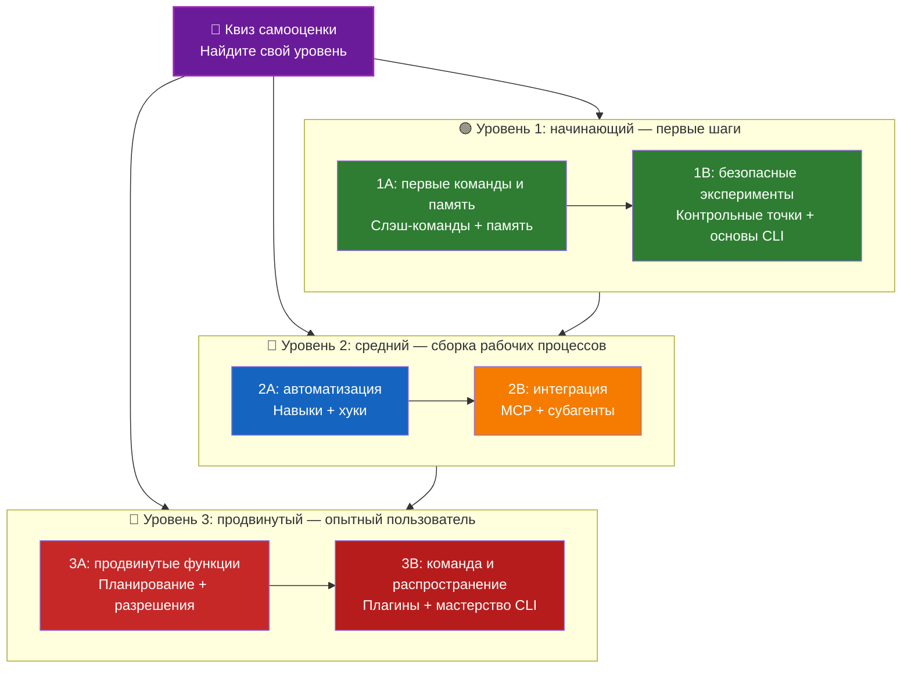

<!-- i18n-source: LEARNING-ROADMAP.md -->
<!-- i18n-source-sha: ca57ef1 -->
<!-- i18n-date: 2026-10-23 -->

<picture>
  <source media="(prefers-color-scheme: dark)" srcset="../resources/logos/claude-howto-logo-dark.svg">
  
</picture>

# 📚 Дорожная карта изучения Claude Code

**Впервые пользуетесь Claude Code?** Это руководство помогает освоить функции Claude Code в своём темпе. Совсем начинающий вы или опытный разработчик — начните с квиза самооценки ниже, чтобы найти свой путь.

---

## 🧭 Найдите свой уровень

Не все начинают с одного и того же. Пройдите эту короткую самооценку, чтобы найти правильную точку входа.

**Ответьте на вопросы честно:**

- [ ] Я умею запустить Claude Code и вести разговор (`claude`)
- [ ] Я создавал или редактировал файл CLAUDE.md
- [ ] Я использовал хотя бы 3 встроенные слэш-команды (например, /help, /compact, /model)
- [ ] Я создавал свою слэш-команду или навык (SKILL.md)
- [ ] Я настраивал MCP-сервер (например, GitHub, база данных)
- [ ] Я настраивал хуки в ~/.claude/settings.json
- [ ] Я создавал или использовал своих субагентов (.claude/agents/)
- [ ] Я использовал режим print (`claude -p`) для скриптов или CI/CD

**Ваш уровень:**

| Отметки | Уровень | Начните с | Время на прохождение |
|--------|-------|----------|------------------|
| 0-2 | **Уровень 1: начинающий** — первые шаги | [Этап 1A](#этап-1a-первые-команды-и-память) | ~3 часа |
| 3-5 | **Уровень 2: средний** — сборка рабочих процессов | [Этап 2A](#этап-2a-автоматизация-навыки--хуки) | ~5 часов |
| 6-8 | **Уровень 3: продвинутый** — опытный пользователь и тимлид | [Этап 3A](#этап-3a-продвинутые-функции) | ~5 часов |

> **Совет**: если не уверены, начните с уровня ниже. Лучше быстро повторить знакомое, чем пропустить основы.

> **Интерактивная версия**: запустите `/self-assessment` в Claude Code. Это квиз с подсказками: он оценит вас по всем 10 областям функций и соберёт персональный учебный путь.

---

## 🎯 Принципы обучения

Каталоги в этом репозитории пронумерованы в **рекомендуемом порядке обучения** по трём принципам:

1. **Зависимости** — сначала базовые понятия
2. **Сложность** — простые функции раньше продвинутых
3. **Частота использования** — самое частое разбираем в начале

Так вы собираете прочный фундамент и сразу получаете пользу в работе.

---

## 🗺️ Ваш учебный путь



**Легенда цветов:**
- 💜 Фиолетовый: квиз самооценки
- 🟢 Зелёный: уровень 1 — путь начинающего
- 🔵 Синий / 🟡 Золотой: уровень 2 — путь среднего уровня
- 🔴 Красный: уровень 3 — путь продвинутого

---

## 📊 Полная таблица дорожной карты

| Шаг | Функция | Сложность | Время | Уровень | Зависимости | Зачем это учить | Главная польза |
|------|---------|-----------|------|-------|--------------|----------------|--------------|
| **1** | [Слэш-команды](01-slash-commands) | ⭐ Начинающий | 30 мин | Уровень 1 | Нет | Быстрые победы в продуктивности (60+ встроенных команд + встроенные навыки) | Мгновенная автоматизация, стандарты команды |
| **2** | [Память](02-memory) | ⭐⭐ Начинающий+ | 45 мин | Уровень 1 | Нет | Нужна для всех функций | Постоянный контекст, предпочтения |
| **3** | [Контрольные точки](08-checkpoints) | ⭐⭐ Средний | 45 мин | Уровень 1 | Управление сессиями | Безопасные эксперименты | Эксперименты, восстановление |
| **4** | [Основы CLI](10-cli) | ⭐⭐ Начинающий+ | 30 мин | Уровень 1 | Нет | Базовое использование CLI | Интерактивный режим и режим print |
| **5** | [Навыки](03-skills) | ⭐⭐ Средний | 1 час | Уровень 2 | Слэш-команды | Автоматическая экспертиза | Повторно используемые возможности, единообразие |
| **6** | [Хуки](06-hooks) | ⭐⭐ Средний | 1 час | Уровень 2 | Инструменты, команды | Автоматизация рабочих процессов (33 события, 5 типов) | Проверка, пороги качества |
| **7** | [MCP](05-mcp) | ⭐⭐⭐ Средний+ | 1 час | Уровень 2 | Настройка | Доступ к живым данным | Интеграция в реальном времени, API |
| **8** | [Субагенты](04-subagents) | ⭐⭐⭐ Средний+ | 1,5 часа | Уровень 2 | Память, команды | Сложные задачи (6 встроенных, включая Explore и Plan) | Делегирование, специализированная экспертиза |
| **9** | [Продвинутые функции](09-advanced-features) | ⭐⭐⭐⭐⭐ Продвинутый | 2-3 часа | Уровень 3 | Все предыдущие | Инструменты опытного пользователя | Планирование, режим Auto, каналы, голосовая диктовка, разрешения |
| **10** | [Плагины](07-plugins) | ⭐⭐⭐⭐ Продвинутый | 2 часа | Уровень 3 | Все предыдущие | Готовые решения | Онбординг команды, распространение |
| **11** | [Мастерство CLI](10-cli) | ⭐⭐⭐ Продвинутый | 1 час | Уровень 3 | Рекомендуется: все | Уверенная работа в командной строке | Скрипты, CI/CD, автоматизация |

**Общее время обучения**: ~11-13 часов (или перейдите на свой уровень и сэкономьте время)

---

## 🟢 Уровень 1: начинающий — первые шаги

**Для**: тех, у кого 0-2 отметки в квизе
**Время**: ~3 часа
**Фокус**: быстрая продуктивность, понимание основ
**Результат**: уверенный ежедневный пользователь, готовность к уровню 2

### Этап 1A: первые команды и память

**Темы**: слэш-команды + память
**Время**: 1-2 часа
**Сложность**: ⭐ Начинающий
**Цель**: сразу поднять продуктивность своими командами и постоянным контекстом

#### Чего вы добьётесь
✅ Свои слэш-команды для повторяющихся задач
✅ Память проекта со стандартами команды
✅ Личные предпочтения
✅ Понимание, как Claude сам загружает контекст

#### Практические упражнения

```bash
# Упражнение 1: установите первую слэш-команду
mkdir -p .claude/commands
cp 01-slash-commands/optimize.md .claude/commands/

# Упражнение 2: создайте память проекта
cp 02-memory/project-CLAUDE.md ./CLAUDE.md

# Упражнение 3: попробуйте
# В Claude Code введите: /optimize
```

#### Критерии успеха
- [ ] Команда `/optimize` успешно вызывается
- [ ] Claude помнит стандарты проекта из CLAUDE.md
- [ ] Вы понимаете, когда использовать слэш-команды, а когда память

#### Следующие шаги
Когда будет комфортно, прочитайте:
- [01-slash-commands/README.md](01-slash-commands/README.md)
- [02-memory/README.md](02-memory/README.md)

> **Проверьте себя**: запустите `/lesson-quiz slash-commands` или `/lesson-quiz memory` в Claude Code, чтобы проверить, что вы усвоили.

---

### Этап 1B: безопасные эксперименты

**Темы**: контрольные точки + основы CLI
**Время**: 1 час
**Сложность**: ⭐⭐ Начинающий+
**Цель**: научиться безопасно экспериментировать и пользоваться основными командами CLI

#### Чего вы добьётесь
✅ Создавать и восстанавливать контрольные точки для безопасных экспериментов
✅ Понимать разницу интерактивного режима и режима print
✅ Пользоваться базовыми флагами и параметрами CLI
✅ Обрабатывать файлы через пайп

#### Практические упражнения

```bash
# Упражнение 1: попробуйте сценарий с контрольными точками
# В Claude Code:
# Внесите экспериментальные изменения, затем нажмите Esc+Esc или используйте /rewind
# Выберите контрольную точку до эксперимента
# Выберите «Восстановить код и разговор», чтобы вернуться

# Упражнение 2: интерактивный режим и режим print
claude "объясни этот проект"           # Интерактивный режим
claude -p "объясни эту функцию"       # Режим print (неинтерактивный)

# Упражнение 3: обработайте содержимое файла через пайп
cat error.log | claude -p "объясни эту ошибку"
```

#### Критерии успеха
- [ ] Создали контрольную точку и вернулись к ней
- [ ] Использовали и интерактивный режим, и режим print
- [ ] Передали файл Claude на анализ через пайп
- [ ] Понимаете, когда контрольные точки нужны для безопасных экспериментов

#### Следующие шаги
- Прочитайте: [08-checkpoints/README.md](08-checkpoints/README.md)
- Прочитайте: [10-cli/README.md](10-cli/README.md)
- **Готовы к уровню 2!** Переходите к [этапу 2A](#этап-2a-автоматизация-навыки--хуки)

> **Проверьте себя**: запустите `/lesson-quiz checkpoints` или `/lesson-quiz cli`, чтобы убедиться, что вы готовы к уровню 2.

---

## 🔵 Уровень 2: средний — сборка рабочих процессов

**Для**: тех, у кого 3-5 отметок в квизе
**Время**: ~5 часов
**Фокус**: автоматизация, интеграция, делегирование задач
**Результат**: автоматические рабочие процессы, внешние интеграции, готовность к уровню 3

### Проверка предпосылок

Прежде чем начинать уровень 2, убедитесь, что вам удобны эти понятия уровня 1:

- [ ] Умеете создавать и использовать слэш-команды ([01-slash-commands/](01-slash-commands))
- [ ] Настроили память проекта через CLAUDE.md ([02-memory/](02-memory))
- [ ] Знаете, как создавать и восстанавливать контрольные точки ([08-checkpoints/](08-checkpoints))
- [ ] Умеете вызывать `claude` и `claude -p` из командной строки ([10-cli/](10-cli))

> **Есть пробелы?** Повторите связанные туториалы выше, прежде чем идти дальше.

---

### Этап 2A: автоматизация (навыки + хуки)

**Темы**: навыки + хуки
**Время**: 2-3 часа
**Сложность**: ⭐⭐ Средний
**Цель**: автоматизировать обычные рабочие процессы и проверки качества

#### Чего вы добьётесь
✅ Сами вызывать специализированные возможности через frontmatter YAML (включая поля `effort` и `shell`)
✅ Настроить автоматизацию по событиям на 33 события хуков
✅ Использовать все 5 типов хуков (command, http, mcp_tool, prompt, agent)
✅ Удерживать стандарты качества кода
✅ Создавать свои хуки под свой рабочий процесс

#### Практические упражнения

```bash
# Упражнение 1: установите навык
cp -r 03-skills/code-review-specialist ~/.claude/skills/

# Упражнение 2: настройте хуки
mkdir -p ~/.claude/hooks
cp 06-hooks/pre-tool-check.sh ~/.claude/hooks/
chmod +x ~/.claude/hooks/pre-tool-check.sh

# Упражнение 3: пропишите хуки в настройках
# Добавьте в ~/.claude/settings.json:
{
  "hooks": {
    "PreToolUse": [
      {
        "matcher": "Bash",
        "hooks": [
          {
            "type": "command",
            "command": "~/.claude/hooks/pre-tool-check.sh"
          }
        ]
      }
    ]
  }
}
```

#### Критерии успеха
- [ ] Навык код-ревью сам вызывается, когда это уместно
- [ ] Хук PreToolUse запускается до выполнения инструмента
- [ ] Вы понимаете разницу между автовызовом навыка и срабатыванием хука по событию

#### Следующие шаги
- Создайте свой навык
- Настройте дополнительные хуки под свой рабочий процесс
- Прочитайте: [03-skills/README.md](03-skills/README.md)
- Прочитайте: [06-hooks/README.md](06-hooks/README.md)

> **Проверьте себя**: запустите `/lesson-quiz skills` или `/lesson-quiz hooks`, чтобы проверить знания, прежде чем идти дальше.

---

### Этап 2B: интеграция (MCP + субагенты)

**Темы**: MCP + субагенты
**Время**: 2-3 часа
**Сложность**: ⭐⭐⭐ Средний+
**Цель**: подключать внешние сервисы и делегировать сложные задачи

#### Чего вы добьётесь
✅ Доступ к живым данным GitHub, баз данных и т. д.
✅ Делегирование работы специализированным ИИ-агентам
✅ Понимание, когда нужен MCP, а когда субагенты
✅ Сборка интегрированных рабочих процессов

#### Практические упражнения

```bash
# Упражнение 1: настройте GitHub MCP
claude mcp add --transport http github https://api.githubcopilot.com/mcp/ --header "Authorization: Bearer YOUR_GITHUB_PAT"

# Упражнение 2: проверьте интеграцию MCP
# В Claude Code: /mcp__github__list_prs

# Упражнение 3: установите субагентов
mkdir -p .claude/agents
cp 04-subagents/*.md .claude/agents/
```

#### Упражнение на интеграцию
Попробуйте цельный рабочий процесс:
1. Через MCP получите PR на GitHub
2. Пусть Claude делегирует ревью субагенту code-reviewer
3. Хуками автоматически запустите тесты

#### Критерии успеха
- [ ] Успешно запросили данные GitHub через MCP
- [ ] Claude делегирует сложные задачи субагентам
- [ ] Вы понимаете разницу между MCP и субагентами
- [ ] Собрали MCP + субагентов + хуки в одном рабочем процессе

#### Следующие шаги
- Настройте ещё MCP-серверы (база данных, Slack и т. д.)
- Создайте своих субагентов под свою область
- Прочитайте: [05-mcp/README.md](05-mcp/README.md)
- Прочитайте: [04-subagents/README.md](04-subagents/README.md)
- **Готовы к уровню 3!** Переходите к [этапу 3A](#этап-3a-продвинутые-функции)

> **Проверьте себя**: запустите `/lesson-quiz mcp` или `/lesson-quiz subagents`, чтобы убедиться, что вы готовы к уровню 3.

---

## 🔴 Уровень 3: продвинутый — опытный пользователь и тимлид

**Для**: тех, у кого 6-8 отметок в квизе
**Время**: ~5 часов
**Фокус**: инструменты команды, CI/CD, корпоративные функции, разработка плагинов
**Результат**: опытный пользователь, умеет настраивать рабочие процессы команды и CI/CD

### Проверка предпосылок

Прежде чем начинать уровень 3, убедитесь, что вам удобны эти понятия уровня 2:

- [ ] Умеете создавать и использовать навыки с автовызовом ([03-skills/](03-skills))
- [ ] Настроили хуки для автоматизации по событиям ([06-hooks/](06-hooks))
- [ ] Умеете настраивать MCP-серверы для внешних данных ([05-mcp/](05-mcp))
- [ ] Знаете, как использовать субагентов для делегирования задач ([04-subagents/](04-subagents))

> **Есть пробелы?** Повторите связанные туториалы выше, прежде чем идти дальше.

---

### Этап 3A: продвинутые функции

**Темы**: продвинутые функции (планирование, разрешения, расширенное мышление, режим Auto, каналы, голосовая диктовка, Remote Control / приложение для компьютера / веб)
**Время**: 2-3 часа
**Сложность**: ⭐⭐⭐⭐⭐ Продвинутый
**Цель**: освоить продвинутые рабочие процессы и инструменты опытного пользователя

#### Чего вы добьётесь
✅ Режим планирования для сложных функций
✅ Тонкое управление разрешениями: 6 режимов (manual — раньше default, acceptEdits, plan, auto, dontAsk, bypassPermissions)
✅ Расширенное мышление переключателем Alt+T / Option+T
✅ Управление фоновыми задачами
✅ Автопамять для выученных предпочтений
✅ Режим Auto с фоновым классификатором безопасности
✅ Каналы, которые присылают события (результаты CI, сообщения чата, вебхуки) в текущую сессию
✅ Голосовая диктовка для работы без рук
✅ Remote Control (общедоступен — ваша машина отображается карточкой устройства в приложении Claude), приложение для компьютера и веб-сессии
✅ Команды агентов для совместной работы нескольких агентов

#### Практические упражнения

```bash
# Упражнение 1: используйте режим планирования
/plan Реализовать систему аутентификации пользователей

# Упражнение 2: попробуйте режимы разрешений (доступно 6: manual [ранее default], acceptEdits, plan, auto, dontAsk, bypassPermissions)
claude --permission-mode plan "проанализируй эту кодовую базу"
claude --permission-mode acceptEdits "отрефакторь модуль auth"
claude --permission-mode auto "реализуй функцию"

# Упражнение 3: включите расширенное мышление
# Во время сессии нажмите Alt+T (Option+T на macOS), чтобы переключить

# Упражнение 4: продвинутый сценарий с контрольными точками
# 1. Создайте контрольную точку «Чистое состояние»
# 2. В режиме планирования спроектируйте функцию
# 3. Реализуйте с делегированием субагенту
# 4. Запустите тесты в фоне
# 5. Если тесты упали, вернитесь к контрольной точке
# 6. Попробуйте другой подход

# Упражнение 5: попробуйте режим Auto (фоновый классификатор безопасности)
claude --permission-mode auto "реализуй страницу настроек пользователя"

# Упражнение 6: включите команды агентов
export CLAUDE_CODE_EXPERIMENTAL_AGENT_TEAMS=1
# Спросите Claude: «Реализовать функцию X командным подходом»

# Упражнение 7: запланированные задачи
/loop 5m /check-status
# Задачи живут в рамках сессии; для постоянного расписания используйте Routines или запланированные задачи Desktop

# Упражнение 8: каналы (исследовательское превью)
# Канал — это MCP-сервер, который присылает события в текущую сессию

# Упражнение 9: голосовая диктовка
# Голосовой ввод для работы с Claude Code без рук
```

#### Критерии успеха
- [ ] Использовали режим планирования для сложной функции
- [ ] Настроили режимы разрешений (plan, acceptEdits, auto, dontAsk)
- [ ] Включали расширенное мышление через Alt+T / Option+T
- [ ] Использовали режим Auto с фоновым классификатором безопасности
- [ ] Использовали фоновые задачи для долгих операций
- [ ] Посмотрели каналы, которые присылают внешние события в сессию
- [ ] Попробовали голосовую диктовку для ввода без рук
- [ ] Понимаете Remote Control, приложение для компьютера и веб-сессии
- [ ] Использовали `notify_when_idle` в межсессионном `SendMessage`, чтобы узнать, когда другая сессия простаивает
- [ ] Включили команды агентов и использовали их для совместных задач
- [ ] Использовали `/loop` для повторяющихся задач или мониторинга по расписанию

#### Следующие шаги
- Прочитайте: [09-advanced-features/README.md](09-advanced-features/README.md)

> **Проверьте себя**: запустите `/lesson-quiz advanced`, чтобы проверить, как вы владеете функциями опытного пользователя.

---

### Этап 3B: команда и распространение (плагины + мастерство CLI)

**Темы**: плагины + мастерство CLI + CI/CD
**Время**: 2-3 часа
**Сложность**: ⭐⭐⭐⭐ Продвинутый
**Цель**: собирать инструменты для команды, создавать плагины, освоить интеграцию CI/CD

#### Чего вы добьётесь
✅ Устанавливать и создавать полные встроенные плагины
✅ Уверенно пользоваться CLI для скриптов и автоматизации
✅ Настроить интеграцию CI/CD через `claude -p`
✅ JSON-вывод для автоматических пайплайнов
✅ Управление сессиями и пакетная обработка

#### Практические упражнения

```bash
# Упражнение 1: установите цельный плагин
claude --plugin-dir ./07-plugins/pr-review  # из корня репозитория

# Упражнение 2: режим print для CI/CD
claude -p "Запусти все тесты и сформируй отчёт"

# Упражнение 3: JSON-вывод для скриптов
claude -p --output-format json "перечисли все функции"

# Упражнение 4: управление сессиями и продолжение
claude -r "feature-auth" "продолжи реализацию"

# Упражнение 5: интеграция CI/CD с ограничениями
claude -p --max-turns 3 --output-format json "проверь код"

# Упражнение 6: пакетная обработка
for file in *.md; do
  claude -p --output-format json "суммируй это: $(cat $file)" > ${file%.md}.summary.json
done
```

#### Упражнение: интеграция CI/CD
Соберите простой скрипт CI/CD:
1. Через `claude -p` проверьте изменённые файлы
2. Выведите результат как JSON
3. Обработайте `jq`, чтобы вытащить конкретные проблемы
4. Встройте в рабочий процесс GitHub Actions

#### Критерии успеха
- [ ] Установили плагин и воспользовались им
- [ ] Собрали или изменили плагин для своей команды
- [ ] Использовали режим print (`claude -p`) в CI/CD
- [ ] Получили JSON-вывод для скриптов
- [ ] Успешно продолжили предыдущую сессию
- [ ] Написали скрипт пакетной обработки
- [ ] Встроили Claude в рабочий процесс CI/CD

#### Реальные сценарии CLI
- **Автоматизация код-ревью**: запускайте код-ревью в пайплайнах CI/CD
- **Анализ логов**: разбирайте журналы ошибок и вывод системы
- **Генерация документации**: пакетно создавайте документацию
- **Выводы из тестов**: анализируйте падения тестов
- **Анализ производительности**: смотрите метрики производительности
- **Обработка данных**: преобразуйте и анализируйте файлы данных

#### Следующие шаги
- Прочитайте: [07-plugins/README.md](07-plugins/README.md)
- Прочитайте: [10-cli/README.md](10-cli/README.md)
- Сделайте общие для команды ярлыки CLI и плагины
- Настройте скрипты пакетной обработки

> **Проверьте себя**: запустите `/lesson-quiz plugins` или `/lesson-quiz cli`, чтобы подтвердить, что вы это освоили.

---

## 🧪 Проверьте знания

В этом репозитории два интерактивных навыка. Ими можно в любой момент пользоваться в Claude Code, чтобы оценить, как вы поняли материал:

| Навык | Команда | Назначение |
|-------|---------|---------|
| **Самооценка** | `/self-assessment` | Оцените общий уровень по всем 10 функциям. Выберите режим Quick (2 мин) или Deep (5 мин), чтобы получить персональный профиль навыков и учебный путь. |
| **Квиз урока** | `/lesson-quiz [lesson]` | Проверьте понимание конкретного урока: 10 вопросов. Используйте до урока (предварительный тест), во время (проверка прогресса) или после (проверка освоения). |

**Примеры:**
```
/self-assessment                  # Общий уровень
/lesson-quiz hooks                # Квиз по уроку 06: хуки
/lesson-quiz 03                   # Квиз по уроку 03: навыки
/lesson-quiz advanced-features    # Квиз по уроку 09
```

---

## ⚡ Короткие маршруты

### Если у вас есть только 15 минут
**Цель**: первая победа

1. Скопируйте одну слэш-команду: `cp 01-slash-commands/optimize.md .claude/commands/`
2. Попробуйте в Claude Code: `/optimize`
3. Прочитайте: [01-slash-commands/README.md](01-slash-commands/README.md)

**Результат**: у вас будет рабочая слэш-команда и понимание основ

---

### Если у вас есть 1 час
**Цель**: настроить базовые инструменты продуктивности

1. **Слэш-команды** (15 мин): скопируйте и проверьте `/optimize` и `/pr`
2. **Память проекта** (15 мин): создайте CLAUDE.md со стандартами проекта
3. **Установите навык** (15 мин): настройте навык code-review-specialist
4. **Попробуйте вместе** (15 мин): посмотрите, как они работают сообща

**Результат**: базовый прирост продуктивности за счёт команд, памяти и автоматических навыков

---

### Если у вас есть выходные
**Цель**: уверенно пользоваться большинством функций

**Суббота, утро** (3 часа):
- Пройдите этап 1A: слэш-команды + память
- Пройдите этап 1B: контрольные точки + основы CLI

**Суббота, день** (3 часа):
- Пройдите этап 2A: навыки + хуки
- Пройдите этап 2B: MCP + субагенты

**Воскресенье** (4 часа):
- Пройдите этап 3A: продвинутые функции
- Пройдите этап 3B: плагины + мастерство CLI + CI/CD
- Соберите свой плагин для команды

**Результат**: вы станете опытным пользователем Claude Code, готовым обучать других и автоматизировать сложные рабочие процессы

---

## 💡 Советы по обучению

### ✅ Делайте

- **Сначала пройдите квиз**, чтобы найти точку старта
- **Делайте практические упражнения** на каждом этапе
- **Начинайте с простого** и усложняйте постепенно
- **Проверяйте каждую функцию**, прежде чем переходить к следующей
- **Записывайте**, что работает в вашем рабочем процессе
- **Возвращайтесь** к ранним понятиям, когда изучаете продвинутые темы
- **Экспериментируйте безопасно** с помощью контрольных точек
- **Делитесь знаниями** с командой

### ❌ Не делайте

- **Не пропускайте проверку предпосылок**, когда переходите на уровень выше
- **Не пытайтесь выучить всё сразу** — это перегружает
- **Не копируйте настройки, не понимая их** — не сможете отладить
- **Не забывайте проверять** — всегда убеждайтесь, что функция работает
- **Не проскакивайте этапы** — дайте себе время понять
- **Не игнорируйте документацию** — в каждом README есть важные детали
- **Не работайте в изоляции** — обсуждайте с коллегами

---

## 🎓 Стили обучения

### Визуальное обучение
- Изучайте диаграммы Mermaid в каждом README
- Смотрите, как проходит выполнение команд
- Рисуйте свои схемы рабочих процессов
- Пользуйтесь наглядным учебным путём выше

### Обучение на практике
- Выполняйте каждое практическое упражнение
- Пробуйте варианты
- Ломайте и чините (используйте контрольные точки!)
- Делайте свои примеры

### Обучение по тексту
- Внимательно читайте каждый README
- Изучайте примеры кода
- Смотрите сравнительные таблицы
- Читайте статьи в блоге из раздела материалов

### Обучение в общении
- Устраивайте сессии парного программирования
- Объясняйте понятия коллегам
- Участвуйте в обсуждениях сообщества Claude Code
- Делитесь своими конфигурациями

---

## 📈 Отслеживание прогресса

Этими списками отмечайте прогресс по уровням. В любой момент запустите `/self-assessment`, чтобы получить свежий профиль навыков, или `/lesson-quiz [lesson]` после каждого туториала, чтобы проверить понимание.

### 🟢 Уровень 1: начинающий
- [ ] Пройден [01-slash-commands](01-slash-commands)
- [ ] Пройден [02-memory](02-memory)
- [ ] Создана первая своя слэш-команда
- [ ] Настроена память проекта
- [ ] **Этап 1A пройден**
- [ ] Пройден [08-checkpoints](08-checkpoints)
- [ ] Пройдены основы [10-cli](10-cli)
- [ ] Создана контрольная точка и выполнен возврат к ней
- [ ] Использованы интерактивный режим и режим print
- [ ] **Этап 1B пройден**

### 🔵 Уровень 2: средний
- [ ] Пройден [03-skills](03-skills)
- [ ] Пройден [06-hooks](06-hooks)
- [ ] Установлен первый навык
- [ ] Настроен хук PreToolUse
- [ ] **Этап 2A пройден**
- [ ] Пройден [05-mcp](05-mcp)
- [ ] Пройден [04-subagents](04-subagents)
- [ ] Подключён GitHub MCP
- [ ] Создан свой субагент
- [ ] Интеграции собраны в одном рабочем процессе
- [ ] **Этап 2B пройден**

### 🔴 Уровень 3: продвинутый
- [ ] Пройден [09-advanced-features](09-advanced-features)
- [ ] Режим планирования использован успешно
- [ ] Настроены режимы разрешений (6 режимов, включая auto)
- [ ] Использован режим Auto с классификатором безопасности
- [ ] Использован переключатель расширенного мышления
- [ ] Изучены каналы и голосовая диктовка
- [ ] **Этап 3A пройден**
- [ ] Пройден [07-plugins](07-plugins)
- [ ] Пройдено продвинутое использование [10-cli](10-cli)
- [ ] Настроен режим print (`claude -p`) в CI/CD
- [ ] Сделан JSON-вывод для автоматизации
- [ ] Claude встроен в пайплайн CI/CD
- [ ] Создан командный плагин
- [ ] **Этап 3B пройден**

---

## 🆘 Типичные трудности в обучении

### Задача 1: «Слишком много понятий сразу»
**Решение**: берите по одному этапу. Сделайте все упражнения, прежде чем идти дальше.

### Задача 2: «Непонятно, какую функцию когда использовать»
**Решение**: загляните в [матрицу сценариев](README.md#use-case-matrix) в основном README.

### Задача 3: «Настройка не работает»
**Решение**: см. раздел [Устранение неполадок](README.md#troubleshooting) и проверьте расположение файлов.

### Задача 4: «Понятия как будто пересекаются»
**Решение**: посмотрите таблицу [Сравнение функций](README.md#feature-comparison), чтобы увидеть различия.

### Задача 5: «Трудно всё запомнить»
**Решение**: сделайте свою шпаргалку. Для безопасных экспериментов используйте контрольные точки.

### Задача 6: «Я опытный, но не знаю, с чего начать»
**Решение**: пройдите [квиз самооценки](#-найдите-свой-уровень) выше. Перейдите на свой уровень и проверкой предпосылок найдите пробелы.

---

## 🎯 Что дальше после прохождения?

Когда все этапы пройдены:

1. **Составьте документацию команды** — опишите, как у вас настроен Claude Code
2. **Соберите свои плагины** — упакуйте рабочие процессы команды, включая новые поля манифеста (`workflows`, `channels`, `dependencies`)
3. **Попробуйте `/design`** — набросайте макет интерфейса, сценарий экранов или лендинг на холсте дизайна, а не пишите HTML вручную (v2.1.265+)
4. **Изучите Remote Control** — продолжите локальную сессию Claude Code с телефона, из браузера или приложения Claude либо запустите её с телефона через карточку устройства в приложении Claude
5. **Попробуйте веб-сессии** — пользуйтесь Claude Code через браузерные интерфейсы для удалённой разработки
6. **Пользуйтесь приложением для компьютера** — функции Claude Code в нативном приложении
7. **Используйте режим Auto** — пусть Claude работает автономно с фоновым классификатором безопасности
8. **Включите автопамять** — пусть Claude сам со временем запоминает ваши предпочтения
9. **Настройте команды агентов** — координируйте нескольких агентов на сложных многосторонних задачах
10. **Используйте каналы** — подключите MCP-сервер, который присылает события (результаты CI, сообщения чата, вебхуки) в текущую сессию
11. **Попробуйте голосовую диктовку** — голосовой ввод без рук для работы с Claude Code
12. **Используйте запланированные задачи** — автоматизируйте повторяющиеся проверки через `/loop` и инструменты cron
13. **Присылайте примеры** — делитесь с сообществом
14. **Наставляйте других** — помогайте коллегам учиться
15. **Улучшайте рабочие процессы** — постоянно дорабатывайте по тому, как вы ими пользуетесь
16. **Следите за обновлениями** — читайте релизы Claude Code и новые функции

---

## 📚 Дополнительные материалы

### Официальная документация
- [Документация Claude Code](https://code.claude.com/docs/en/overview)
- [Документация Anthropic](https://docs.anthropic.com)
- [Спецификация протокола MCP](https://modelcontextprotocol.io)

### Статьи в блоге
- [Знакомство со слэш-командами Claude Code](https://medium.com/@luongnv89/discovering-claude-code-slash-commands-cdc17f0dfb29)

### Сообщество
- [Anthropic Cookbook](https://github.com/anthropics/anthropic-cookbook)
- [Репозиторий MCP-серверов](https://github.com/modelcontextprotocol/servers)

---

## 💬 Обратная связь и поддержка

- **Нашли проблему?** Создайте issue в репозитории
- **Есть идея?** Откройте pull request
- **Нужна помощь?** Загляните в документацию или спросите сообщество

---

**Обновлено**: 18 октября 2026
**Версия Claude Code**: 2.1.302
**Источники**:
- https://code.claude.com/docs/en/overview
- https://code.claude.com/docs/en/hooks
- https://code.claude.com/docs/en/permission-modes
- https://github.com/anthropics/claude-code/releases/tag/v2.1.144
- https://github.com/anthropics/claude-code/releases/tag/v2.1.145
- https://code.claude.com/docs/en/model-config
- https://code.claude.com/docs/en/agent-teams
- https://code.claude.com/docs/en/mcp
- https://code.claude.com/docs/en/plugins/install
- https://code.claude.com/docs/en/channels
- https://code.claude.com/docs/en/remote-control
- https://code.claude.com/docs/en/scheduled-tasks
- https://code.claude.com/docs/en/commands
- https://code.claude.com/docs/en/sub-agents
**Совместимые модели**: Claude Fable 5.1, Claude Fable 5, Claude Opus 5, Claude Sonnet 5, Claude Sonnet 4.6, Claude Opus 4.8, Claude Haiku 4.5
**Поддерживают**: участники Claude How To
**Лицензия**: для обучения, можно свободно использовать и адаптировать

---

[← Назад к основному README](README.md)
