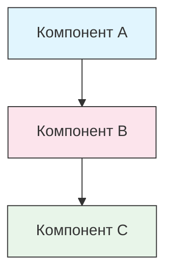

<!-- i18n-source: STYLE_GUIDE.md -->
<!-- i18n-source-sha: 0e01159 -->
<!-- i18n-date: 2026-10-23 -->

<picture>
  <source media="(prefers-color-scheme: dark)" srcset="../resources/logos/claude-howto-logo-dark.svg">
  
</picture>

# Руководство по стилю

> Соглашения и правила оформления для тех, кто дополняет Claude How To. Следуйте этому руководству, чтобы текст оставался единообразным, профессиональным и простым в сопровождении.

---

## Содержание

- [Именование файлов и папок](#именование-файлов-и-папок)
- [Структура документа](#структура-документа)
- [Заголовки](#заголовки)
- [Форматирование текста](#форматирование-текста)
- [Списки](#списки)
- [Таблицы](#таблицы)
- [Блоки кода](#блоки-кода)
- [Ссылки и перекрёстные ссылки](#ссылки-и-перекрёстные-ссылки)
- [Диаграммы](#диаграммы)
- [Использование emoji](#использование-emoji)
- [YAML-frontmatter](#yaml-frontmatter)
- [Изображения и медиа](#изображения-и-медиа)
- [Тон и голос](#тон-и-голос)
- [Сообщения коммитов](#сообщения-коммитов)
- [Чек-лист для авторов](#чек-лист-для-авторов)

---

## Именование файлов и папок

### Каталоги уроков

Каталоги уроков начинаются с **двузначного числового префикса**, за ним идёт описатель в **kebab-case**:

```
01-slash-commands/
02-memory/
03-skills/
04-subagents/
05-mcp/
```

Номер отражает порядок учебного пути от начинающего к продвинутому.

### Имена файлов

| Тип | Соглашение | Примеры |
|------|-----------|----------|
| **README урока** | `README.md` | `01-slash-commands/README.md` |
| **Файл функции** | kebab-case, `.md` | `code-reviewer.md`, `generate-api-docs.md` |
| **Скрипт оболочки** | kebab-case, `.sh` | `format-code.sh`, `validate-input.sh` |
| **Файл конфигурации** | Стандартные имена | `.mcp.json`, `settings.json` |
| **Файл памяти** | С префиксом области | `project-CLAUDE.md`, `personal-CLAUDE.md` |
| **Документы верхнего уровня** | UPPER_CASE, `.md` | `CATALOG.md`, `QUICK_REFERENCE.md`, `CONTRIBUTING.md` |
| **Изображения** | kebab-case | `pr-slash-command.png`, `claude-howto-logo.svg` |

### Правила

- Пишите **строчными** все имена файлов и папок (кроме документов верхнего уровня вроде `README.md`, `CATALOG.md`)
- Разделяйте слова **дефисами** (`-`), никогда подчёркиваниями или пробелами
- Имена должны быть понятными, но короткими

---

## Структура документа

### Корневой README

Корневой `README.md` идёт в таком порядке:

1. Логотип (элемент `<picture>` со светлым и тёмным вариантами)
2. Заголовок H1
3. Вводная цитата (ценностное предложение в одну строку)
4. Раздел «Зачем это руководство?» со сравнительной таблицей
5. Горизонтальная линия (`---`)
6. Содержание
7. Каталог функций
8. Быстрая навигация
9. Учебный путь
10. Разделы функций
11. С чего начать
12. Лучшие практики / устранение неполадок
13. Участие в разработке / лицензия

### README урока

Каждый `README.md` урока идёт в таком порядке:

1. Заголовок H1 (например, `# Слэш-команды`)
2. Короткий обзорный абзац
3. Таблица краткого справочника (необязательно)
4. Диаграмма архитектуры (Mermaid)
5. Подробные разделы (H2)
6. Практические примеры (нумерованные, 4–6 примеров)
7. Лучшие практики (таблицы «делайте» и «не делайте»)
8. Устранение неполадок
9. Связанные руководства / официальная документация
10. Подвал с метаданными документа

### Файл функции или примера

Отдельные файлы функций (например, `optimize.md`, `pr.md`):

1. YAML-frontmatter (если нужен)
2. Заголовок H1
3. Назначение / описание
4. Инструкции по использованию
5. Примеры кода
6. Советы по настройке

### Разделители разделов

Горизонтальными линиями (`---`) отделяйте крупные области документа:

```markdown
---

## Новый крупный раздел
```

Ставьте их после вводной цитаты и между логически разными частями документа.

---

## Заголовки

### Иерархия

| Уровень | Назначение | Пример |
|-------|-----|---------|
| `#` H1 | Название страницы (одно на документ) | `# Слэш-команды` |
| `##` H2 | Крупные разделы | `## Лучшие практики` |
| `###` H3 | Подразделы | `### Добавление навыка` |
| `####` H4 | Под-подразделы (редко) | `#### Параметры конфигурации` |

### Правила

- **Один H1 на документ** — только название страницы
- **Не пропускайте уровни** — не перескакивайте с H2 на H4
- **Заголовки короткие** — стремитесь к 2–5 словам
- **Как в обычном предложении** — с заглавной только первое слово и имена собственные (исключение: имена функций остаются как есть)
- **Префиксы emoji только в заголовках корневого README** (см. [Использование emoji](#использование-emoji))

---

## Форматирование текста

### Выделение

| Стиль | Когда использовать | Пример |
|-------|------------|---------|
| **Жирный** (`**текст**`) | Ключевые термины, подписи в таблицах, важные понятия | `**Установка**:` |
| *Курсив* (`*текст*`) | Первое употребление технического термина, названия книг и документов | `*frontmatter*` |
| `Код` (`` `текст` ``) | Имена файлов, команды, значения конфигурации, ссылки на код | `` `CLAUDE.md` `` |

### Цитаты для выносок

Важные замечания оформляйте цитатой с жирным префиксом:

```markdown
> **Примечание**: пользовательские слэш-команды слиты с навыками с v2.0.

> **Важно**: никогда не коммитьте API-ключи и учётные данные.

> **Совет**: сочетайте память с навыками, чтобы получить максимум.
```

Поддерживаемые типы выносок: **Примечание**, **Важно**, **Совет**, **Предупреждение**.

### Абзацы

- Абзацы короткие (2–4 предложения)
- Между абзацами пустая строка
- Сначала главная мысль, потом контекст
- Объясняйте «зачем», а не только «что»

---

## Списки

### Маркированные списки

Маркер — дефис (`-`), вложенность — отступ в 2 пробела:

```markdown
- Первый пункт
- Второй пункт
  - Вложенный пункт
  - Ещё один вложенный пункт
    - Глубокая вложенность (не уходите глубже 3 уровней)
- Третий пункт
```

### Нумерованные списки

Нумерованные списки — для шагов по порядку, инструкций и ранжированных пунктов:

```markdown
1. Первый шаг
2. Второй шаг
   - Подробность подпункта
   - Ещё один подпункт
3. Третий шаг
```

### Списки с описаниями

Жирные подписи — для списков в виде «ключ — значение»:

```markdown
- **Узкие места производительности** — находите операции O(n^2), неэффективные циклы
- **Утечки памяти** — ищите неосвобождённые ресурсы, циклические ссылки
- **Улучшения алгоритмов** — предлагайте лучшие алгоритмы или структуры данных
```

### Правила

- Отступ одинаковый (2 пробела на уровень)
- Пустая строка до списка и после него
- Пункты параллельны по форме (все с глагола или все существительные и так далее)
- Не вкладывайте глубже 3 уровней

---

## Таблицы

### Стандартный формат

```markdown
| Столбец 1 | Столбец 2 | Столбец 3 |
|----------|----------|----------|
| Данные     | Данные     | Данные     |
```

### Типичные шаблоны таблиц

**Сравнение функций (3–4 столбца):**

```markdown
| Функция | Вызов | Сохранение | Лучше всего для |
|---------|-----------|------------|----------|
| **Слэш-команды** | Вручную (`/cmd`) | Только сессия | Быстрые сокращения |
| **Память** | Загружается сама | Между сессиями | Долгое обучение |
```

**Делайте и не делайте:**

```markdown
| Делайте | Не делайте |
|----|-------|
| Используйте понятные имена | Используйте размытые имена |
| Держите файлы сфокусированными | Перегружайте один файл |
```

**Краткий справочник:**

```markdown
| Аспект | Подробности |
|--------|---------|
| **Назначение** | Генерация документации API |
| **Область** | Уровень проекта |
| **Сложность** | Средний уровень |
```

### Правила

- **Жирные заголовки таблицы**, когда это подписи строк (первый столбец)
- Выравнивайте вертикальные черты в исходнике для читаемости (необязательно, но лучше так)
- Текст ячейки короткий; подробности — ссылкой
- Команды и пути к файлам внутри ячеек оформляйте `кодом`

---

## Блоки кода

### Языковые метки

Всегда указывайте языковую метку для подсветки синтаксиса:

| Язык | Метка | Для чего |
|----------|-----|---------|
| Оболочка | `bash` | Команды CLI, скрипты |
| Python | `python` | Код Python |
| JavaScript | `javascript` | Код JS |
| TypeScript | `typescript` | Код TS |
| JSON | `json` | Файлы конфигурации |
| YAML | `yaml` | Frontmatter, конфигурация |
| Markdown | `markdown` | Примеры Markdown |
| SQL | `sql` | Запросы к базе данных |
| Обычный текст | (без метки) | Ожидаемый вывод, деревья каталогов |

### Соглашения

```bash
# Комментарий, который объясняет, что делает команда
claude mcp add notion --transport http https://mcp.notion.com/mcp
```

- **Строка комментария** перед неочевидными командами
- Все примеры **можно сразу скопировать**
- Где уместно, показывайте **и простой, и продвинутый** вариант
- Добавляйте **ожидаемый вывод**, если он помогает понять (блок кода без метки)

### Блоки установки

Для инструкций по установке используйте такой шаблон:

```bash
# Скопируйте файлы в свой проект
cp 01-slash-commands/*.md .claude/commands/
```

### Многошаговые рабочие процессы

```bash
# Шаг 1: создайте каталог
mkdir -p .claude/commands

# Шаг 2: скопируйте шаблоны
cp 01-slash-commands/*.md .claude/commands/

# Шаг 3: проверьте установку
ls .claude/commands/
```

---

## Ссылки и перекрёстные ссылки

### Внутренние ссылки (относительные)

Все внутренние ссылки — относительными путями:

```markdown
[Слэш-команды](01-slash-commands/)
[Руководство по навыкам](03-skills/)
[Архитектура памяти](02-memory/#архитектура-памяти)
```

Из каталога урока назад к корню или к соседнему уроку:

```markdown
[Назад к основному руководству](../README.md)
[Связанное: навыки](../03-skills/)
```

### Внешние ссылки (абсолютные)

Полный URL и понятный текст ссылки:

```markdown
[Официальная документация Anthropic](https://code.claude.com/docs/en/overview)
```

- Никогда не пишите «нажмите здесь» или «эта ссылка» как текст ссылки
- Текст должен быть понятен и вне контекста

### Якоря разделов

Ссылки на разделы того же документа — якорями в стиле GitHub:

```markdown
[Каталог функций](#-каталог-функций)
[Лучшие практики](#лучшие-практики)
```

### Шаблон связанных руководств

Уроки заканчивайте разделом связанных руководств:

```markdown
## Связанные руководства

- [Слэш-команды](../01-slash-commands/) — быстрые сокращения
- [Память](../02-memory/) — постоянный контекст
- [Навыки](../03-skills/) — переиспользуемые возможности
```

---

## Диаграммы

### Mermaid

Все диаграммы — на Mermaid. Поддерживаемые типы:

- `graph TB` / `graph LR` — архитектура, иерархия, поток
- `sequenceDiagram` — потоки взаимодействия
- `timeline` — последовательности во времени

GitHub рисует Mermaid сам. Сайт и EPUB рисуют тот же исходник через [Pele](https://github.com/obsidianmd/pele), версия закреплена в `scripts/vendor_assets.py`, а хук pre-commit `mermaid-syntax` проверяет каждый блок тем же пакетом, поэтому блок, прошедший хук, рисуется везде.

### Соглашения о стиле

Единые цвета задавайте блоками style:



**Палитра:**

| Цвет | Hex | Для чего |
|-------|-----|---------|
| Светло-синий | `#e1f5fe` | Основные компоненты, входы |
| Светло-розовый | `#fce4ec` | Обработка, промежуточный слой |
| Светло-зелёный | `#e8f5e9` | Выходы, результаты |
| Светло-жёлтый | `#fff9c4` | Конфигурация, необязательное |
| Светло-фиолетовый | `#f3e5f5` | Для пользователя, UI |

### Правила

- Подписи узлов — в виде `["Текст подписи"]` (так проходят спецсимволы)
- Переносы внутри подписей — через `<br/>`
- Подписи — обычный текст, нумерованные пишите как есть (`["1. Загрузить файл"]`, без обратной косой перед точкой)
- Не полагайтесь на директивы `%%{init}%%` и темы Mermaid: сайт накладывает свою светлую и тёмную палитру
- Диаграммы простые (не больше 10–12 узлов)
- Под диаграммой — короткое текстовое описание для доступности
- Сверху вниз (`TB`) для иерархий, слева направо (`LR`) для рабочих процессов

---

## Использование emoji

### Где используются emoji

Emoji — **редко и по делу**, только в определённых местах:

| Контекст | Emoji | Пример |
|---------|--------|---------|
| Заголовки разделов корневого README | Значки категорий | `## 📚 Учебный путь` |
| Указатели уровня | Цветные круги | 🟢 Начинающий, 🔵 Средний уровень, 🔴 Продвинутый |
| Делайте и не делайте | Галочка и крестик | ✅ Делайте так, ❌ Не делайте так |
| Оценки сложности | Звёзды | ⭐⭐⭐ |

### Стандартный набор emoji

| Emoji | Значение |
|-------|---------|
| 📚 | Обучение, руководства, документация |
| ⚡ | С чего начать, краткий справочник |
| 🎯 | Функции, краткий справочник |
| 🎓 | Учебные пути |
| 📊 | Статистика, сравнения |
| 🚀 | Установка, быстрые команды |
| 🟢 | Уровень начинающего |
| 🔵 | Средний уровень |
| 🔴 | Продвинутый уровень |
| ✅ | Рекомендуемая практика |
| ❌ | Избегать / антипаттерн |
| ⭐ | Единица оценки сложности |

### Правила

- **Никаких emoji в основном тексте** и в абзацах
- **Emoji в заголовках только корневого README** (не в README уроков)
- **Не добавляйте декоративные emoji** — каждый должен что-то значить
- Набор emoji совпадает с таблицей выше

---

## YAML-frontmatter

### Файлы функций (навыки, команды, агенты)

```yaml
---
name: unique-identifier
description: Что делает эта функция и когда её использовать
allowed-tools: Bash, Read, Grep
---
```

### Необязательные поля

```yaml
---
name: my-feature
description: Краткое описание
argument-hint: "[file-path] [options]"
allowed-tools: Bash, Read, Grep, Write, Edit
model: opus                        # opus, sonnet или haiku
disable-model-invocation: true     # Вызов только пользователем
user-invocable: false              # Скрыто из меню пользователя
context: fork                      # Запуск в изолированном субагенте
agent: Explore                     # Тип агента для context: fork
---
```

### Правила

- Frontmatter — в самом начале файла
- Поле `name` — в **kebab-case**
- `description` — одно предложение
- Только те поля, которые нужны

---

## Изображения и медиа

### Шаблон логотипа

Документы, которые начинаются с логотипа, используют элемент `<picture>` для тёмной и светлой темы:

```html
<picture>
  <source media="(prefers-color-scheme: dark)" srcset="resources/logos/claude-howto-logo-dark.svg">
  
</picture>
```

### Снимки экрана

- Храните в каталоге соответствующего урока (например, `01-slash-commands/pr-slash-command.png`)
- Имена файлов — в kebab-case
- У картинки понятный альтернативный текст
- Диаграммы лучше в SVG, снимки экрана — в PNG

### Правила

- У изображений всегда есть альтернативный текст
- Размер файла разумный (PNG меньше 500 КБ)
- Ссылки на изображения — относительными путями
- Картинки лежат в том же каталоге, что и документ, который на них ссылается, или в `assets/` для общих изображений

---

## Тон и голос

### Стиль письма

- **Профессионально, но по-человечески** — техническая точность без перегруза жаргоном
- **Действительный залог** — «Создайте файл», а не «Файл должен быть создан»
- **Прямые инструкции** — «Выполните эту команду», а не «Возможно, вам стоит выполнить эту команду»
- **Понятно начинающему** — читатель новичок в Claude Code, а не в программировании

### Принципы содержания

| Принцип | Пример |
|-----------|---------|
| **Показывайте, а не рассказывайте** | Давайте рабочие примеры, а не абстрактные описания |
| **Нарастающая сложность** | Начните с простого, глубину добавляйте в следующих разделах |
| **Объясняйте «зачем»** | «Используйте память для…, потому что…», а не просто «Используйте память для…» |
| **Можно сразу скопировать** | Каждый блок кода должен работать, если вставить его как есть |
| **Реальный контекст** | Практические сценарии, а не выдуманные примеры |

### Словарь

- Пишите «Claude Code» (а не «Claude CLI» и не «инструмент»)
- Пишите «навык» (а не «пользовательская команда» — устаревший термин)
- Для нумерованных разделов пишите «урок» или «руководство»
- Для отдельных файлов функций пишите «пример»

---

## Сообщения коммитов

Следуйте [Conventional Commits](https://www.conventionalcommits.org/):

```
type(scope): описание
```

### Типы

| Тип | Для чего |
|------|---------|
| `feat` | Новая функция, пример или руководство |
| `fix` | Исправление бага, поправка, битая ссылка |
| `docs` | Улучшения документации |
| `refactor` | Реструктуризация без изменения поведения |
| `style` | Только изменения форматирования |
| `test` | Добавление или изменение тестов |
| `chore` | Сборка, зависимости, CI |

### Области

Область — имя урока или зона файла:

```
feat(slash-commands): Добавить генератор документации API
docs(memory): Улучшить пример личных предпочтений
fix(README): Исправить ссылку в содержании
docs(skills): Добавить подробный навык код-ревью
```

---

## Подвал с метаданными документа

README уроков заканчиваются блоком метаданных:

```markdown
---
**Последнее обновление**: 25 августа 2026
**Версия Claude Code**: 2.1.245
**Совместимые модели**: Claude Fable 5, Claude Opus 5, Claude Sonnet 5, Claude Sonnet 4.6, Claude Opus 4.8, Claude Haiku 4.5
```

- Берите версию из текущего прогона синхронизации, а не значение, показанное здесь
- Формат даты — день, месяц и год (например, «20 мая 2026»)
- Обновляйте версию, когда меняются функции
- Перечисляйте все совместимые модели

---

## Чек-лист для авторов

Перед отправкой материала проверьте:

- [ ] Имена файлов и папок в kebab-case
- [ ] Документ начинается с заголовка H1 (один на файл)
- [ ] Иерархия заголовков верная (уровни не пропущены)
- [ ] У всех блоков кода есть языковые метки
- [ ] Примеры кода можно сразу скопировать
- [ ] Внутренние ссылки — относительными путями
- [ ] У внешних ссылок понятный текст
- [ ] Таблицы оформлены правильно
- [ ] Emoji из стандартного набора (если они вообще есть)
- [ ] Диаграммы Mermaid используют стандартную палитру
- [ ] Нет чувствительных данных (API-ключи, учётные данные)
- [ ] YAML-frontmatter корректен (если он есть)
- [ ] У изображений есть альтернативный текст
- [ ] Абзацы короткие и по делу
- [ ] Раздел связанных руководств ссылается на нужные уроки
- [ ] Сообщение коммита в формате Conventional Commits

---

**Последнее обновление**: 25 августа 2026
**Версия Claude Code**: 2.1.245
**Источники**:
- https://code.claude.com/docs/en/overview
- https://code.claude.com/docs/en/changelog
- https://code.claude.com/docs/en/model-config
- https://github.com/anthropics/claude-code/releases/tag/v2.1.154
**Совместимые модели**: Claude Fable 5, Claude Opus 5, Claude Sonnet 5, Claude Sonnet 4.6, Claude Opus 4.8, Claude Haiku 4.5
