<!-- i18n-source: claude_concepts_guide.md -->
<!-- i18n-source-sha: ca57ef1 -->
<!-- i18n-date: 2026-10-23 -->

<picture>
  <source media="(prefers-color-scheme: dark)" srcset="../resources/logos/claude-howto-logo-dark.svg">
  
</picture>

# Полное руководство по концепциям Claude

Концептуальный обзор того, как функции Claude Code устроены и складываются вместе — архитектурные диаграммы, таблицы решений и сравнения слэш-команд, субагентов, памяти, MCP, навыков, плагинов, хуков и остального.

> **Как пользоваться этим руководством**: на этой странице объясняются *концепции* — что представляет собой каждая функция, как она работает внутри и когда к ней обращаться. **Шаблоны, которые можно скопировать, и полный справочный материал живут в нумерованных модулях** (`01-`–`10-`), на которые ссылается каждый раздел. Начните здесь, чтобы собрать мысленную модель, затем перейдите в модуль, чтобы что-то настроить.

---

## Содержание

1. [Слэш-команды](#слэш-команды) — [модуль](01-slash-commands)
2. [Субагенты](#субагенты) — [модуль](04-subagents)
3. [Память](#память) — [модуль](02-memory)
4. [Протокол MCP](#протокол-mcp) — [модуль](05-mcp)
5. [Навыки агента](#навыки-агента) — [модуль](03-skills)
6. [Плагины](#плагины-claude-code) — [модуль](07-plugins)
7. [Сравнение и интеграция](#сравнение-и-интеграция)
8. [Сводная таблица](#сводная-таблица)
9. [Руководство по быстрому старту](#руководство-по-быстрому-старту)
10. [Хуки](#хуки) — [модуль](06-hooks)
11. [Контрольные точки и перемотка](#контрольные-точки-и-перемотка) — [модуль](08-checkpoints)
12. [Продвинутые функции](#продвинутые-функции) — [модуль](09-advanced-features)
13. [Модели и уровень усилий рассуждения](#модели-и-уровень-усилий-рассуждения) — [модуль](10-cli)
14. [Ресурсы](#ресурсы)

---

## Слэш-команды

### Обзор

Слэш-команды — это вызываемые пользователем ярлыки в виде файлов Markdown, которые Claude Code умеет выполнять. С ними команды стандартизируют часто используемые промпты и рабочие процессы.

### Архитектура

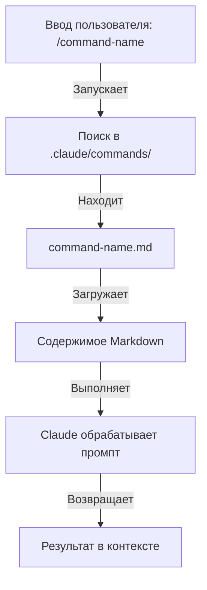

### Структура файлов

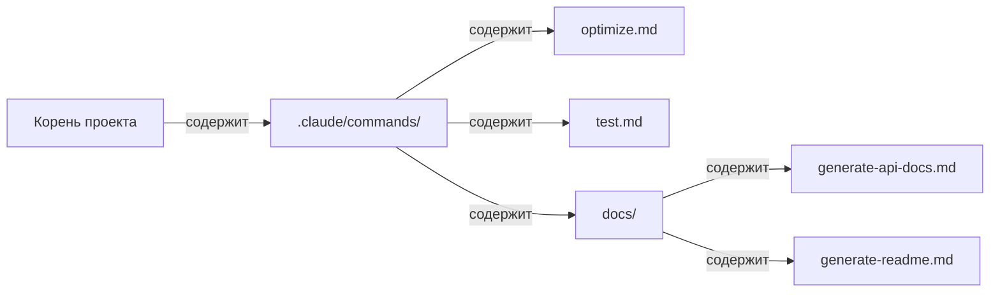

### Таблица организации команд

| Расположение | Область | Доступность | Сценарий | В Git |
|----------|-------|--------------|----------|-------------|
| `.claude/commands/` | Для проекта | Участники команды | Рабочие процессы команды, общие стандарты | ✅ Да |
| `~/.claude/commands/` | Личное | Отдельный пользователь | Личные ярлыки между проектами | ❌ Нет |
| Подкаталоги | С пространством имён | По родительскому каталогу | Организация по категориям | ✅ Да |

### Функции и возможности

| Функция | Пример | Поддерживается |
|---------|---------|-----------|
| Выполнение скрипта оболочки | `bash scripts/deploy.sh` | ✅ Да |
| Ссылки на файлы | `@path/to/file.js` | ✅ Да |
| Интеграция с Bash | `$(git log --oneline)` | ✅ Да |
| Аргументы | `/pr --verbose` | ✅ Да |
| Команды MCP | `/mcp__github__list_prs` | ✅ Да |

### Практические примеры

Восемь шаблонов команд, которые можно скопировать, лежат в **[01-slash-commands/](01-slash-commands)** — `/optimize`, `/pr`, `/commit`, `/push-all`, `/generate-api-docs`, `/doc-refactor`, `/setup-ci-cd` и `/unit-test-expand`.

**[01-slash-commands/README.md](01-slash-commands/README.md)** также содержит полный справочник встроенных команд (60+ команд) и таблицу полей frontmatter.

### Диаграмма жизненного цикла команды

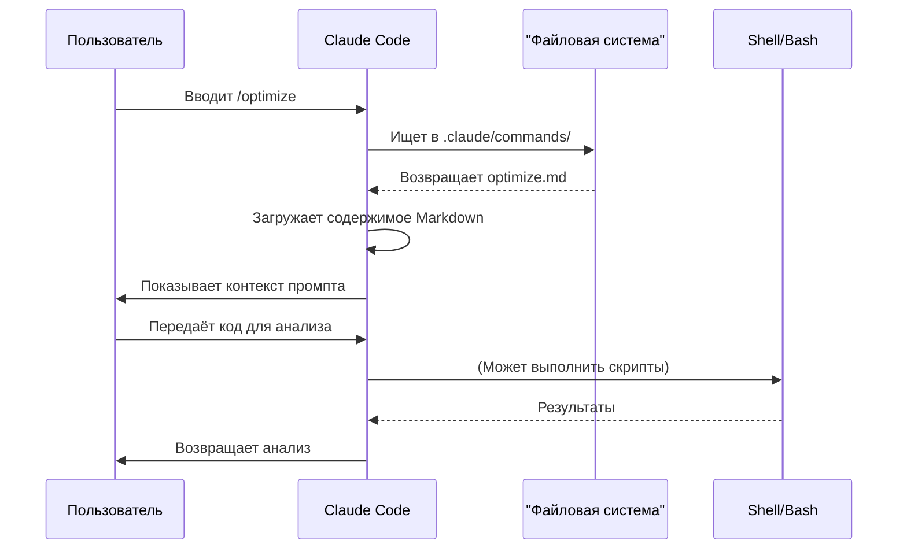

### Рекомендации

| ✅ Делайте | ❌ Не делайте |
|------|---------|
| Берите ясные имена, направленные на действие | Не создавайте команды для разовых задач |
| Документируйте слова-триггеры в описании | Не стройте сложную логику в командах |
| Держите команду на одной задаче | Не создавайте дублирующие команды |
| Храните проектные команды под контролем версий | Не вшивайте чувствительные данные |
| Раскладывайте по подкаталогам | Не плодите длинные списки команд |
| Пишите простые читаемые промпты | Не используйте сокращения и загадочные формулировки |

---

## Субагенты

### Обзор

Субагенты — это специализированные ИИ-ассистенты с изолированными контекстными окнами и своими системными промптами. Они позволяют делегировать выполнение задач и при этом держать зоны ответственности отдельно.

Субагенты могут порождать собственных субагентов, **вложенность включена по умолчанию до глубины 3 (v2.1.219)** — иерархия не ограничена одним уровнем «главный → субагент», который показан ниже. Задайте `CLAUDE_CODE_MAX_SUBAGENT_SPAWN_DEPTH`, чтобы изменить предел, или `1`, чтобы выключить вложенность. (История: в v2.1.172–v2.1.216 вложенность по умолчанию доходила до 5 уровней, и изменить это было нельзя; v2.1.217 сделала вложенность включаемой явно на глубине 1; v2.1.219 поставила значение по умолчанию 3.)

### Архитектурная диаграмма

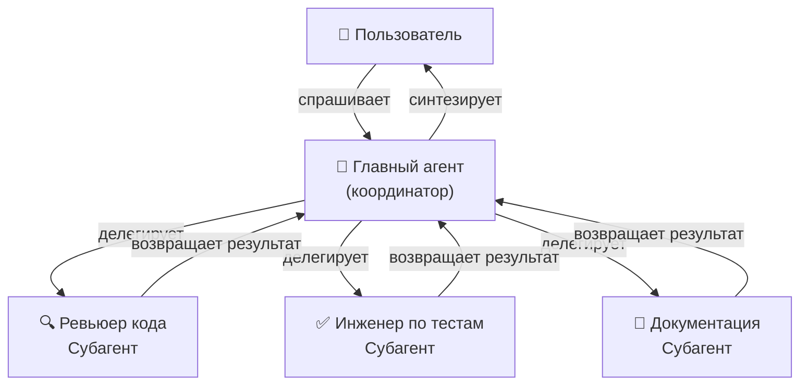

### Жизненный цикл субагента

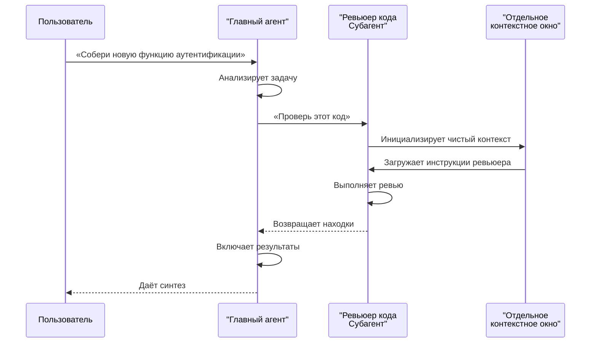

### Таблица конфигурации субагента

| Конфигурация | Тип | Назначение | Пример |
|---------------|------|---------|---------|
| `name` | Строка | Идентификатор агента | `code-reviewer` |
| `description` | Строка | Назначение и слова-триггеры | `Полный анализ качества кода` |
| `tools` | Список/строка | Разрешённые инструменты | `Read, Grep, Glob, Bash` |
| *(тело Markdown)* | Markdown | Системный промпт / инструкции поведения | Свои правила |

### Иерархия доступа к инструментам

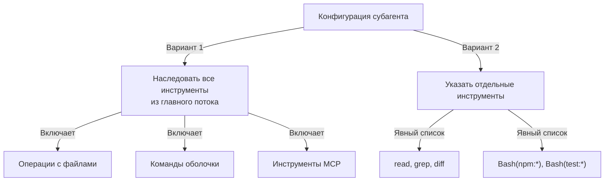

### Практические примеры

Девять готовых определений субагентов лежат в **[04-subagents/](04-subagents)** — `code-reviewer`, `clean-code-reviewer`, `secure-reviewer`, `test-engineer`, `documentation-writer`, `implementation-agent`, `performance-optimizer`, `debugger` и `data-scientist`.

**[04-subagents/README.md](04-subagents/README.md)** описывает полный справочник frontmatter, правила доступа к инструментам, пределы вложенности и команды агентов.

### Управление контекстом субагента

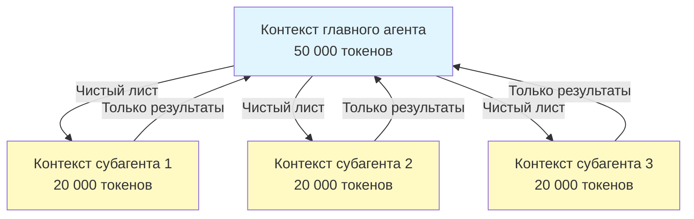

### Когда использовать субагентов

| Сценарий | Субагент | Почему |
|----------|--------------|-----|
| Сложная функция из многих шагов | ✅ Да | Разделить зоны ответственности, не засорять контекст |
| Быстрое код-ревью | ❌ Нет | Лишние накладные расходы |
| Параллельное выполнение задач | ✅ Да | У каждого субагента свой контекст |
| Нужна узкая экспертиза | ✅ Да | Свои системные промпты |
| Долгий анализ | ✅ Да | Главный контекст не исчерпывается |
| Одна задача | ❌ Нет | Лишняя задержка |

### Команды агентов

Команды агентов координируют нескольких агентов, которые работают над связанными задачами. Вместо делегирования одному субагенту за раз команды агентов позволяют главному агенту дирижировать группой: агенты сотрудничают, делятся промежуточными результатами и идут к общей цели. Это полезно для крупных задач вроде разработки функции на весь стек, где агент фронтенда, агент бэкенда и агент тестирования работают параллельно.

---

## Память

### Обзор

Память позволяет Claude сохранять контекст между сессиями и разговорами. Она существует в двух видах: автоматический синтез в claude.ai и CLAUDE.md на файловой системе в Claude Code.

### Архитектура памяти

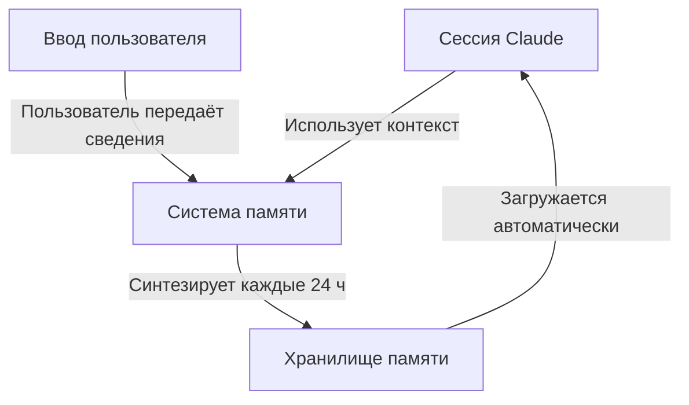

### Иерархия памяти в Claude Code (7 уровней)

Claude Code загружает память из 7 уровней. Файлы CLAUDE.md склеиваются в контекст, а не перекрывают друг друга, и загружаются в порядке управляемая → пользовательская → проектная → локальная (более поздние, более конкретные файлы читаются последними):

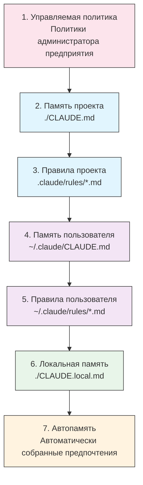

### Таблица расположения памяти

| Уровень | Расположение | Область | Приоритет | Общая | Лучше всего для |
|------|----------|-------|----------|--------|----------|
| 1. Управляемая политика | Администратор предприятия | Организация | Наивысший | Все пользователи организации | Соответствие требованиям, политики безопасности |
| 2. Проект | `./CLAUDE.md` | Проект | Высокий | Команда (Git) | Стандарты команды, архитектура |
| 3. Правила проекта | `.claude/rules/*.md` | Проект | Высокий | Команда (Git) | Модульные соглашения проекта |
| 4. Пользователь | `~/.claude/CLAUDE.md` | Личная | Средний | Один человек | Личные предпочтения |
| 5. Правила пользователя | `~/.claude/rules/*.md` | Личная | Средний | Один человек | Личные модули правил |
| 6. Локальная | `./CLAUDE.local.md` | Локальная | Низкий | Не общая | Настройки конкретной машины |
| 7. Автопамять | Автоматически | На репозиторий | Наинизший | Один человек | Выученные предпочтения и шаблоны |

### Автопамять

Автопамять сама запоминает предпочтения пользователя и шаблоны, замеченные во время сессий. Claude учится на ваших взаимодействиях и помнит:

- Предпочтения по стилю кода
- Типичные исправления, которые вы делаете
- Выбор фреймворков и инструментов
- Предпочтения по стилю общения

Автопамять работает в фоне и не требует ручной настройки.

### Жизненный цикл обновления памяти

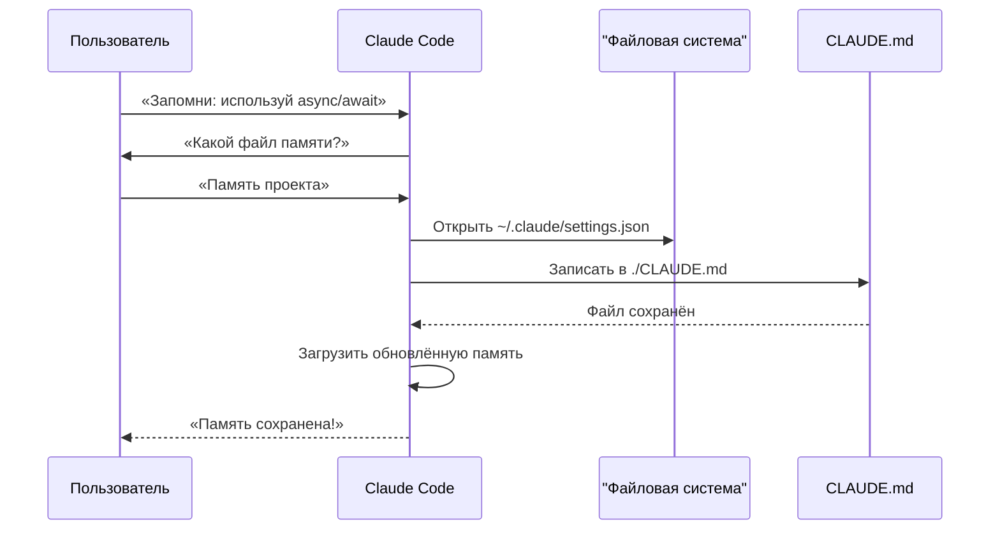

### Практические примеры

Шаблоны памяти, которые можно скопировать, лежат в **[02-memory/](02-memory)**:

- **`project-CLAUDE.md`** — стандарты проекта для всей команды, для `./CLAUDE.md`
- **`personal-CLAUDE.md`** — личные предпочтения для `~/.claude/CLAUDE.md`
- **`directory-api-CLAUDE.md`** — стандарты для поддерева каталогов

**[02-memory/README.md](02-memory/README.md)** разбирает полную иерархию, синтаксис импорта, `.claude/rules/`, автопамять и то, как удерживать CLAUDE.md в пределах 200 строк.

### Память в Claude Web/Desktop

#### Хронология синтеза памяти

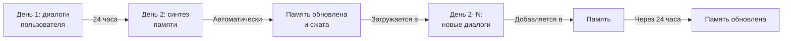

### Содержимое автопамяти

Автопамять хранит то, что Claude узнаёт о вас между сессиями, в `~/.claude/projects/<project>/memory/`, с индексом `MEMORY.md`. См. **[02-memory/README.md](02-memory/README.md)**: раскладка файлов, пределы загрузки и как включить или выключить её.

### Сравнение функций памяти

| Функция | Claude Web/Desktop | Claude Code (CLAUDE.md) |
|---------|-------------------|------------------------|
| Автосинтез | ✅ Каждые 24 ч | ❌ Вручную |
| Между проектами | ✅ Общая | ❌ В рамках проекта |
| Доступ команды | ✅ Общие проекты | ✅ Отслеживается в Git |
| Поиск | ✅ Встроенный | ✅ Через `/memory` |
| Правка | ✅ В чате | ✅ Прямое редактирование файла |
| Импорт/экспорт | ✅ Да | ✅ Скопировать |
| Постоянство | ✅ 24 ч и дольше | ✅ Бессрочно |

---

## Протокол MCP

### Обзор

MCP (Model Context Protocol, протокол контекста модели) — стандартный способ дать Claude доступ к внешним инструментам, API и источникам данных в реальном времени. В отличие от памяти, MCP даёт живой доступ к меняющимся данным.

### Архитектура MCP

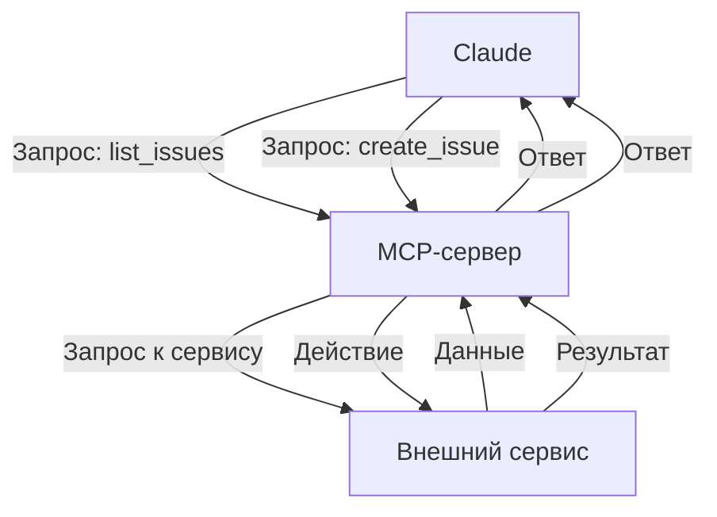

### Экосистема MCP

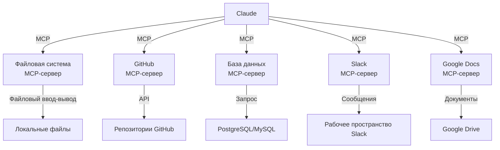

### Процесс настройки MCP

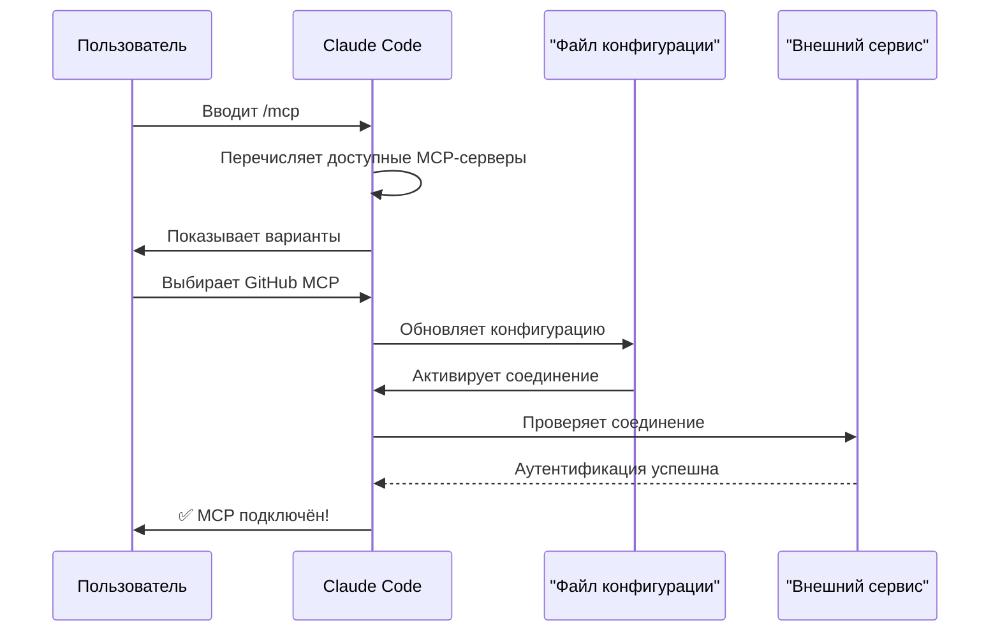

### Таблица доступных MCP-серверов

| MCP-сервер | Назначение | Типичные инструменты | Аутентификация | В реальном времени |
|------------|---------|--------------|------|-----------|
| **Файловая система** | Операции с файлами | read, write, delete | Разрешения ОС | ✅ Да |
| **GitHub** | Управление репозиториями | list_prs, create_issue, push | OAuth | ✅ Да |
| **Slack** | Командное общение | send_message, list_channels | Токен | ✅ Да |
| **База данных** | SQL-запросы | query, insert, update | Учётные данные | ✅ Да |
| **Google Docs** | Доступ к документам | read, write, share | OAuth | ✅ Да |
| **Asana** | Управление проектами | create_task, update_status | API-ключ | ✅ Да |
| **Stripe** | Платёжные данные | list_charges, create_invoice | API-ключ | ✅ Да |
| **Память** | Постоянная память | store, retrieve, delete | Локально | ❌ Нет |

### Практические примеры

Готовые конфигурации MCP-серверов лежат в **[05-mcp/](05-mcp)**: `github-mcp.json`, `database-mcp.json`, `filesystem-mcp.json` и `multi-mcp.json` (четыре сервера в одном файле).

**[05-mcp/README.md](05-mcp/README.md)** разбирает полный синтаксис `claude mcp add`, транспорты, области, OAuth и корпоративные списки разрешённых серверов.

### MCP и память: матрица решений

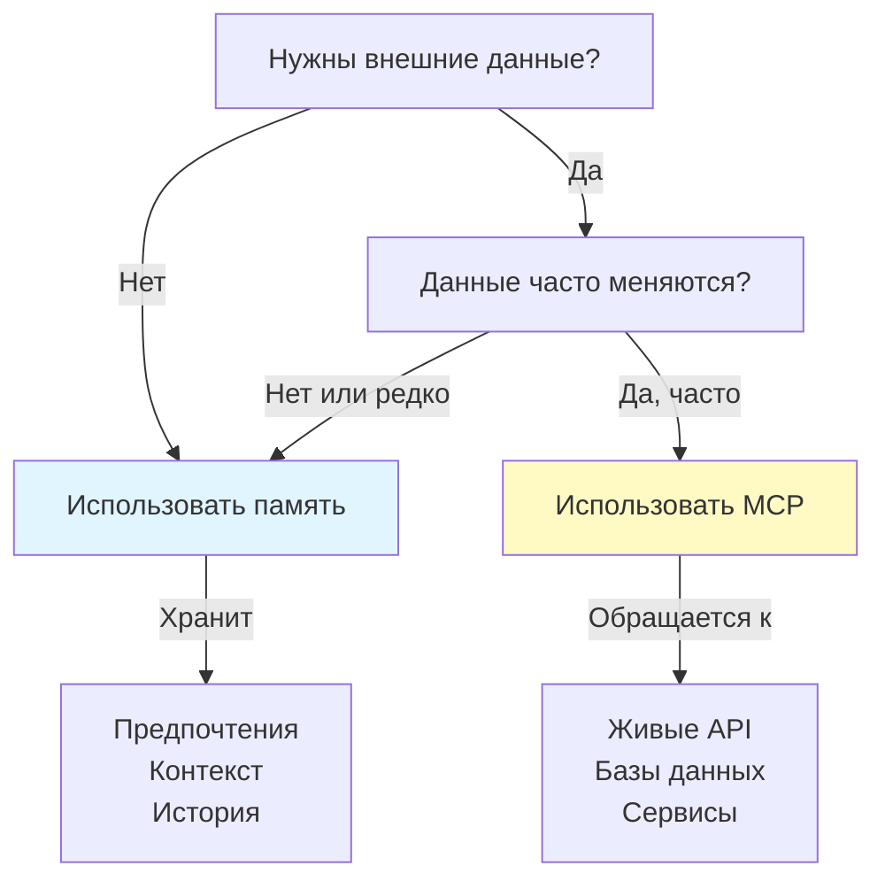

### Схема запроса и ответа

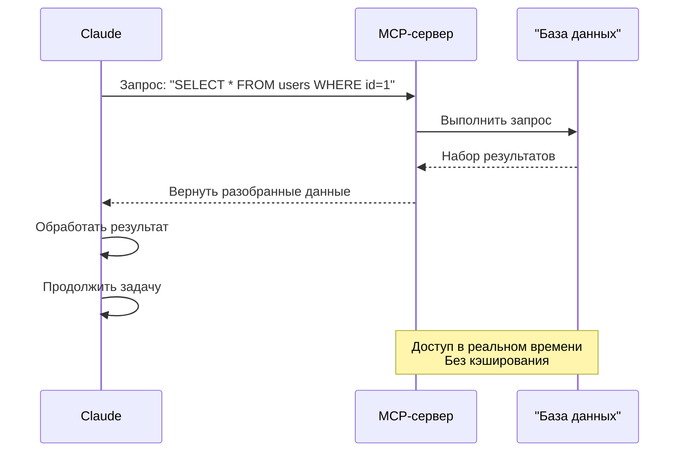

---

## Навыки агента

### Обзор

Навыки агента — это переиспользуемые возможности, которые вызывает модель. Они упакованы в папки с инструкциями, скриптами и ресурсами. Claude сам находит подходящие навыки и применяет их.

### Архитектура навыка

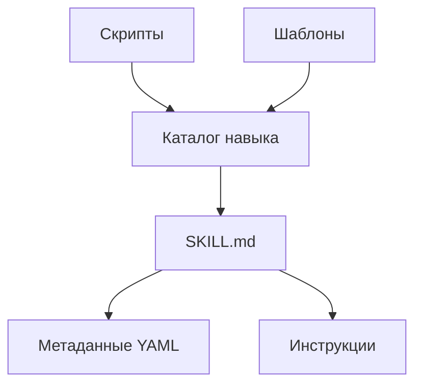

### Процесс загрузки навыка

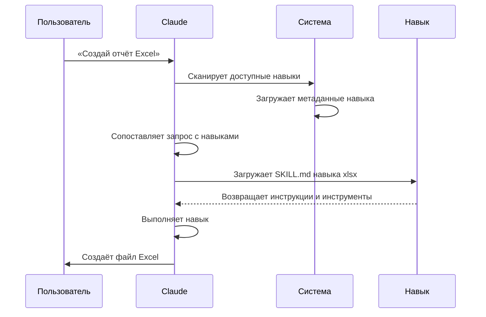

### Таблица типов и расположений навыков

| Тип | Расположение | Область | Общий | Синхронизация | Лучше всего для |
|------|----------|-------|--------|------|----------|
| Предустановленный | Встроенный | Глобальная | Все пользователи | Авто | Создание документов |
| Личный | `~/.claude/skills/` | Один человек | Нет | Вручную | Личная автоматизация |
| Проектный | `.claude/skills/` | Команда | Да | Git | Стандарты команды |
| Плагин | Через установку плагина | Зависит | Зависит | Авто | Интегрированные функции |

### Предустановленные навыки

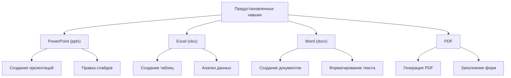

### Встроенные навыки

В Claude Code есть встроенные навыки, доступные сразу, в том числе:

| Навык | Команда | Назначение |
|-------|---------|---------|
| **Batch** | `/batch` | Запуск операций по нескольким файлам или элементам |
| **Claude API** | `/claude-api` | Загрузить справочник Claude API и Managed Agents для языка вашего проекта; включается сам, когда код импортирует `anthropic` или `@anthropic-ai/sdk` |
| **Code Review** | `/code-review` | Проверить текущий diff на баги корректности при выбранном уровне усилий. Это отдельный навык от `/simplify` (чистка качества и повторного использования), который снова выделили в v2.1.154. Claude также может запустить его сам, везде с v2.1.246 |
| **Simplify** | `/simplify` | Ревью качества, повторного использования и чистки — снова отдельно от `/code-review` с v2.1.154 |
| **Debug** | `/debug` | Включить журнал отладки текущей сессии и разбирать проблему по этому журналу |
| **Fewer Permission Prompts** | `/fewer-permission-prompts` | Просмотреть расшифровки и предложить приоритетный список разрешений для типичных инструментов только для чтения |
| **Loop** | `/loop` | Планировать повторяющиеся задачи по таймеру |
| **Run** | `/run` | Запустить приложение проекта и управлять им, чтобы проверить изменение (v2.1.145+) |
| **Run Skill Generator** | `/run-skill-generator` | Написать навык проекта, который учит `/run` и `/verify`, как собирать, запускать и управлять вашим приложением (v2.1.145+) |
| **Verify** | `/verify` | Проверить, что изменение действительно работает (v2.1.145+). Только явный вызов с v2.1.215 |

Эти встроенные навыки всегда доступны и не требуют установки или настройки.

### Практические примеры

Шесть полных навыков — со скриптами, шаблонами и справочными файлами — лежат в **[03-skills/](03-skills)**:

- **`code-review-specialist/`** — чеклист ревью, шаблон находки и два скрипта метрик на Python
- **`refactor/`** — каталог запахов кода, каталог рефакторинга, шаблон плана и два скрипта анализа
- **`doc-generator/`** — генерация документации API из исходников
- **`blog-draft/`** — шаблоны плана и черновика с соглашением об именах версионированного вывода
- **`brand-voice/`** — правила тона и шаблоны сообщений (показывает `user-invocable: false`)
- **`claude-md/`** — создание, обновление и аудит файлов CLAUDE.md

См. **[03-skills/README.md](03-skills/README.md)**: полный справочник frontmatter и модель постепенного раскрытия.

### Обнаружение и вызов навыка

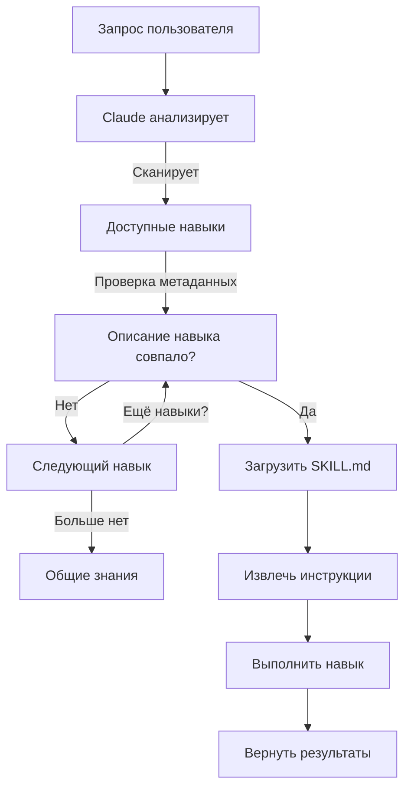

### Навык и другие функции

```mermaid
graph TB
    A["Расширение Claude"]
    B["Слэш-команды"]
    C["Субагенты"]
    D["Память"]
    E["MCP"]
    F["Навыки"]

    A --> B
    A --> C
    A --> D
    A --> E
    A --> F

    B -->|Вызов пользователем| G["Быстрые ярлыки"]
    C -->|Автоделегирование| H["Изолированные контексты"]
    D -->|Постоянная| I["Контекст между сессиями"]
    E -->|В реальном времени| J["Доступ к внешним данным"]
    F -->|Автовызов| K["Автономное выполнение"]
```

---

## Плагины Claude Code

### Обзор

Плагины Claude Code — это собранные наборы настроек (слэш-команды, субагенты, MCP-серверы и хуки), которые ставятся одной командой. Это механизм расширения самого высокого уровня — несколько функций складываются в цельные пакеты, которыми можно делиться.

### Архитектура

```mermaid
graph TB
    A["Плагин"]
    B["Слэш-команды"]
    C["Субагенты"]
    D["MCP-серверы"]
    E["Хуки"]
    F["Конфигурация"]

    A -->|включает| B
    A -->|включает| C
    A -->|включает| D
    A -->|включает| E
    A -->|включает| F
```

### Процесс загрузки плагина

```mermaid
sequenceDiagram
    participant User as Пользователь
    participant Claude as Claude Code
    participant Plugin as "Маркетплейс плагинов"
    participant Install as Установка
    participant SlashCmds as Слэш-команды
    participant Subagents as Субагенты
    participant MCPServers as MCP-серверы
    participant Hooks as Хуки
    participant Tools as "Настроенные инструменты"

    User->>Claude: claude --plugin-dir ./07-plugins/pr-review
    Claude->>Plugin: Скачать манифест плагина
    Plugin-->>Claude: Вернуть описание плагина
    Claude->>Install: Извлечь компоненты
    Install->>SlashCmds: Настроить
    Install->>Subagents: Настроить
    Install->>MCPServers: Настроить
    Install->>Hooks: Настроить
    SlashCmds-->>Tools: Готовы к работе
    Subagents-->>Tools: Готовы к работе
    MCPServers-->>Tools: Готовы к работе
    Hooks-->>Tools: Готовы к работе
    Tools-->>Claude: Плагин установлен ✅
```

### Типы и распространение плагинов

| Тип | Область | Общий | Кто отвечает | Примеры |
|------|-------|--------|-----------|----------|
| Официальный | Глобальная | Все пользователи | Anthropic | PR Review, Security Guidance |
| Сообщество | Публичная | Все пользователи | Сообщество | DevOps, наука о данных |
| Организация | Внутренняя | Участники команды | Компания | Внутренние стандарты, инструменты |
| Личный | Один человек | Один пользователь | Разработчик | Свои рабочие процессы |

### Структура описания плагина

Манифест — это JSON в `.claude-plugin/plugin.json`. Обязателен только `name`, а нераспознанные ключи верхнего уровня отбрасываются:

```json
{
  "name": "plugin-name",
  "version": "1.0.0",
  "description": "Что делает этот плагин"
}
```

### Структура плагина

```
my-plugin/
├── .claude-plugin/
│   └── plugin.json
├── commands/
│   ├── task-1.md
│   ├── task-2.md
│   └── workflows/
├── agents/
│   ├── specialist-1.md
│   ├── specialist-2.md
│   └── configs/
├── skills/
│   └── skill-name/
│       └── SKILL.md
├── hooks/
│   └── hooks.json
├── .mcp.json
├── bin/
│   └── my-tool
├── .lsp.json
├── settings.json
├── templates/
│   └── issue-template.md
├── scripts/
│   ├── helper-1.sh
│   └── helper-2.py
├── docs/
│   ├── README.md
│   └── USAGE.md
└── tests/
    └── plugin.test.js
```

### Практические примеры

Три полных устанавливаемых плагина лежат в **[07-plugins/](07-plugins)**:

- **`pr-review/`** — команды ревью, три агента-специалиста, GitHub MCP и хук перед ревью
- **`documentation/`** — команды генерации документации, три агента и переиспользуемые шаблоны
- **`devops-automation/`** — команды деплоя, отката, статуса и инцидента, три агента, Kubernetes MCP и скрипты оболочки

У каждого есть манифест `.claude-plugin/plugin.json` и раскладка каталогов.

### Маркетплейс плагинов

```mermaid
graph TB
    A["Маркетплейс плагинов"]
    B["Официальные<br/>Anthropic"]
    C["Сообщество<br/>Маркетплейс"]
    D["Корпоративный<br/>реестр"]

    A --> B
    A --> C
    A --> D

    B -->|Категории| B1["Разработка"]
    B -->|Категории| B2["DevOps"]
    B -->|Категории| B3["Документация"]

    C -->|Поиск| C1["Автоматизация DevOps"]
    C -->|Поиск| C2["Мобильная разработка"]
    C -->|Поиск| C3["Наука о данных"]

    D -->|Внутренние| D1["Стандарты компании"]
    D -->|Внутренние| D2["Унаследованные системы"]
    D -->|Внутренние| D3["Соответствие требованиям"]
```

### Установка и жизненный цикл плагина

```mermaid
graph LR
    A["Найти"] -->|Просмотр| B["Маркетплейс"]
    B -->|Выбор| C["Страница плагина"]
    C -->|Просмотр| D["Компоненты"]
    D -->|Установка| E["/plugin install"]
    E -->|Извлечение| F["Настройка"]
    F -->|Активация| G["Использование"]
    G -->|Проверка| H["Обновление"]
    H -->|Доступно| G
    G -->|Готово| I["Отключить"]
    I -->|Позже| J["Включить"]
    J -->|Назад| G
```

### Сравнение функций плагинов

| Функция | Слэш-команда | Навык | Субагент | Плагин |
|---------|---------------|-------|----------|--------|
| **Установка** | Ручное копирование | Ручное копирование | Ручная настройка | Одна команда |
| **Время настройки** | 5 минут | 10 минут | 15 минут | 2 минуты |
| **Состав** | Один файл | Один файл | Один файл | Несколько |
| **Версионирование** | Вручную | Вручную | Вручную | Автоматически |
| **Обмен в команде** | Копировать файл | Копировать файл | Копировать файл | ID установки |
| **Обновления** | Вручную | Вручную | Вручную | Доступны автоматически |
| **Зависимости** | Нет | Нет | Нет | Могут входить |
| **Маркетплейс** | Нет | Нет | Нет | Да |
| **Распространение** | Репозиторий | Репозиторий | Репозиторий | Маркетплейс |

### Сценарии использования плагинов

| Сценарий | Рекомендация | Почему |
|----------|-----------------|-----|
| **Онбординг команды** | ✅ Использовать плагин | Мгновенная настройка, все конфигурации |
| **Настройка фреймворка** | ✅ Использовать плагин | Собирает команды под конкретный фреймворк |
| **Корпоративные стандарты** | ✅ Использовать плагин | Центральное распространение, контроль версий |
| **Быстрая автоматизация задачи** | ❌ Использовать команду | Избыточная сложность |
| **Экспертиза в одной области** | ❌ Использовать навык | Слишком тяжело, используйте навык |
| **Специализированный анализ** | ❌ Использовать субагента | Создайте вручную или используйте навык |
| **Доступ к живым данным** | ❌ Использовать MCP | Отдельный механизм, не упаковывайте |

### Когда создавать плагин

```mermaid
graph TD
    A["Создавать плагин?"]
    A -->|Нужно несколько компонентов| B{"Несколько команд<br/>или субагентов<br/>или MCP?"}
    B -->|Да| C["✅ Создать плагин"]
    B -->|Нет| D["Отдельная функция"]
    A -->|Рабочий процесс команды| E{"Делиться<br/>с командой?"}
    E -->|Да| C
    E -->|Нет| F["Оставить локальной настройкой"]
    A -->|Сложная настройка| G{"Нужна авто<br/>настройка?"}
    G -->|Да| C
    G -->|Нет| D
```

### Публикация плагина

**Шаги публикации:**

1. Создайте структуру плагина со всеми компонентами
2. Напишите манифест `.claude-plugin/plugin.json`
3. Создайте `README.md` с документацией
4. Проверьте локально через `claude --plugin-dir ./my-plugin`
5. Отправьте в маркетплейс плагинов
6. Дождитесь ревью и одобрения
7. Плагин опубликован в маркетплейсе
8. Пользователи ставят его одной командой

### Пример README плагина

См. три полных плагина в **[07-plugins/](07-plugins)** — у `pr-review/`, `documentation/` и `devops-automation/` есть полный `README.md`, манифест, команды, агенты и конфигурация MCP, которые можно скопировать целиком.

### Плагин и ручная настройка

**Ручная настройка (2+ часа):**
- Ставить слэш-команды по одной
- Создавать субагентов по отдельности
- Настраивать MCP отдельно
- Настраивать хуки вручную
- Документировать всё
- Делиться с командой (и надеяться, что настроят так же)

**С плагином (2 минуты):**
```bash
claude --plugin-dir ./07-plugins/pr-review
# ✅ Всё установлено и настроено
# ✅ Готово к использованию сразу
# ✅ Команда может воспроизвести ту же настройку
```

---

## Сравнение и интеграция

### Матрица сравнения функций

| Функция | Вызов | Сохранение | Область | Сценарий |
|---------|-----------|------------|-------|----------|
| **Слэш-команды** | Вручную (`/cmd`) | Только сессия | Одна команда | Быстрые ярлыки |
| **Субагенты** | Автоделегирование | Изолированный контекст | Специализированная задача | Распределение задач |
| **Память** | Автозагрузка | Между сессиями | Контекст пользователя или команды | Долгосрочное обучение |
| **Протокол MCP** | Автозапрос | Внешние данные в реальном времени | Доступ к живым данным | Динамическая информация |
| **Навыки** | Автовызов | На файловой системе | Переиспользуемая экспертиза | Автоматизированные рабочие процессы |

### Хронология взаимодействия

```mermaid
graph LR
    A["Начало сессии"] -->|Загрузка| B["Память (CLAUDE.md)"]
    B -->|Обнаружение| C["Доступные навыки"]
    C -->|Регистрация| D["Слэш-команды"]
    D -->|Подключение| E["MCP-серверы"]
    E -->|Готово| F["Взаимодействие с пользователем"]

    F -->|Ввод /cmd| G["Слэш-команда"]
    F -->|Запрос| H["Автовызов навыка"]
    F -->|Запрос данных| I["Данные MCP"]
    F -->|Сложная задача| J["Делегирование субагенту"]

    G -->|Использует| B
    H -->|Использует| B
    I -->|Использует| B
    J -->|Использует| B
```

### Практический пример интеграции: автоматизация поддержки клиентов

#### Архитектура

```mermaid
graph TB
    User["Письмо клиента"] -->|Получает| Router["Маршрутизатор поддержки"]

    Router -->|Анализ| Memory["Память<br/>История клиента"]
    Router -->|Поиск| MCP1["MCP: база клиентов<br/>Прошлые тикеты"]
    Router -->|Проверка| MCP2["MCP: Slack<br/>Статус команды"]

    Router -->|Сложный маршрут| Sub1["Субагент: техподдержка<br/>Контекст: технические проблемы"]
    Router -->|Простой маршрут| Sub2["Субагент: биллинг<br/>Контекст: проблемы оплаты"]
    Router -->|Срочный маршрут| Sub3["Субагент: эскалация<br/>Контекст: приоритетная обработка"]

    Sub1 -->|Формат| Skill1["Навык: генератор ответов<br/>Голос бренда сохранён"]
    Sub2 -->|Формат| Skill2["Навык: генератор ответов"]
    Sub3 -->|Формат| Skill3["Навык: генератор ответов"]

    Skill1 -->|Генерация| Output["Оформленный ответ"]
    Skill2 -->|Генерация| Output
    Skill3 -->|Генерация| Output

    Output -->|Публикация| MCP3["MCP: Slack<br/>Уведомить команду"]
    Output -->|Отправка| Reply["Ответ клиенту"]
```

#### Поток запроса

```markdown
## Поток запроса в поддержку клиентов

### 1. Входящее письмо
«При загрузке файлов я получаю ошибку 500. Это блокирует мой рабочий процесс!»

### 2. Поиск в памяти
- Загружает CLAUDE.md со стандартами поддержки
- Проверяет историю клиента: VIP-клиент, третий инцидент в этом месяце

### 3. Запросы MCP
- GitHub MCP: список открытых issue (находит связанный баг-репорт)
- MCP базы данных: проверка статуса системы (сбоев не заявлено)
- Slack MCP: проверка, знает ли инженерия

### 4. Обнаружение и загрузка навыка
- Запрос совпадает с навыком «Техническая поддержка»
- Загружает шаблон ответа поддержки из навыка

### 5. Делегирование субагенту
- Маршрут к субагенту техподдержки
- Передаёт контекст: история клиента, детали ошибки, известные проблемы
- У субагента полный доступ к инструментам read, bash, grep

### 6. Обработка субагентом
Субагент техподдержки:
- Ищет в кодовой базе ошибку 500 при загрузке файла
- Находит недавнее изменение в коммите 8f4a2c
- Создаёт документацию обходного пути

### 7. Выполнение навыка
Навык генератора ответов:
- Использует правила голоса бренда
- Оформляет ответ с эмпатией
- Включает шаги обходного пути
- Ссылается на связанную документацию

### 8. Вывод MCP
- Публикует обновление в канал Slack #support
- Отмечает команду инженерии
- Обновляет тикет в Jira MCP

### 9. Ответ
Клиент получает:
- Эмпатичное подтверждение
- Объяснение причины
- Немедленный обходной путь
- Срок постоянного исправления
- Ссылку на связанные issue
```

### Полная оркестрация функций

```mermaid
sequenceDiagram
    participant User as Пользователь
    participant Claude as Claude Code
    participant Memory as "Память<br/>CLAUDE.md"
    participant MCP as MCP-серверы
    participant Skills as Навыки
    participant SubAgent as Субагенты

    User->>Claude: Запрос: «Собери систему аутентификации»
    Claude->>Memory: Загрузить стандарты проекта
    Memory-->>Claude: Стандарты аутентификации, практики команды
    Claude->>MCP: Запросить у GitHub похожие реализации
    MCP-->>Claude: Примеры кода, рекомендации
    Claude->>Skills: Найти подходящие навыки
    Skills-->>Claude: Навык проверки безопасности + навык тестирования
    Claude->>SubAgent: Делегировать реализацию
    SubAgent->>SubAgent: Собрать функцию
    Claude->>Skills: Применить навык проверки безопасности
    Skills-->>Claude: Результаты чеклиста безопасности
    Claude->>SubAgent: Делегировать тестирование
    SubAgent-->>Claude: Результаты тестов
    Claude->>User: Готовая система передана
```

### Когда использовать каждую функцию

```mermaid
graph TD
    A["Новая задача"] --> B{"Тип задачи?"}

    B -->|Повторяемый рабочий процесс| C["Слэш-команда"]
    B -->|Нужны данные в реальном времени| D["Протокол MCP"]
    B -->|Запомнить на следующий раз| E["Память"]
    B -->|Специализированная подзадача| F["Субагент"]
    B -->|Предметная работа| G["Навык"]

    C --> C1["✅ Ярлык команды"]
    D --> D1["✅ Доступ к живому API"]
    E --> E1["✅ Постоянный контекст"]
    F --> F1["✅ Параллельное выполнение"]
    G --> G1["✅ Автоматически вызываемая экспертиза"]
```

### Дерево выбора

```mermaid
graph TD
    Start["Нужно расширить Claude?"]

    Start -->|Быстрая повторяемая задача| A{"Вручную или автоматически?"}
    A -->|Вручную| B["Слэш-команда"]
    A -->|Автоматически| C["Навык"]

    Start -->|Нужны внешние данные| D{"В реальном времени?"}
    D -->|Да| E["Протокол MCP"]
    D -->|"Нет, между сессиями"| F["Память"]

    Start -->|Сложный проект| G{"Несколько ролей?"}
    G -->|Да| H["Субагенты"]
    G -->|Нет| I["Навыки + память"]

    Start -->|Долгосрочный контекст| J["Память"]
    Start -->|Рабочий процесс команды| K["Слэш-команда +<br/>память"]
    Start -->|Полная автоматизация| L["Навыки +<br/>субагенты +<br/>MCP"]
```

---

## Сводная таблица

| Аспект | Слэш-команды | Субагенты | Память | MCP | Навыки | Плагины |
|--------|---|---|---|---|---|---|
| **Сложность настройки** | Легко | Средне | Легко | Средне | Средне | Легко |
| **Кривая обучения** | Низкая | Средняя | Низкая | Средняя | Средняя | Низкая |
| **Польза для команды** | Высокая | Высокая | Средняя | Высокая | Высокая | Очень высокая |
| **Уровень автоматизации** | Низкий | Высокий | Средний | Высокий | Высокий | Очень высокий |
| **Управление контекстом** | Одна сессия | Изолированный | Постоянный | В реальном времени | Постоянный | Все функции |
| **Бремя сопровождения** | Низкое | Среднее | Низкое | Среднее | Среднее | Низкое |
| **Масштабируемость** | Хорошая | Отличная | Хорошая | Отличная | Отличная | Отличная |
| **Удобство обмена** | Приёмлемое | Приёмлемое | Хорошее | Хорошее | Хорошее | Отличное |
| **Версионирование** | Вручную | Вручную | Вручную | Вручную | Вручную | Автоматически |
| **Установка** | Ручное копирование | Ручная настройка | н/д | Ручная настройка | Ручное копирование | Одна команда |

---

## Руководство по быстрому старту

### Неделя 1: начните с простого
- Создайте 2–3 слэш-команды для типичных задач
- Включите память в настройках
- Зафиксируйте стандарты команды в CLAUDE.md

### Неделя 2: добавьте доступ в реальном времени
- Настройте 1 MCP (GitHub или база данных)
- Используйте `/mcp` для настройки
- Запрашивайте живые данные в своих рабочих процессах

### Неделя 3: распределите работу
- Создайте первого субагента под конкретную роль
- Попросите Claude создать его или добавьте файл `.claude/agents/<name>.md` (мастер `/agents` убран)
- Проверьте делегирование на простой задаче

### Неделя 4: автоматизируйте всё
- Создайте первый навык для повторяющейся автоматизации
- Возьмите навык из маркетплейса или соберите свой
- Соедините все функции в полный рабочий процесс

### Дальше
- Раз в месяц просматривайте и обновляйте память
- Добавляйте новые навыки, когда проступают шаблоны
- Оптимизируйте запросы MCP
- Оттачивайте промпты субагентов

---

## Хуки

### Обзор

Хуки — это событийные команды оболочки, которые выполняются сами в ответ на события Claude Code. Они дают автоматизацию, проверку и свои рабочие процессы без ручного вмешательства.

### События хуков

Claude Code поддерживает **33 события хуков** пяти типов (command, http, mcp_tool, prompt, agent):

| Событие хука | Триггер | Сценарии |
|------------|---------|-----------|
| **SessionStart** | Сессия начинается, возобновляется, очищается или сжимается | Подготовка окружения, инициализация |
| **Setup** | Запуск с `--init-only` или `-p` с `--init` / `--maintenance` (не при обычном старте) | Подготовка инструментов, установка зависимостей |
| **InstructionsLoaded** | Загружен CLAUDE.md или файл правил | Проверка, преобразование, дополнение |
| **UserPromptSubmit** | Пользователь отправляет промпт | Проверка ввода, фильтрация промпта |
| **UserPromptExpansion** | Введённая слэш-команда (навык, своя команда, промпт MCP) разворачивается в промпт; хук может её заблокировать | Блокировка или журнал прямого вызова `/command`, добавление контекста навыка |
| **PreToolUse** | Перед запуском любого инструмента | Проверка, ворота одобрения, журнал |
| **PermissionRequest** | Показан диалог разрешения | Потоки автоматического одобрения и отказа |
| **PermissionDenied** | Режим Auto отклоняет вызов инструмента (не при ручном отказе) | Журнал, аналитика, применение политики |
| **PostToolUse** | После успешной работы инструмента | Автоформатирование, уведомления, очистка |
| **PostToolUseFailure** | Выполнение инструмента завершилось ошибкой | Обработка ошибок, журнал |
| **PostToolBatch** | После завершения пакета вызовов инструментов | Сводные отчёты, пакетная проверка |
| **Notification** | Отправлено уведомление | Оповещения, внешние интеграции |
| **MessageDisplay** | Пока показывается текст сообщения ассистента | Преобразовать или скрыть показанный текст |
| **SubagentStart** | Порожден субагент | Внедрение контекста, инициализация |
| **SubagentStop** | Субагент завершил работу | Проверка результата, журнал |
| **Stop** | Claude закончил ответ | Генерация сводки, задачи очистки |
| **StopFailure** | Ошибка API завершает ход | Восстановление после ошибки, журнал |
| **TeammateIdle** | Участник команды агентов простаивает | Распределение работы, координация |
| **TaskCompleted** | Задача отмечена выполненной. Срабатывает только когда инструменты задач включены — по умолчанию они есть лишь на моделях Claude 3.x, Opus 4–4.7, Sonnet 4–4.6 и Haiku 4.5; `CLAUDE_CODE_ENABLE_TODO_TOOLS=1` возвращает их (v2.1.233) | Обработка после задачи |
| **TaskCreated** | Задача создана через TaskCreate. Срабатывает только когда инструменты задач включены — по умолчанию они есть лишь на моделях Claude 3.x, Opus 4–4.7, Sonnet 4–4.6 и Haiku 4.5; `CLAUDE_CODE_ENABLE_TODO_TOOLS=1` возвращает их (v2.1.233) | Учёт задач, журнал |
| **ConfigChange** | Изменился файл конфигурации | Проверка, распространение |
| **CwdChanged** | Изменился рабочий каталог | Настройка под каталог |
| **DirectoryAdded** | В середине сессии зарегистрирован новый рабочий каталог через `/add-dir` или управляющий запрос SDK `register_repo_root` | Настроить инструменты для только что добавленного каталога |
| **FileChanged** | Изменился отслеживаемый файл | Наблюдение за файлами, триггеры пересборки |
| **PreCompact** | Перед сжатием контекста | Сохранение состояния |
| **PostCompact** | После завершения сжатия | Действия после сжатия |
| **PreModelSwitch** | Перед применением запрошенной смены модели | Пропустить или отклонить смену модели |
| **PostModelSwitch** | После смены модели сессии | Записать в журнал или отреагировать на смену модели |
| **WorktreeCreate** | Создаётся worktree | Заменить стандартное создание git worktree; нужно вывести путь worktree |
| **WorktreeRemove** | Worktree удаляется | Очистка, освобождение ресурсов |
| **Elicitation** | MCP-сервер запрашивает ввод пользователя | Проверка ввода |
| **ElicitationResult** | Пользователь отвечает на запрос | Обработка ответа |
| **SessionEnd** | Сессия завершается | Очистка, финальный журнал |

### Типичные хуки

Хуки настраиваются в `~/.claude/settings.json` (уровень пользователя) или `.claude/settings.json` (уровень проекта):

```json
{
  "hooks": {
    "PostToolUse": [
      {
        "matcher": "Write",
        "hooks": [
          {
            "type": "command",
            "command": "jq -r '.tool_input.file_path' | xargs npx prettier --write"
          }
        ]
      }
    ],
    "PreToolUse": [
      {
        "matcher": "Edit",
        "hooks": [
          {
            "type": "command",
            "command": "jq -r '.tool_input.file_path' | xargs npx eslint"
          }
        ]
      }
    ]
  }
}
```

### Переменные окружения хуков

- Вход хука приходит как JSON на stdin (`session_id`, `tool_name`, `tool_input.file_path`, …) — читайте его через `jq`
- `$CLAUDE_CODE_SESSION_ID` — идентификатор текущей сессии
- `$CLAUDE_PROJECT_DIR` — путь к каталогу проекта

### Рекомендации

✅ **Делайте:**
- Держите хуки быстрыми (< 1 секунды)
- Используйте хуки для проверки и автоматизации
- Обрабатывайте ошибки аккуратно
- Используйте абсолютные пути

❌ **Не делайте:**
- Не делайте хуки интерактивными
- Не используйте хуки для долгих задач
- Не вшивайте учётные данные

**См.**: [06-hooks/](06-hooks) — подробные примеры

---

## Контрольные точки и перемотка

### Обзор

Контрольные точки позволяют сохранить состояние разговора и перемотать к предыдущим точкам. Так можно безопасно экспериментировать и пробовать несколько подходов.

### Ключевые понятия

| Понятие | Описание |
|---------|-------------|
| **Контрольная точка** | Снимок состояния разговора: сообщения, файлы и контекст |
| **Перемотка** | Возврат к предыдущей контрольной точке с отбрасыванием последующих изменений |
| **Точка ветвления** | Контрольная точка, от которой исследуют несколько подходов |

### Доступ к контрольным точкам

Контрольные точки создаются автоматически с каждым промптом пользователя. Чтобы перемотать:

```bash
# Нажмите Esc дважды, чтобы открыть браузер контрольных точек
Esc + Esc

# Или используйте команду /rewind
/rewind
```

Когда вы выбираете контрольную точку, есть шесть вариантов:
1. **Восстановить код и разговор** — откатить и то и другое к этой точке
2. **Восстановить разговор** — перемотать сообщения, оставить текущий код
3. **Восстановить код** — откатить файлы, оставить разговор
4. **Сжать отсюда** — сжать разговор в сводку
5. **Сжать до этого места** — сжать всё до этой точки в сводку
6. **Неважно** — отмена

### Сценарии использования

| Сценарий | Рабочий процесс |
|----------|----------|
| **Исследование подходов** | Сохранить → Попробовать A → Сохранить → Перемотать → Попробовать B → Сравнить |
| **Безопасный рефакторинг** | Сохранить → Рефакторинг → Тест → Если неудача: перемотка |
| **A/B-тестирование** | Сохранить → Вариант A → Сохранить → Перемотать → Вариант B → Сравнить |
| **Исправление ошибки** | Заметить проблему → Перемотать к последнему хорошему состоянию |

### Настройка

Контрольные точки включены по умолчанию; ими управляет `fileCheckpointingEnabled`:

```json
{
  "fileCheckpointingEnabled": true
}
```

**См.**: [08-checkpoints/](08-checkpoints) — подробные примеры

---

## Продвинутые функции

### Режим планирования

Составьте подробный план реализации до кода.

**Включение:**
```bash
/plan Реализуй систему аутентификации пользователей
```

**Польза:**
- Ясная дорожная карта с оценками времени
- Оценка рисков
- Системная разбивка задач
- Возможность проверить и изменить план

### Расширенное мышление

Глубокое рассуждение для сложных задач.

**Включение:**
- Переключайте через `Alt+T` (или `Option+T` на macOS) во время сессии
- Opus 4.7+, Sonnet 5+, Haiku 5.5 и Fable всегда используют адаптивное рассуждение, поэтому фиксированный бюджет `MAX_THINKING_TOKENS` не применяется; глубиной управляет `/effort`

```bash
# Управляйте глубиной рассуждения уровнем усилий
/effort high
```

**Польза:**
- Тщательный разбор компромиссов
- Более удачные архитектурные решения
- Учёт граничных случаев
- Систематическая оценка

### Фоновые задачи

Долгие операции идут, не блокируя разговор.

**Использование:**
```bash
Пользователь: Запусти тесты в фоне

Claude: Запущена задача bg-1234

/tasks               # Просмотр и управление фоновой работой (псевдоним: /bashes)
```

### Режимы разрешений

Управляйте тем, что Claude может делать.

| Режим | Описание | Сценарий |
|------|-------------|----------|
| **manual** | Стандартные разрешения с запросами на чувствительные действия (в интерфейсе показывается как Manual с v2.1.200; значение в конфигурации по-прежнему `default`, его же сообщают хуки и SDK) | Обычная разработка |
| **acceptEdits** | Автоматически принимать правки файлов без подтверждения | Доверенные рабочие процессы редактирования |
| **plan** | Только анализ и планирование, без изменения файлов | Код-ревью, планирование архитектуры |
| **auto** | Классификатор одобряет безопасные действия и блокирует рискованные; запросы возвращаются только после 3 блокировок подряд или 20 всего | Сбалансированная автономия с защитой |
| **dontAsk** | Автоматически отклонять всё, что вызвало бы запрос; выполняются только заранее одобренные инструменты и чтения | Жёстко ограниченные CI и скрипты |
| **bypassPermissions** | Полный неограниченный доступ, без проверок безопасности | Пайплайны CI/CD, доверенные скрипты |

**Использование:**
```bash
claude --permission-mode plan          # Анализ только для чтения
claude --permission-mode acceptEdits   # Автоматически принимать правки
claude --permission-mode auto          # Автоматически одобрять безопасные действия
claude --permission-mode dontAsk       # Только заранее одобренные инструменты; остальное отклонять
```

### Режим без интерфейса (режим print)

Запускайте Claude Code без интерактивного ввода для автоматизации и CI/CD через флаг `-p` (print).

**Использование:**
```bash
# Запуск конкретной задачи
claude -p "Запусти все тесты"

# Вход через конвейер для анализа
cat error.log | claude -p "объясни эту ошибку"

# Интеграция CI/CD (GitHub Actions)
- name: ИИ-ревью кода
  run: claude -p "Проверь изменения в PR и сообщи о проблемах"

# Вывод JSON для скриптов
claude -p --output-format json "перечисли все функции в src/"
```

### Запланированные задачи

Запускайте задачи по повторяющемуся расписанию командой `/loop`.

**Использование:**
```bash
/loop every 30m "Запусти тесты и сообщи о сбоях"
/loop every 2h "Проверь обновления зависимостей"
/loop every 1d "Собери ежедневную сводку изменений кода"
```

Запланированные задачи идут в фоне и сообщают результат, когда заканчивают. Они полезны для непрерывного наблюдения, периодических проверок и автоматического обслуживания.

### Интеграция с Chrome

Claude Code умеет работать с браузером Chrome для автоматизации веба. Можно открывать страницы, заполнять формы, делать снимки экрана и извлекать данные с сайтов прямо в рабочем процессе разработки.

### Управление сессиями

Ведите несколько рабочих сессий.

**Команды:**
```bash
/resume                # Возобновить предыдущий разговор
/rename "Функция"      # Назвать текущую сессию
/fork                  # Сделать форк в новую сессию
claude -c              # Продолжить самый свежий разговор
claude -r "Функция"    # Возобновить сессию по имени или ID
```

### Интерактивные возможности

**Сочетания клавиш:**
- `Ctrl + R` — поиск по истории команд
- `Tab` — автодополнение
- `↑ / ↓` — история команд
- `Ctrl + L` — очистить экран

**Многострочный ввод:** нажмите `\` + Enter, Option+Enter (macOS), Shift+Enter или Ctrl+J, чтобы начать новую строку. Терминатора `\end` нет.

### Настройка

Полный пример конфигурации:

```json
{
  "alwaysThinkingEnabled": true,
  "showThinkingSummaries": true,
  "permissions": {
    "defaultMode": "manual"
  }
}
```

Блока `settings.json` для фоновых задач нет — функцией управляет переменная окружения `CLAUDE_CODE_DISABLE_BACKGROUND_TASKS`, а параллелизмом — `CLAUDE_CODE_MAX_CONCURRENT_SUBAGENTS` (по умолчанию `20`).

**См.**: [09-advanced-features/](09-advanced-features) — подробное руководство

---

## Модели и уровень усилий рассуждения

Claude Code поддерживает следующие модели с адаптивным уровнем усилий рассуждения:

| Модель | Контекстное окно | Уровни усилий | Усилие по умолчанию (Claude Code) |
|-------|----------------|---------------|------------------------------|
| Claude Opus 5.5 | 1M токенов (нативно) | `low`, `medium`, `high`, `xhigh`, `max` | `medium` — модель по умолчанию и модель Opus по умолчанию с v2.1.280 (нужен Claude Code v2.1.280+) |
| Claude Sonnet 5.5 | 1M токенов (нативно) | `low`, `medium`, `high`, `xhigh`, `max` | `medium` — модель Sonnet по умолчанию в Anthropic API с v2.1.284 (нужен Claude Code v2.1.284+) |
| Claude Haiku 5.5 | 1M токенов (нативно) | `low`, `medium`, `high`, `xhigh`, `max` | `medium` — модель Haiku по умолчанию в Anthropic API с v2.1.293 (нужен Claude Code v2.1.293+) |
| Claude Opus 5 | 1M токенов (нативно) | `low`, `medium`, `high`, `xhigh`, `max` | `high` — модель Opus по умолчанию с v2.1.219 до v2.1.280 (нужен Claude Code v2.1.219+) |
| Claude Sonnet 5 | 1M токенов (нативно) | `low`, `medium`, `high`, `xhigh`, `max` | `high` — модель по умолчанию для Pro/Team Standard с v2.1.197 до v2.1.280 (теперь Opus 5.5) |
| Claude Opus 4.8 | 1M токенов (нативно) | `low`, `medium`, `high`, `xhigh`, `max` | `high` (с v2.1.154) |
| Claude Opus 4.7 (устаревшая) | 1M токенов (нативно) | `low`, `medium`, `high`, `xhigh`, `max` | `xhigh` (с запуска Opus 4.7, 2026-04-16) |
| Claude Sonnet 4.6 | 1M токенов | `low`, `medium`, `high`, `max` | `high` для подписчиков Pro/Max (повышено с `medium` в v2.1.117) |
| Claude Haiku 4.5 | 200K токенов | — (уровни усилий не поддерживаются) | — |

> **Примечание**: `xhigh` доступен на Opus 5.5, Sonnet 5.5, Haiku 5.5, Opus 5, Sonnet 5, Opus 4.8 и Opus 4.7; `max` работает на Opus 5.5, Sonnet 5.5, Haiku 5.5, Opus 5, Sonnet 5, Opus 4.8/4.7/4.6 и Sonnet 4.6 (только в сессии). Haiku 4.5 не поддерживает уровни усилий.

> **Примечание**: в v2.1.117 исправлена ошибка, из-за которой сессии Opus 4.7 считали `/context` по окну 200K, а не по нативному окну 1M — обновитесь до v2.1.117 или новее, чтобы действительно получить контекст 1M на Opus 4.7. У Opus 5 и Opus 4.8 тоже нативное окно в 1M токенов.

> **Примечание**: `/cost` и `/stats` объединены в `/usage` в v2.1.118. `/usage` теперь каноническая команда с вкладками стоимости, статистики и других данных; `/cost` и `/stats` остаются короткими псевдонимами, которые открывают соответствующую вкладку. С v2.1.149 представление стоимости также раскладывает траты по категориям (навыки, субагенты, плагины и стоимость по каждому MCP-серверу).

## Ресурсы

- [Документация Claude Code](https://code.claude.com/docs/en/overview)
- [Журнал изменений Claude Code](https://code.claude.com/docs/en/changelog)
- [MCP-серверы на GitHub](https://github.com/modelcontextprotocol/servers)
- [Anthropic Cookbook](https://github.com/anthropics/anthropic-cookbook)

---
**Последнее обновление**: 18 октября 2026
**Версия Claude Code**: 2.1.302
**Источники**:
- https://code.claude.com/docs/en/plugins/manifest-reference
- https://code.claude.com/docs/en/plugins/create
- https://code.claude.com/docs/en/plugins/install
- https://code.claude.com/docs/en/settings-reference
- https://code.claude.com/docs/en/interactive-mode
- https://code.claude.com/docs/en/checkpointing
- https://code.claude.com/docs/en/memory
- https://code.claude.com/docs/en/skills
- https://code.claude.com/docs/en/tools-reference#task-tool-availability
- https://www.anthropic.com/news/claude-sonnet-5
- https://code.claude.com/docs/en/cli-reference
- https://code.claude.com/docs/en/model-config
- https://github.com/anthropics/claude-code/blob/main/CHANGELOG.md
- https://code.claude.com/docs/en/hooks
- https://code.claude.com/docs/en/sub-agents
- https://code.claude.com/docs/en/permission-modes
- https://code.claude.com/docs/en/commands
- https://code.claude.com/docs/en/remote-control
- https://code.claude.com/docs/en/hooks#userpromptexpansion
**Совместимые модели**: Claude Fable 5.1, Claude Fable 5, Claude Opus 5, Claude Sonnet 5, Claude Sonnet 4.6, Claude Opus 4.8, Claude Haiku 4.5
