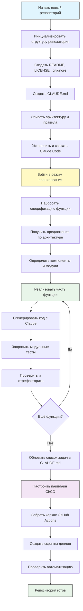
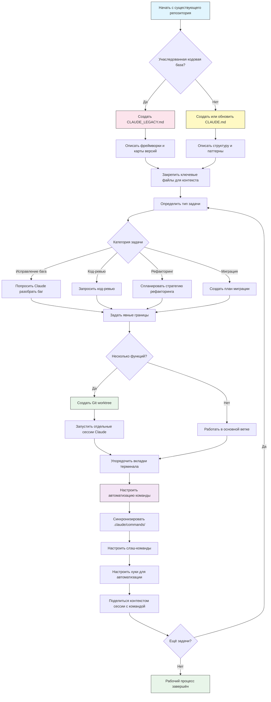

<!-- i18n-source: resources.md -->
<!-- i18n-source-sha: 232591b -->
<!-- i18n-date: 2026-10-23 -->

<picture>
  <source media="(prefers-color-scheme: dark)" srcset="../resources/logos/claude-howto-logo-dark.svg">
  
</picture>

# Список полезных материалов

## Официальная документация

| Материал | Описание | Ссылка |
|----------|-------------|------|
| Документация Claude Code | Официальная документация Claude Code | [code.claude.com/docs/en/overview](https://code.claude.com/docs/en/overview) |
| Документация Anthropic | Полная документация Anthropic | [docs.anthropic.com](https://docs.anthropic.com) |
| Протокол MCP | Спецификация Model Context Protocol | [modelcontextprotocol.io](https://modelcontextprotocol.io) |
| MCP-серверы | Официальные реализации MCP-серверов | [github.com/modelcontextprotocol/servers](https://github.com/modelcontextprotocol/servers) |
| Anthropic Cookbook | Примеры кода и туториалы | [github.com/anthropics/anthropic-cookbook](https://github.com/anthropics/anthropic-cookbook) |
| Навыки Claude Code | Репозиторий навыков сообщества | [github.com/anthropics/skills](https://github.com/anthropics/skills) |
| Команды агентов | Координация и совместная работа нескольких агентов | [code.claude.com/docs/en/agent-teams](https://code.claude.com/docs/en/agent-teams) |
| Запланированные задачи | Повторяющиеся задачи с /loop и cron | [code.claude.com/docs/en/scheduled-tasks](https://code.claude.com/docs/en/scheduled-tasks) |
| Интеграция с Chrome | Автоматизация браузера | [code.claude.com/docs/en/chrome](https://code.claude.com/docs/en/chrome) |
| Сочетания клавиш | Настройка сочетаний клавиш | [code.claude.com/docs/en/keybindings](https://code.claude.com/docs/en/keybindings) |
| Настольное приложение | Нативное приложение для рабочего стола | [code.claude.com/docs/en/desktop](https://code.claude.com/docs/en/desktop) |
| Remote Control | Удалённое управление сессией | [code.claude.com/docs/en/remote-control](https://code.claude.com/docs/en/remote-control) |
| Режим Auto | Автоматическое управление разрешениями | [code.claude.com/docs/en/permissions](https://code.claude.com/docs/en/permissions) |
| Каналы | Многоканальная связь | [code.claude.com/docs/en/channels](https://code.claude.com/docs/en/channels) |
| Голосовой ввод | Голосовой ввод для Claude Code | [code.claude.com/docs/en/voice-dictation](https://code.claude.com/docs/en/voice-dictation) |
| Код-ревью | Управляемые ревью pull request через приложение Claude для GitHub (Team и Enterprise) | [code.claude.com/docs/en/code-review](https://code.claude.com/docs/en/code-review) |

## Инженерный блог Anthropic

| Статья | Описание | Ссылка |
|---------|-------------|------|
| Выполнение кода с MCP | Как убрать раздувание контекста MCP выполнением кода — снижение числа токенов на 98,7% | [anthropic.com/engineering/code-execution-with-mcp](https://www.anthropic.com/engineering/code-execution-with-mcp) |

---

## Освоить Claude Code за 30 минут

_Видео_: https://www.youtube.com/watch?v=6eBSHbLKuN0

_**Все советы**_
- **Изучайте продвинутые функции и сочетания клавиш**
  - Регулярно смотрите в заметках к релизам новые возможности Claude по правке кода и контексту.
  - Выучите сочетания клавиш, чтобы быстро переключаться между чатом, файлом и редактором.

- **Эффективная настройка**
  - Создавайте сессии под проект с ясными именами и описаниями, чтобы их было легко найти.
  - Закрепляйте самые нужные файлы или папки, чтобы Claude мог открыть их в любой момент.
  - Настройте интеграции Claude (например, GitHub и популярные IDE), чтобы упростить работу с кодом.

- **Полезные вопросы и ответы по кодовой базе**
  - Задавайте Claude подробные вопросы об архитектуре, паттернах проектирования и конкретных модулях.
  - В вопросах указывайте файл и строки (например, «Что делает логика в `app/models/user.py`?»).
  - Для больших кодовых баз дайте сводку или манифест, чтобы Claude держал фокус.
  - **Пример промпта**: _«Можете объяснить поток аутентификации в src/auth/AuthService.ts:45-120? Как он связан с middleware в src/middleware/auth.ts?»_

- **Правка кода и рефакторинг**
  - Используйте комментарии в строке или просьбы в блоках кода, чтобы получить точечные правки («Отрефакторьте эту функцию ради ясности»).
  - Просите сравнение до и после рядом.
  - После крупных правок пусть Claude сгенерирует тесты или документацию для контроля качества.
  - **Пример промпта**: _«Отрефакторьте функцию getUserData в api/users.js: используйте async/await вместо промисов. Покажите сравнение до и после и сгенерируйте модульные тесты для версии после рефакторинга.»_

- **Управление контекстом**
  - Вставляйте только тот код и контекст, которые нужны для текущей задачи.
  - Для лучшего результата используйте структурированные промпты («Вот файл A, вот функция B, мой вопрос — X»).
  - Убирайте или сворачивайте большие файлы в окне промпта, чтобы не выйти за пределы контекста.
  - **Пример промпта**: _«Вот модель User из models/User.js и функция validateUser из utils/validation.js. Мой вопрос: как добавить проверку электронной почты и сохранить обратную совместимость?»_

- **Подключайте инструменты команды**
  - Связывайте сессии Claude с репозиториями и документацией команды.
  - Используйте встроенные шаблоны или создавайте свои для повторяющихся инженерных задач.
  - Сотрудничайте: делитесь с коллегами расшифровками сессий и промптами.

- **Как повысить отдачу**
  - Давайте Claude ясные инструкции, ориентированные на цель (например, «Кратко опишите этот класс в пяти пунктах»).
  - Убирайте из контекстного окна лишние комментарии и шаблонный код.
  - Если ответ Claude ушёл в сторону, сбросьте контекст или переформулируйте вопросы, чтобы вернуться к цели.
  - **Пример промпта**: _«Кратко опишите класс DatabaseManager в src/db/Manager.ts в пяти пунктах: главные обязанности и ключевые методы.»_

- **Практические примеры**
  - Отладка: вставьте ошибки и трассировки стека, затем спросите о возможных причинах и исправлениях.
  - Генерация тестов: просите property-based, модульные или интеграционные тесты для сложной логики.
  - Код-ревью: просите Claude найти рискованные изменения, граничные случаи или запахи кода.
  - **Примеры промптов**:
    - _«У меня такая ошибка: 'TypeError: Cannot read property 'map' of undefined at line 42 in components/UserList.jsx'. Вот трассировка стека и соответствующий код. В чём причина и как это исправить?»_
    - _«Сгенерируйте полные модульные тесты для класса PaymentProcessor, включая граничные случаи неудачных транзакций, таймаутов и неверного ввода.»_
    - _«Просмотрите diff этого pull request и найдите возможные проблемы безопасности, узкие места производительности и запахи кода.»_

- **Автоматизация рабочего процесса**
  - Скриптуйте повторяющиеся задачи (форматирование, очистки, однотипные переименования) промптами Claude.
  - Просите Claude набросать описания pull request, заметки к релизу или документацию по diff кода.
  - **Пример промпта**: _«По git diff составьте подробное описание PR: сводка изменений, список изменённых файлов, шаги проверки и возможные последствия. Также подготовьте заметки к релизу версии 2.3.0.»_

**Совет**: для лучшего результата сочетайте несколько этих практик — начните с закрепления критичных файлов и краткого описания целей, затем точечными промптами и инструментами рефакторинга Claude шаг за шагом улучшайте кодовую базу и автоматизацию.

**Рекомендуемый рабочий процесс с Claude Code**

### Рекомендуемый рабочий процесс с Claude Code

#### Для нового репозитория

1. **Инициализируйте репозиторий и интеграцию с Claude**
   - Заложите в новом репозитории основу: README, LICENSE, .gitignore, корневые конфиги.
   - Создайте файл `CLAUDE.md` с архитектурой, целями верхнего уровня и правилами кода.
   - Установите Claude Code и свяжите его с репозиторием для подсказок по коду, каркаса тестов и автоматизации рабочего процесса.

2. **Используйте режим планирования и спецификации**
   - В режиме планирования (`shift-tab` или `/plan`) набросайте подробную спецификацию до реализации функций.
   - Попросите Claude предложить архитектуру и начальную раскладку проекта.
   - Держите ясную, ориентированную на цель последовательность промптов — просите наброски компонентов, основные модули и зоны ответственности.

3. **Разрабатывайте и проверяйте итеративно**
   - Реализуйте основные функции небольшими кусками, прося Claude генерировать код, делать рефакторинг и писать документацию.
   - После каждого шага просите модульные тесты и примеры.
   - Ведите текущий список задач в CLAUDE.md.

4. **Автоматизируйте CI/CD и деплой**
   - Просите Claude собрать каркас GitHub Actions, скриптов npm/yarn или рабочих процессов деплоя.
   - Пайплайны легко менять: обновите CLAUDE.md и попросите соответствующие команды и скрипты.

#### Для существующего репозитория

1. **Настройка репозитория и контекста**
   - Добавьте или обновите `CLAUDE.md`: структура репозитория, паттерны кода и ключевые файлы. Для унаследованных репозиториев используйте `CLAUDE_LEGACY.md`: фреймворки, карты версий, инструкции, баги и заметки по обновлению.
   - Закрепите или выделите главные файлы, которые Claude должен брать как контекст.

2. **Вопросы и ответы по коду в контексте**
   - Просите у Claude код-ревью, разбор багов, рефакторинг или планы миграции со ссылкой на конкретные файлы и функции.
   - Задавайте Claude явные границы (например, «меняйте только эти файлы» или «никаких новых зависимостей»).

3. **Ветки, worktree и несколько сессий**
   - Используйте несколько git worktree для изолированных функций или исправлений багов и запускайте отдельную сессию Claude на каждый worktree.
   - Держите вкладки и окна терминала по веткам или функциям, чтобы параллельные рабочие процессы не смешивались.

4. **Инструменты команды и автоматизация**
   - Синхронизируйте свои команды через `.claude/commands/`, чтобы в команде было единообразие.
   - Автоматизируйте повторяющиеся задачи, создание PR и форматирование кода слэш-командами или хуками Claude.
   - Делитесь сессиями и контекстом с командой для совместного разбора и ревью.

**Советы**:
- Каждую новую функцию или исправление начинайте со спецификации и промпта в режиме планирования.
- Для унаследованных и сложных репозиториев храните подробные указания в CLAUDE.md и CLAUDE_LEGACY.md.
- Давайте ясные сосредоточенные инструкции и разбивайте сложную работу на многофазные планы.
- Регулярно чистите сессии, обрезайте контекст и удаляйте завершённые worktree, чтобы не копился беспорядок.

Эти шаги собирают главные рекомендации для ровных рабочих процессов с Claude Code и в новых, и в существующих кодовых базах.

---

## Новые функции и возможности

### Ключевые материалы по функциям

| Функция | Описание | Подробнее |
|---------|-------------|------------|
| **Автоматическая память** | Claude сам узнаёт и запоминает ваши предпочтения между сессиями | [Руководство по памяти](02-memory) |
| **Remote Control** | Продолжайте локальную сессию Claude Code с телефона, из браузера или из приложения Claude | [Продвинутые функции](09-advanced-features) |
| **Веб-сессии** | Доступ к Claude Code через браузерные интерфейсы для удалённой разработки | [Справочник CLI](10-cli) |
| **Настольное приложение** | Нативное приложение Claude Code для рабочего стола с расширенным интерфейсом | [Документация Claude Code](https://code.claude.com/docs/en/desktop) |
| **Расширенное мышление** | Переключатель глубокого рассуждения через `Alt+T`/`Option+T`; Opus 4.7+, Sonnet 5+, Haiku 5.5 и Fable всегда используют адаптивное рассуждение, поэтому фиксированный бюджет `MAX_THINKING_TOKENS` не применяется (глубину задаёт `/effort`) | [Продвинутые функции](09-advanced-features) |
| **Режимы разрешений** | Тонкое управление: manual (ранее default), acceptEdits, plan, auto, dontAsk, bypassPermissions | [Продвинутые функции](09-advanced-features) |
| **Память из 7 уровней** | Managed Policy, Project, Project Rules, User, User Rules, Local, Auto Memory | [Руководство по памяти](02-memory) |
| **События хуков** | 33 события: PreToolUse, PostToolUse, PostToolUseFailure, Stop, StopFailure, SubagentStart, SubagentStop, Notification, Elicitation и другие | [Руководство по хукам](06-hooks) |
| **Команды агентов** | Координируйте нескольких агентов, которые вместе работают над сложными задачами | [Руководство по субагентам](04-subagents) |
| **Запланированные задачи** | Настройте повторяющиеся задачи с помощью `/loop` и cron | [Продвинутые функции](09-advanced-features) |
| **Интеграция с Chrome** | Автоматизация браузера в вашем Chrome через расширение Claude in Chrome | [Продвинутые функции](09-advanced-features) |
| **Настройка клавиатуры** | Настраивайте сочетания клавиш, включая аккорды | [Продвинутые функции](09-advanced-features) |
| **Инструмент Monitor** | Следит за потоком stdout фоновой команды и реагирует на события вместо опроса (v2.1.98+) | [Продвинутые функции](09-advanced-features) |
| **Режим /goal** | Регистрирует условие завершения на уровне сессии; Claude продолжает работу, пока оно не выполнено (v2.1.139+) | [Слэш-команды](01-slash-commands) |
| **claude agents (Agent View)** | Список, просмотр и возобновление фоновых агентов из терминала; `--json` для машинно-читаемого вывода (v2.1.139+, `--json` добавлен в v2.1.145) | [code.claude.com/docs/en/agent-view](https://code.claude.com/docs/en/agent-view) |
| **/run, /verify, /run-skill-generator** | Встроенные навыки, чтобы запустить проект, убедиться, что исправление работает, и сгенерировать навыки run/verify для проекта (v2.1.145+) | [Руководство по навыкам](03-skills) |

---
**Последнее обновление**: 18 октября 2026
**Версия Claude Code**: 2.1.302
**Источники**:
- https://code.claude.com/docs/en/overview
- https://code.claude.com/docs/en/changelog
- https://code.claude.com/docs/en/agent-view
- https://code.claude.com/docs/en/permission-modes
- https://github.com/anthropics/claude-code/releases/tag/v2.1.144
- https://github.com/anthropics/claude-code/releases/tag/v2.1.145
- https://code.claude.com/docs/en/model-config
- https://code.claude.com/docs/en/chrome
- https://code.claude.com/docs/en/remote-control
- https://code.claude.com/docs/en/code-review
**Совместимые модели**: Claude Fable 5, Claude Opus 5, Claude Sonnet 5, Claude Sonnet 4.6, Claude Opus 4.8, Claude Haiku 4.5
